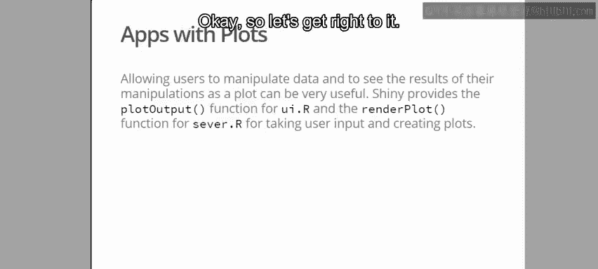
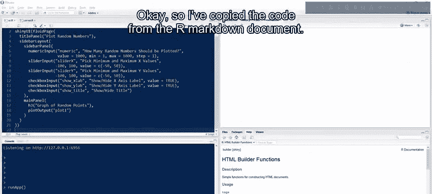
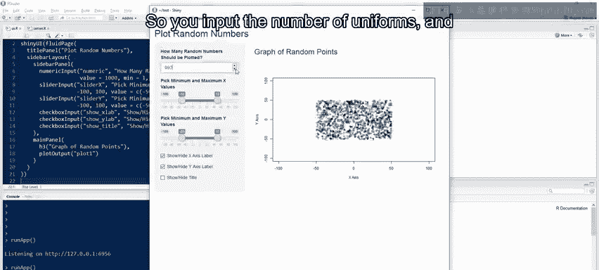
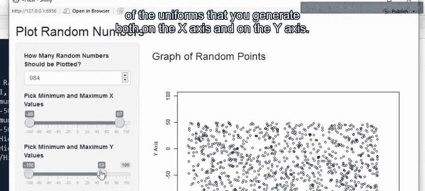
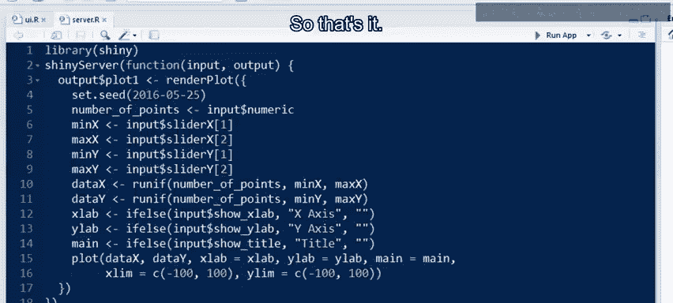
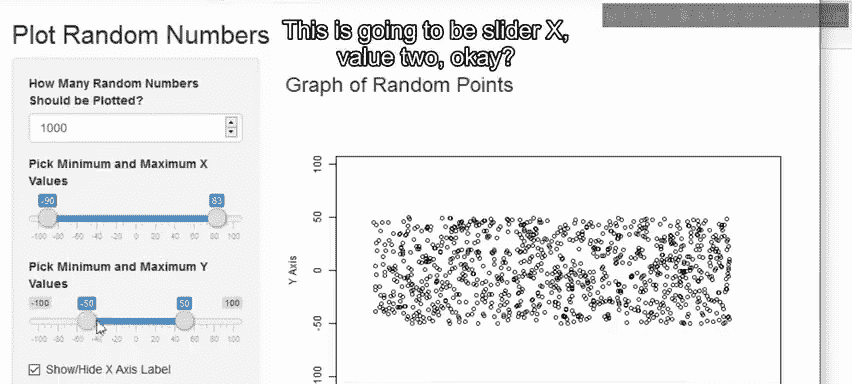

# 006：创建交互式图形 📊

在本节课中，我们将学习如何使用Shiny创建交互式图形。Shiny极大地扩展了R在创建交互式图形方面的能力，并能将结果嵌入网页，便于广泛传播。



## 概述





上一节我们介绍了Shiny应用的基本结构。本节中，我们将通过一个具体的例子，学习如何构建一个包含多种输入控件（如数字输入框、滑块、复选框）的交互式图形应用。我们将详细解析代码，理解数据如何在用户界面（UI）和服务器（server）之间流动。

## 代码解析



让我们首先运行应用，直观感受其功能，然后再深入分析其内部代码结构。

该应用的功能是绘制两组随机均匀分布的数据点。用户可以通过以下控件进行交互：
*   一个数字输入框，用于设置生成的数据点数量。
*   两个滑块，分别用于控制X轴和Y轴上随机数的生成范围。
*   三个复选框，用于显示或隐藏X轴标签、Y轴标签以及图表标题。

每次更改任何控件的值，整个服务器端的代码都会重新执行并更新图形，这体现了Shiny的“响应式”编程特点。

### 用户界面 (UI) 分析

以下是构建用户界面的核心代码部分：

```r
shinyUI(fluidPage(
  titlePanel("Interactive Plot Example"),
  sidebarLayout(
    sidebarPanel(
      numericInput("numeric", "Number of Points:", value = 100, min = 1, max = 1000, step = 10),
      sliderInput("sliderX", "X Range:", -10, 10, value = c(-5, 5)),
      sliderInput("sliderY", "Y Range:", -10, 10, value = c(-5, 5)),
      checkboxInput("show_xlab", "Show/Hide X Axis Label", value = TRUE),
      checkboxInput("show_ylab", "Show/Hide Y Axis Label", value = TRUE),
      checkboxInput("show_title", "Show/Hide Title", value = TRUE)
    ),
    mainPanel(
      plotOutput("plot1")
    )
  )
))
```

*   `numericInput` 创建了一个带增减按钮的数字输入框，其输入值在服务器端可通过 `input$numeric` 访问。
*   `sliderInput` 创建了滑块。注意 `value = c(-5, 5)` 表示这是一个双值滑块，返回一个包含最小值和最大值的向量，在服务器端对应 `input$sliderX[1]` 和 `input$sliderX[2]`。
*   `checkboxInput` 创建了复选框，其值（勾选为TRUE，未勾选为FALSE）在服务器端可通过例如 `input$show_xlab` 访问。
*   `plotOutput("plot1")` 在主体面板预留了一个位置，用于显示服务器端生成并命名为 `"plot1"` 的图形。

### 服务器逻辑 (Server) 分析

服务器端代码负责处理所有计算和图形生成。其核心结构如下：

```r
shinyServer(function(input, output) {
  output$plot1 <- renderPlot({
    set.seed(123)
    
    # 从UI输入中获取值
    num_points <- input$numeric
    x_min <- input$sliderX[1]
    x_max <- input$sliderX[2]
    y_min <- input$sliderY[1]
    y_max <- input$sliderY[2]
    
    # 生成随机数据
    data_x <- runif(num_points, x_min, x_max)
    data_y <- runif(num_points, y_min, y_max)
    
    # 根据复选框状态决定标签文本
    xlab <- ifelse(input$show_xlab, "X Axis", "")
    ylab <- ifelse(input$show_ylab, "Y Axis", "")
    main <- ifelse(input$show_title, "Title", "")
    
    # 绘制图形
    plot(data_x, data_y,
         xlab = xlab, ylab = ylab, main = main,
         xlim = c(x_min, x_max), ylim = c(y_min, y_max))
  })
})
```

*   `output$plot1 <- renderPlot({ ... })` 是核心响应式表达式。花括号 `{}` 内的所有代码都会在相关输入（`input$...`）发生变化时自动重新执行。
*   代码首先从 `input` 列表中提取所有控件的当前值。
*   使用 `runif()` 函数根据用户设定的数量和范围生成随机数据。
*   利用 `ifelse()` 函数，根据复选框的状态（TRUE/FALSE）动态决定坐标轴标签和标题的文本内容。
*   最后，使用基础的 `plot()` 函数绘制图形，并将动态决定的参数传递给它。

## 核心概念与响应式流程



这个例子清晰地展示了Shiny应用的响应式数据流：
1.  **用户操作**：用户在UI界面调整控件（如移动滑块、勾选复选框）。
2.  **输入更新**：`input` 对象中的对应值（如 `input$sliderX`, `input$show_xlab`）立即更新。
3.  **代码重算**：所有依赖于这些发生了变化的 `input` 值的 `render*` 函数（本例中是 `renderPlot`）会自动重新执行其内部的代码块。
4.  **输出更新**：重新计算产生的 `output$plot1` 被发送回UI，图形得以更新。

对于计算量小的操作，这种即时响应非常流畅。对于耗时较长的计算（如大型模拟），我们可以在后续课程中学习如何添加“执行/更新”按钮，由用户手动触发计算，避免不必要的频繁重算。

## 总结



本节课中，我们一起学习了如何构建一个功能完整的Shiny交互式图形应用。我们分析了如何通过 `numericInput`、`sliderInput` 和 `checkboxInput` 创建用户输入控件，并在服务器端使用 `renderPlot` 响应式地处理这些输入，生成动态图形。

你的课后练习是：基于这个例子，创建你自己的交互式图形。尝试使用其他类型的输入控件（如下拉菜单 `selectInput`、单选框 `radioButtons`），并绘制对你有实际意义的数据图形。通过动手实践，你将能更熟练地运用Shiny来满足日常数据分析与展示的需求。