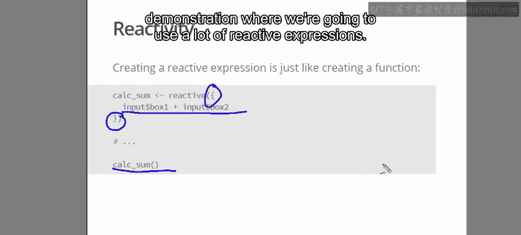

# 007：Shiny 2 🚀


## 概述


在本节课中，我们将学习Shiny中的**响应式表达式**。我们将编写一个实际使用响应式表达式的Shiny应用。到目前为止，我们已经创建了交互式图形，但我们需要进一步学习，以便服务器端的计算更复杂，能从输入中执行更有意义的计算，输出更有意义的结果，并绘制更有趣的图形。这引出了**响应性**这一主题。


## 什么是响应式表达式？🧩


上一节我们介绍了Shiny的基本交互。本节中我们来看看如何让计算响应输入的变化。


响应式表达式本质上就像一个“配方”，它操作来自Shiny的输入，然后返回一个值。它引入了一些略微非传统的R编码方式，当然，所有代码都是正确的R代码，但由于Shiny自身的复杂性，它确实带来了一些独特的写法。

如果你想创建能够响应用户界面（`ui.R` 或 `shinyUI` 函数）输入的独立表达式，那么它们需要被包裹在一个 `reactive({})` 函数中。


以下是其工作原理的一个示例：


假设在我的Shiny服务器函数中有两个输入框，分别标记为 `box1` 和 `box2`。我想将 `box1` 和 `box2` 的结果相加，并将结果赋值给一个变量。我希望每次输入值改变时，这个计算都重新执行。那么，这需要放在一个响应式语句中。


代码示例如下：


```r
calc_sum <- reactive({
    input$box1 + input$box2
})
```


这里，计算输出 `calc_sum` 被赋值为 `reactive({})`。请注意这里稍微独特的语法：既有函数括号，也有包含响应式语句的花括号。记住要正确闭合所有括号和花括号。


然后，我们将 `input$box1` 和 `input$box2` 相加。现在，这个 `calc_sum` 实际上不是一个变量，而是一个**函数**。它会随着我们在 `box1` 和 `box2` 中输入新值而自动更新。


稍后要引用 `calc_sum` 时，需要将其作为函数来引用，例如 `calc_sum()`。


## 构建响应式环境 🛠️


接下来，我们将通过一个相对简单的例子来演示如何在Shiny中创建响应式环境。完成这个例子后，你将几乎拥有完整的工具集来开始制作自己的Shiny应用，处理你可能需要做的任何事情。

例如，如果你创建了一个机器学习算法，希望用户输入一组参数，然后输出预测结果及预测误差，你现在将能够实现这一点。你将能够实时进行这些计算。

在本节课的末尾，我们还将展示如何实现**条件响应**，即用户必须按下按钮才能执行命令。这对于服务器端某些非常耗时的算法很有帮助。

## 代码演示：使用响应式表达式 💻


现在，我们将进入代码演示环节，其中会大量使用响应式表达式。


## 总结




本节课中，我们一起学习了Shiny中的**响应式表达式**。我们了解了其基本概念，即通过 `reactive({})` 函数封装计算逻辑，使其能够自动响应输入值的变化。我们还探讨了其语法特点，并预告了如何构建更复杂的响应式应用以及实现条件响应功能。掌握这些知识是创建动态、交互式数据产品的关键一步。