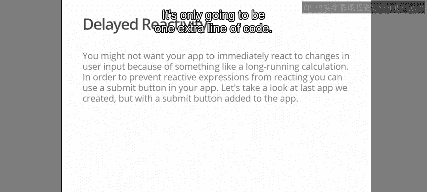
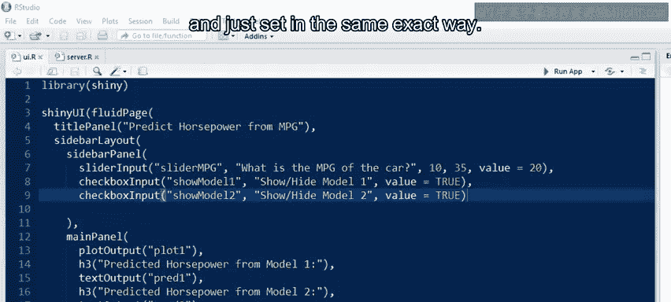
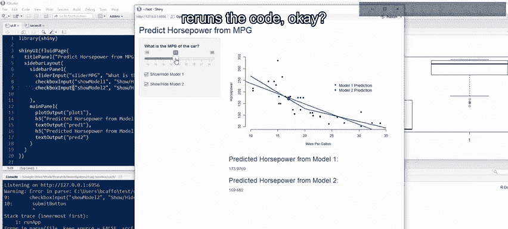
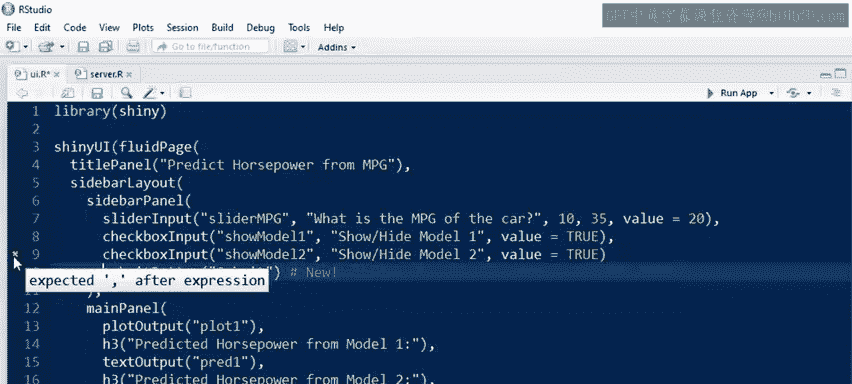
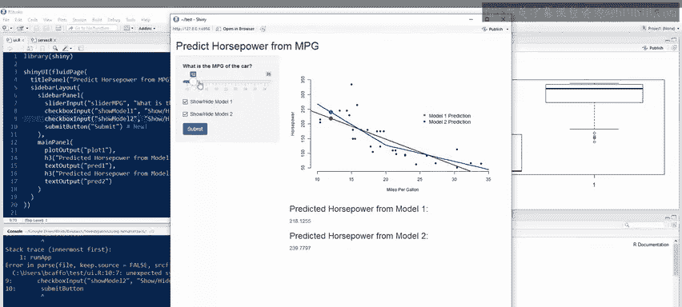
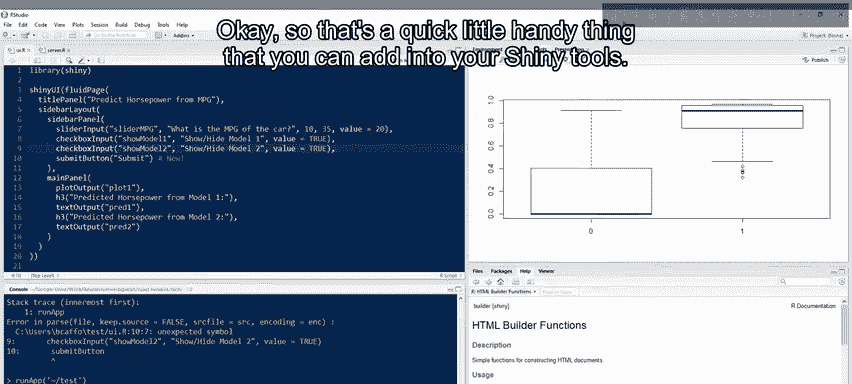

# 009：延迟响应性 🕰️

在本节课中，我们将要学习Shiny应用中的一个重要概念：**延迟响应性**。我们将探讨为何有时需要延迟代码的执行，以及如何通过一个简单的“提交”按钮来实现这一功能。

## 概述

在之前的课程中，我们了解到Shiny的响应式特性会在输入控件（如滑块）的值改变时，**自动**重新执行服务器函数中的代码。这对于小型、快速的计算非常理想。然而，当应用需要进行计算密集型任务（如大型蒙特卡洛模拟或自助法）时，这种即时响应可能会导致性能问题。本节将介绍如何通过添加一个“提交”按钮，让用户先设置好所有参数，再手动触发计算，从而延迟响应。

## 从即时响应到延迟响应

上一节我们介绍了Shiny的基本响应式工作原理。本节中，我们来看看如何控制响应的时机，实现延迟执行。

在之前的示例应用中，滑块值的任何变化都会立即触发服务器端代码的重新运行。



```r
# 这是一个具有即时响应性的简单Shiny应用示例
# 滑动滑块会立即更新输出
```

## 实现延迟响应性





实现延迟响应的核心是使用 `submitButton()` 函数。这只需要在用户界面（UI）部分添加一行代码。

以下是修改步骤：

1.  在UI的 `sidebarPanel` 或相应位置，添加 `submitButton()` 函数。
2.  为按钮指定一个ID（例如 `"submit"`），以便在服务器逻辑中引用。
3.  **重要**：记住在R函数调用中，参数之间需要用逗号分隔。

```r
# 在UI部分添加提交按钮
submitButton("submit") # "submit"是按钮的ID
```

添加此按钮后，所有输入控件的更改将不会立即触发计算。只有当用户点击“提交”按钮时，Shiny才会收集所有当前输入值，并执行一次服务器端的计算。

## 常见错误与注意事项



在编写Shiny应用时，一个常见的错误是忘记函数参数间的逗号。RStudio通常会通过红色“X”图标提示这类语法错误，请注意检查。

> **提示**：`submitButton()` 本身会创建一个特殊的输入变量。在服务器函数中，你可以通过 `input$submit` 来检查按钮是否被点击（其值在点击时会发生变化），并据此编写条件逻辑。

## 效果演示



修改代码并运行应用后，界面将出现一个“提交”按钮。
*   此时，调整滑块值，输出不会立即改变。
*   只有点击“提交”按钮后，应用才会根据最新的滑块值重新计算并更新输出。

这种方式将控制权交给了用户，非常适合处理耗时的计算任务。

## 总结



本节课中，我们一起学习了Shiny中的**延迟响应性**。通过引入 `submitButton()`，我们能够将代码执行的触发条件从“输入变更”改为“用户主动提交”，从而优化需要大量计算的应用体验。记住，这只需在UI中添加一行代码即可实现，是提升Shiny应用可用性的一个简单而强大的工具。