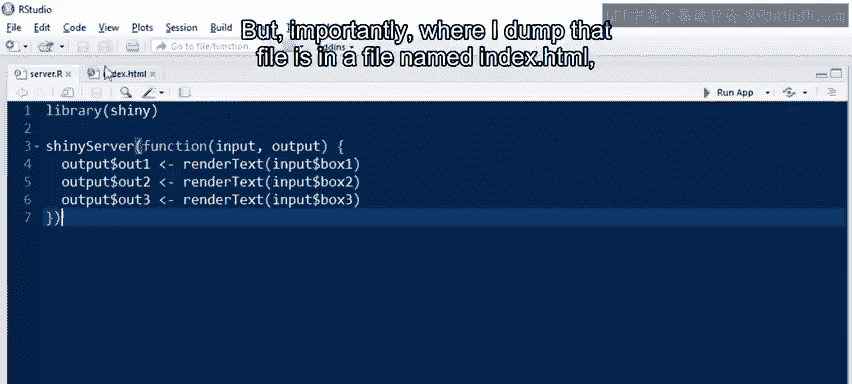
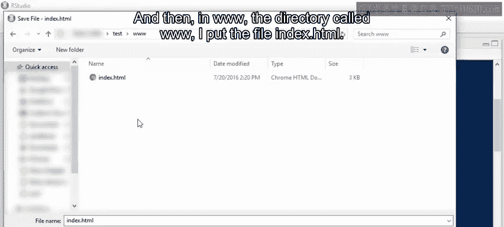
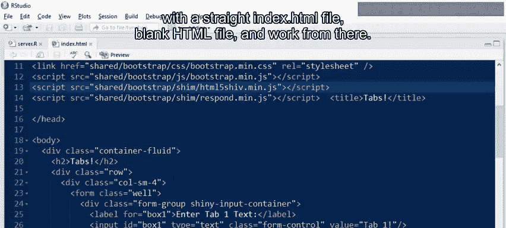
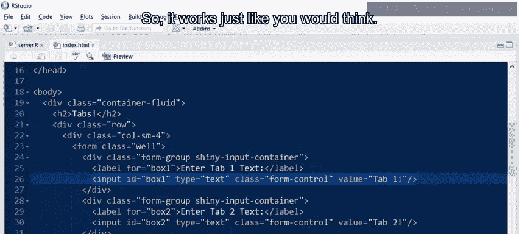
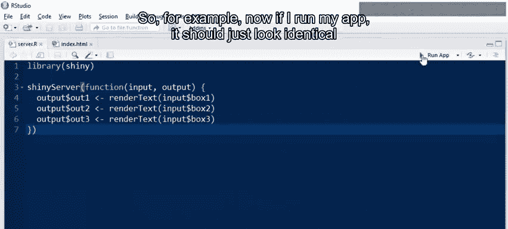
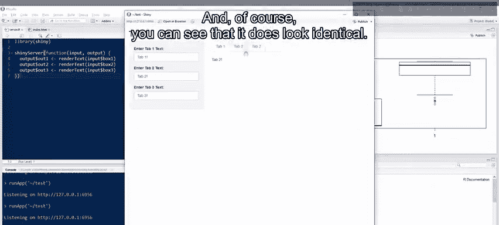
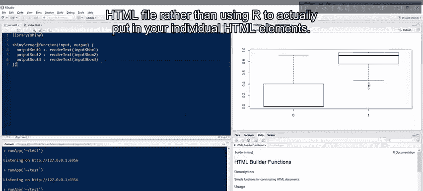

# 011：使用自定义HTML 🎨

在本节课中，我们将学习如何在Shiny应用中直接使用自定义的HTML文件来构建用户界面。这种方法特别适合熟悉网页开发的用户，因为它允许你完全控制界面的样式和结构。

上一节我们介绍了如何使用Shiny的基本UI函数构建界面。本节中我们来看看如何绕过这些函数，直接使用原始的HTML文件。

## 概述：使用自定义HTML文件

Shiny应用默认通过`ui.R`文件中的R函数（如`fluidPage`、`sidebarLayout`）来构建用户界面。然而，你也可以将一个完整的HTML文件作为界面。具体做法是：
1.  创建一个名为`www`的子目录。
2.  将你的HTML文件命名为`index.html`并放入`www`目录中。
3.  Shiny会自动识别并使用这个文件作为应用的界面。





以下是具体步骤和关键点。

### 步骤一：获取初始HTML文件

一个快速的方法是先构建一个简单的Shiny应用原型，然后从浏览器中获取其生成的HTML代码。

*   **操作**：在浏览器中打开你的Shiny应用，使用“查看页面源代码”功能（快捷键通常是`Ctrl+U`），复制所有HTML代码。
*   **保存**：将复制的代码粘贴到一个文件中，并将该文件命名为`index.html`。
*   **位置**：确保`index.html`文件被放置在应用目录下的`www`子文件夹中。你的目录结构应类似于：
    ```
    your_app/
    ├── server.R
    └── www/
        └── index.html
    ```


*（图示：包含`server.R`和`www/index.html`的目录结构）*

### 步骤二：理解与简化HTML结构



从Shiny原型获取的HTML文件包含许多引导样式（Bootstrap）的代码，这些并非全部必要。

*   **简化**：你可以删除大部分样式代码，只保留核心结构，然后替换成你自己想要的样式。
*   **起点**：如果你不熟悉网页开发，使用这个生成的HTML作为起点是一个很好的方法。你可以在此基础上进行修改和构建。
*   **直接开始**：如果你熟悉网页开发，也可以从一个空白的HTML文件开始直接编写。


*（图示：一个HTML文件示例，其中包含`<head>`和`<body>`部分）*

### 步骤三：在HTML中定义Shiny组件

在自定义的HTML文件中，你需要使用特定的格式来定义Shiny的输入和输出控件。

以下是关键元素的写法：

*   **输入控件**：使用标准的HTML输入标签，并通过`id`属性进行标识，这个`id`就相当于在`ui.R`中使用的输入ID。
    ```html
    <input id="box1" type="number" value="5">
    <input id="box2" type="number" value="6">
    <input id="box3" type="number" value="7">
    ```
    示例中定义了三个输入框，ID分别为`box1`、`box2`和`box3`。周围的`<div>`标签是为了实现Bootstrap的块状布局样式。




*（图示：HTML代码中定义了三个输入框，ID分别为box1, box2, box3）*

*   **输出控件**：使用`<div>`或`<span>`标签，并通过`id`和特定的`class`来声明这是一个Shiny输出区域。
    ```html
    <div id="out" class="shiny-text-output"></div>
    ```
    关键在于`class`属性必须设置为`shiny-text-output`（对于文本输出）或`shiny-plot-output`（对于图形输出）等Shiny预定义的类。


*（图示：HTML代码中定义了一个输出区域，id为“out”，class为“shiny-text-output”）*

通过构建原型并查看其HTML，你可以轻松地获知这些必要的`class`名称，从而为你的自定义HTML文件提供参考。

### 步骤四：运行与验证

完成以上步骤后，运行你的Shiny应用。由于你直接复制了原型的HTML，应用界面看起来应该和之前完全一样。





*（图示：运行中的Shiny应用界面，显示三个输入框和一个文本输出区域）*


这种方法为熟悉网页开发的用户提供了极大的灵活性，使他们能够摆脱通过R函数间接构建界面的限制，直接利用HTML和CSS进行精细化的界面设计。


*（图示：总结性画面，强调直接使用HTML的便利性）*

## 总结


本节课中我们一起学习了在Shiny应用中使用自定义HTML文件的方法。关键要点包括：将`index.html`文件置于`www`目录下；可以通过复制原型应用的HTML代码作为起点；在HTML中需使用正确的`id`和特定的`class`（如`shiny-text-output`）来定义Shiny的输入输出控件。这种方法赋予了开发者对前端界面的完全控制权，是进阶Shiny开发的重要技能。