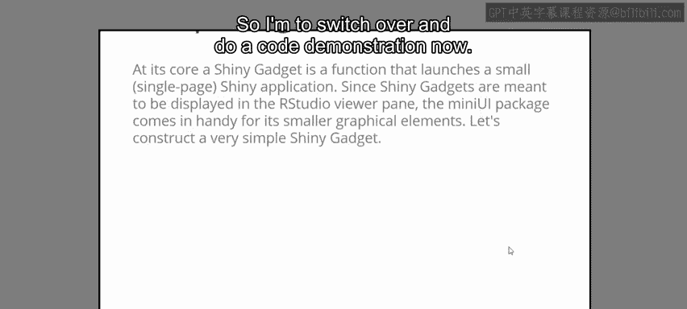
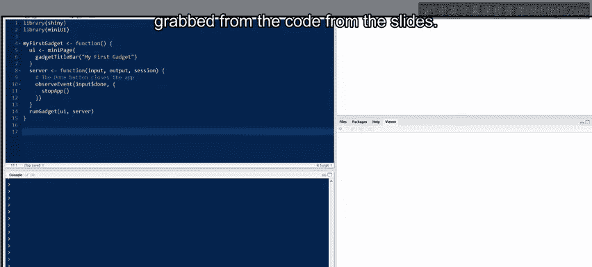
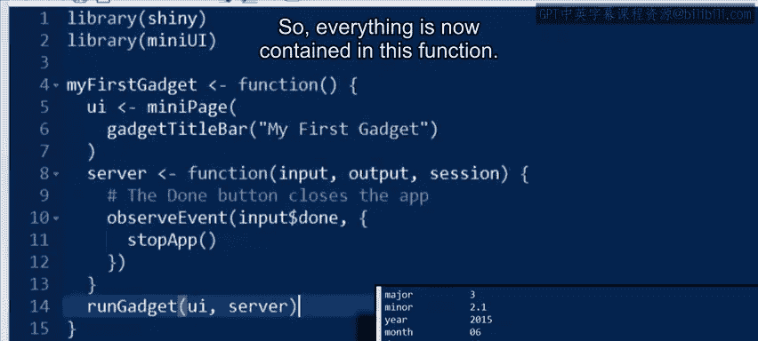
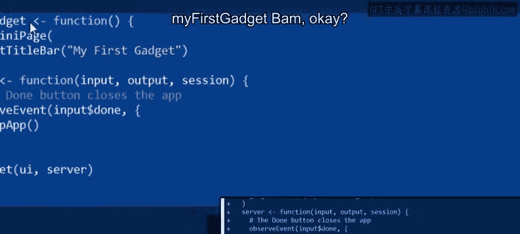
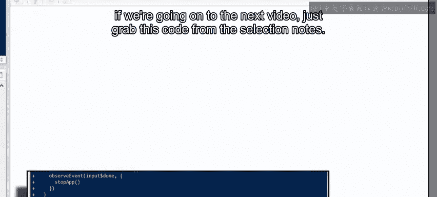

# 013：Shiny小工具入门 🛠️

在本节课中，我们将学习Shiny小工具的基础知识。Shiny小工具是一种在RStudio环境中快速创建交互式数据分析工具的方法，它比传统的Shiny应用更轻量、更便捷，适合在数据分析过程中进行快速交互和探索。

---

大家好，我是Brian Kaffho。本次讲座将讨论Shiny小工具。我要感谢与我们数据科学实验室合作的Sean Cross，他准备了这些幻灯片。

我们过去曾介绍过一个名为`manipulate`的主题。`manipulate`是一个由RStudio创建的小型R包，用于在R中进行简单、交互式的数据分析。当你需要在数据分析中创建一些交互式图表时，`manipulate`是一个很好的选择。然而，RStudio似乎已经停止开发`manipulate`了。我认为原因在于Shiny环境提供了更好的实现方式。通过Shiny小工具，你现在可以在R程序中实现相同的功能，其基本作用与`manipulate`过去所做的相同。

Shiny小工具提供了一种在数据分析中使用Shiny交互功能的方式。这是一种更简单、更快捷的方法，不同于我们通常用于开发面向他人使用的完整Web应用的Shiny开发。Shiny小工具更适合我们自己，或者少数与我们合作进行数据分析的同事使用。由于我们将在RStudio程序的小屏幕中显示应用，我们将使用`miniUI`包来帮助我们为小屏幕创建界面。

接下来，我将解读幻灯片中的核心内容。一个Shiny小工具是一个函数，它会在你的RStudio窗格中启动一个单页的Shiny应用程序。同样，因为它们将在RStudio中查看，所以`miniUI`包非常有用。

接下来，我们将创建一个简单的Shiny小工具。我们会将其简化到最基本的程序，并逐一讲解各个组成部分。现在，我将切换到代码演示环节。

---

## 创建第一个Shiny小工具

以下是创建一个最简单Shiny小工具的步骤。我们将从幻灯片中获取代码，并逐步解析。

首先，确保加载`shiny`和`miniUI`包。如果你没有安装它们，请使用`install.packages()`命令安装，或者通过RStudio的工具栏界面安装。我的R版本是3.2.1，虽然有点旧，但如果你使用的是非常旧的R版本，我建议你更新它，因为Shiny小工具是RStudio相对较新的功能。

你的小工具将是一个函数。我的第一个小工具是一个没有参数的R函数，我们稍后会添加参数。就像Shiny应用一样，它包含一个用户界面（UI）和一个服务器函数。

我的UI部分使用`miniPage`布局，这来自`miniUI`库。我们创建了一个最简单的页面，只包含一个标题栏。添加标题栏元素的命令是`gadgetTitleBar`，我们将其命名为“我的第一个小工具”。

我的服务器也是一个函数，它接收`input`、`output`和`session`参数。目前，我们的服务器函数只检查一个名为`done`的输入变量，并使用`observeEvent`函数在`done`为真时停止应用。

Shiny的语法可能与我们通常在R中的编程方式有些不同，有点奇怪。但一旦你习惯了，你会发现关于响应式编程等所有规则都会从Shiny延续到Shiny小工具中。然后，我们有一个运行小工具的函数`runGadget`，它包含UI和服务器逻辑。

现在，我需要运行这个函数。

运行后，你会看到它显示“正在监听”。这意味着它创建了一个小型Web服务器，RStudio正在查看器窗格中渲染该网页并监听服务器。它只显示“我的第一个小工具”，目前功能不多。但如果你点击“完成”，它会带你回到R提示符。

这是熟悉Shiny小工具的重要第一步。既然你已经学习并实践过一些Shiny，我相信随着我们在Shiny小工具中进一步深入，许多更复杂的概念（如响应式编程）会自然而然地掌握。

在进入下一个视频之前，我建议每个人都从讲义中获取这段代码，运行一次，然后我们将继续学习一些更复杂的内容。

---

## 总结

本节课中，我们一起学习了Shiny小工具的基本概念和创建方法。我们了解到Shiny小工具是用于在RStudio内快速构建交互式数据分析工具的函数，它比完整的Shiny应用更轻便。我们通过一个最简单的示例，演示了如何定义UI、服务器函数，并使用`miniUI`包和`runGadget`来启动小工具。掌握这个基础是进一步探索更复杂交互功能的关键。