# 015：Shiny小工具入门 🛠️

在本节课中，我们将学习如何使用Shiny小工具（Shiny Gadgets）来创建交互式图形。我们将通过一个具体的例子，演示如何构建一个允许用户通过鼠标框选数据点并返回对应数据子集的小工具。

---

## 概述

Shiny小工具是Shiny框架的扩展，允许我们创建轻量级的交互式应用，通常用于数据分析中的特定任务。本节课我们将重点学习如何利用Shiny小工具创建交互式绘图，并通过一个实例来理解其核心语法和工作流程。

## 构建交互式绘图小工具

上一节我们介绍了Shiny小工具的基本概念，本节中我们来看看如何具体构建一个。我们将创建一个函数，用于绘制`trees`数据集，并允许用户通过鼠标拖拽矩形框来选择数据点，最终返回被选中点对应的数据行。

### 代码结构与关键组件

我们的Shiny小工具本质上是一个R函数。它需要两个核心部分：用户界面（UI）定义和服务器逻辑。

以下是构建该小工具所需的完整代码结构：

```r
library(shiny)
library(miniUI)

pickTrees <- function() {
  ui <- miniPage(
    gadgetTitleBar("通过拖拽鼠标选择点"),
    miniContentPanel(
      plotOutput("plot", height = "100%", brush = "brush")
    )
  )
  
  server <- function(input, output, session) {
    output$plot <- renderPlot({
      plot(trees$Girth, trees$Volume,
           main = "Trees",
           xlab = "Girth",
           ylab = "Volume")
    })
    
    observeEvent(input$done, {
      stopApp(brushedPoints(trees, input$brush,
                            xvar = "Girth",
                            yvar = "Volume"))
    })
  }
  
  runGadget(ui, server)
}
```

### 代码详解

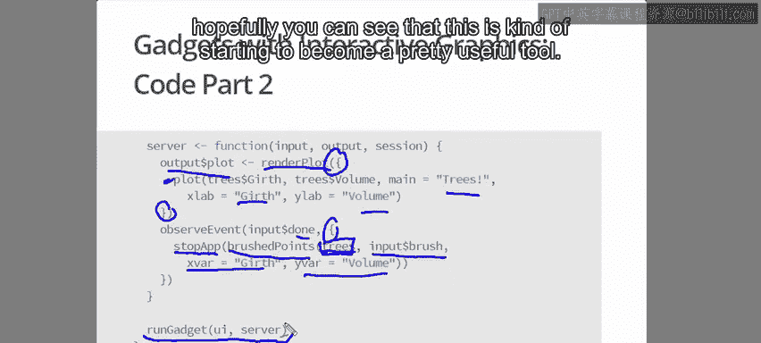

以下是上述代码各部分的详细解释：

1.  **加载库**：首先需要加载`shiny`和`miniUI`库。
2.  **UI定义 (`ui`)**：
    *   `miniPage()`: 创建小工具的基本页面布局。
    *   `gadgetTitleBar()`: 添加标题栏，其中包含“完成”按钮。
    *   `miniContentPanel()`: 定义主要内容区域。
    *   `plotOutput("plot", ...)`: 创建一个名为`"plot"`的绘图输出区域。`height = "100%"`使其占据全部可用高度。`brush = "brush"`启用了刷取（框选）交互，并将此输入命名为`"brush"`。
3.  **服务器逻辑 (`server`)**：
    *   `output$plot <- renderPlot({...})`: 定义名为`plot`的输出内容。这里绘制了`trees`数据集中`Girth`与`Volume`的散点图。
    *   `observeEvent(input$done, {...})`: 监听名为`done`的事件（即用户点击标题栏的“完成”按钮）。当事件触发时，执行花括号内的代码。
    *   `stopApp(...)`: 停止小工具应用，并将括号内的值作为结果返回。这里使用`brushedPoints()`函数，它根据刷取区域`input$brush`，从`trees`数据框中筛选出对应的数据点。**关键点**：`xvar`和`yvar`参数必须与绘图时使用的变量名（`"Girth"`, `"Volume"`）以及数据框中的列名完全一致。
4.  **运行小工具**：`runGadget(ui, server)`执行定义好的小工具。

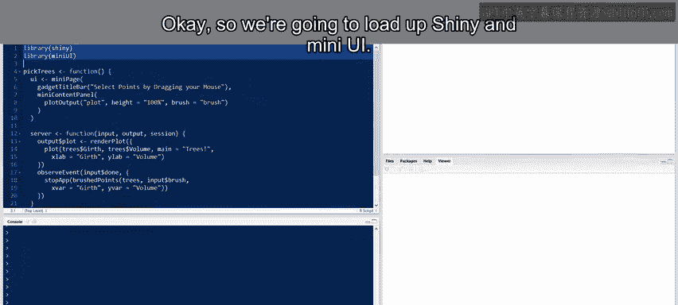

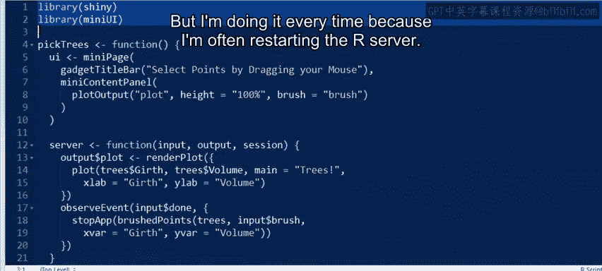

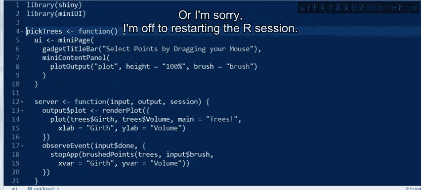

### 命名规则的重要性

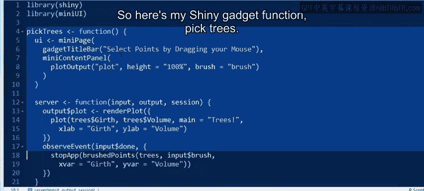

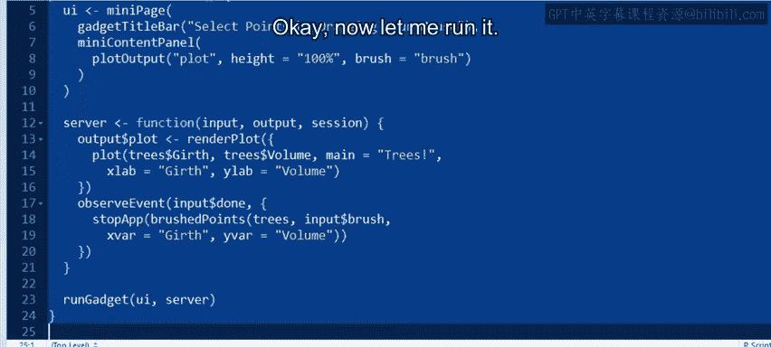

在Shiny框架中，输入（`input`）和输出（`output`）的命名必须前后严格一致。

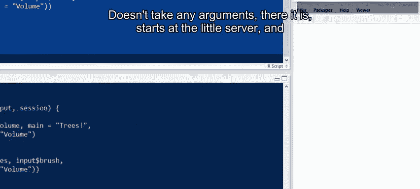

*   **输出命名**：UI中`plotOutput("plot", ...)`创建了一个名为`"plot"`的输出区域，因此在服务器端必须用`output$plot`来定义其内容。
*   **输入命名**：UI中`brush = "brush"`创建了一个名为`"brush"`的输入，因此在服务器端需要通过`input$brush`来调用它。

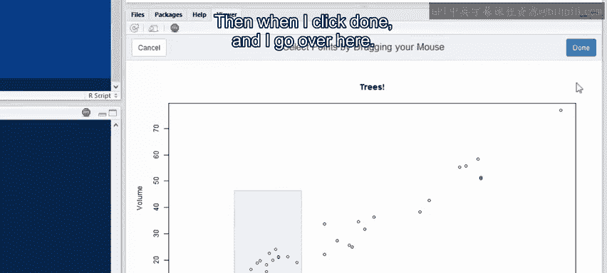

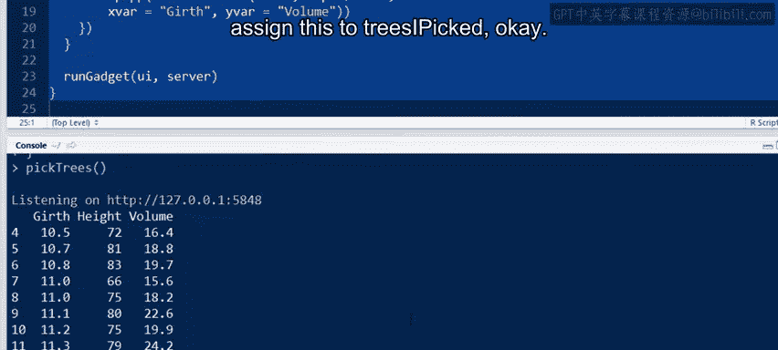

如果名称不匹配（例如，UI中叫`plot1`而服务器中叫`output$plot`），相应的功能将无法正常工作。

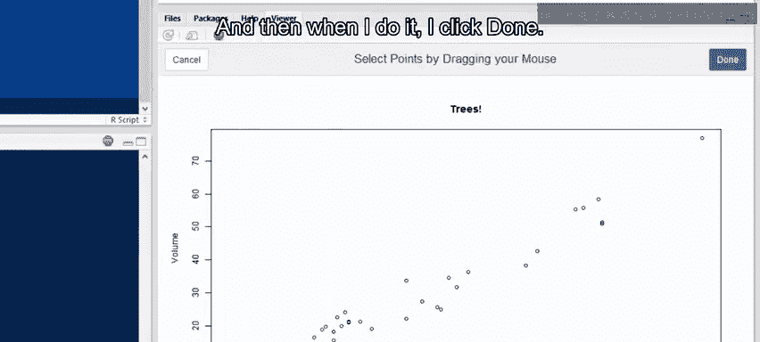

## 运行示例

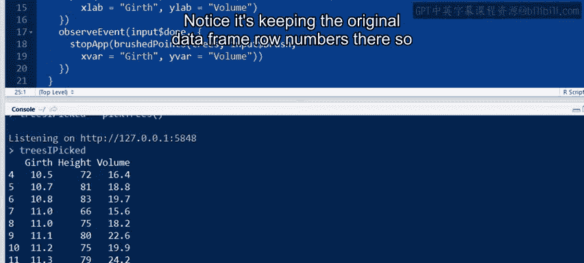

现在让我们运行这个`pickTrees`函数。

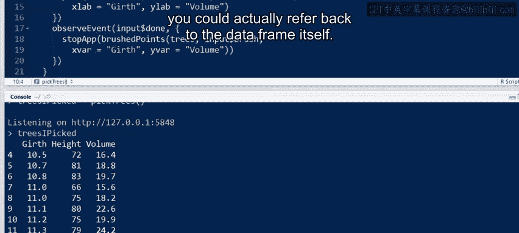

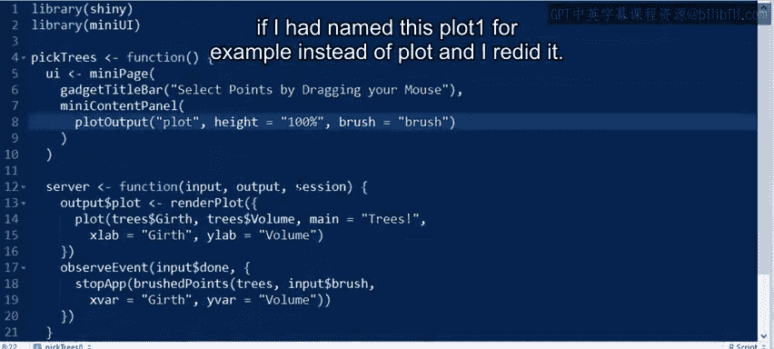

1.  执行`pickTrees()`，会弹出一个窗口显示散点图。
2.  在图形上按住鼠标左键并拖拽，可以绘制一个矩形选择框。你可以移动或调整这个框。
3.  选择感兴趣的数据点后，点击窗口顶部的 **“Done”** 按钮。
4.  小工具窗口关闭，函数将返回一个包含被选中数据点的数据框。你可以将其赋值给一个变量（例如`selected_trees <- pickTrees()`）以供后续分析使用。返回的数据框保留了原始`trees`数据框的行号，方便溯源。

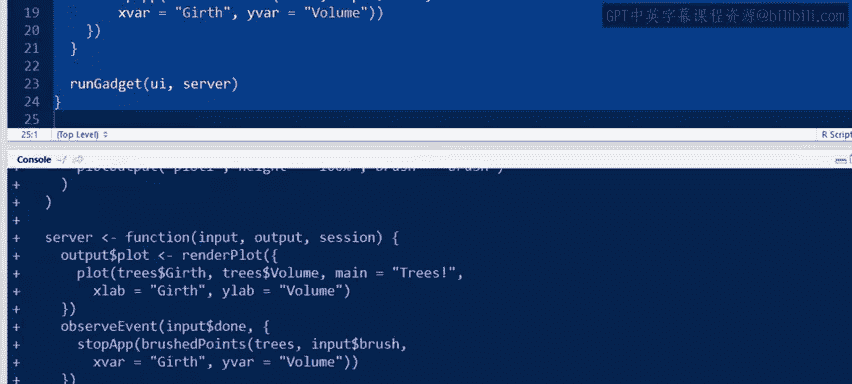

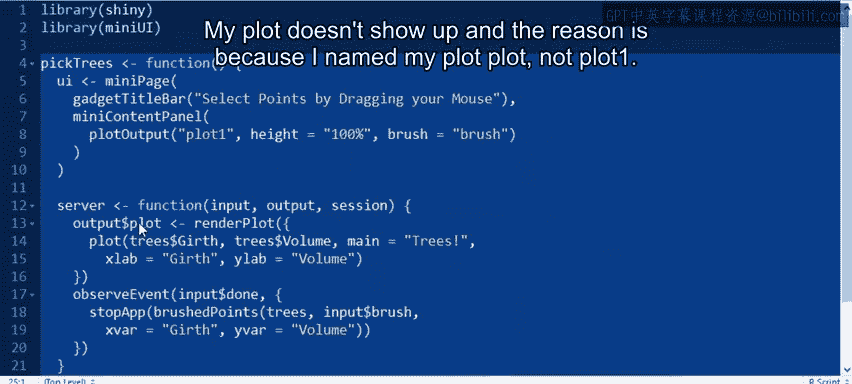

这个工具在数据探索中非常有用，例如，快速识别并提取图表中的离群点或特定集群的数据。

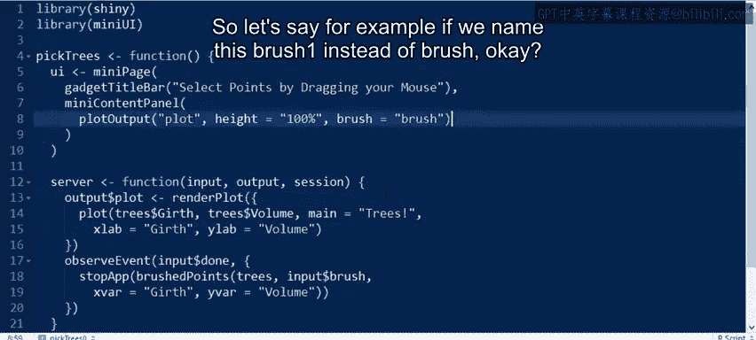

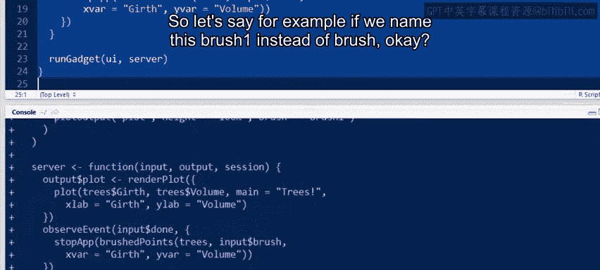

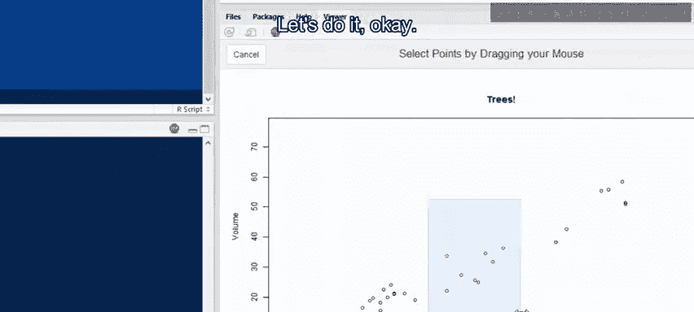

---

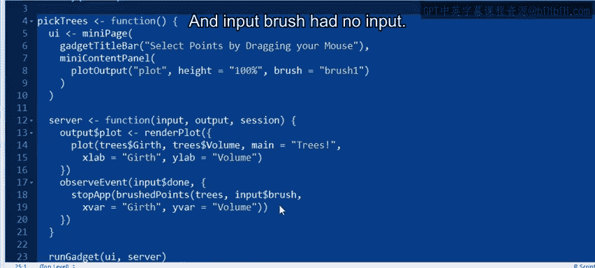

## 总结

本节课我们一起学习了Shiny小工具的基础应用。我们通过构建一个交互式数据点选择器，掌握了以下核心技能：
1.  Shiny小工具的基本结构：它是一个包含UI和服务器逻辑的R函数。
2.  如何使用`miniPage`、`gadgetTitleBar`和`miniContentPanel`构建界面。
3.  如何利用`brush`参数实现图形的交互式框选功能。
4.  理解并应用Shiny中**严格的输入输出命名匹配规则**，这是功能正常工作的关键。
5.  使用`observeEvent`监听按钮事件，并使用`stopApp`返回结果。

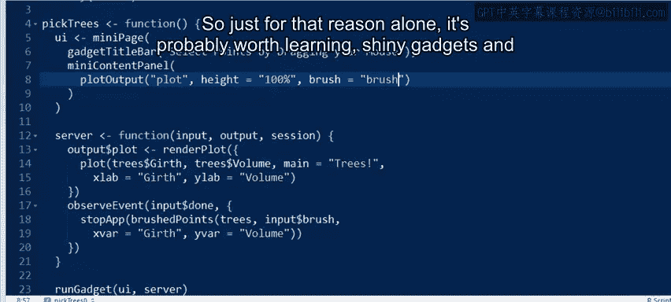

交互式图形是数据探索的强大工具，而Shiny小工具使得在R环境中快速创建这类工具变得简单高效。掌握这项技能能显著提升你的数据分析工作流程的交互性和效率。