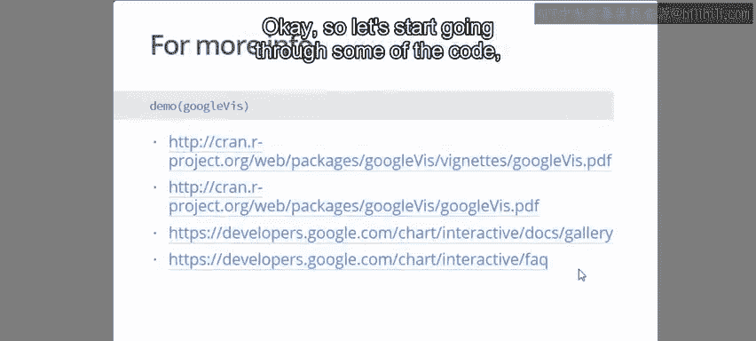
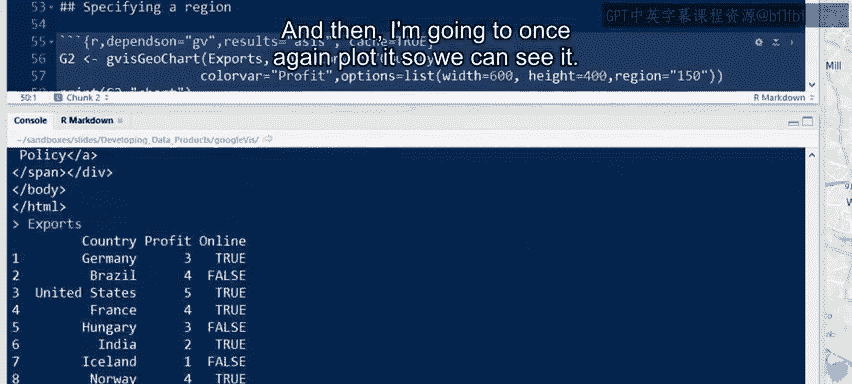
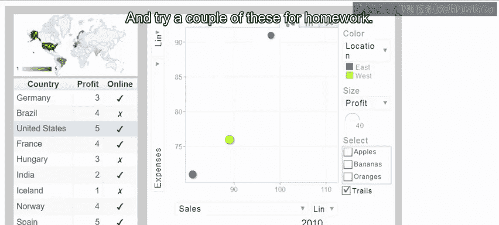

# 017：使用googleVis包创建交互式图表 📊

在本节课中，我们将学习如何使用R语言中的`googleVis`包，轻松创建功能强大且交互式的可视化图表。`googleVis`包允许我们直接调用谷歌丰富的可视化工具库，并将其嵌入到各种文档和演示文稿中。

---

## 1. googleVis包简介 🌟

`googleVis`是一个功能强大的R包，它为我们提供了访问谷歌大部分可视化工具的接口。这意味着我们可以轻松创建动态图表、交互式地图、线图、柱状图，甚至可以根据数据制作类似速度计的小部件。其文档非常完善，包含使用指南和详细的包文档。

上一节我们介绍了数据产品开发的概念，本节中我们来看看如何利用现成的强大工具快速实现可视化。

---

## 2. 创建交互式地图 🗺️

交互式图表是`googleVis`的一大亮点，尤其是在地图绘制方面。谷歌已经完成了大量复杂工作，使得创建带有指定国家弹出窗口的JavaScript地图变得非常简单。这些地图可以轻松嵌入网页、Slideify演示文稿或R Markdown文档中。

以下是一个在Markdown演示文稿中实现交互性的例子。你可以进行缩放等操作，这主要通过指定各种选项来实现。

关于选项设置，有非常多的参数可供调整。你可以通过下方链接查看所有可用的选项页面，这些选项可以作为参数传递给`googleVis`图表。

其工作原理是，你需要将一个列表作为`options`参数传入。列表中的元素需要正确命名并赋值。虽然它使用的是类似JSON的语法，但你无需精通JSON，只需查看一两个例子熟悉一下即可。

---

## 3. 绘制线图示例 📈

现在，让我们看一个绘制线图的简单例子。

首先，我们需要准备数据。假设我们有以下数据框：

```r
df <- data.frame(
  country = c(“US”, “GB”, “BR”),
  value1 = c(1, 3, 4),
  value2 = c(23, 12, 32)
)
```

接着，我们使用`gvisLineChart`函数创建图表，并设置一些基本的格式选项：

```r
Line <- gvisLineChart(df, options=list(title=“Hello World”, legend=“bottom”))
plot(Line)
```

执行代码后，会生成一个带有标题和图例的简单线图。观察我们设置选项的方式，并将其与生成的图表联系起来，你会发现虽然JavaScript语法起初可能有些陌生，但这里只是原样传递谷歌图表所需的参数。了解这一点很有好处，因为未来你可能需要在谷歌文档等地方以相同的方式设置图表选项。

---



## 4. 合并多个图表 🔄

最后，我们来探讨如何将多个图表合并在一起显示。这可以通过`gvisMerge`函数实现。

以下是合并图表的步骤：
1.  首先，像之前一样创建一个地理图表（`GeoChart`）。
2.  然后，创建一个表格（`Table`），它可以直接将我们的数据框呈现为交互式表格。
3.  接着，使用`gvisMerge`函数将地理图表和表格垂直堆叠（`horizontal=FALSE`）合并。
4.  最后，再将这个合并后的图表与另一个图表（如动态图表`MotionChart`）水平并排（`horizontal=TRUE`）合并。

执行合并与绘图后，你会得到一个布局精美的结果：上方是地理图表，中间是数据的交互式表格，旁边是动态图表。你还可以设置背景颜色等选项。用相对较少的代码就能实现如此丰富的可视化效果，这主要得益于谷歌绘图库在后台处理了所有复杂工作。

---

## 5. 嵌入与注意事项 ⚙️



正如我们在本文档中所做的那样，你可以将`googleVis`图表的结果嵌入到R Markdown文档中。

在这个过程中，有两个重要的注意事项：
1.  确保你使用的所有工具（如Slideify、knitr等）都是最新版本。
2.  在代码块选项中，必须设置`results=‘asis’`，否则图表将无法正常渲染。

根据经验，这个过程有时可能需要一些调试。你可能需要重新安装包、清理knitr缓存等，但通常最终都能成功。一旦配置成功一次，后续就会顺利很多。

---

## 6. 代码实战演示 💻

现在，让我们通过一些代码来生成有趣的图表。

首先，我们生成一个地理图表。在展示图表之前，我们先查看将要使用的数据框：

```r
head(df)
```

数据框包含国家名称、用于弹出窗口的数值等列。在本例中，我们将使用`country`和`profit`变量。

创建地理图表的代码如下：

```r
G1 <- gvisGeoChart(df, locationvar=“country”, colorvar=“profit”, options=list(projection=“kavrayskiy-vii”))
plot(G1)
```

执行后，它会打开一个网页，显示绘制的地图。几乎不费什么力气就能得到如此精美的效果。

接下来，我们尝试指定区域进行缩放。例如，设置`region=‘150’`可以聚焦在西欧地区：

```r
G2 <- gvisGeoChart(df, locationvar=“country”, colorvar=“profit”, options=list(region=“150”))
plot(G2)
```

---

## 7. 总结 🎯

本节课中，我们一起学习了如何使用`googleVis`包创建交互式可视化图表。
*   我们了解了`googleVis`包可以调用丰富的谷歌图表工具。
*   我们实践了创建交互式地图和线图，并学习了如何设置图表选项。
*   我们掌握了使用`gvisMerge`函数将多个图表合并布局的技巧。
*   最后，我们讨论了将图表嵌入文档时的关键注意事项。



`googleVis`包通过利用谷歌强大的后端绘图库，使得用极少量的代码创建专业、交互式的图表成为可能。建议大家多动手尝试，创建一些自己的谷歌图表，你会发现它非常便捷，并可以尝试将其用于课后作业中。