# 018：Plotly入门教程 📊


在本节课中，我们将要学习如何使用Plotly库在R语言中创建交互式网络图形。Plotly是一个功能强大的工具，支持多种编程语言，并能轻松集成到R Markdown文档中，生成可交互的网页可视化图表。

---

大家好，我是Brian Kaho。这是关于Plotly的《开发数据产品》讲座。

Plotly是一个非常精巧的网页应用程序和R语言库。我之前有一个关于它的早期视频，但那时它还在发展初期。我最近回顾了一下，对其自那以后取得的巨大发展感到惊讶。对于在R中创建交互式网络图形，Plotly绝对是一个值得你关注的东西。它的优点在于也能与多种其他语言集成。

那么，什么是Plotly？Plotly是一个用于创建和分享可视化的网页应用程序。据我所知，它能与Matlab、Python、Javascript等多种语言协同工作。如果你喜欢通过点击操作来创建图表，他们也有一个网页界面，你可以直接上传CSV文件等。

在我们即将进行的代码演示中，你会看到Plotly非常容易上手和运行。

特别是在RStudio和R环境中工作时。

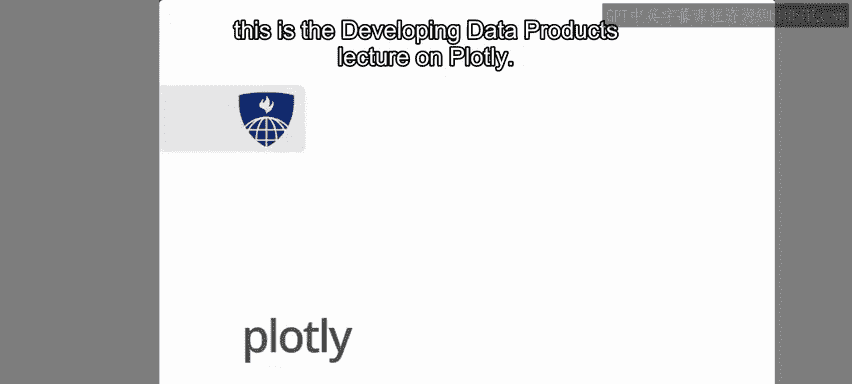

关于安装Plotly，我不会在此进行代码演示。对于课程进行到现在的你来说，这应该很熟悉了。使用`install.packages("plotly")`安装，然后当然可以通过`library(plotly)`或`require(plotly)`来加载它。

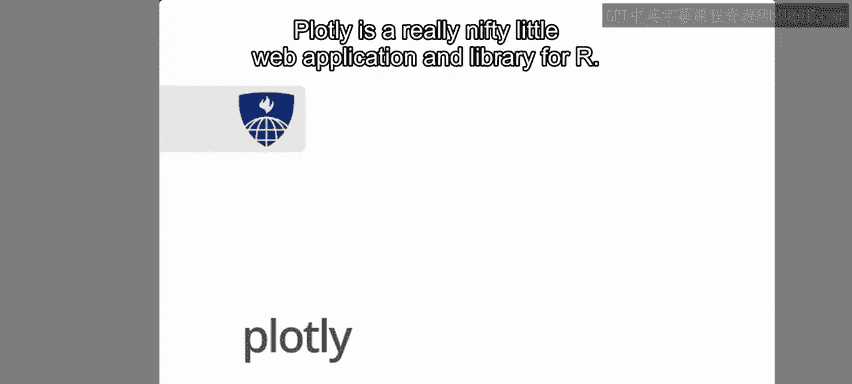


在本系列讲座的最后部分，我将讨论如何分享你的Plotly图表。这并非R特有的功能，更多是关于如何分享HTML图形的讨论。其中一种方式实际上是在Plotly网站上，他们提供免费和付费选项，如果你需要私密展示和用户认证等功能。如果你想通过Plotly分享你的可视化作品，当然可以做到。此外，它们生成的只是HTML图形，你可以创建网页并自行分享，完全无需Plotly参与，除了使用Plotly的R包。

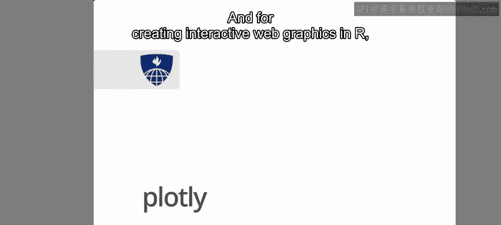


他们的网页界面也相当有趣，提供了许多精巧的工具，有些甚至在R中都不那么容易实现，例如交互式更改坐标轴标签。这在R中很难做到，通常需要重新运行代码。总之，在Plotly网页界面上你可以做这类事情，我们将在最后展示。

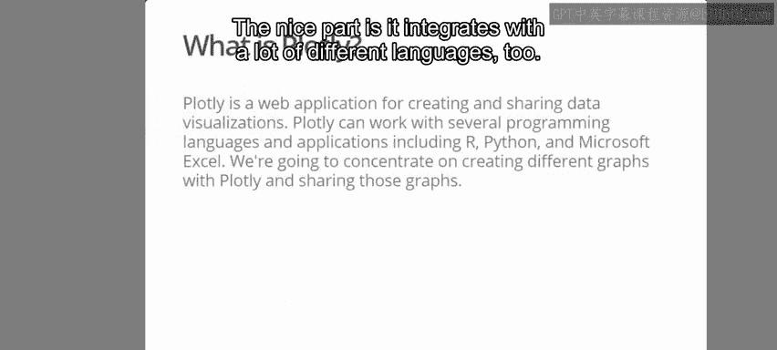

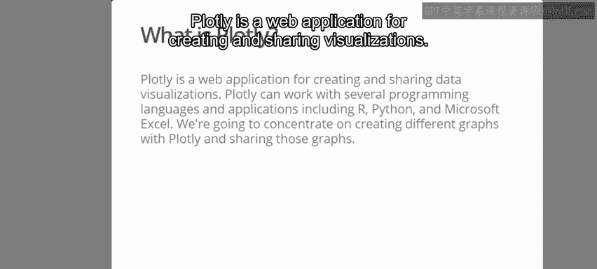

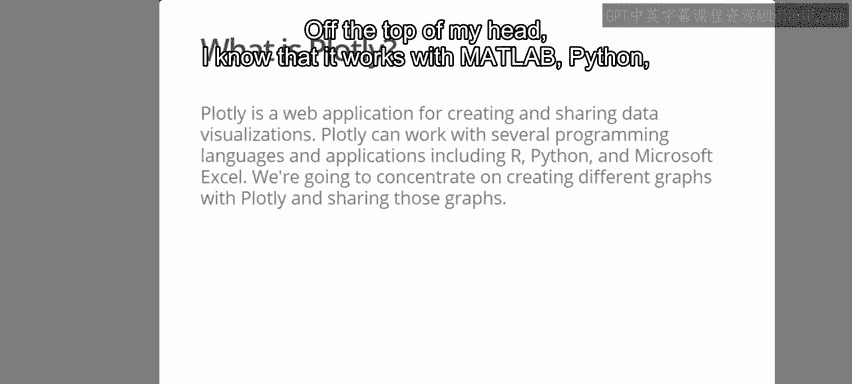

但现在，我们只在R控制台中工作，展示在本地运行Plotly的情况。

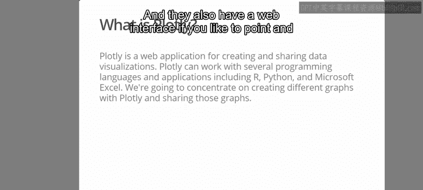


在我进行代码演示之前，让我先浏览一下幻灯片。幻灯片展示了如何调用`plot_ly`命令，使用空的`cars`数据集，并指定X和Y轴。在开始代码演示前，我想展示一点：这个图表实际上是嵌入到这个knitr文档中的，也就是那个被编译成HTML文档的R Markdown文档。它作为文档和幻灯片的一部分，正在显示交互式图形。你可以进行例如放大等操作，这在静态图表中通常无法实现。这一切都嵌入在幻灯片中。当你查看R Markdown文档时，实现这些的命令非常简单。

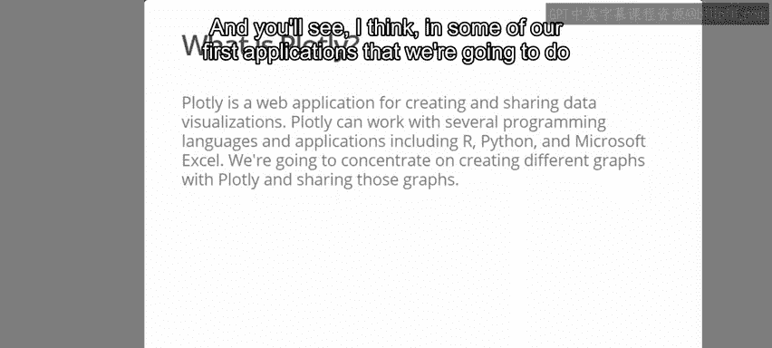

Plotly一个有趣的应用就是将其嵌入到你的Slideify、RStudio Presenter或Slidy等由knitr生成的文档中。


那么，让我们开始一些代码演示，我们将浏览几种不同类型的Plotly图表，最后讨论如何分享它们。

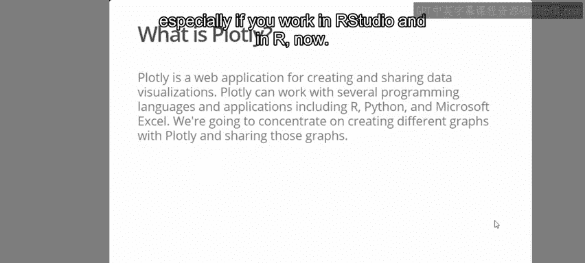

---

## 安装与加载Plotly 🛠️

上一节我们介绍了Plotly的基本概念，本节中我们来看看如何在R环境中安装和加载它。

安装Plotly包的命令如下：

```r
install.packages("plotly")
```

安装完成后，在R脚本或控制台中使用以下命令加载库：

```r
library(plotly)
# 或者
require(plotly)
```

## 创建第一个交互式图表 📈

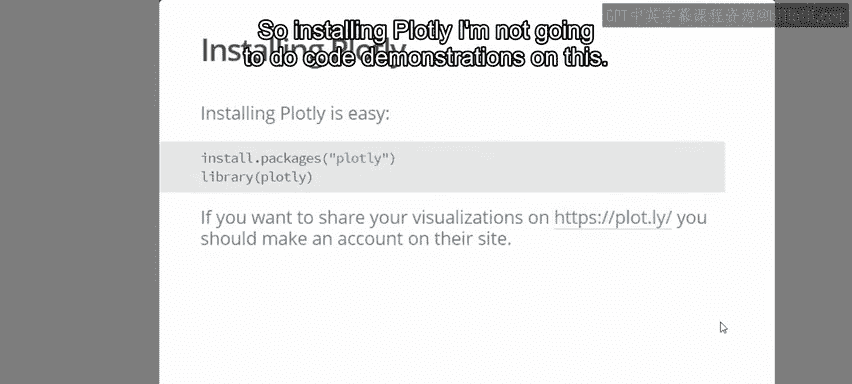

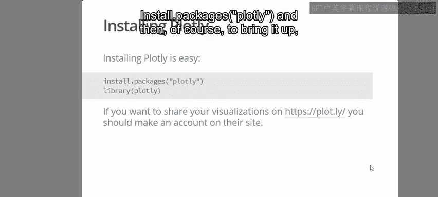

现在我们已经加载了Plotly库，本节将创建一个简单的散点图作为入门示例。

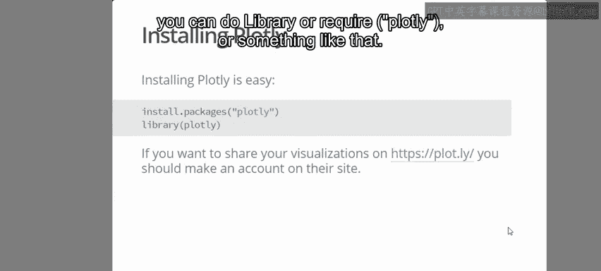

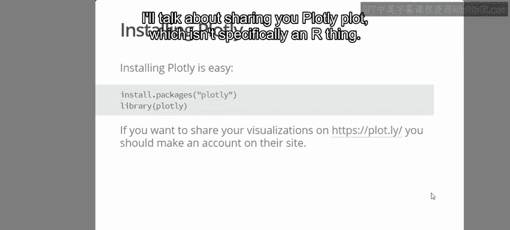

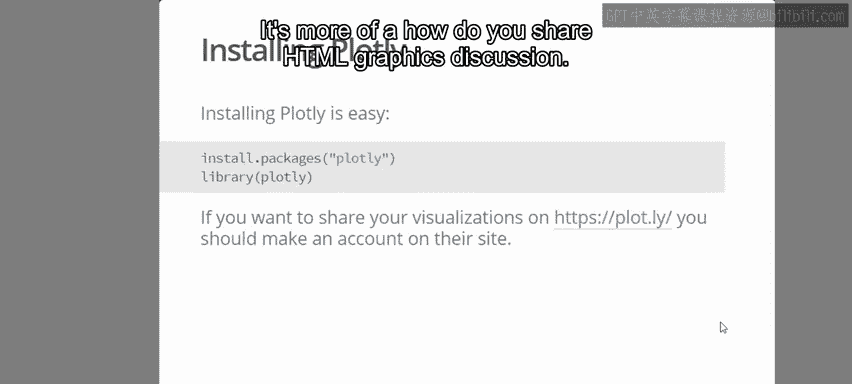

我们将使用R内置的`mtcars`数据集来演示。以下是创建基础散点图的代码：

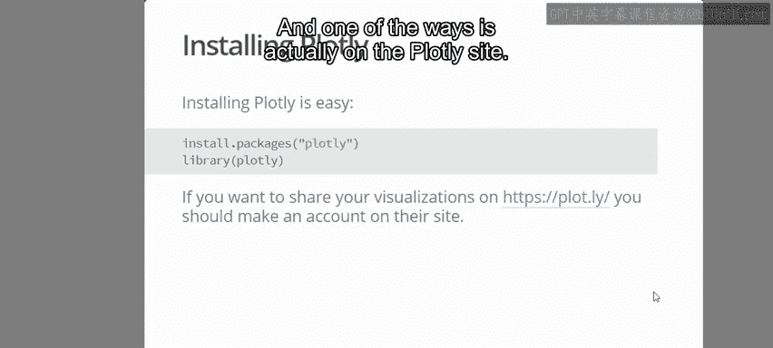

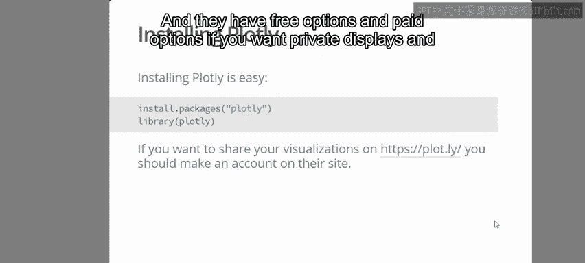

```r
# 加载数据
data(mtcars)

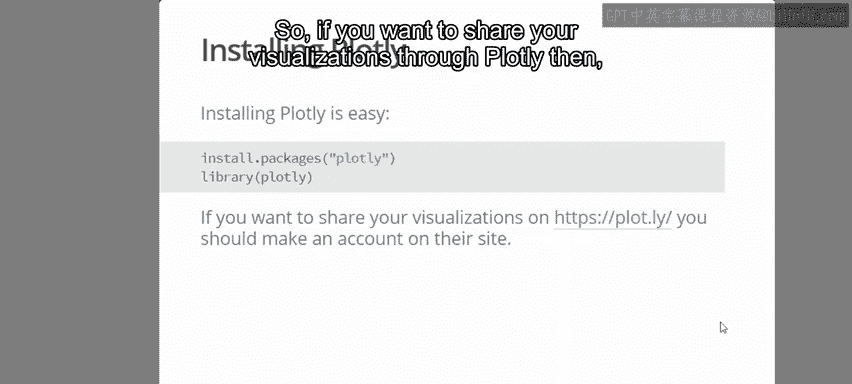

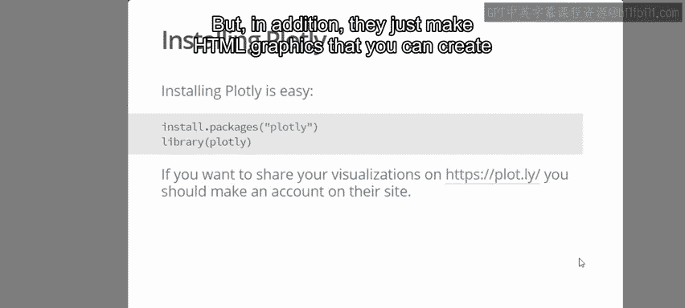


# 使用plot_ly创建散点图
p <- plot_ly(data = mtcars,
             x = ~wt,        # 指定x轴为车重
             y = ~mpg,       # 指定y轴为每加仑英里数
             type = 'scatter', # 图表类型为散点图
             mode = 'markers') # 模式为标记点

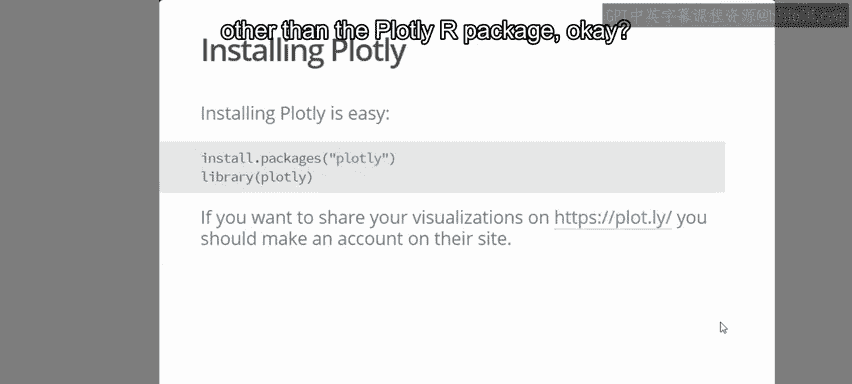


# 显示图表
p
```

运行上述代码后，RStudio的Viewer面板或你的网页浏览器中会显示一个交互式图表。你可以将鼠标悬停在数据点上查看具体数值，使用工具栏进行缩放、平移或保存为图片。

## 自定义图表外观 🎨

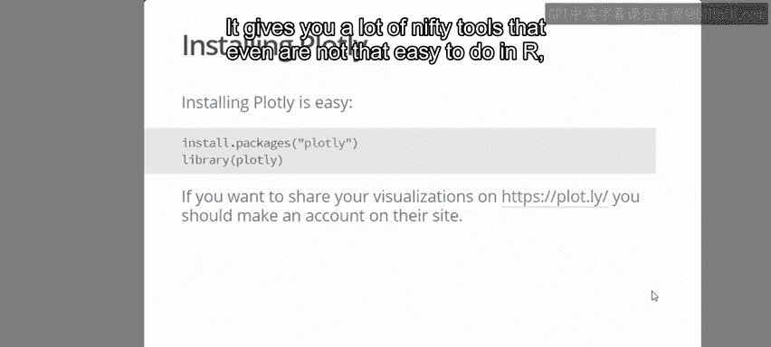

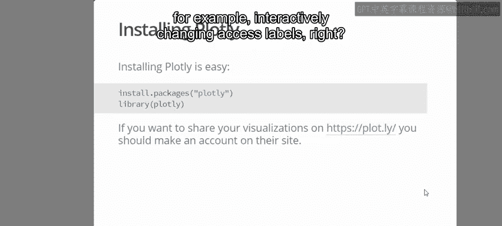

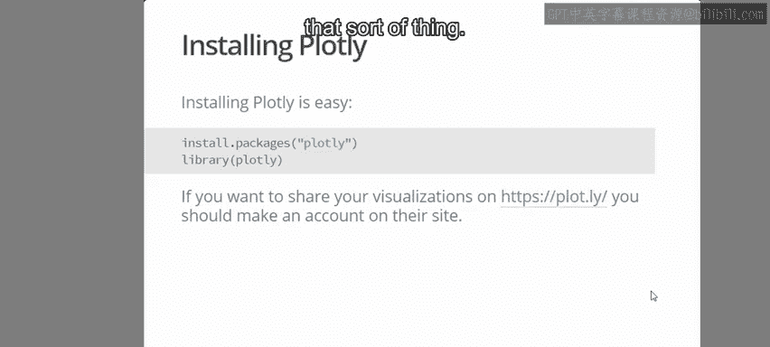

基础图表已经完成，本节中我们将学习如何自定义图表的外观，使其更符合需求。

Plotly提供了丰富的参数用于定制。以下是一些常见的自定义选项：

以下是自定义图表标题、坐标轴标签和颜色的示例：

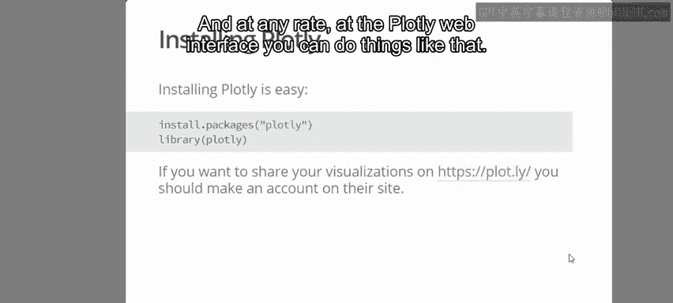

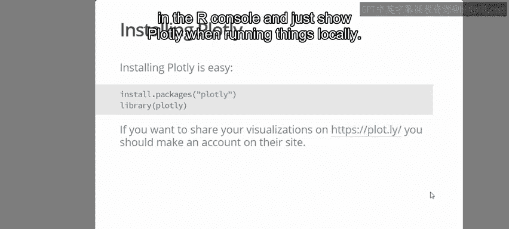

```r
p <- plot_ly(data = mtcars,
             x = ~wt,
             y = ~mpg,
             type = 'scatter',
             mode = 'markers',
             marker = list(size = 10, color = 'rgba(255, 100, 102, 0.8)')) %>% # 设置点的大小和颜色
  layout(title = '汽车重量与油耗关系图', # 添加主标题
         xaxis = list(title = '重量 (千磅)'), # 设置x轴标题
         yaxis = list(title = '油耗 (英里/加仑)')) # 设置y轴标题

p
```

## 在R Markdown中嵌入图表 📄

Plotly的强大之处在于它能无缝嵌入到动态报告中。本节我们将学习如何在R Markdown文档中嵌入交互式Plotly图表。

在R Markdown代码块中，你只需正常生成Plotly对象，它会在渲染后的HTML、PDF或Word文档中显示为交互式图表（在支持的情况下）。

以下是一个R Markdown代码块的示例：

    ```{r, echo=TRUE}
    library(plotly)
    plot_ly(data = iris,
            x = ~Sepal.Length,
            y = ~Petal.Length,
            type = 'scatter',
            mode = 'markers',
            color = ~Species)
    ```

当使用`Knit`按钮编译此R Markdown文档为HTML时，图表将以交互形式呈现。

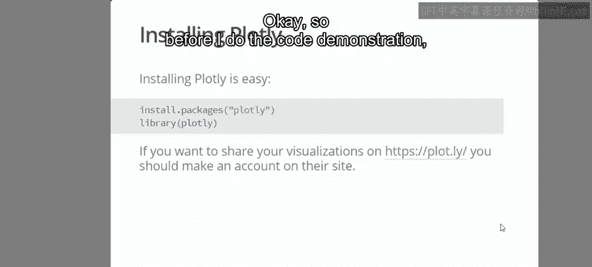

## 分享你的可视化作品 🌐

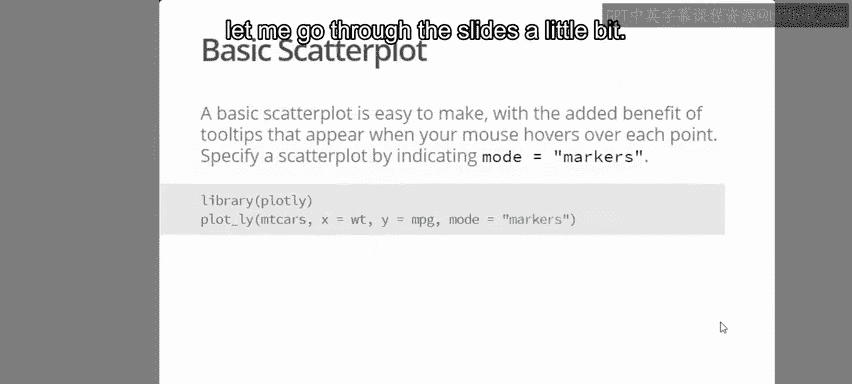

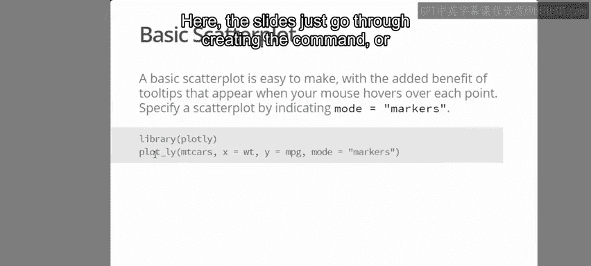

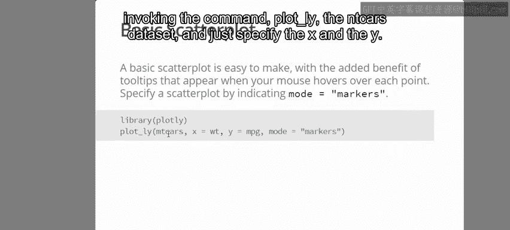

创建了精美的图表后，你可能希望与他人分享。本节将介绍几种分享Plotly图表的方法。

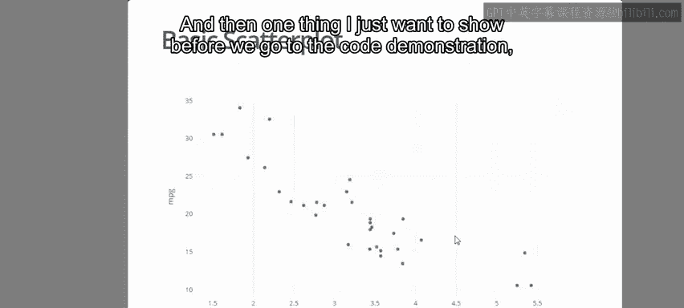

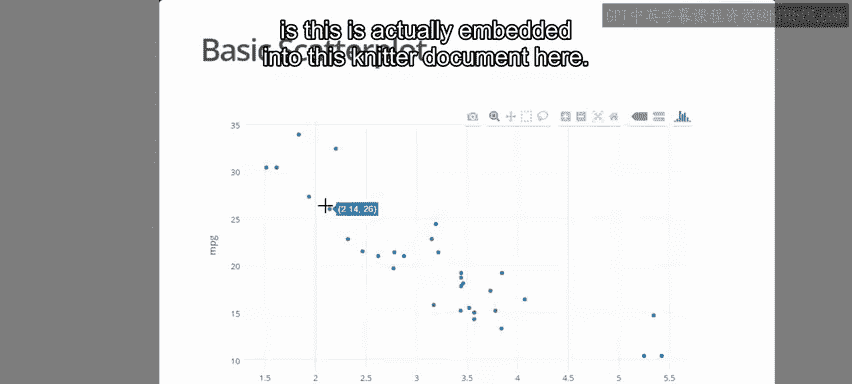

主要有两种分享途径：

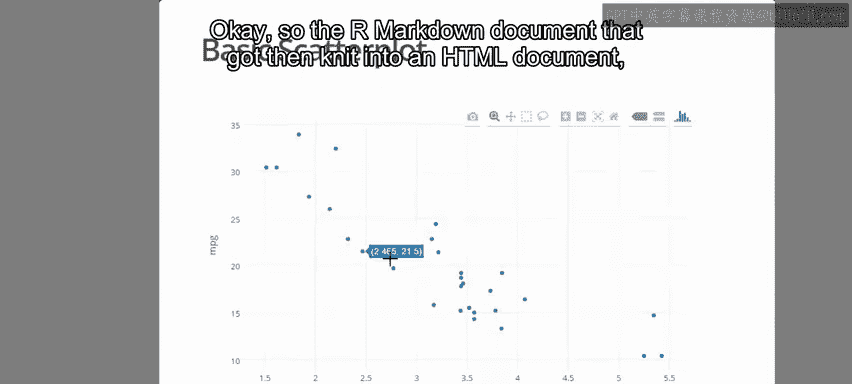

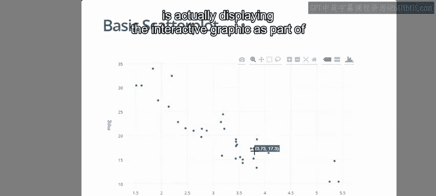

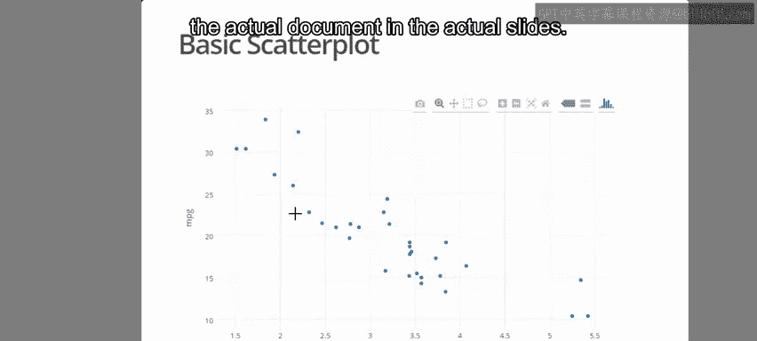

1.  **通过Plotly云端服务**：你可以在Plotly网站注册账户，将图表上传至其云端。这样可以获得一个可分享的链接，甚至可以进行隐私设置和用户认证。这需要联网并使用`plotly`包中的`api_create()`函数。
2.  **作为独立的HTML文件**：Plotly图表本质上是HTML/JavaScript代码。你可以使用`htmlwidgets::saveWidget()`函数将图表保存为一个独立的HTML文件，然后通过邮件、网页服务器或其他任何方式分享这个文件。接收者只需用浏览器打开即可查看交互图表。

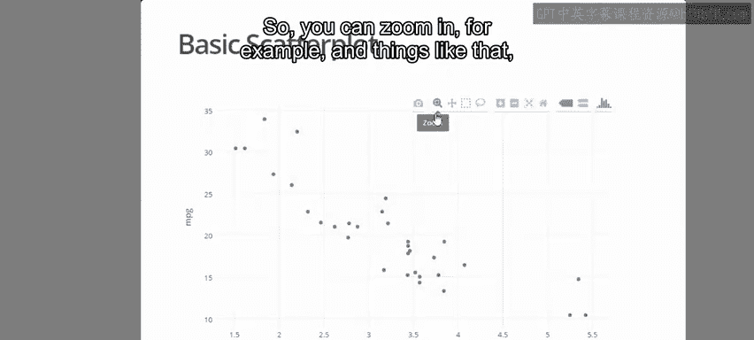

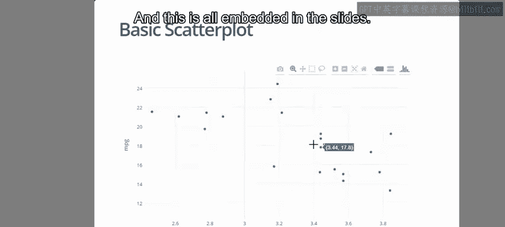

以下是保存为独立HTML文件的代码示例：

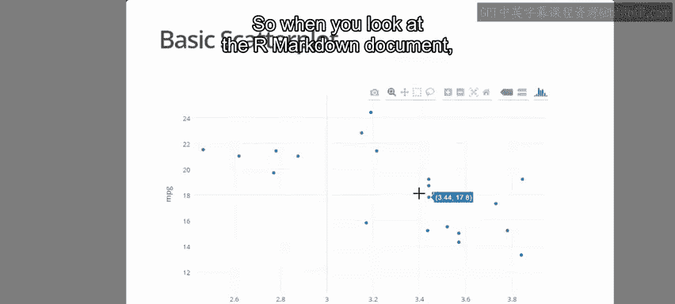

```r
# 首先确保安装了htmlwidgets包
# install.packages("htmlwidgets")
library(htmlwidgets)

# 假设p是你的plotly图表对象
saveWidget(p, file = "my_interactive_plot.html")
```

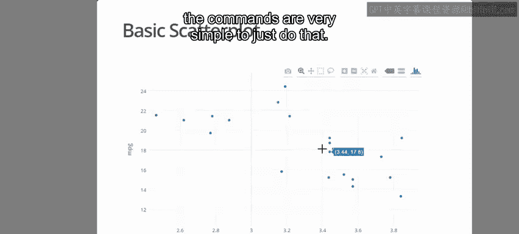

---

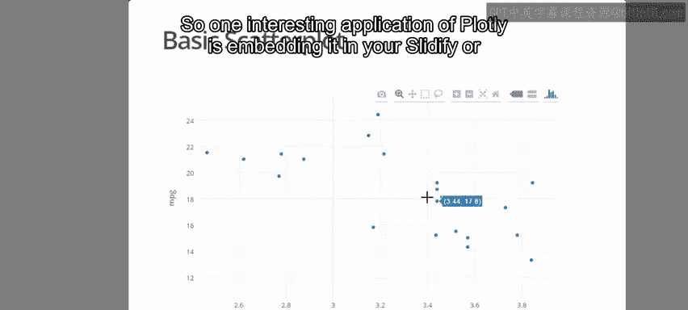

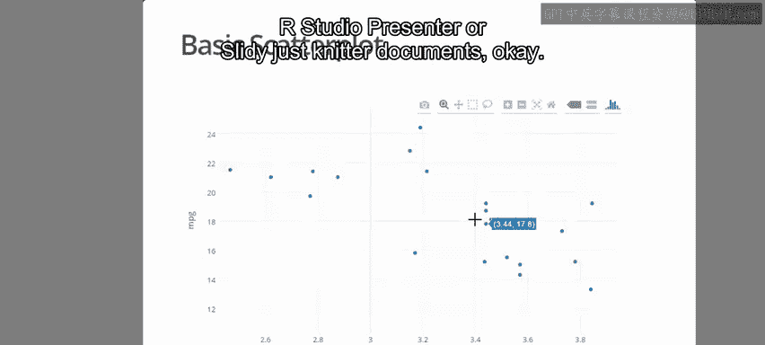

本节课中我们一起学习了Plotly的基础知识。我们从Plotly的定义和优势开始，逐步完成了在R中的安装、加载，并创建了第一个交互式散点图。接着，我们探索了如何自定义图表的外观，包括颜色、标题和坐标轴。然后，我们了解了如何将Plotly图表嵌入到R Markdown文档中，生成动态报告。最后，我们讨论了两种主要的图表分享方式：通过Plotly云端服务和保存为独立的HTML文件。

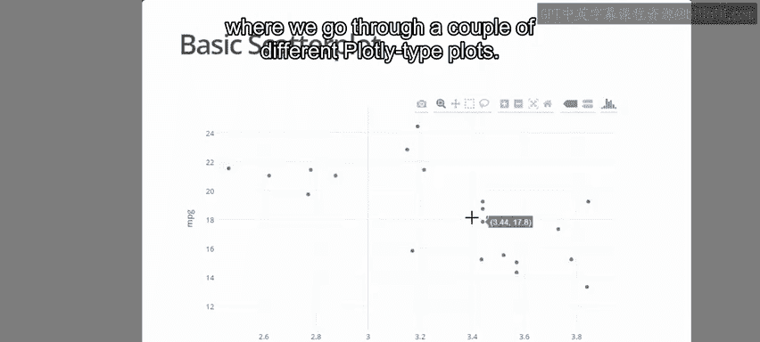

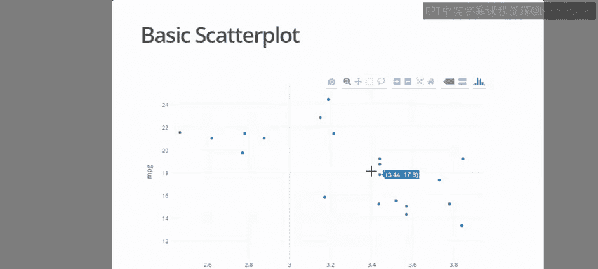

Plotly为R用户提供了一个强大而灵活的工具，用于创建可在网络上广泛传播和交互的数据可视化作品。