# 021：使用Plotly创建折线图 📈

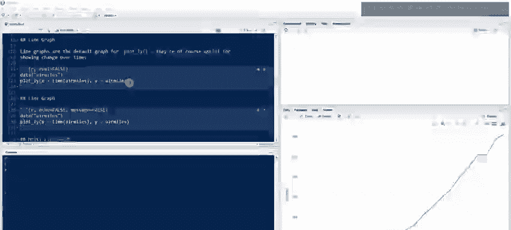

在本节课中，我们将要学习如何使用Plotly库创建交互式折线图。我们将从绘制一个简单的时间序列图开始，然后进阶到绘制包含多条线的股票市场指数图。过程中会涉及数据格式的转换，这是使用Plotly绘制多线图的关键步骤。

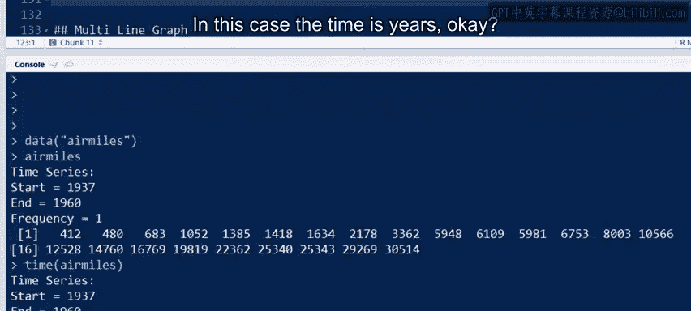

## 绘制简单时间序列图

上一节我们介绍了Plotly的基础，本节中我们来看看如何绘制折线图。

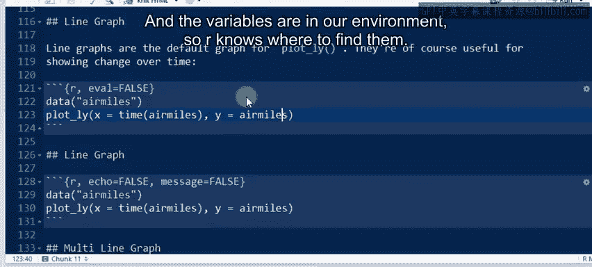

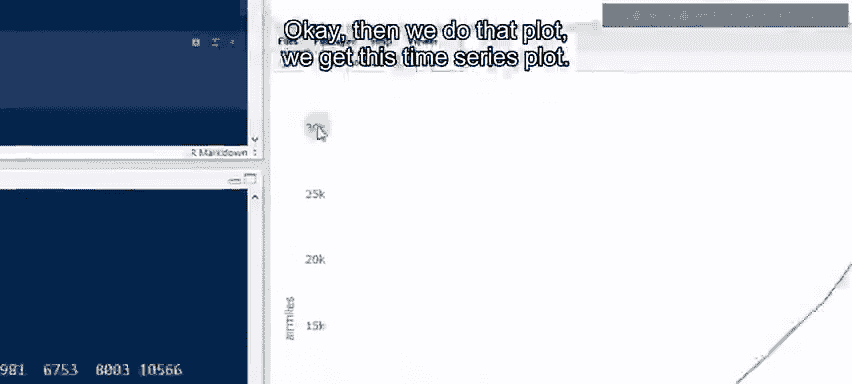

首先，我们使用一个名为 `AirPassengers` 的数据集，它记录了多年的航空乘客数量。这是一个时间序列数据，每个数据点对应一个年份。

以下是绘制该时间序列图的代码：

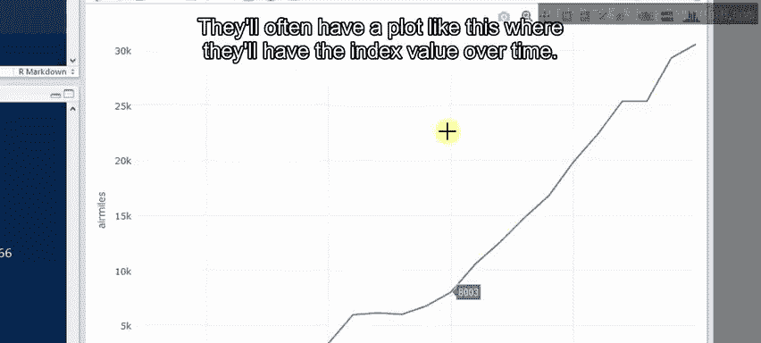

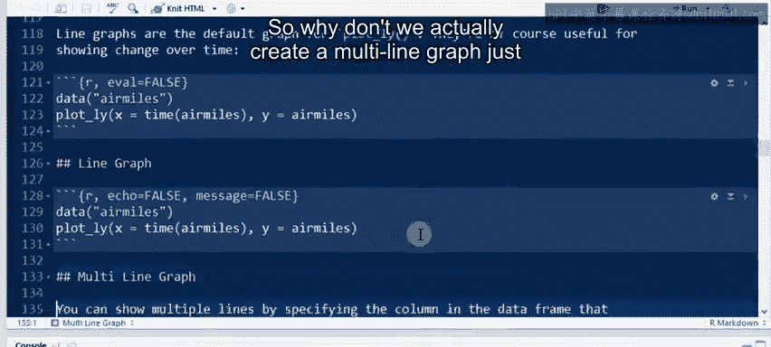

```r
plot_ly(x = time(AirPassengers), y = AirPassengers, type = 'scatter', mode = 'lines')
```

执行这段代码后，会生成一个交互式折线图。当鼠标悬停在图上的任意点时，会显示对应的具体年份和乘客数量。这种图表常见于展示如标准普尔500指数等市场指数随时间的变化趋势。

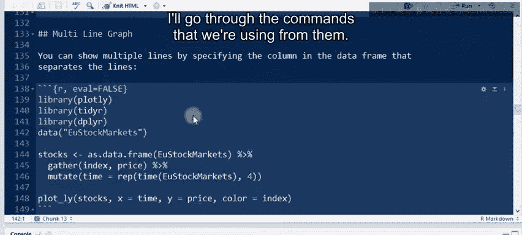

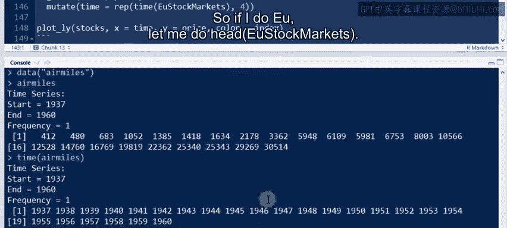

## 创建多线股票市场指数图

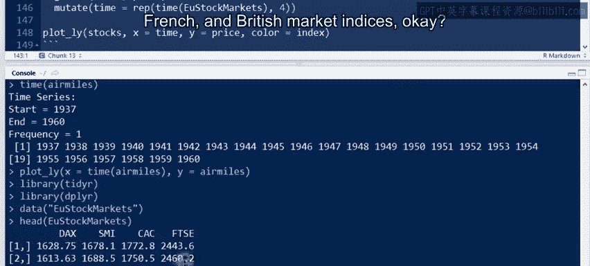

接下来，我们将创建一个更复杂的图表，同时展示多个股票市场指数的走势。我们将使用 `EuStockMarkets` 数据集，它包含了德国、瑞士、法国和英国的市场指数数据。

由于Plotly绘制多线图时需要特定的“长格式”数据，而原始数据是“宽格式”的，因此我们需要先进行数据转换。

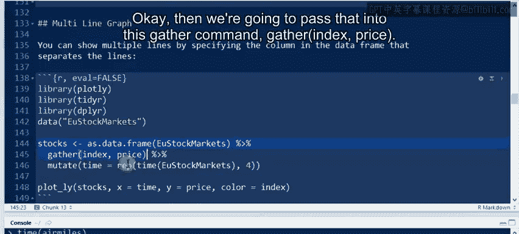

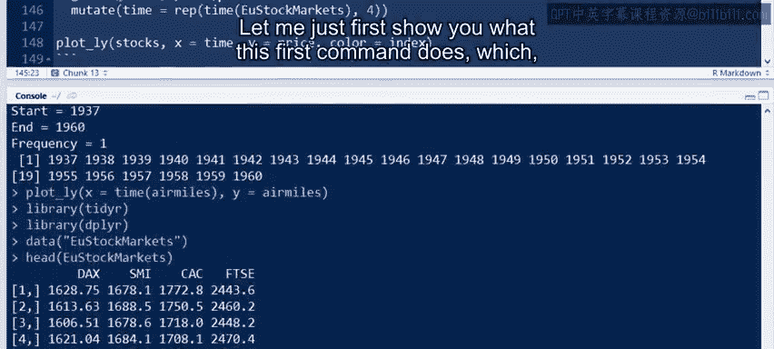

以下是准备数据所需的步骤和命令：

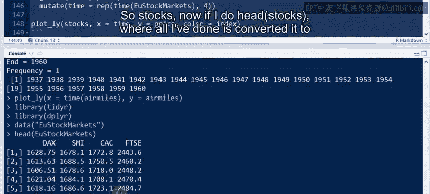

1.  首先，将 `EuStockMarkets` 时间序列对象转换为数据框。
2.  然后，使用 `tidyr` 包的 `gather()` 函数将数据从宽格式转换为长格式。这会将所有指数的列名（如DAX, SMI）合并为一个名为“index”的因子变量，并将对应的指数值合并到“price”列中。
3.  最后，为数据框创建一个时间变量。

以下是完成上述数据转换的代码：

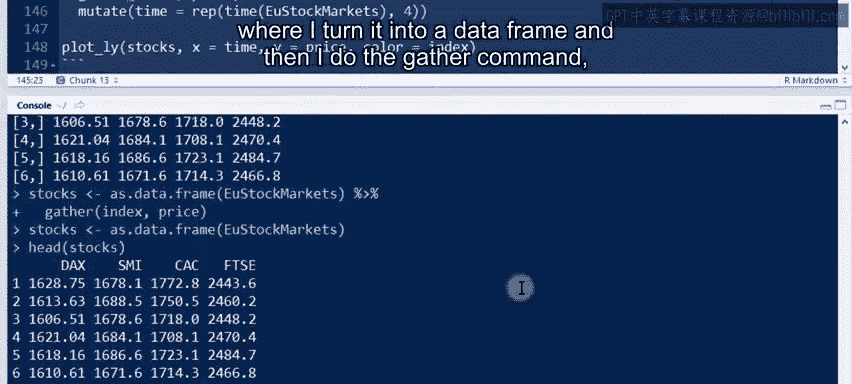

```r
library(plotly)
library(tidyr)
library(dplyr)

# 1. 转换为数据框
stocks <- as.data.frame(EuStockMarkets)

# 2. 转换为长格式
stocks <- stocks %>%
  gather(key = "index", value = "price")

# 3. 创建时间变量
stocks$time <- rep(time(EuStockMarkets), times = 4)
```

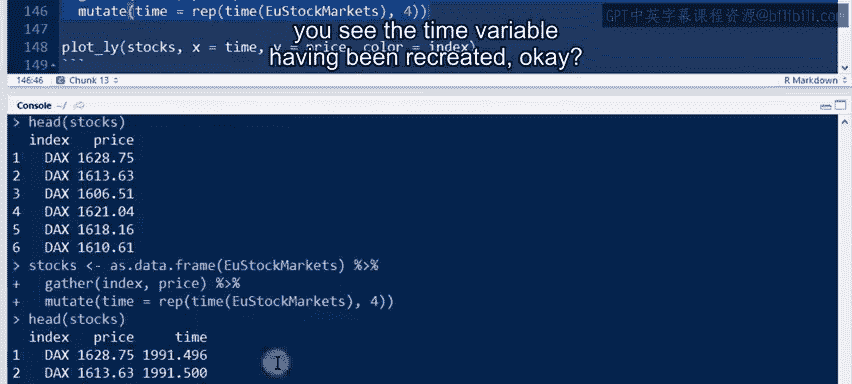

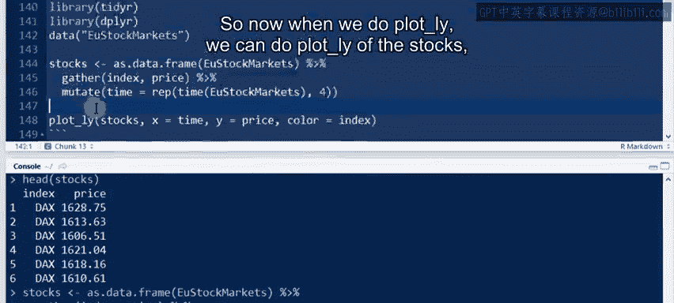

数据准备完成后，就可以使用Plotly绘制多线图了。

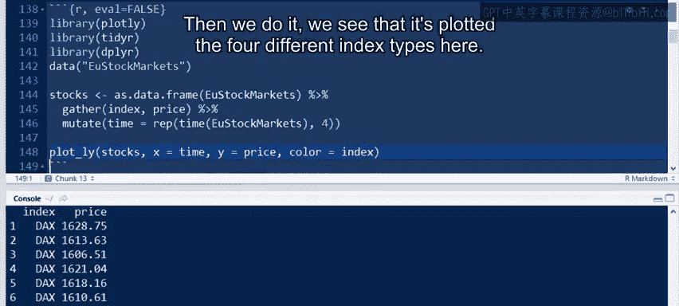

以下是绘制多线图的代码：

```r
plot_ly(data = stocks, x = ~time, y = ~price, color = ~index, type = 'scatter', mode = 'lines')
```

生成的图表会以不同颜色的线条分别显示四个股票市场指数。图表侧边配有图例，鼠标悬停时同样可以查看任意时间点的具体指数值。这种图表与金融网站上常见的指数走势图非常相似。

## 总结与练习

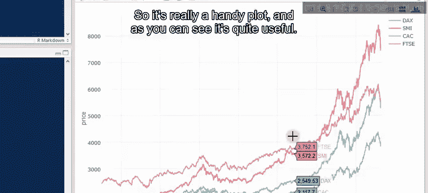

本节课中我们一起学习了使用Plotly创建交互式折线图。我们从绘制单条时间序列线开始，然后通过数据转换，学会了如何绘制展示多条趋势线的股票市场指数图。在这个过程中，`tidyr` 和 `dplyr` 包在数据重塑和操作方面起到了至关重要的作用。

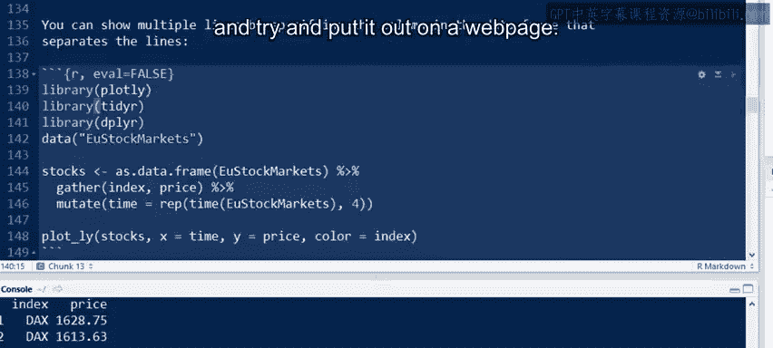

建议你尝试使用本课的数据，或者寻找其他股票市场数据，练习创建自己的多线走势图，并尝试将其发布到网页上。