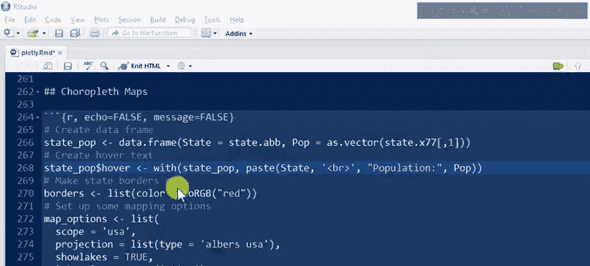
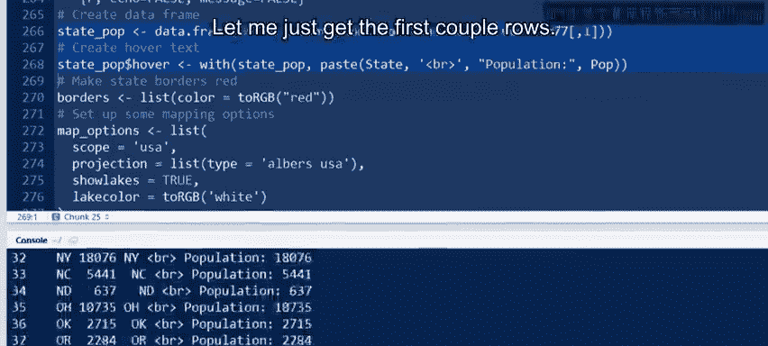
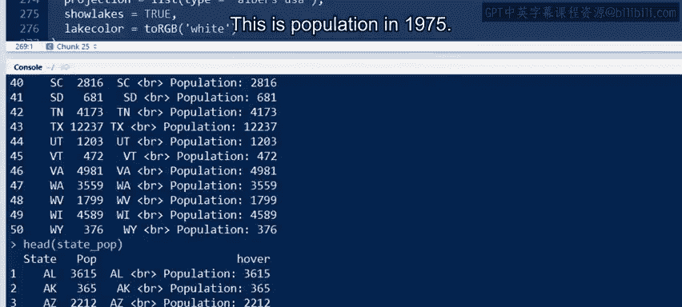
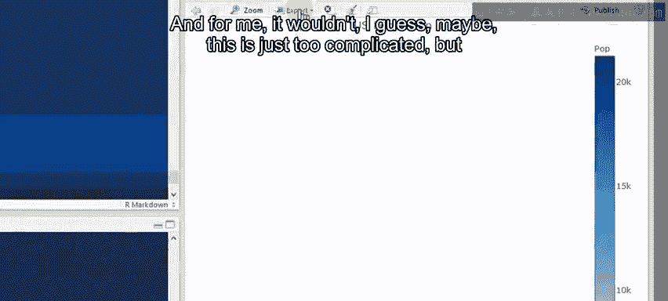
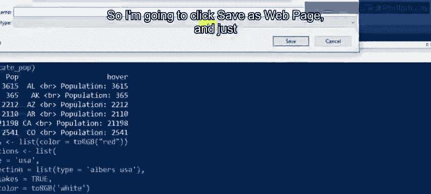
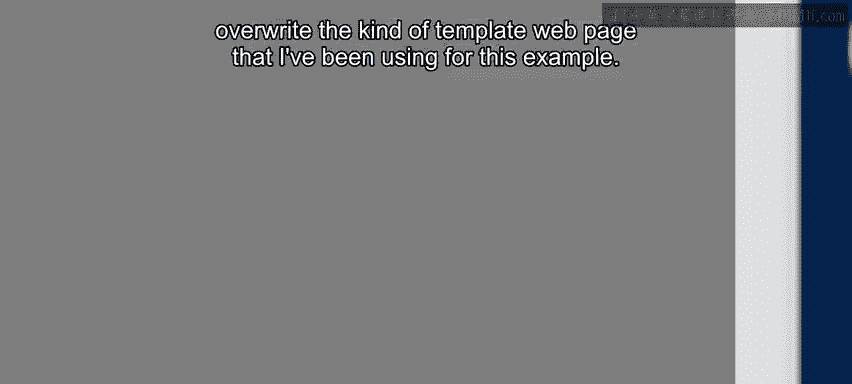
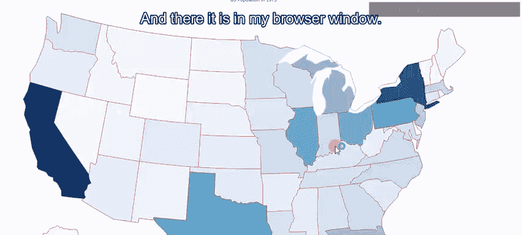
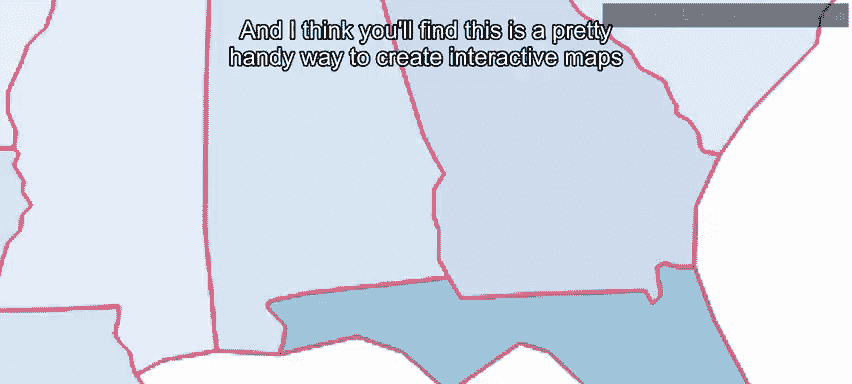

# 023：使用Plotly创建交互式地图 🗺️



在本节课中，我们将学习如何使用Plotly库创建一个带有悬停效果的交互式美国人口地图。我们将从准备数据开始，逐步讲解地图的配置和绘制过程，最终生成一个可在网页中查看的交互式可视化作品。

## 数据准备



首先，我们需要创建一个数据集。以下代码将生成一个包含美国各州信息的数据框。

```r
# 创建数据集示例代码
state_pop <- data.frame(
  state = state.abb, # 州缩写
  population = ... # 人口数据（此处应为具体数值）
)
```

该数据框包含50个州的信息。对于每个州（例如阿拉巴马州），我们存储了其缩写、以百万为单位的人口数量，以及用于悬停显示的文本。悬停文本的格式为“州缩写 + 换行符 + 人口数量”，例如“AL\n 3615000”，其中3615000是1975年的人口数据。



## 地图样式与选项配置

上一节我们准备好了数据，本节中我们来看看如何配置地图的视觉样式和布局选项。

首先，我们设置州边界的颜色。虽然这部分并非必需，但可以增强地图的可读性。

```r
# 设置边界颜色为红色
borders <- list(color = "red")
```

接下来，我们通过一个列表来定义地图的布局选项。

```r
# 定义地图选项
map_options <- list(
  scope = 'usa', # 地图范围设置为美国
  showlakes = TRUE, # 显示湖泊
  lakecolor = 'white' # 将湖泊颜色设置为白色
)
```

将湖泊颜色设置为白色是为了避免与用蓝色编码人口数量的各州颜色混淆，确保地图清晰易读。

## 绘制交互式地图

配置好样式和选项后，现在我们可以使用Plotly函数来绘制地图了。

以下是绘制地图的核心代码：

```r
# 使用plot_geo函数绘制地图
p <- plot_geo(state_pop, # 数据源
              locationmode = 'USA-states') %>% # 位置模式为美国州
  add_trace(
    z = ~population, # 根据人口数量着色
    text = ~hover, # 悬停时显示的文本
    locations = ~state, # 位置信息来自州缩写列
    color = ~population, # 颜色映射到人口数量
    colors = 'Blues' # 使用蓝色调色板
  ) %>%
  layout(
    title = '1975年美国各州人口', # 地图标题
    geo = map_options # 应用之前定义的地图选项
  )
```

在这段代码中：
*   `plot_geo()` 函数初始化一个地理绘图。
*   `add_trace()` 函数添加数据轨迹，其中 `z` 参数决定了颜色的深浅，`text` 参数定义了悬停信息。
*   `colors = 'Blues'` 指定使用连续的蓝色渐变来表示人口数量。
*   `layout()` 函数用于设置标题并应用我们之前定义的 `map_options`。

## 输出与查看结果





运行绘图代码后，结果可能不会直接在RStudio的查看器中显示，尤其是对于复杂的地图。

我们可以将结果保存为一个独立的HTML网页文件来查看。





```r
# 将交互式地图保存为网页
htmlwidgets::saveWidget(p, file = "us_population_map.html")
```

在浏览器中打开生成的HTML文件，你将看到一个交互式美国地图。将鼠标悬停在任何一个州上（例如阿拉巴马州），就会显示出我们预先设置好的文本信息，包括州缩写和具体的人口数量。

## 练习与总结

本节课中，我们一起学习了使用Plotly创建交互式地图的完整流程。

为了巩固所学，建议进行以下练习：
*   首先，完全复现本教程中的地图。
*   然后，尝试使用数据框中的其他变量（而非人口数量）来创建新地图。
*   最后，尝试修改颜色所代表的含义，或调整其他地图选项。



通过动手实践，你会更熟悉各项参数的作用，并发现这是一种创建交互式地图非常便捷有效的方法。