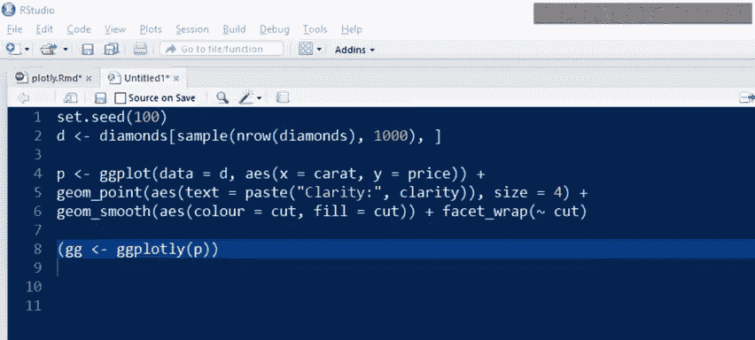
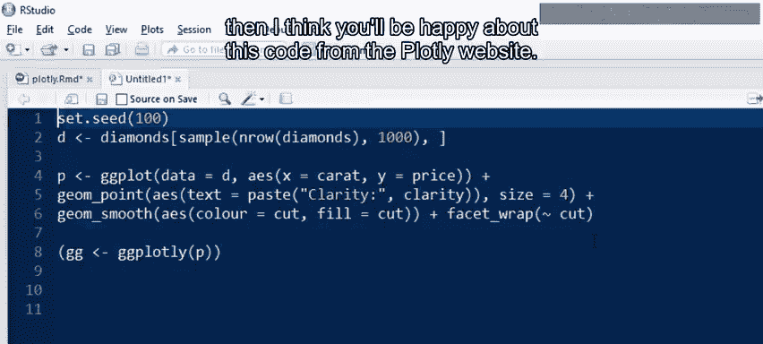
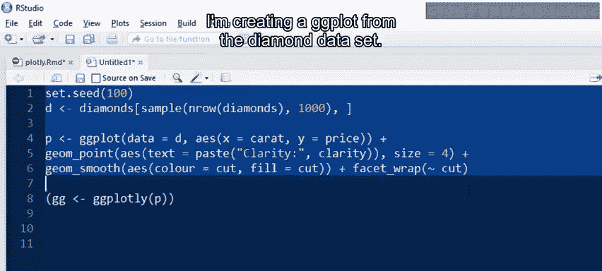
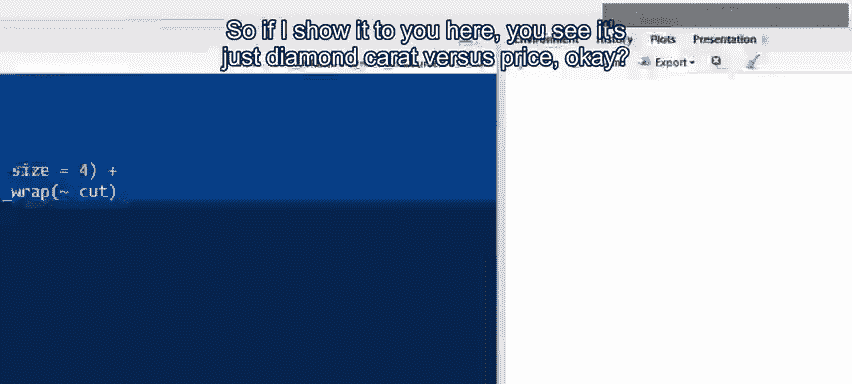
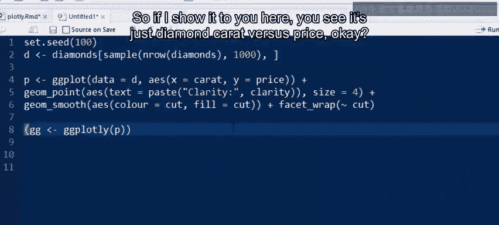

# 024：Plotly基础入门 🎨

在本节课中，我们将学习如何利用Plotly库将静态的ggplot图形转换为交互式的HTML图表。Plotly是一个功能强大的数据可视化工具，它允许用户创建可在网页上直接查看和操作的动态图表。



---

## 从ggplot到交互式图表

上一节我们介绍了Plotly的基本概念，本节中我们来看看如何将熟悉的ggplot图形转换为Plotly的交互式格式。

如果你喜欢使用ggplot2进行数据可视化，那么Plotly提供的一个功能会让你感到非常方便。该功能允许你直接将ggplot对象转换为交互式的Plotly图形。

以下是一个简单的代码示例，它使用钻石数据集创建了一个基础的ggplot散点图：

```r
# 加载必要的库
library(ggplot2)
library(plotly)

# 使用ggplot2创建散点图
p <- ggplot(diamonds, aes(x = carat, y = price)) +
  geom_point()



# 显示静态的ggplot图形
print(p)
```



这段代码会生成一个展示钻石克拉数与价格关系的静态散点图。



---

## 使用`ggplotly`进行转换

Plotly库中的`ggplotly()`函数是实现转换的核心工具。它能够接收一个ggplot对象，并输出一个交互式的Plotly图形对象。

以下是转换过程的代码：

```r
# 将ggplot对象转换为Plotly交互式图形
interactive_plot <- ggplotly(p)

# 显示交互式图形
interactive_plot
```

执行上述代码后，你将在RStudio的“Viewer”面板中看到一个HTML格式的交互式图表。这个图表与在网页浏览器中查看的效果一致。

---



## 两种视图的对比


理解静态视图与交互式视图的区别对于掌握本课内容很重要。

*   在RStudio的绘图面板中，显示的是标准的静态R图形。
*   在RStudio的查看器面板中，显示的是由Plotly生成的HTML交互式图形。你可以在此进行缩放、平移、查看数据点具体信息等操作。

---

## 核心步骤总结

本节课中我们一起学习了将ggplot图形转换为Plotly交互式图表的基本流程。

其核心步骤可以概括为以下两点：
1.  使用`ggplot2`正常创建你所需的图形对象。
2.  使用`plotly`包的`ggplotly()`函数对该对象进行转换。

通过这种方式，你可以快速地为现有的ggplot可视化作品添加交互功能，从而更灵活地探索和展示数据。