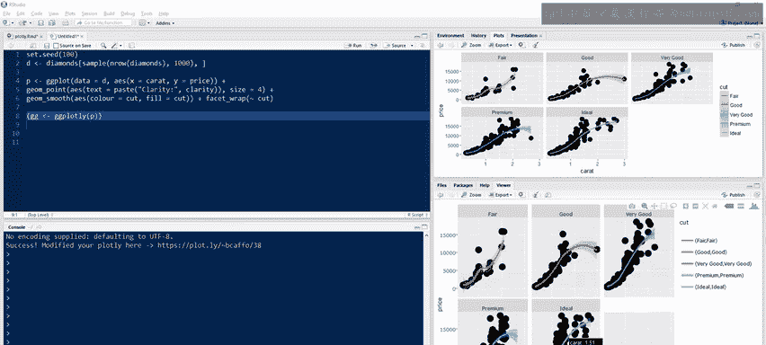
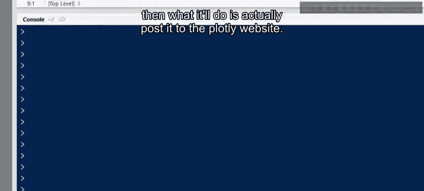
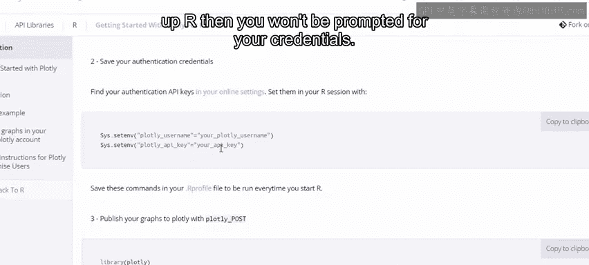

# 025：使用Plotly发布交互式图表 📊



在本节课中，我们将学习如何将R语言中创建的图表直接发布到Plotly在线平台，并利用其强大的网页图形用户界面进行编辑和分享。

上一节我们介绍了如何在R中创建基础的交互式图表。本节中，我们来看看如何将这些图表发布到线上，以便于分享和进一步美化。

## 发布图表到Plotly网站



首先，假设我们已经使用`ggplot2`创建了一个图表对象，并已将其存储在变量`GG`中。在R控制台中输入`GG`可以预览它。

要将此图表发布到Plotly，我们需要使用`plotly_post()`函数。其基本语法如下：

```r
plotly_post(GG, filename = "我的图表")
```

执行此命令后，图表将被上传至您的Plotly账户。

## Plotly在线编辑器的功能

图表成功发布后，会自动在浏览器中打开Plotly网站上的对应页面。该在线平台提供了丰富的编辑工具。

以下是Plotly在线编辑器的主要功能：
*   **图形化编辑**：通过网页图形用户界面直接操作。
*   **调整坐标轴**：轻松修改X轴和Y轴的标签、范围和刻度。
*   **修改变量名**：直接在图例和标题中更改数据系列的名称。
*   **更改样式**：调整颜色、主题、字体等视觉元素。
*   **添加注释**：在图表上添加文本或形状标注。

Plotly界面设计直观，并且网站提供了大量视频教程和指南，方便用户探索所有功能。建议您尝试将图表导出到Plotly，并使用其界面进行各种调整和实验。

## 配置认证环境变量

为了让发布过程顺畅无阻，无需每次手动输入密码，我们需要预先设置两个环境变量。

以下是配置Plotly认证信息的步骤：
1.  **获取凭证**：登录Plotly网站，进入“Settings”（设置）页面，找到您的用户名和API密钥。
2.  **设置环境变量**：在R中，使用以下代码设置（将`your_username`和`your_api_key`替换为您的实际信息）：
    ```r
    Sys.setenv("plotly_username"="your_username")
    Sys.setenv("plotly_api_key"="your_api_key")
    ```
3.  **永久配置（推荐）**：为了每次启动R时自动设置，可以将上述两行代码添加到您的`.Rprofile`文件中。

完成配置后，再次调用`plotly_post()`函数时将不再提示输入凭证。

---



本节课中我们一起学习了如何将R中生成的图表发布到Plotly在线平台，探索了其网页编辑器的核心功能，并完成了自动化发布所需的账户认证配置。这为在线分享和协作开发数据可视化产品提供了便利。