# 026：使用R Markdown创建可重现演示文稿 📊


在本节课中，我们将学习如何使用R Markdown创建可重现的演示文稿。我们将探讨其核心概念、优势，并通过示例了解其工作流程。

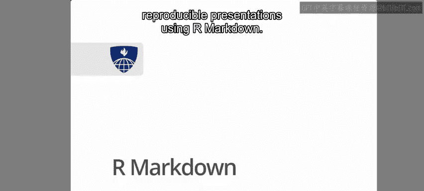


---

上一节我们介绍了本课程的主题。本节中，我们来看看R Markdown的基本概念及其在创建可重现文档中的重要性。


R Markdown内置于RStudio中，它允许你从R内部创建文档（特别是HTML文档）。其核心机制是将分析过程中的**代码**、**代码运行结果**、**图表**等所有内容，整合到一个文档中。

**核心公式/代码描述：**
一个R Markdown文档的基本结构可以概括为：
```
文档 = 文本内容 + R代码块 + 渲染引擎（knitr）
```
当渲染（Knit）文档时，引擎会执行代码块并将结果嵌入到最终输出中。

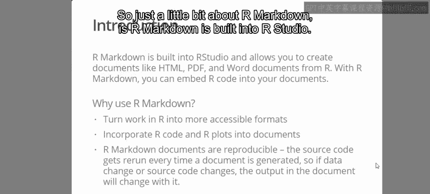


---

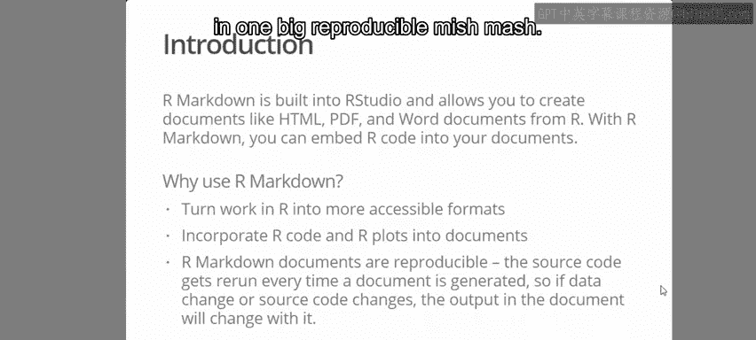

传统的工作流程存在一些问题，R Markdown旨在解决它们。

在旧的工作流程中，你可能有：
1.  一份用于分析的R代码（可能缺乏文档）。
2.  一份独立的报告或演示文稿文档（如Word、PowerPoint）。
3.  你需要手动将图表、结果从R复制粘贴到文档中。

这种方式会导致**版本控制困难**，并且接收你文件的人**无法重现**其中的图表和计算结果。

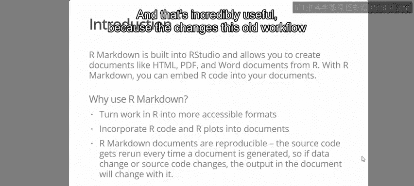

相比之下，使用R Markdown生成文档是更好的方式，它关注**可重现性**，并为生成演示文稿提供了**一致且自动化的结构**。


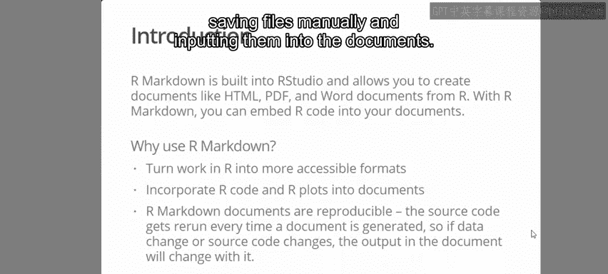

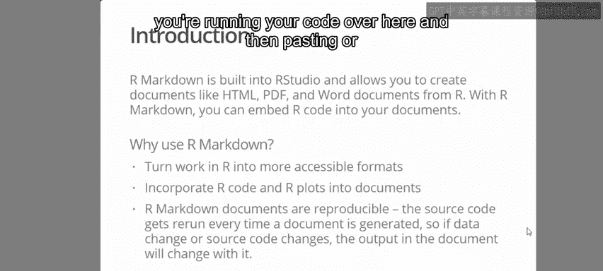


---

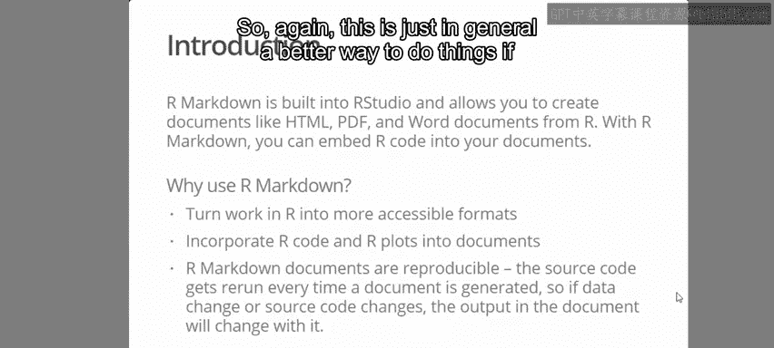

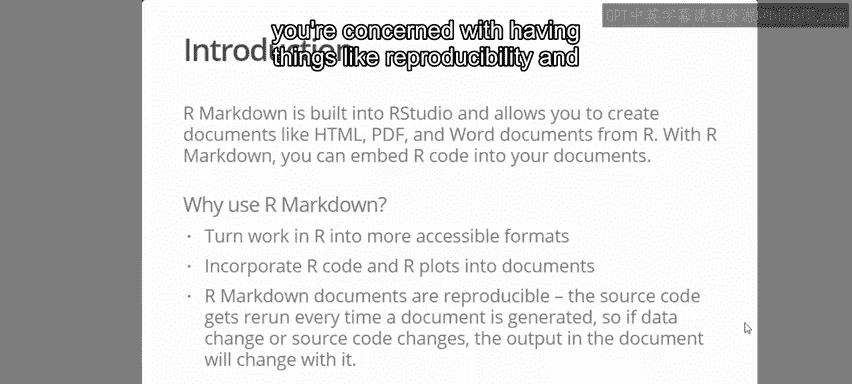

R Markdown在创建周期性或自动化报告方面尤其有用。

试想在一个公司场景中，需要定期（例如每两周）根据最新数据生成报告。与其每次重复繁琐且易出错的复制粘贴过程，不如拥有一个能**自动生成包含最新数据的演示文稿的脚本**。这种方式使得一切过程都可追溯且易于版本控制。

因此，将R Markdown视为创建**周期性演示文稿**或**自动化演示文稿**的有效工具。

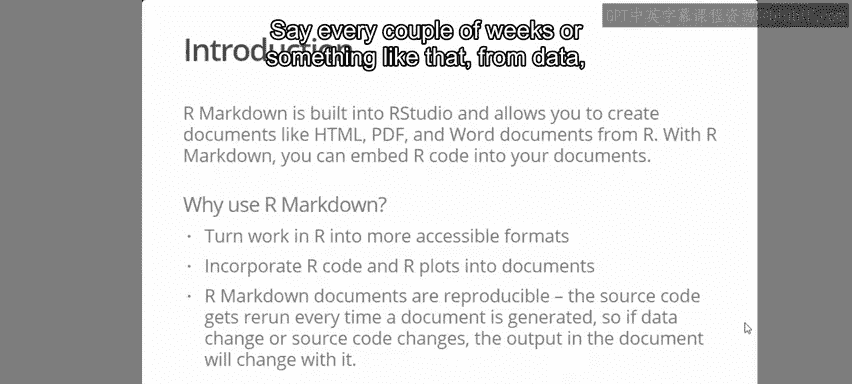

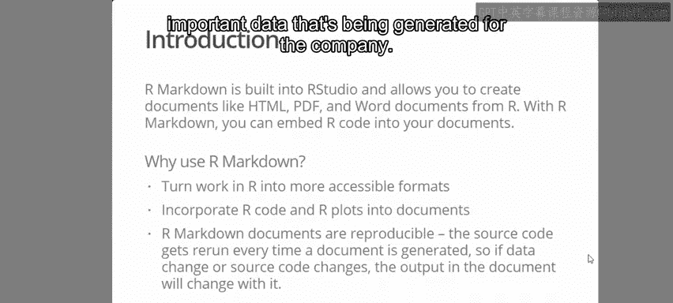

---

“可重现性”这一理念在学术界受到了广泛关注，R Markdown极大地促进了这一点。

许多已发表的论文，当其他独立团队试图用相同数据集复现其分析结果时，常常无法成功。这导致了关于哪方结果正确的争议。

拥有一份**内嵌了代码的文档**，能极大提升文档的可重现性。虽然它并非完美（可能涉及外部文件、计算架构差异等），但它在创建更可重现的结果方面迈出了一大步。


---

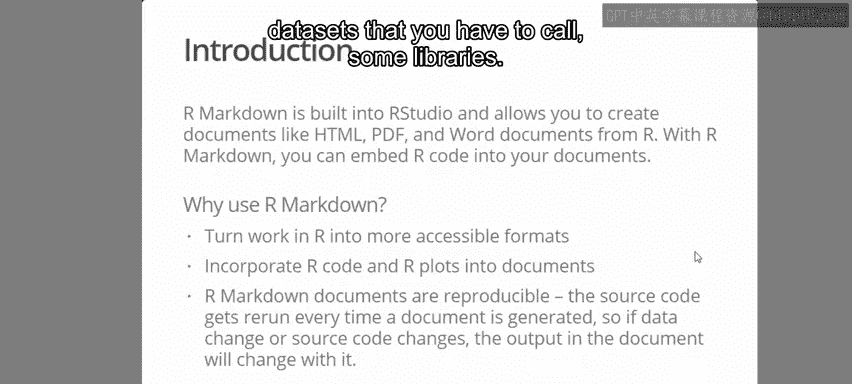

如果你学习过数据科学专项课程中的《可重现研究》课程，可能已对这部分内容有所了解。本课程将主要聚焦于**演示文稿的创建**，因为我们视本课程为“产品”课程——你生成的演示文稿就是你为产品所做的“推介”，我们希望这个“推介”能以可重现的格式创建。

接下来，我们将开始看一些具体的示例。

---

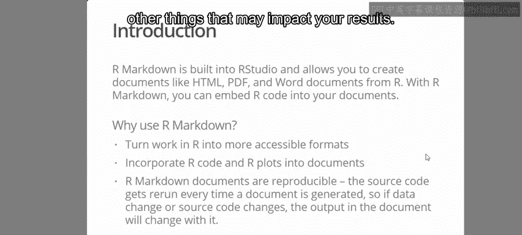

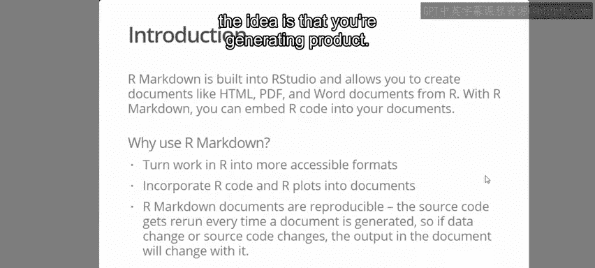

本节课中我们一起学习了使用R Markdown创建可重现演示文稿的核心价值。我们了解了它如何通过整合代码与文本来解决传统工作流程的弊端，强调了其在确保分析可重现性和自动化报告生成方面的重要性。在接下来的课程中，我们将通过实际示例深入其具体应用。