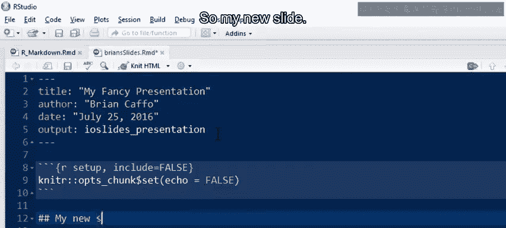
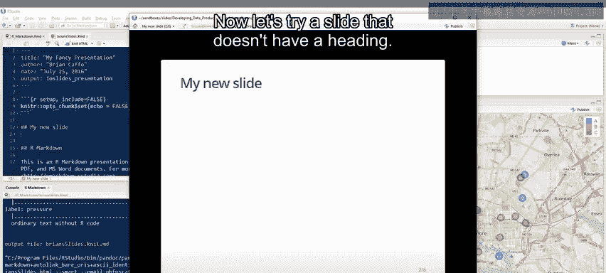
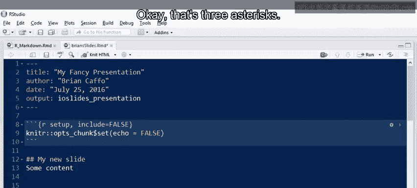
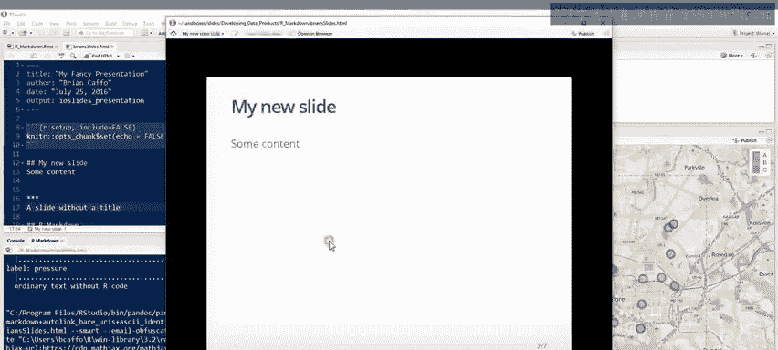
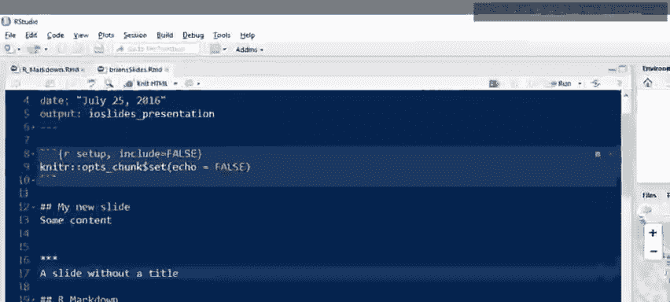
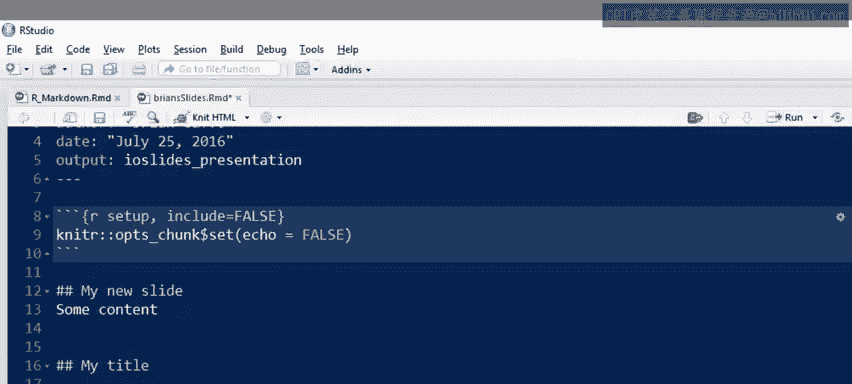
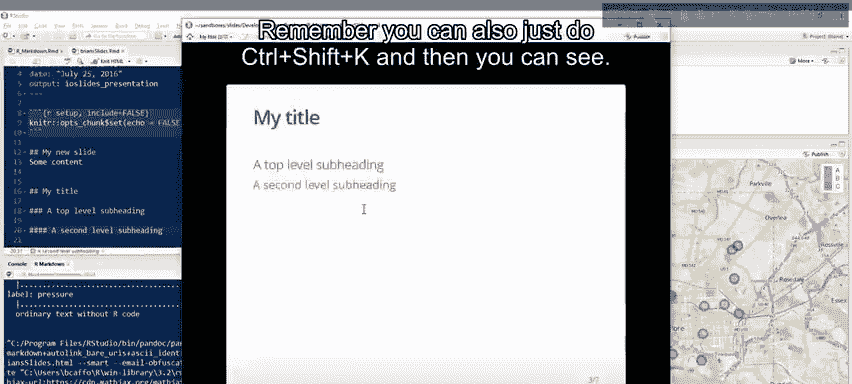
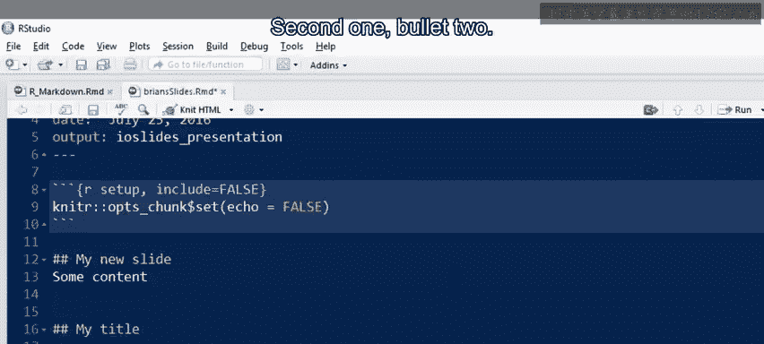
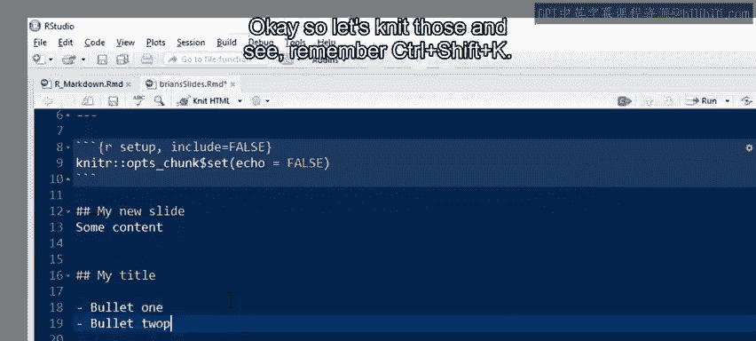
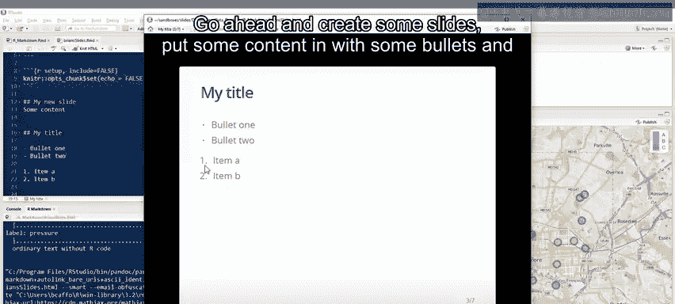

# 028：R Markdown基础（第一部分）📝

在本节课中，我们将学习如何使用R Markdown创建演示文稿。我们将从了解文档的基本结构开始，逐步学习如何添加标题、幻灯片、列表等元素，并通过实际操作来巩固这些知识。

## 了解YAML前言

首先，我们来看一下R Markdown文档开头的YAML部分。这部分内容被三个短横线 `---` 包围，用于设置文档的元数据和输出格式。

例如，你可以在这里修改文档的标题、作者和日期。`output: ioslides_presentation` 这一行指定了输出格式为幻灯片。如果你想改变格式，可以在此处修改。`knitr` 选项中的 `echo: FALSE` 意味着默认情况下，代码块中的代码不会在输出中显示。

```yaml
---
title: "我的演示文稿"
author: "你的名字"
date: "2023-10-27"
output: ioslides_presentation
knitr:
  echo: FALSE
---
```

## 创建新幻灯片

上一节我们介绍了文档的YAML前言，本节中我们来看看如何创建幻灯片。



在R Markdown中，创建新幻灯片非常简单。使用两个井号 `##` 即可开始一个新幻灯片，并为其添加标题。

```
## 我的新幻灯片
```

现在，让我们尝试编译（Knit）这个文档。你可以点击RStudio中的“Knit”按钮，或者使用快捷键 `Ctrl + Shift + K`。编译完成后，你将看到标题为“我的新幻灯片”的页面。

## 添加幻灯片内容



我们已经学会了创建带标题的幻灯片，接下来看看如何为幻灯片添加内容。

你可以在标题下方直接输入文本作为幻灯片的内容。





```
## 带内容的幻灯片

这是幻灯片上的内容。
```



你也可以创建没有标题的幻灯片。只需直接输入内容，而不使用 `##` 标题。

```
这是一张没有标题的幻灯片。
它的内容直接开始。
```

## 使用标题与子标题

为了在单张幻灯片内组织内容，我们可以使用不同层级的标题。



以下是不同层级标题的标记方法：
*   **两级标题（幻灯片主标题）**：使用两个井号 `##`。
*   **三级标题（一级子标题）**：使用三个井号 `###`。
*   **四级标题（二级子标题）**：使用四个井号 `####`。

例如：
```
## 幻灯片主标题
### 一级子标题
#### 二级子标题
```



编译后，这些标题会以不同大小和样式呈现，帮助你清晰地组织信息。

## 插入列表



列表是整理要点的好方法。R Markdown支持两种主要列表：无序列表和有序列表。

以下是创建列表的方法：
*   **无序列表（项目符号）**：使用短横线 `-` 或星号 `*` 开始每一行。
    ```
    - 项目一
    - 项目二
    ```
*   **有序列表（编号）**：使用数字加句点 `1.`、`2.` 开始每一行。
    ```
    1. 项目A
    2. 项目B
    ```

让我们将列表加入幻灯片并编译查看效果。

## 实践练习



现在，请尝试运用以上知识创建你自己的幻灯片。

请完成以下步骤：
1.  创建多张带有不同标题的幻灯片。
2.  在其中一些幻灯片中添加无序列表和有序列表。
3.  使用不同层级的标题和子标题来组织单张幻灯片内的内容。
4.  编译你的文档，查看最终的幻灯片效果。

通过动手实践，你将更好地掌握R Markdown制作演示文稿的基本流程。

---



本节课中我们一起学习了R Markdown创建演示文稿的基础。我们从YAML前言配置开始，学习了如何创建新幻灯片、添加标题与内容、使用子标题结构以及插入有序和无序列表。掌握这些基础标记是使用R Markdown进行高效、可重复报告和演示的关键第一步。