# 031：R Markdown 图表与发布 🚀

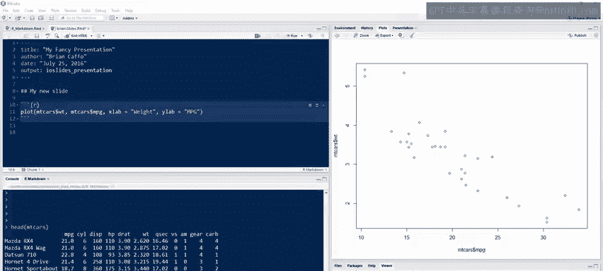

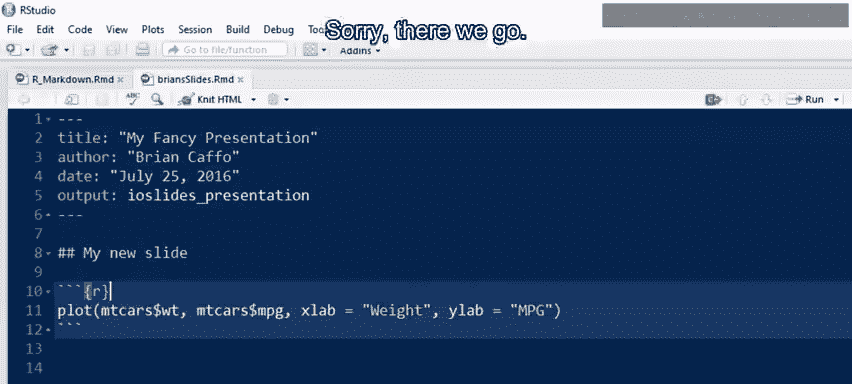

在本节课中，我们将学习如何在R Markdown文档中创建和美化图表，并探索几种将最终生成的HTML演示文稿发布到网络上的方法。

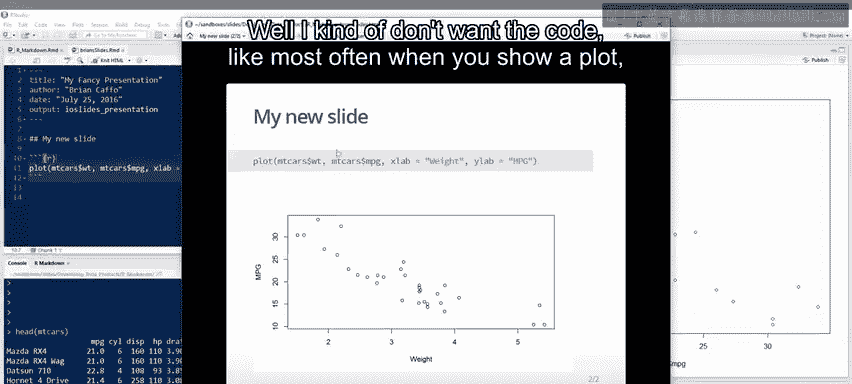

---

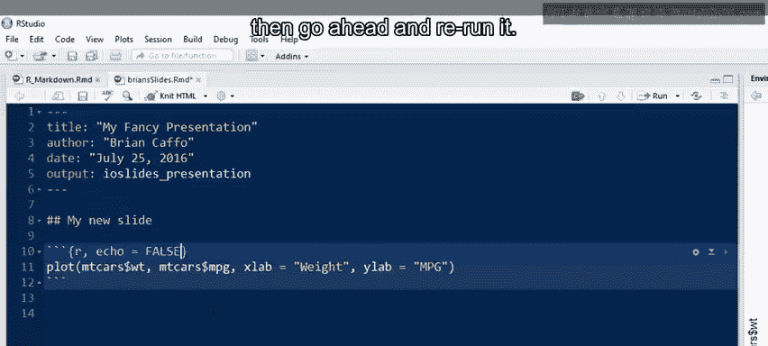

## 创建基础图表 📊

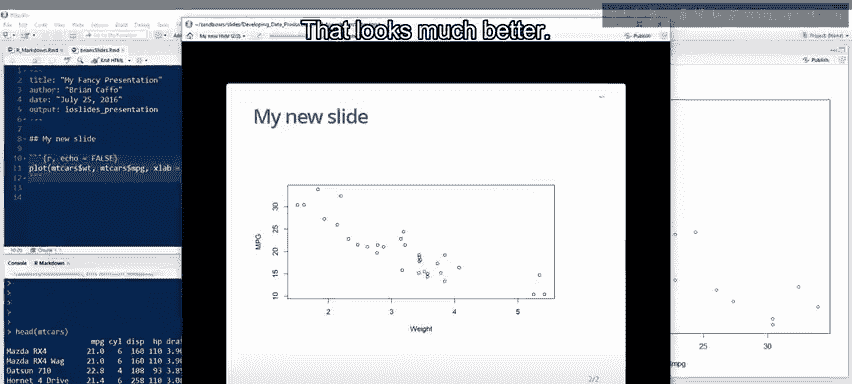

上一节我们介绍了R Markdown的基本语法，本节中我们来看看如何在文档中嵌入并控制R代码生成的图表。

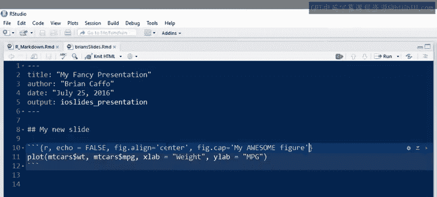

首先，我们创建一个简单的散点图，展示汽车重量与每加仑英里数（油耗）之间的关系。

```r
plot(cars$weight, cars$mpg, xlab = "Weight", ylab = "Miles Per Gallon")
```

运行上述代码会生成图表，但同时也会在最终文档中显示这段R代码。

---

## 控制代码与图表输出 ⚙️

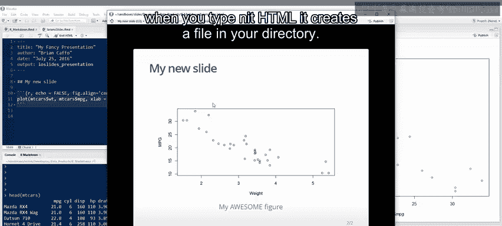

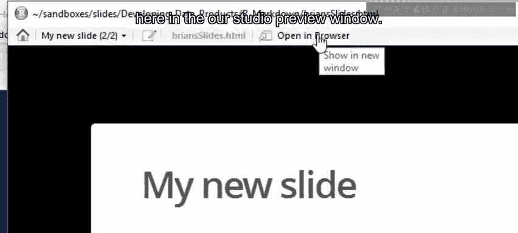

大多数时候，我们希望在最终报告中只展示图表，而不显示生成它的代码。这可以通过设置代码块的 `echo` 参数来实现。

将代码块设置为 `echo = FALSE` 后重新运行，生成的文档将只显示图表，代码本身会被隐藏。

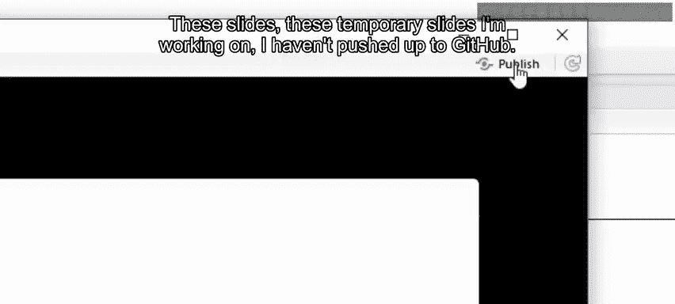

此外，`knitr` 包提供了丰富的图表控制选项。以下是几个常用选项：

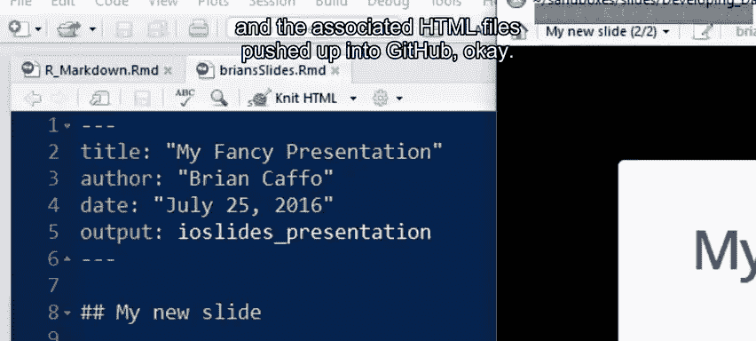

*   **`fig.align`**： 用于控制图表的对齐方式，例如设置为 `"center"` 可使图表居中。
*   **`fig.cap`**： 用于为图表添加标题，例如 `fig.cap = "我的超棒图表"`。
*   **`fig.height`** 与 **`fig.width`**： 用于控制图表的尺寸。

你可以尝试调整这些参数，观察它们对最终输出效果的影响。

---

## 发布你的幻灯片 🌐

当你点击 `Knit to HTML` 后，R Markdown会在你的工作目录中生成一个 `.html` 文件。这个文件可以在任何浏览器中独立打开查看。

以下是几种常见的发布方式：

*   **本地查看**： 直接在文件管理器中双击生成的 `.html` 文件，即可在默认浏览器中打开演示文稿。这对于在无网络环境下（如在飞机上）工作非常方便。
*   **RStudio Publish**： 在RStudio的预览窗口中，点击“Publish”按钮，可以将其发布到 `RPubs` 平台。这是一个简单快捷的在线发布方式。
*   **Dropbox**： 你可以将HTML文件放入Dropbox的公开文件夹，通过分享链接来发布网页。
*   **GitHub Pages**： 这是我最推荐的方式，尤其适合已经使用GitHub进行版本控制的数据科学工作者。它允许你将仓库直接托管为静态网站。

---

## 使用GitHub Pages发布 🔧

GitHub Pages是GitHub提供的一项免费服务，可以将仓库中的特定分支（通常是 `gh-pages` 分支）直接作为网站发布。

操作步骤如下：

1.  确保你的项目仓库中有一个名为 `gh-pages` 的分支。
2.  将你的R Markdown生成的HTML文件（以及其他必要资源）推送到这个分支。
3.  访问页面的URL格式通常为：`https://[你的用户名].github.io/[仓库名]/[文件路径]`。

例如，讲师Sean Cross的课程幻灯片就托管在他的GitHub Pages上。通过访问特定的URL，可以直接在浏览器中浏览渲染好的HTML演示文稿，而不是查看源代码。

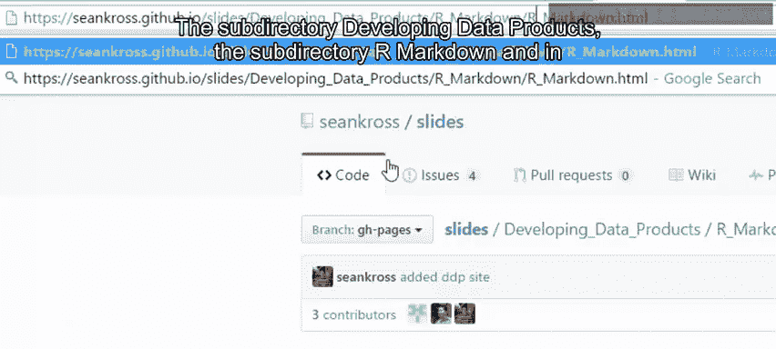

这种方式与我们日常的数据科学工作流（使用Git进行代码管理）完美契合，使得分享和展示成果变得非常顺畅。

---

## 课后练习 💻

为了巩固本节知识，请完成以下练习：

*   在你的R Markdown演示文稿中创建一个图表。
*   尝试使用不同的图表选项（如对齐、标题、尺寸）来美化它。
*   将文档编译为HTML，并在本地浏览器中打开验证。
*   尝试将其发布到 `RPubs` 或 `GitHub Pages`。对于GitHub Pages，如果你遇到困难，可以查阅其官方文档。

掌握这些发布技能至关重要，因为在本课程的最终项目中，你需要使用R Markdown创建项目提案，并希望将其发布到网上供大家查阅。

---

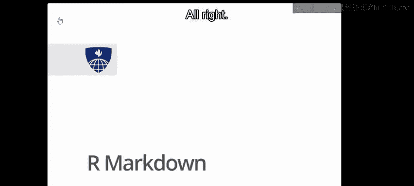

本节课中我们一起学习了如何在R Markdown中控制图表的显示与样式，并掌握了多种将动态文档发布为可共享网页的方法。这些技能是创建和传播数据产品的关键一步。