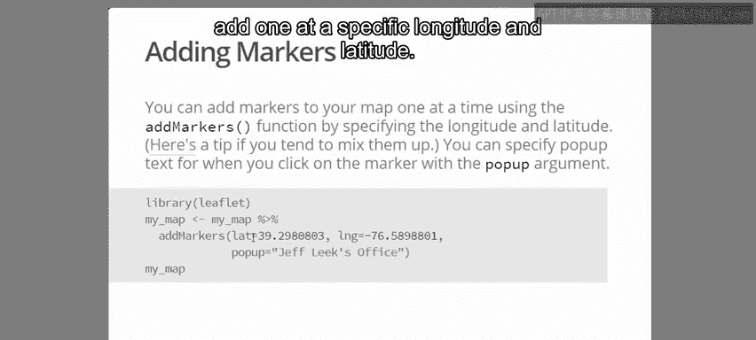
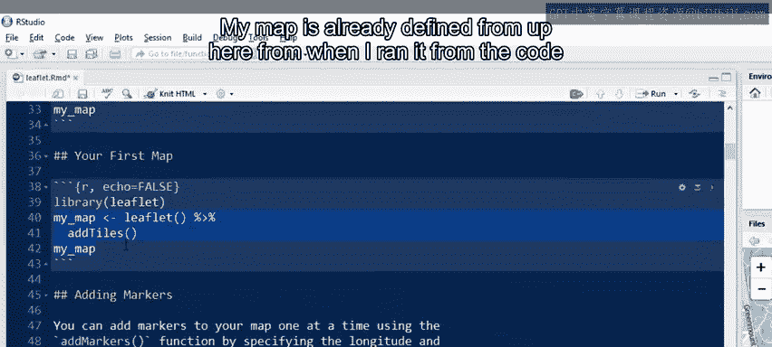
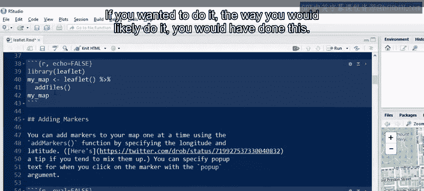

# 033：使用Leaflet创建交互式地图 🗺️

在本节课中，我们将学习如何使用R语言中的`leaflet`包，快速创建交互式地图，并在地图上添加标记点。即使你不熟悉JavaScript，也能轻松生成功能丰富的网页地图组件。

## 概述：创建基础地图

上一节我们介绍了`leaflet`包的基本概念。本节中，我们来看看如何具体创建一个地图并添加交互元素。

`leaflet()`函数可以理解为一个创建地图画布或背景层的工具。之后，我们需要在地图背景上添加具体的内容，例如地图瓦片数据。



以下是创建基础地图的代码：

```r
library(leaflet)
myMap <- leaflet() %>%
  addTiles()
```

这段代码执行了两个操作：
1.  `leaflet()`初始化了一个地图对象。
2.  `addTiles()`从OpenStreetMap添加了默认的地图瓦片数据。

运行后，我们会得到一个可以缩放和移动的交互式地图。

## 为地图添加标记点

仅有基础地图通常不够，我们经常需要在地图的特定位置添加标记点。`leaflet`包提供了简单的方法来实现这一点。

以下是添加一个标记点的代码：



```r
myMap <- myMap %>%
  addMarkers(lng = -76.617, lat = 39.297, popup = "Jeff Leek's office")
```

这段代码的作用是：
*   `lng`和`lat`参数指定了标记点的经度和纬度坐标。
*   `popup`参数定义了点击标记点时弹出的文本内容。

运行代码后，地图上会出现一个标记。点击该标记，会显示“Jeff Leek‘s office”的提示信息。通过缩放地图，我们可以精确定位到约翰霍普金斯大学公共卫生学院的位置。

## 理解管道操作符 `%>%`

你可能注意到代码中使用了`%>%`（管道操作符）。这种写法初看可能有些奇怪，但它能显著简化代码，尤其是在进行一系列链式操作时。

上面的代码等价于以下不使用管道的写法：

```r
myMap <- addMarkers(myMap, lng = -76.617, lat = 39.297, popup = "Jeff Leek's office")
```

管道操作符`%>%`将左侧对象的结果（或值）作为右侧函数的**第一个参数**传递进去。它的优势在于：
*   **提高可读性**：让操作流程从左到右依次呈现，更符合逻辑思维。
*   **避免重复**：无需在每一步都重复输入变量名。
*   **简化复杂操作**：当需要连续添加多个图层、标记或其他元素时，链式管道代码更加清晰简洁。



在`dplyr`等包中广泛使用的管道操作，在`leaflet`中同样适用且推荐使用。从现在起，我们将主要使用管道语法来演示后续的`leaflet`命令。

## 扩展应用：添加多个标记点

`addMarkers()`函数的功能非常直观。基于管道链，第一个参数（地图对象）已自动传递，我们只需专注于提供每个标记点的坐标和弹出信息。

你可以想象，在制作一个复杂地图时，可能需要添加大量标记点。其基本模式如下：

```r
myMap <- myMap %>%
  addMarkers(lng = 经度1, lat = 纬度1, popup = "信息1") %>%
  addMarkers(lng = 经度2, lat = 纬度2, popup = "信息2") %>%
  addMarkers(lng = 经度3, lat = 纬度3, popup = "信息3")
```

通过这种方式，可以轻松地在地图上叠加丰富的信息点。

## 总结

本节课中我们一起学习了：
1.  使用`leaflet()`和`addTiles()`快速创建交互式基础地图。
2.  使用`addMarkers()`函数在地图的指定经纬度位置添加标记点，并设置弹出信息。
3.  理解了管道操作符`%>%`在`leaflet`包中的用法及其优势，它使链式添加多个地图元素的代码更加简洁易读。

通过以上步骤，我们无需编写任何JavaScript代码，就能利用R生成功能完整的网页地图组件。