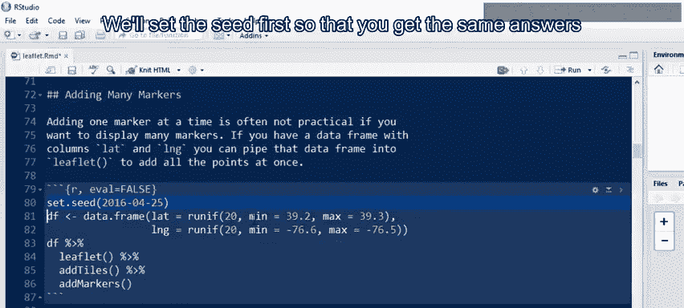
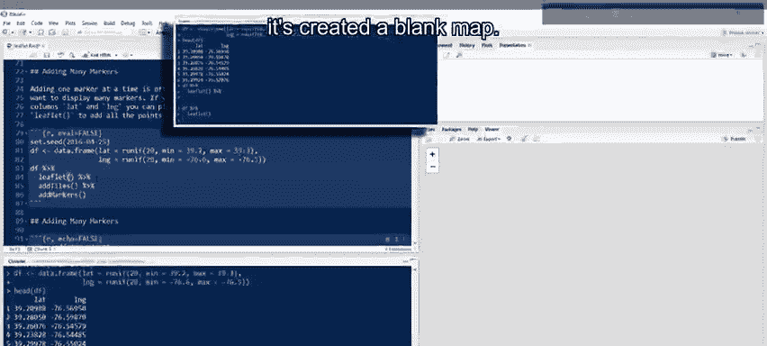
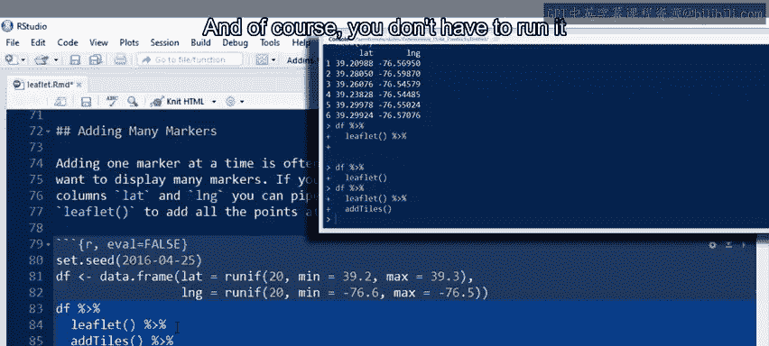

# 034：使用Leaflet批量添加标记 🗺️

在本节课中，我们将学习如何使用Leaflet库批量添加多个标记到地图上。通过一个简单的数据框，我们可以高效地一次性在地图上放置大量位置点。


上一节我们介绍了如何添加单个标记，本节中我们来看看如何批量添加多个标记。

以下是实现批量添加标记的核心步骤。

首先，我们需要创建一个包含经纬度数据的数据框。这里我们使用随机生成的经纬度作为示例。



```r
set.seed(1234)
df <- data.frame(lat = runif(20, min = 39.2, max = 39.3),
                 lng = runif(20, min = -76.6, max = -76.5))
```

这段代码创建了一个名为`df`的数据框，其中包含20个随机生成的经纬度坐标点，分别位于`lat`（纬度）和`lng`（经度）两列中。


接下来，我们将这个数据框传递给`leaflet()`函数来初始化一个地图。

```r
leaflet(df)
```

这行代码会创建一个空白的地图对象，但此时地图上还没有任何底图或标记。


然后，我们使用`addTiles()`函数为地图添加底图图层。

```r
leaflet(df) %>% addTiles()
```

`addTiles()`函数负责引入地图的瓦片数据，即我们看到的街道、地形等背景地图。执行后，我们会得到一个有底图但无标记的地图。


最后，我们使用`addMarkers()`函数将数据框中的所有坐标点作为标记添加到地图上。



```r
leaflet(df) %>% addTiles() %>% addMarkers()
```

`addMarkers()`函数会自动读取传入数据框中的`lat`和`lng`列，并在对应的每个坐标位置放置一个标记。当然，您不需要像演示中那样分步运行代码，完全可以将所有代码一次性运行。


执行完整代码后，您将看到地图上成功添加了所有的标记。




您可以尝试自己动手操作：创建一个包含随机经纬度的数据框，并生成一个带有所有标记的地图。

本节课中我们一起学习了如何使用Leaflet库，通过构建一个包含坐标信息的数据框，来批量地向地图上添加多个标记。这种方法简单高效，是处理大量地理位置数据可视化的基础。