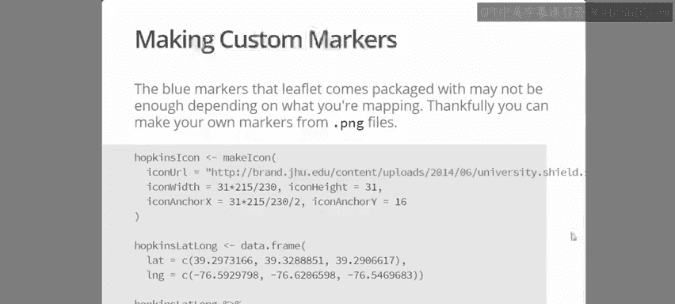
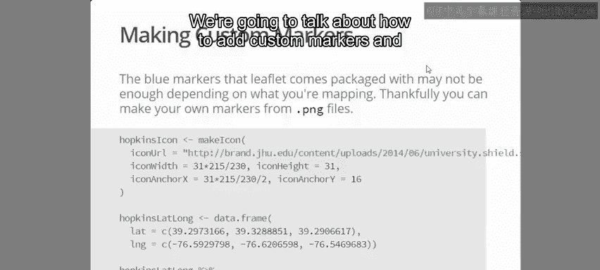
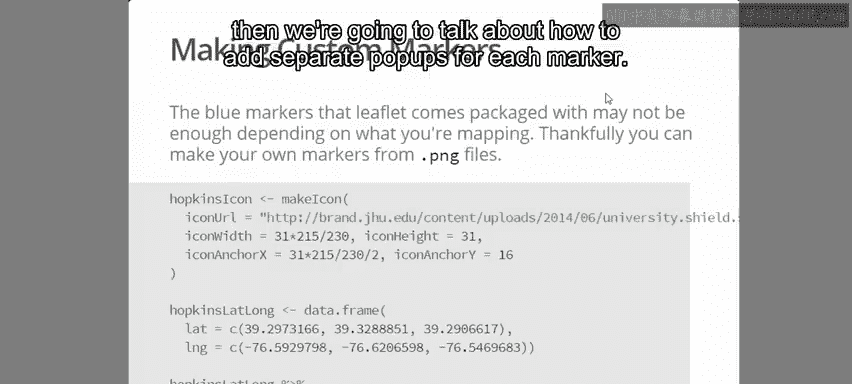

# 035：使用Leaflet添加自定义标记与弹出窗口 🗺️



在本节课程中，我们将学习如何使用Leaflet库在地图上添加自定义标记图标，并为每个标记设置独立的弹出窗口链接。我们将通过一个具体的例子，展示如何将约翰霍普金斯大学的标志作为标记图标，并让每个标记点击后能跳转到对应的官方网站。

## 概述





上一节我们介绍了Leaflet的基础地图绘制功能。本节中，我们来看看如何进一步定制地图标记，使其更具个性化和实用性。我们将重点完成两个任务：第一，将默认的标记图标替换为自定义图标；第二，为每个标记添加一个独立的弹出窗口，其中包含可点击的链接。

## 添加自定义标记图标

首先，我们需要定义并应用一个自定义图标来替换Leaflet的默认标记。以下是实现这一功能的核心步骤。

以下是定义自定义图标并应用到地图上的代码：

```r
# 定义自定义图标（此处以约翰霍普金斯大学徽标为例）
hopkinsIcon <- makeIcon(
  iconUrl = "https://example.com/hopkins_logo.png", # 图标URL
  iconWidth = 30, iconHeight = 30, # 图标尺寸
  iconAnchorX = 15, iconAnchorY = 30 # 图标锚点（与标记点的对齐位置）
)

# 定义一组经纬度坐标（例如霍普金斯大学各建筑位置）
hopkinsLonLat <- data.frame(
  lon = c(-76.6175, -76.6193),
  lat = c(39.3299, 39.3310)
)

# 创建地图并添加自定义标记
leaflet(hopkinsLonLat) %>%
  addTiles() %>%
  addMarkers(icon = hopkinsIcon)
```

运行上述代码后，地图上的标记将不再是默认的蓝色水滴状图标，而是显示为指定的霍普金斯大学徽标。

## 为标记添加独立弹出窗口

成功添加自定义图标后，我们发现点击标记没有任何反应。接下来，我们将为每个标记绑定一个独立的弹出窗口，其中包含可点击的链接。

以下是实现为每个标记添加独立弹出窗口的步骤：

1.  **准备链接数据**：我们需要创建一个文本向量，其中包含与每个经纬度坐标顺序对应的HTML超链接。
2.  **在`addMarkers`函数中指定弹出内容**：使用`popup`参数将上一步准备的链接向量传递给标记。

以下是完整的实现代码示例：

```r
# 定义与坐标对应的网站链接向量
hopkinsSites <- c(
  "<a href='https://peabody.jhu.edu'>Peabody Institute</a>",
  "<a href='https://engineering.jhu.edu'>Whiting School of Engineering</a>"
)

# 创建地图，添加自定义标记和弹出窗口
leaflet(hopkinsLonLat) %>%
  addTiles() %>%
  addMarkers(
    icon = hopkinsIcon,
    popup = hopkinsSites
  )
```

执行这段代码后，地图上的每个标记都附带了弹出窗口。点击标记，会显示一个包含链接的弹出框（例如“Peabody Institute”）。点击该链接，浏览器将跳转到对应的官方网站。

## 总结

本节课中我们一起学习了Leaflet库的两个进阶功能。首先，我们掌握了如何使用`makeIcon()`函数和`addMarkers(icon = ...)`参数来替换默认标记，使用自定义图标增强地图的视觉效果。接着，我们学习了如何通过`addMarkers(popup = ...)`参数为每个标记绑定独立的HTML弹出内容，从而实现了交互式链接功能。结合这两项技术，你可以创建出信息丰富、样式独特且交互性强的定制化地图应用。