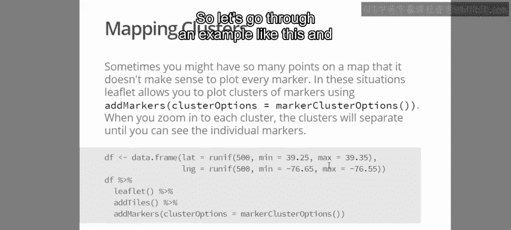
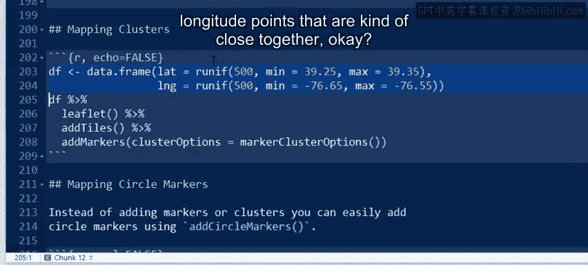
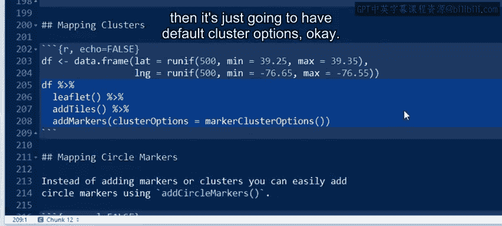

# 036：Leaflet标记聚类与圆形标记 🗺️

在本节课中，我们将学习如何使用Leaflet库处理地图上密集的标记点。当大量标记点聚集在一起时，它们可能难以区分。Leaflet提供了一个优雅的解决方案：标记点聚类。此外，我们还将介绍如何使用圆形标记替代默认标记，以增强可视化效果。

---

## 标记点聚类功能



上一节我们介绍了基础标记的添加方法。本节中，我们来看看如何处理密集的标记点。Leaflet的聚类功能能在不同缩放级别下自动聚合或分散标记，使地图保持清晰可读。

以下是实现标记点聚类的步骤：

1.  创建一个包含500个相近经纬度点的数据框。
2.  将该数据框传递给`leaflet()`函数。
3.  将上一步的结果传递给`addTiles()`函数添加底图。
4.  再将结果传递给`addMarkers()`函数添加标记，此时将自动启用默认的聚类选项。

相关代码如下：
```r
# 创建示例数据框
df <- data.frame(
  lat = runif(500, min = 39.2, max = 39.3),
  lng = runif(500, min = -76.6, max = -76.5)
)

# 创建带聚类功能的地图
leaflet(df) %>%
  addTiles() %>%
  addMarkers()
```
执行代码后，地图上会显示聚合簇。每个簇上会标出该区域内的点数。例如，一个显示“96”的簇表示该处聚集了96个点。





随着地图缩放级别的改变，这些簇会动态地聚合或分散。放大时，大簇会分解成多个小簇或单个标记，从而逐步展示所有500个点。此功能能有效管理大量数据点的显示，避免视觉重叠。

---

## 使用圆形标记

除了聚类标记和标准弹出窗口，Leaflet还允许使用圆形标记。圆形标记能提供不同的视觉样式。

以下是添加圆形标记的方法：

1.  我们创建一个包含20个标记点的数据框。
2.  使用`addCircleMarkers()`函数替代`addMarkers()`函数来添加圆形标记。

相关代码如下：
```r
# 创建少量示例数据
df_circles <- data.frame(
  lat = runif(20, min = 39.2, max = 39.3),
  lng = runif(20, min = -76.6, max = -76.5)
)

# 创建带圆形标记的地图
leaflet(df_circles) %>%
  addTiles() %>%
  addCircleMarkers()
```
地图上将显示为小圆圈而非默认的图钉图标。这为数据可视化提供了另一种风格选择。

---

本节课中我们一起学习了Leaflet的两个实用功能：标记点聚类和圆形标记。标记点聚类通过动态聚合解决了大量点重叠显示的问题，而圆形标记则提供了可替换的视觉表现形式。结合使用这些工具，可以创建出信息丰富且界面清晰的地图数据产品。