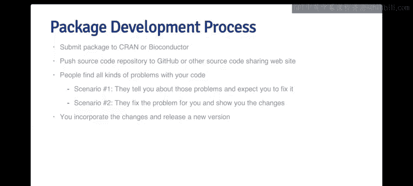

# 038：R包开发（第一部分）📦


在本节课中，我们将学习如何构建R包。R包是分发你开发的统计方法或其他功能的关键产品，也是向其他R用户传播你工作成果的有效方式。

## 什么是R包？🤔

上一节我们介绍了课程目标，本节中我们来看看R包的基本概念。

R包是扩展R基础功能的机制。当你下载R时，会获得一些基础包，例如图形和GR设备包，它们提供了核心功能。然而，基本R发行版不可能包含所有用户可能需要的功能。因此，R提供了名为“包系统”的扩展机制，允许开发者编写函数和其他功能，供其他用户添加到基础R安装中。

一个R包通常是**R函数**或**数据对象**的集合，并与文档等其他元素打包在一起。R包系统的目标是系统化地组织这些内容，确保所有包都具有一致的结构，例如帮助文件总是以相同方式访问。这为用户提供了可预测的体验。

全球开发者已经编写了成千上万个R包。

## 在哪里可以找到R包？🔍

以下是R包的主要来源：

*   **综合R存档网络**：即CRAN，是R包的核心官方仓库。
*   **Bioconductor**：一个包含大量生物信息学和基因组学工具的大型仓库。
*   **源代码共享网站**：例如GitHub、Bitbucket、GitLab。许多包也托管在这些平台上。

从CRAN或Bioconductor安装包，可以使用R自带的 `install.packages()` 函数。你只需指定包名和仓库地址即可。

```r
install.packages("package_name", repos = "https://cloud.r-project.org")
```

从GitHub等平台安装包，可以使用`devtools`包中的`install_github()`函数。

```r
devtools::install_github("username/repository_name")
```

分发R包不一定非要上传到中央仓库，你也可以直接发送文件给他人。但将包放在中央仓库有助于更多人发现和安装它。

## 为什么要制作R包？🎯

你可能会问，既然可以直接发送代码文件，为何要费心制作R包？为他人提供R包具有多项优势。

首先，它是一种结构化的格式，其他R用户能够理解。其次，R包**强制要求编写文档**，这促使你向他人解释函数的使用方法、参数和返回值。第三，它允许你创建定义良好的**API**，明确指定用户应该调用哪些函数，以及哪些内部函数不应被直接访问。这样，你可以隐藏和抽象许多实现细节。未来如果需要修改内部代码，可以在不破坏公开接口的情况下进行。

此外，R包通常更易于维护，因为其结构和文档是必需的。如果你将来无法继续维护，也可以将其移交给他人，既有的结构将为他们提供便利。最后，通过CRAN等平台发布的包需要通过一系列检查，这为用户提供了一定的可靠性和稳健性保证，让他们对包的质量更有信心。

## R包开发的基本流程 🔄

R包的开发流程通常包含以下几个环节，不同开发者的具体实践可能略有不同。

通常，你首先会在R脚本或文件中编写一些R代码，定义函数并进行调试和测试。当你觉得这些代码对自己非常有用，或者希望以更结构化的方式保存项目成果时，就可能决定将其制作成R包。

接下来，你需要将编写好的R代码整合到R包的结构中。然后，为面向用户的公共函数编写文档。之后，你还可以考虑添加其他材料，例如示例、演示、数据集、教程或“小插图”。

完成以上步骤后，你就可以将所有这些内容打包，生成你的R包。

## 发布与维护 📤

拥有R包后，你可以选择仅在自己系统上安装，或通过邮件分享给朋友。但更常见的做法是将其提交到CRAN或Bioconductor等仓库，或者将源代码推送到GitHub等代码共享网站，以便他人查看和修改。

将包公开后，你可能会遇到两种情况。第一种是其他用户使用你的代码，报告遇到的问题，并期望你进行修复。第二种可能是他们直接查看你的代码，发现问题并自行修复，然后向你展示修改建议。无论是哪种情况，让其他用户查看你的代码都有助于你改进它，这是公开代码的一大益处。

在采纳了这些修改和修复后，你可以发布包的新版本。

---



本节课中我们一起学习了R包的基本概念、优势、开发流程以及发布维护的要点。R包是封装和分享R代码成果的强大工具，掌握其开发方法对于创建可重用、可维护且易于分发的数据产品至关重要。