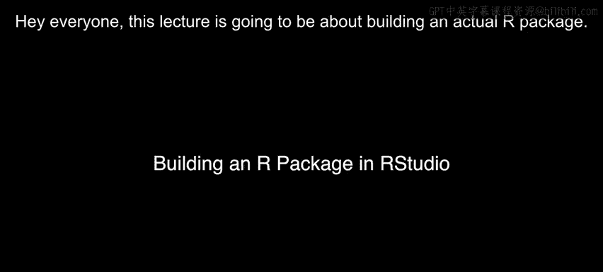
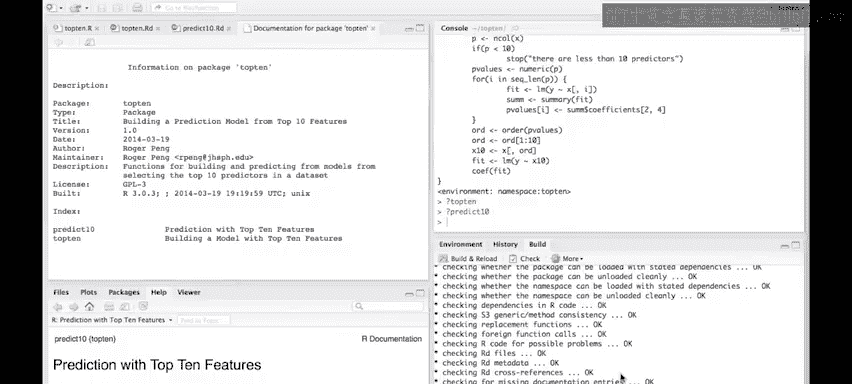

# 040：构建R包演示 📦



在本节课中，我们将学习如何从头开始构建一个完整的R包。我们将通过一个具体的演示，展示如何将包的所有组件（如代码、文档、描述文件等）组合在一起，并利用RStudio提供的便捷工具来简化整个过程。

---

## 概述

我们将构建一个名为 `top10` 的简单R包。这个包的核心功能是：对于一个高维数据集，通过拟合单变量回归模型，筛选出与响应变量关联最强的10个预测变量，然后使用这10个变量构建最终的预测模型。包内将包含两个主要函数：`top10`（用于构建模型）和 `predict10`（用于进行预测）。

---

## 启动项目与创建文件

首先，我们需要在RStudio中创建一个新的项目。在菜单栏选择 **File -> New Project**，然后选择 **New Directory** 和 **R Package**。我们将项目命名为 `top10` 并创建。

创建后，RStudio会自动生成包的基本骨架文件，包括 `DESCRIPTION`、`NAMESPACE` 和一个空的 `R/` 目录。

接下来，我们编辑 `DESCRIPTION` 文件，填写包的基本信息：

```
Package: top10
Title: Building a Prediction Model From the Top 10 Features
Version: 1.0
Author: Your Name
Maintainer: Your Name <your.email@example.com>
Description: Building and predicting from models by selecting the top 10 predictors in data.
License: GPL-3
```

---

## 编写核心函数

上一节我们设置了包的基本信息，本节中我们来看看如何编写包的核心功能代码。我们将创建两个函数，并保存在 `R/` 目录下的一个R脚本文件中。

以下是 `top10` 函数的代码，它用于从所有预测变量中筛选出最重要的10个并拟合模型：

```r
top10 <- function(x, y) {
    p <- ncol(x)
    if(p < 10)
        stop("There are less than 10 predictors")
    pvalues <- numeric(p)
    for(i in 1:p) {
        fit <- lm(y ~ x[, i])
        summ <- summary(fit)
        pvalues[i] <- summ$coefficients[2, 4]
    }
    ord <- order(pvalues)
    ord10 <- ord[1:10]
    x10 <- x[, ord10]
    fit <- lm(y ~ x10)
    coef(fit)
}
```

接下来是 `predict10` 函数，它使用 `top10` 函数得到的模型系数对新数据进行预测：

```r
predict10 <- function(x, b) {
    x <- cbind(1, x)
    drop(x %*% b)
}
```

---

## 使用roxygen2添加文档

我们已经编写了核心函数，但一个完整的R包还需要详细的文档。本节中我们将使用 `roxygen2` 包直接在代码文件中编写文档，它会自动生成帮助手册（man pages）和 `NAMESPACE` 文件。

以下是为 `top10` 函数添加的文档注释：

```r
#' Building a Model with Top 10 Features
#'
#' This function develops a prediction algorithm based on the top 10 features in X that are most predictive of Y.
#'
#' @param x An n by p matrix of n observations and p predictors.
#' @param y A vector of length n representing the response.
#'
#' @return A vector of coefficients from the final fitted model with the top 10 features.
#'
#' @details This function runs a univariate regression of y on each predictor in x, calculates the p-values for the significance of the association, and selects the final set of 10 predictors from the 10 smallest p-values.
#'
#' @author Your Name
#' @seealso \code{\link{lm}}
#' @export
#' @importFrom stats lm
top10 <- function(x, y) {
    # ... 函数体代码
}
```

以下是为 `predict10` 函数添加的文档注释：

```r
#' Prediction with the Top 10 Features
#'
#' This function takes a set of coefficients produced by the \code{top10} function and makes a prediction for each of the values provided in the input x matrix.
#'
#' @param x An n by 10 matrix containing n new observations.
#' @param b A vector of coefficients obtained from the \code{top10} function.
#'
#' @return A numeric vector containing the predicted values.
#'
#' @export
predict10 <- function(x, b) {
    # ... 函数体代码
}
```

---

## 构建与检查包

现在，我们已经完成了代码和文档的编写。本节中我们来看看如何使用RStudio的工具来构建、加载并检查我们的包。

1.  在RStudio中，转到 **Build** 标签页。
2.  点击 **Configure Build Tools**，确保勾选了 **Generate documentation with Roxygen** 选项，并选择在构建时重新生成NAMESPACE和手册页。
3.  点击 **Build & Reload**。RStudio会编译包并将其加载到当前会话中。
4.  构建完成后，你可以在 `man/` 目录下看到自动生成的 `.Rd` 帮助文件。
5.  要检查包是否符合CRAN标准，可以点击 **Check** 按钮。如果所有测试通过，说明包的结构和代码是规范的。

构建成功后，你可以像使用其他R包一样使用它：

```r
library(top10)
?top10
?predict10
```

---



## 总结

本节课中我们一起学习了构建一个完整R包的完整流程。我们从创建一个新的R包项目开始，编写了核心功能函数，使用 `roxygen2` 语法为函数添加了内联文档，最后利用RStudio的构建工具完成了包的编译、加载和检查。虽然我们构建的 `top10` 包功能简单，但这个流程适用于任何规模的R包开发。掌握这些步骤后，你就可以将自己的R代码组织成可分发、可重用的专业工具包了。