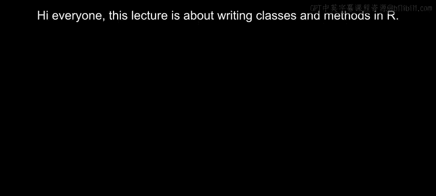
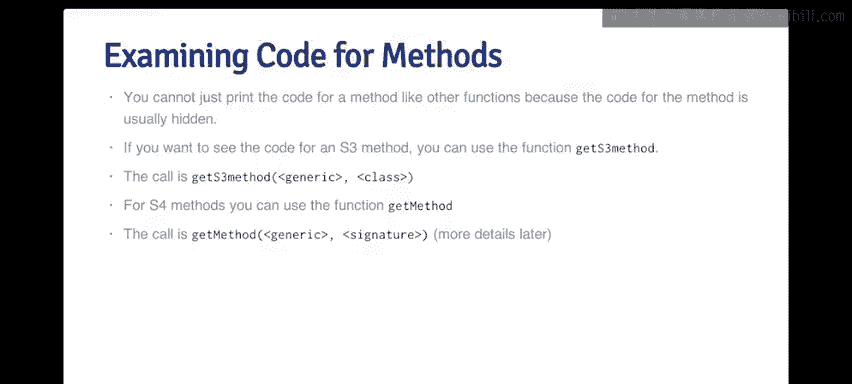

# 041：R语言中的类与方法（第一部分）📊



在本节课中，我们将学习如何在R语言中编写类和方法。R语言中的类与方法系统是其面向对象编程的核心，它允许我们定义新的数据类型，并为这些类型创建特定的操作函数。通过掌握这一系统，你可以从R语言的使用者转变为开发者，从而扩展R语言的功能以应对新的数据分析需求。

## 概述：什么是类与方法？🤔

R语言中编写类和方法的基本思想，是为了表示R语言默认不支持的、新型的数据或数据类型。例如，列表（list）是R语言固有的基本数据类型，R内置了许多可以操作列表的函数和流程。然而，当一个新的领域出现并产生了其自身特有的数据时，R的原始设计者可能并未预见到这种情况。此时，你就需要开发新的数据结构来支持这类数据，并创建一系列新的函数来操作这种数据类型。这就是在R中编写类和方法的核心理念：让R系统能够适应并支持不断出现的新数据类型和数据结构。

## R中的面向对象编程系统 🏗️

R语言中的类与方法系统本质上是一个面向对象编程（OOP）系统。多年前R语言刚出现时，它是一个非常有趣的语言，因为它既是一个交互式系统，又支持一种形式化的面向对象机制。当时许多其他语言，如C++和Java，虽然拥有非常完善的面向对象编程基础设施，但通常不被认为是交互式语言。那些语言需要你编写程序、编译然后运行，而不是像在R中那样，可以在命令行中逐条输入并执行命令。

R语言中支持类与方法开发的大量代码是由John Chambers本人编写的，他也是S语言的创造者，并编写了R系统中的许多代码。这些基本思想记录在他的著作《Programming with Data》中。

R语言中类与方法系统的理念，是让人们能够从使用者过渡到程序员。正如我在R编程课程中提到的R语言基本概述，John Chambers最初对S语言的设想是：人们从使用者开始，随着对语言的熟悉，他们会逐渐尝试为自己定制系统，从而转变为程序员。R语言秉承了相同的基本哲学：人们可以从执行函数的用户开始，随着需求的增长并超出R系统的现有功能时，他们可以成为程序员，在R中开发新事物。这正是类与方法的基础。

## R中两种类与方法风格 📜

R语言中基本上有两种风格的类与方法，这是历史发展的结果。一种是较旧的风格，另一种是较新的风格。

*   **S3类与方法**：有时我们称旧风格为S3类与方法，这对应于S语言的第3版。这些类和方法是非正式的，有些笨拙，形式上也不够严谨，但它们能完成任务且效果很好。你在R中使用的许多基本函数都建立在S3类与方法之上，因此我们知道它们非常有用，并且在短期内不会消失。
*   **S4类与方法**：更正式、更严谨的系统通常被称为S4系统，因为它随S语言第4版而来，并在2001年12月发布的R 1.4.0版本中引入。这些有时被称为新式类与方法。对于新项目，通常鼓励人们在开发新类型的类与方法时使用S4系统。

在可预见的未来，这两种系统将并存，这主要是由于R的历史以及大量内置功能是用S3编写的。但S3和S4系统是独立的，意味着在编程新事物时通常不会混合使用它们。开发者被鼓励使用S4风格的类与方法（例如在Bioconductor项目中广泛使用）。不过，S3类与方法有时也很有用，因为它们快速、简单，更容易编程，对于短期项目，你可能倾向于先构建一些S3类与方法。本节课我们将主要讨论S4系统的开发，但也会简要介绍S3系统，以便你熟悉它。

## 基础概念与实现包 📦

需要了解的重要一点是，R中所有面向对象系统（针对S4类与方法）的实现都在 **`methods`** 包中。`methods`包通常默认加载。如果你从全新安装启动R，`methods`包通常已被加载。如果没有，你总是可以通过调用 `library(methods)` 来加载它。

在R中编程时，基本思想是你拥有**类**和**方法**。

*   **类**：是对某事物的描述，通常是一些新事物，如新的数据类型或新概念。可以使用`methods`包中的`setClass`函数来定义类。
*   **对象**：是类的实例。可以使用`new`函数创建对象，尽管也常通过其他类型的函数创建。
*   **方法**：是操作特定类别对象的函数。方法是针对特定类的函数。
*   **泛型函数**：是一个R函数，它负责**派发**方法。泛型函数通常试图封装一个通用的概念。例如，`plot`函数就是其中之一，可能是最常用的泛型函数。绘图是一个相当通用的概念，而如何绘图可能取决于你正在绘制的数据类型。因此，有许多不同的绘图方法可以应用于不同的数据类型。`plot`函数的任务是查看数据类型，并为这些不同的数据类型派发特定的方法。**泛型函数本身不执行任何计算或工作，它的主要工作是派发方法**。

因此，**方法**是泛型函数针对特定类别对象的实现。基本概念就是：类、对象、方法和泛型函数。

## 查看与探索类与方法 🔍

在学习这个系统的过程中，`methods`包中的许多帮助文件可能会派上用场。主要文档在帮助文件中，你可以查看`?class`、`?Methods`的帮助页面，也可以查看`?setClass`、`?setMethod`和`?setGeneric`的帮助页面。其中一些内容非常技术性，你现在可能只想浏览一下，但随着你学习这个系统，将来会更容易理解。

R中的每个对象都有一个类，该对象的类可以通过`class`函数确定。

```r
class(1)        # 输出: "numeric"
class(TRUE)     # 输出: "logical"
class(rnorm(10))# 输出: "numeric"
class(NA)       # 输出: "logical" (默认，但也可以是numeric等)
class("hello")  # 输出: "character"
```

这些都是相当直接的**原子类**。但你可以超越原子类，例如，我可以拟合一个线性模型，`lm`函数的输出是一个`lm`类。拟合线性模型的输出不是你认为是标准数据类型（如数值型、整型或字符型）的东西，但它是一种数据类型，其中封装了某些概念（如果你熟悉统计学的话）。因此，它可能值得拥有自己的数据类型，所以我们称之为`lm`数据类型或类。这就是R中类背后的思想。

泛型和方法是你将编写的、用于为某些类型的类实现功能的函数。S4和S3风格的泛型函数看起来不同，但它们在概念上是相同的，扮演着相同的角色。在编程时，你可以为现有的泛型编写新方法（例如，可能已经存在像`plot`这样的泛型，然后你为一种新的数据类型编写一个新方法）。但也可能需要创建新的泛型（例如，你可能为执行新操作创建一个新的泛型函数，然后必须为给定的数据类型编写该泛型及其方法）。

以下是一些泛型函数的例子，这些是S3泛型函数，可能是你已经见过的函数。

```r
mean
print
```

当你打印出这些函数时，几乎看不到与之相关的代码。`mean`函数中唯一的代码是`UseMethod("mean")`，类似地，对于`print`泛型函数，你只看到`UseMethod("print")`。基本思想是，这些泛型函数的工作是为传递给它们的任何数据类型找到一个合适的方法。

你可以通过调用`methods`函数来查看`mean`泛型函数有哪些可用方法。

```r
methods(mean)
```

随着你在R环境中加载包，这些包可能会为`mean`添加方法。因此，在你使用R的过程中，可用于`mean`函数的方法集合可能会随时间变化，这个列表会随着你加载更多包而增长。

这是一个S4泛型函数的例子，它来自`methods`包，叫做`show`，相当于`print`的S4版本。当你打印`show`函数的主体时，会看到更多内容被打印出来，但基本思想是一样的。`show`的代码是`standardGeneric("show")`，然后它会尝试识别传递给它的对象的类，接着派发适当的方法。在R中，大多数时候你不需要调用`show`函数或`print`函数，因为对象会在命令行自动打印。

你可以查看与`show`泛型函数关联的方法。

```r
methods(show)
```

## 泛型函数与方法的交互机制 ⚙️

泛型函数与方法相互作用的基本机制如下：

1.  任何泛型函数的**第一个参数**都是一个特定类的对象（可能还有其他参数，但第一个参数很重要）。
2.  流程的工作方式是：泛型函数将检查该对象的类（尝试识别类）。泛型函数本质上会进行搜索，看看是否有针对该类的特定方法。
3.  **如果存在针对该类的方法**，那么它将在该对象上调用该方法，然后泛型函数的工作就完成了，方法将完成其余的工作。
4.  **如果没有针对该类的方法**，那么泛型搜索将查看是否存在**默认方法**（一种如果没有其他更具体类型的方法时总是被应用的“兜底”方法）。
5.  如果存在默认方法，则调用默认方法，然后它完成所有工作。
6.  如果没有默认方法，则会出现错误，因为泛型函数不知道要调用什么，并且没有默认方法，所以它自己无法做任何事情。

很多时候，你可能想查看方法的代码，但重要的是要知道，通常不可能像打印任何其他函数的代码那样打印方法函数的代码。对于一些不是泛型或方法的函数，你只需在命令行中输入函数名，就能看到函数体并查看代码。但对于S3或S4方法，情况并非总是如此。因此，查看方法代码的适当方式是使用`getS3method`函数（针对S3泛型方法）或`getMethod`函数（针对S4）。基本思想是，你向这个函数传递两个参数：第一个参数是泛型的名称，第二个参数是对象的类。

## 总结 📝



本节课我们一起学习了R语言中类与方法的基础知识。我们了解了为什么需要类与方法系统（为了支持新的数据类型），认识了R中两种主要的类与方法风格（S3和S4），并掌握了核心概念：**类**是数据类型的蓝图，**对象**是类的具体实例，**方法**是操作特定类对象的函数，而**泛型函数**则负责根据对象类型派发正确的方法。我们还学习了如何查看对象的类、探索可用的方法，以及泛型函数与方法交互的基本机制。理解这些概念是成为R语言高级用户和开发者的关键一步，它使你能够扩展R语言，以解决更专业、更独特的数据分析问题。