# 043：使用Swirlify创建Swirl课程 🎓

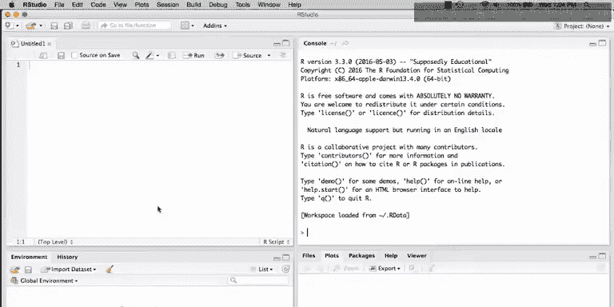

在本节课中，我们将学习如何使用 **Swirlify** 包来创建自己的 **Swirl** 交互式课程。Swirl是一个R语言包，它能将R控制台转变为交互式学习环境。通过本教程，你将掌握创建自定义课程和课程内容的基础步骤。

---

## Swirl简介与快速体验

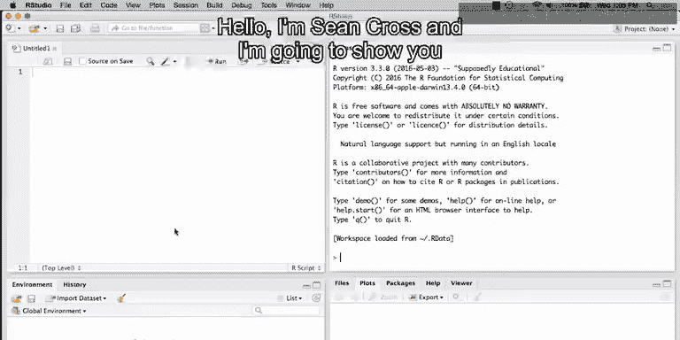

上一节我们提到了Swirl的基本概念，本节中我们来实际体验一下它的工作方式。

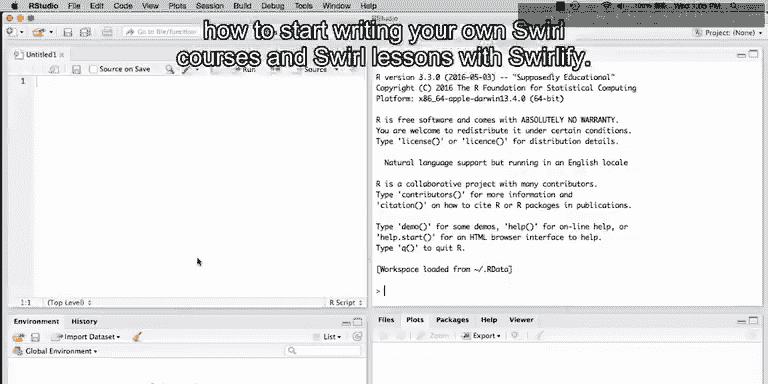

如果你之前没有使用过Swirl，以下是一个简短的演示。

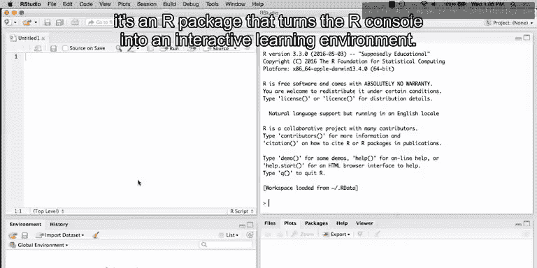

首先，加载Swirl包并启动它。

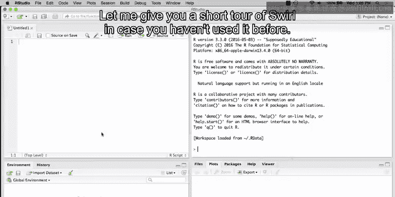

```r
library(swirl)
swirl()
```

启动后，R控制台会开始与你对话，并询问你的名字。例如，你可以输入“Sean”。

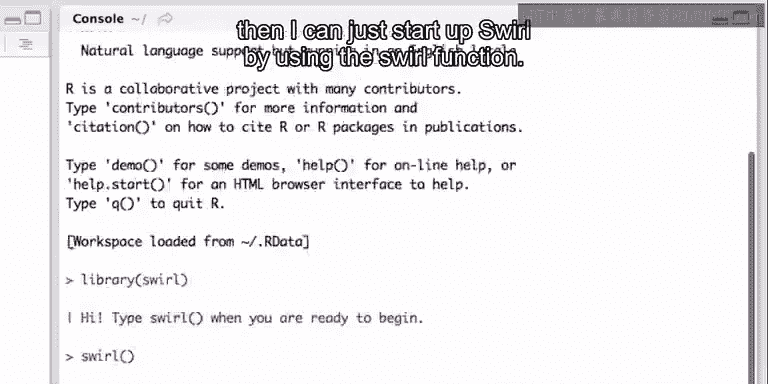

接着，系统会提供一个课程列表供你选择。你可以选择“R Programming”课程，然后在该课程中选择第一课“Basic Building Blocks”。

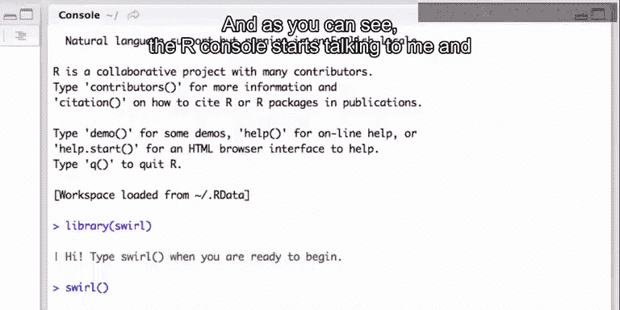

进入课程后，Swirl会显示一些介绍文本，然后提出第一个问题。例如，它可能要求你输入 `5 + 7`。

```r
> 5 + 7
[1] 12
```

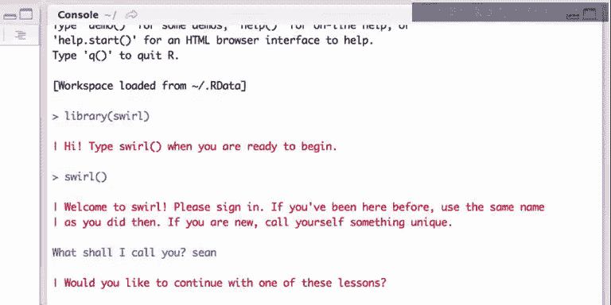

回答正确后，Swirl会继续提出下一个问题。例如，它可能要求你将 `5 + 7` 的结果赋值给变量 `x`。

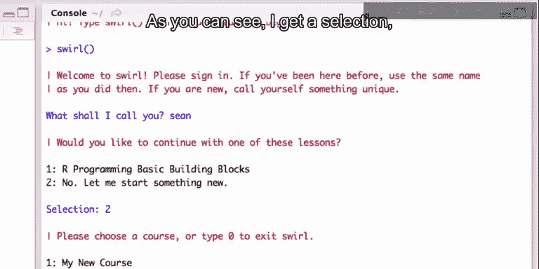

```r
> x <- 5 + 7
```

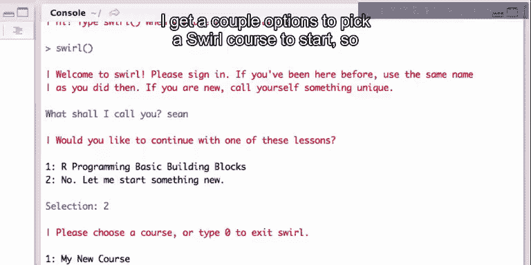

如果你输入了错误的答案，例如 `x <- 5 + 8`，Swirl会提示你答案不正确，并给出一个提示，引导你输入正确的表达式 `5 + 7`。

Swirl可以提出多种类型的问题。以上只是一个简短的介绍。现在，我们可以按 `Esc` 键退出当前课程。

---

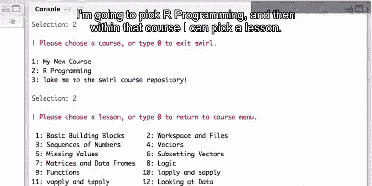

## 使用Swirlify创建课程

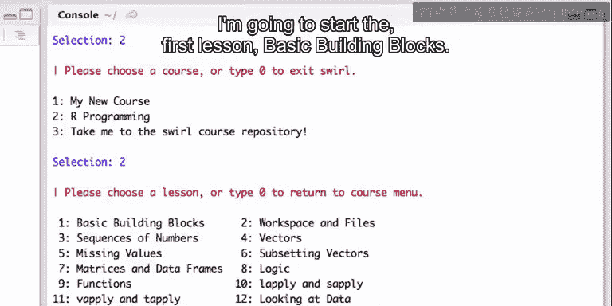

上一节我们体验了Swirl的基本功能，本节中我们来看看如何使用 **Swirlify** 包来创建自己的课程。

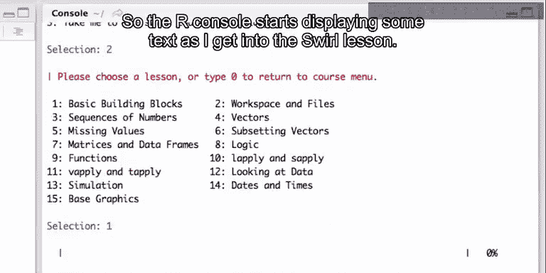

Swirlify是一个专门用于编写和测试Swirl课程内容的R包。以下是开始创建课程的基本步骤。

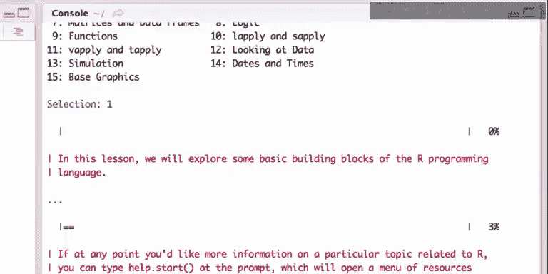

首先，你需要安装并加载Swirlify包。

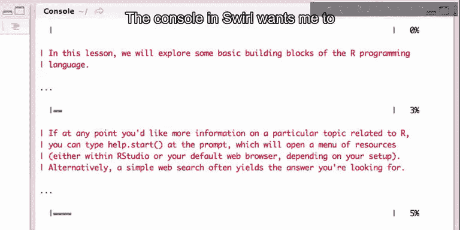

```r
install.packages("swirlify")
library(swirlify)
```

加载完成后，你可以使用 `new_lesson` 函数来创建一个新课程。这个函数会引导你设置课程名称、课程标题等基本信息。

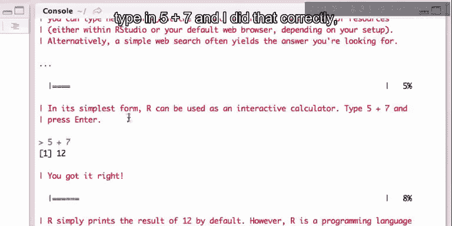

```r
new_lesson("我的第一课", "我的Swirl课程")
```

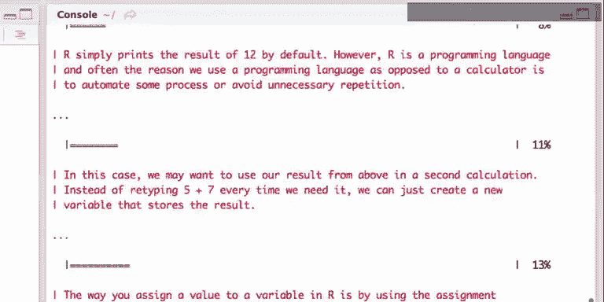

创建课程后，Swirlify会在你的工作目录中生成一个包含课程所有必要文件的文件夹结构。主要文件包括：
*   `lesson.yaml`: 课程的核心配置文件，定义了课程的结构、问题和答案。
*   各个问题脚本文件：通常以数字序号命名，包含具体的问题文本、答案和提示。

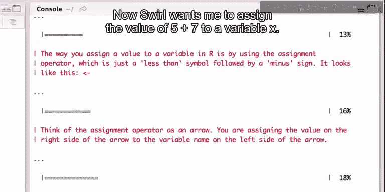

课程的核心逻辑都定义在 `lesson.yaml` 文件中。你需要编辑这个文件来添加课程内容。以下是一个简单的 `lesson.yaml` 文件结构示例：

```yaml
- Class: meta
  Course: 我的Swirl课程
  Lesson: 我的第一课
  Author: 你的名字
  Type: Standard
  Output: 控制台

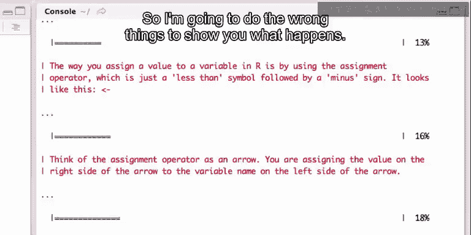

- Class: text
  Output: 欢迎来到我的第一课！我们将学习基础操作。

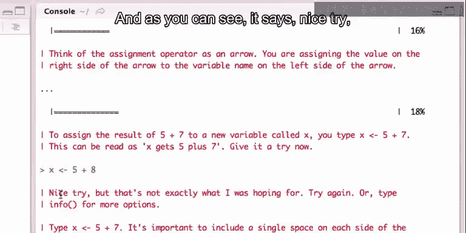

- Class: cmd_question
  Output: 请计算 3 乘以 4 的结果。
  CorrectAnswer: 12
  AnswerTests: omnitest(correctExpr='3 * 4')
  Hint: 使用乘法运算符 *。
```

在上面的示例中：
*   `Class: text` 表示这是一个纯文本信息块。
*   `Class: cmd_question` 表示这是一个需要学生在控制台输入命令的问题。
*   `CorrectAnswer` 定义了正确答案。
*   `AnswerTests` 定义了如何检测学生的答案是否正确。`omnitest` 是一个常用的测试函数。
*   `Hint` 是当学生回答错误时显示的提示信息。

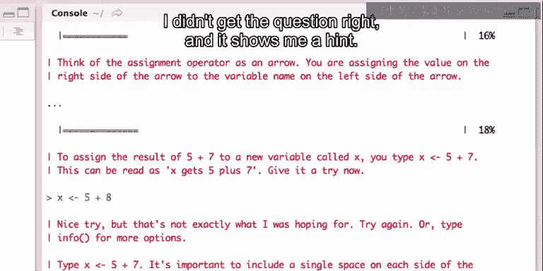

编写完课程内容后，你可以使用 `test_lesson` 函数在Swirl环境中测试你的课程，确保所有问题都能正常工作。

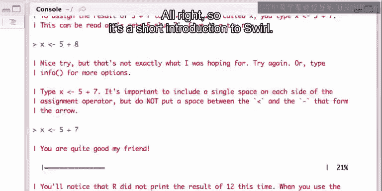

```r
test_lesson()
```

测试无误后，你就可以让学生通过 `swirl()` 函数来学习你创建的课程了。

---

## 总结

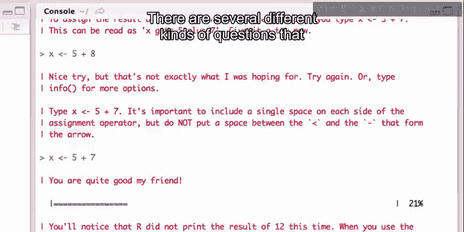

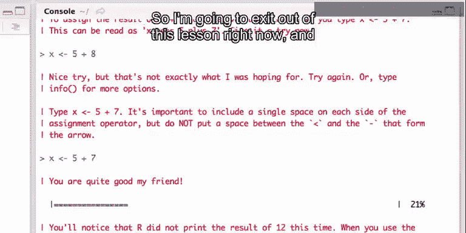

本节课中，我们一起学习了如何创建自定义的Swirl交互式课程。

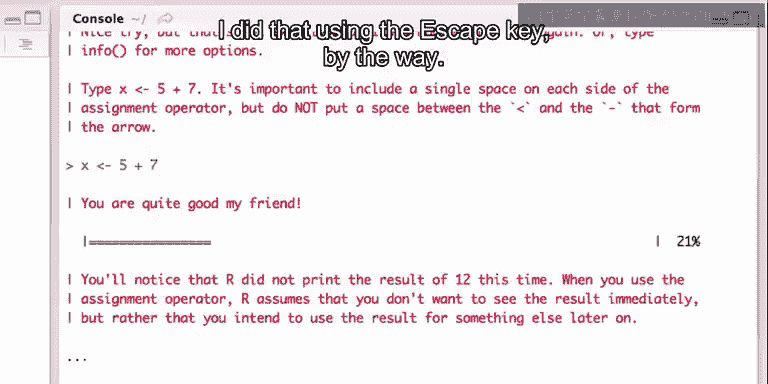

我们首先快速体验了Swirl作为R语言交互学习环境的基本工作流程。接着，我们重点介绍了 **Swirlify** 包，它是创建Swirl课程的核心工具。我们学习了从安装包、创建新课程、编辑核心的 `lesson.yaml` 配置文件到测试课程的完整步骤。

通过掌握这些知识，你现在可以开始为你的学生或团队成员创建量身定制的R语言学习材料了。