# 045：创建更复杂的Swirl课程问题类型 🧩


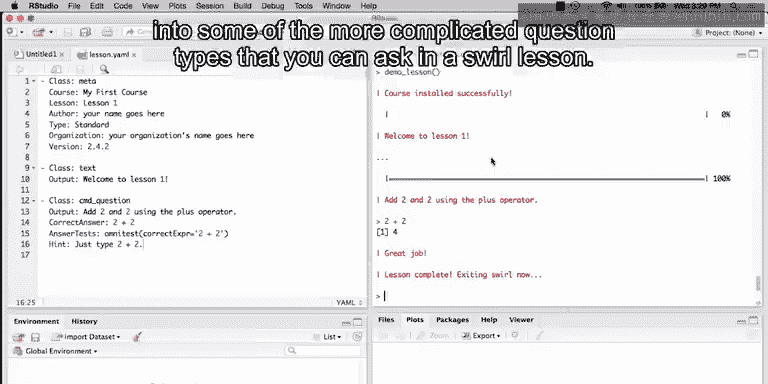


在本节课中，我们将学习如何在Swirl课程中创建更复杂的问题类型，包括多选题和图形题。我们将从创建新课程开始，逐步探索这些高级功能。

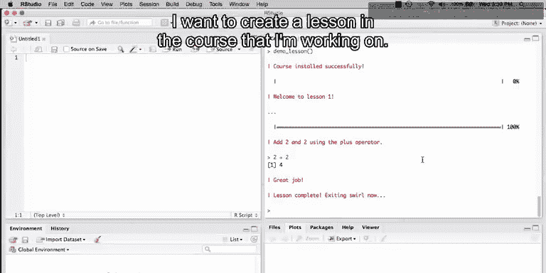

上一节我们创建并测试了第一个简单的Swirl课程。本节中，我们来看看如何创建包含多选题和图形题等更复杂交互的课程。


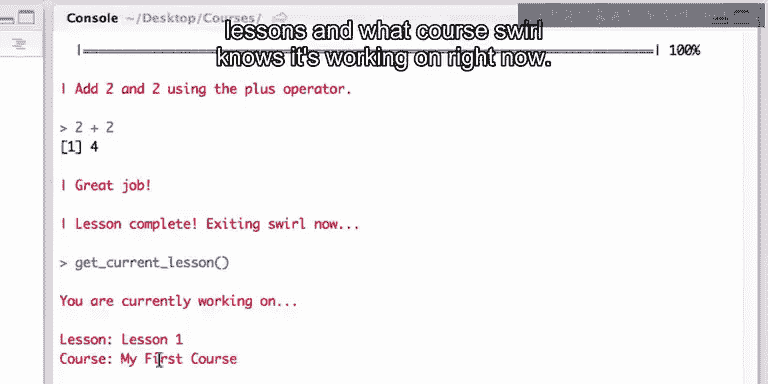

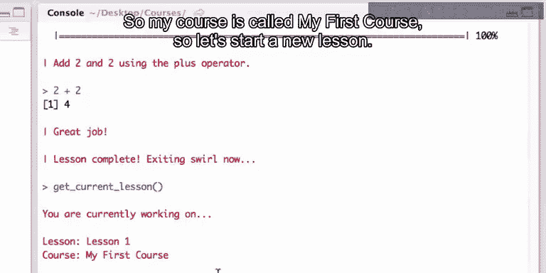

## 创建新课程

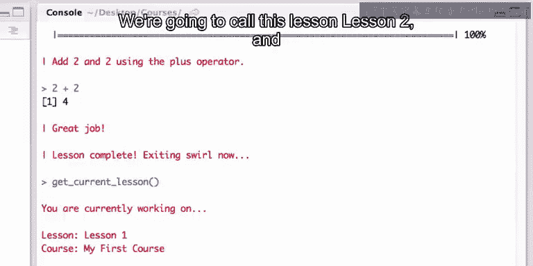


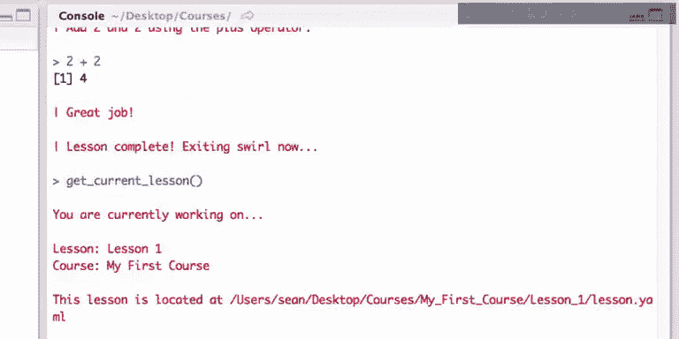

首先，我们需要创建一个新的课程。使用 `get_current_lesson()` 函数可以查看当前正在工作的课程信息。

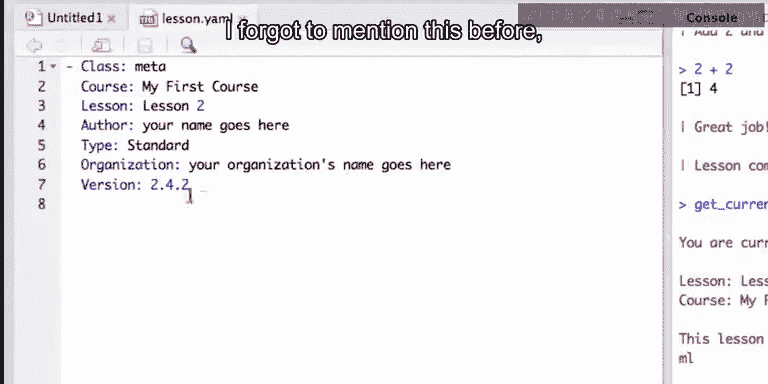


```r
get_current_lesson()
```

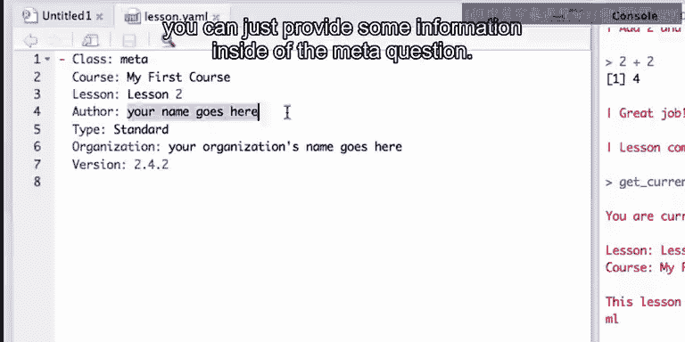

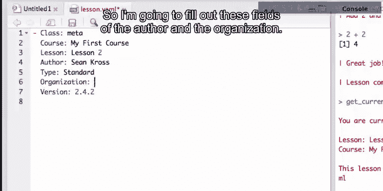

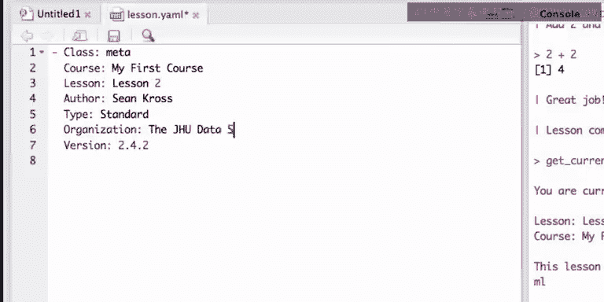

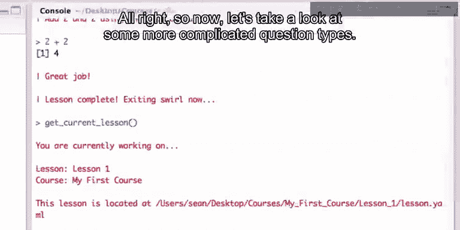

结果显示当前课程名为“my first course”。接下来，我们在这个课程下创建一个名为“lesson 2”的新课程。


## 元问题

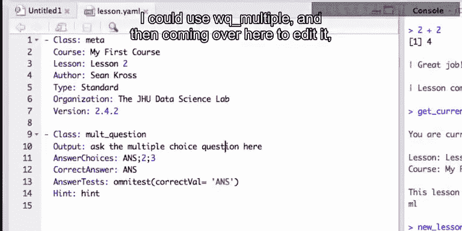

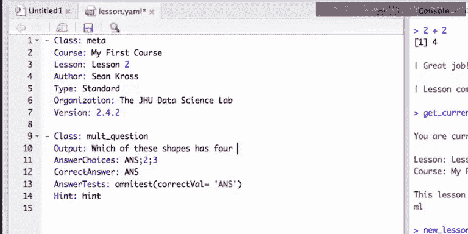


每个Swirl课程的第一个问题被称为“元问题”。学生看不到这个问题，但开发者可以在这里填写课程的作者和组织等信息。


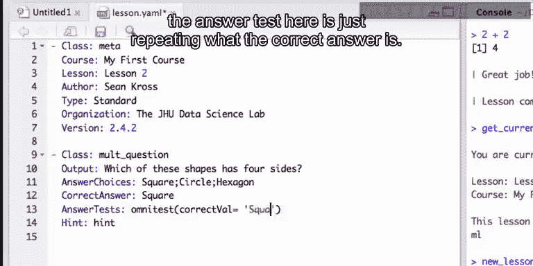

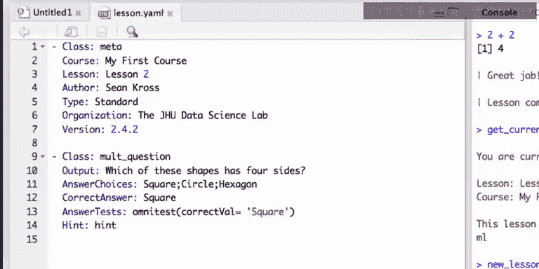

## 创建多选题


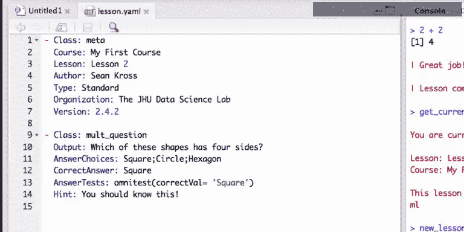


现在，让我们创建一个多选题。在R控制台中使用 `wq_multiple()` 函数可以添加一个多选题模板。


以下是创建多选题的步骤：

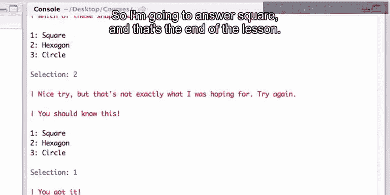

1.  在编辑器中，输入问题文本，例如：“Which of these shapes has four sides?”
2.  用分号分隔不同的选项。
3.  指定正确答案。
4.  在“答案测试”字段中重复正确答案。
5.  可以提供一个提示。


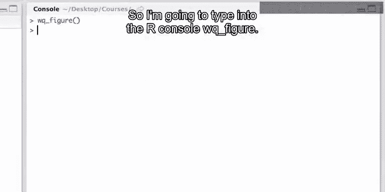


例如，一个完整的多选题配置如下：
*   **问题**：`Which of these shapes has four sides?`
*   **选项**：`circle; square; triangle`
*   **正确答案**：`square`
*   **答案测试**：`omnitest(correctVal='square')`
*   **提示**：`Think about the number of sides each shape has.`

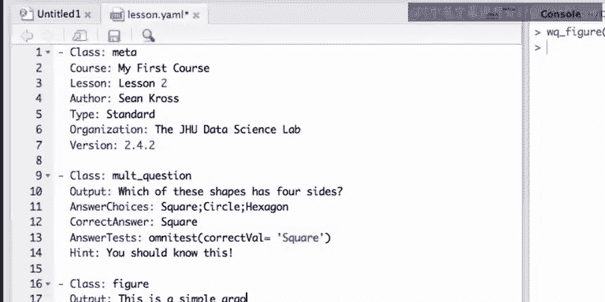

添加课程到清单并运行 `test_lesson()` 确保没有错误后，可以使用 `demo_lesson()` 进行测试。


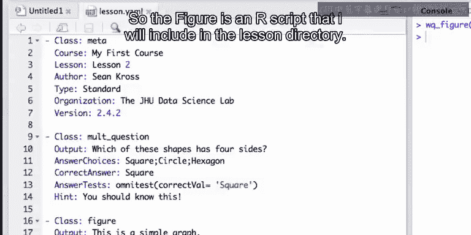

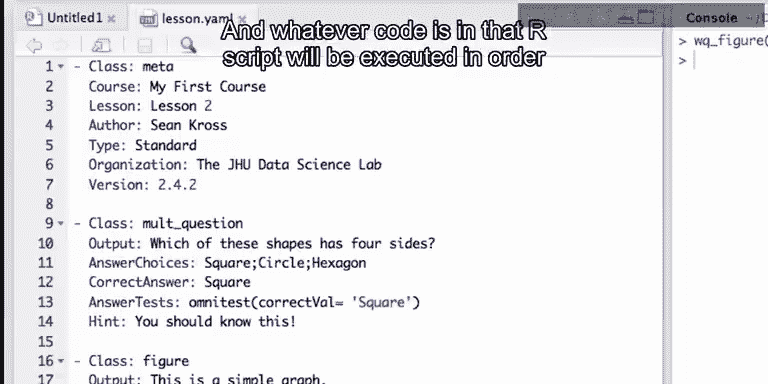


## 创建图形题

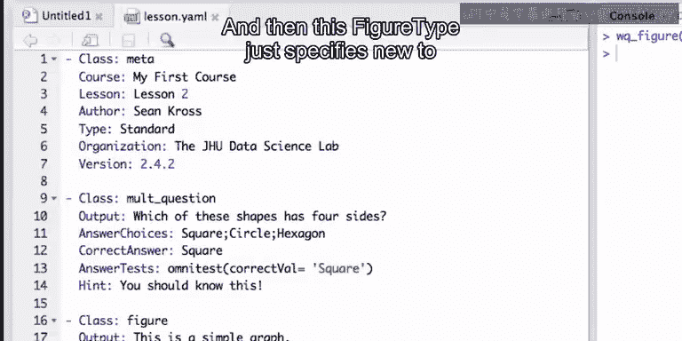


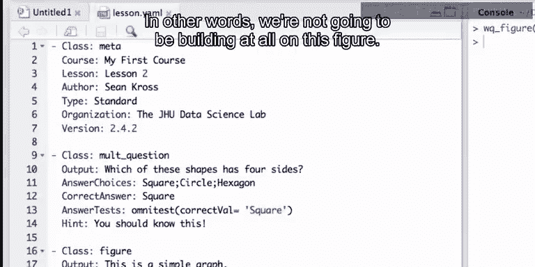

Swirl允许创建展示图形的题目。使用 `wq_figure()` 函数可以添加一个图形题模板。


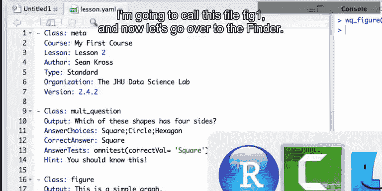

图形题包含几个关键部分：
*   **消息**：展示给用户的文本。
*   **图形文件**：一个R脚本，其中包含生成图形的代码。
*   **图形类型**：指定是创建新图形（`new`）还是在现有图形上添加（`add`）。

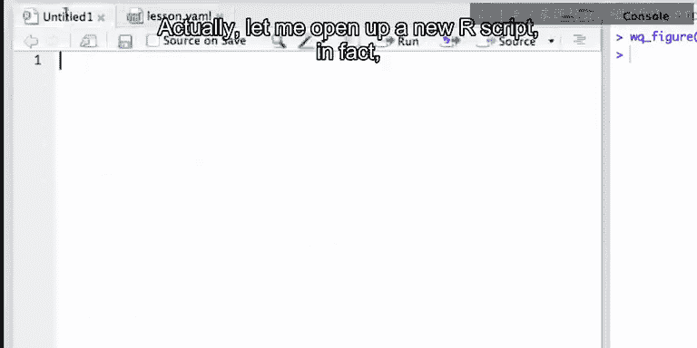

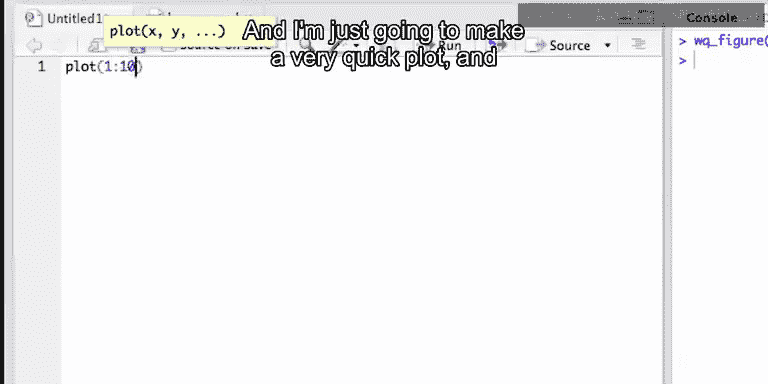


### 创建新图形


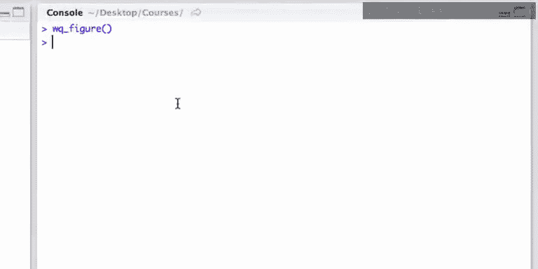


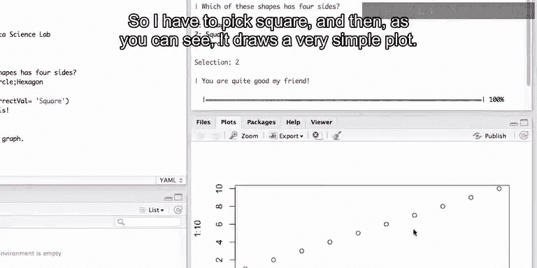

首先，我们创建一个展示简单图形的新问题。
1.  将消息设置为“This is a simple graph.”
2.  创建一个名为 `fig1.R` 的R脚本文件，并保存在课程目录下。脚本内容可以是简单的绘图代码，例如 `plot(1:10)`。
3.  将图形类型设置为 `new`。


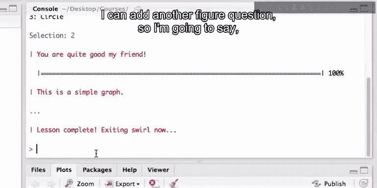

### 在图形上添加元素


接下来，我们可以创建第二个图形题，在已绘制的图形上添加新元素。
1.  再次使用 `wq_figure()` 添加一个新模板。
2.  将消息设置为“I added a line.”
3.  创建第二个R脚本文件 `fig2.R`，包含添加元素的代码，例如 `abline(h = 5)`。
4.  关键步骤：将图形类型设置为 `add`，这表示代码将在上一个图形的基础上执行。

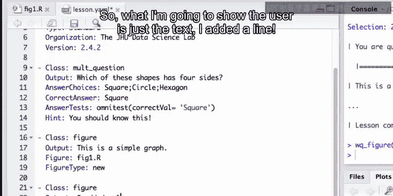

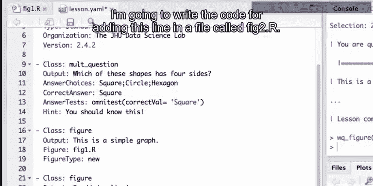


运行 `demo_lesson()` 进行测试，学生将依次看到多选题、第一个图形，以及添加了线条的第二个图形。


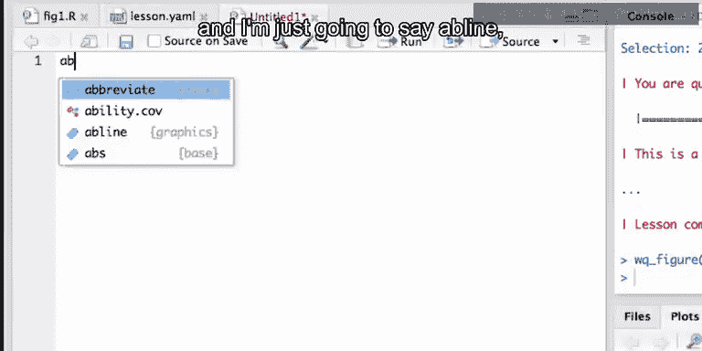


---

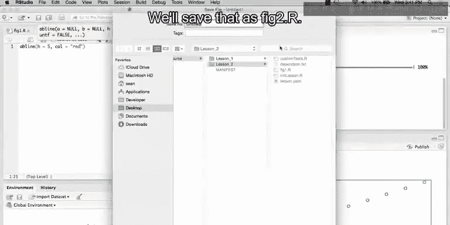

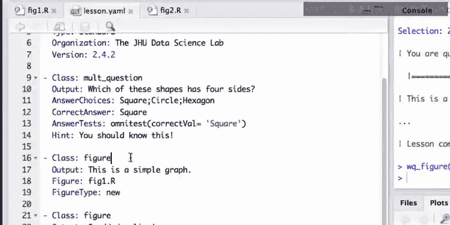


本节课中我们一起学习了如何在Swirl中创建包含多选题和图形题的更复杂课程。我们了解了元问题的用途，掌握了使用 `wq_multiple()` 创建选择题，以及使用 `wq_figure()` 配合 `new` 和 `add` 类型来创建交互式图形演示的方法。这些工具能帮助你构建更丰富、更具互动性的数据科学教学材料。