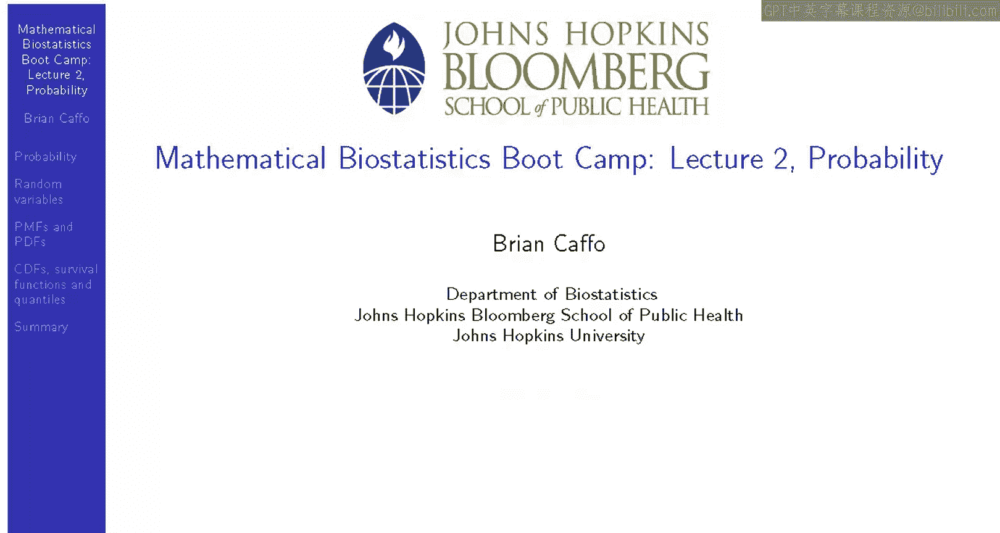
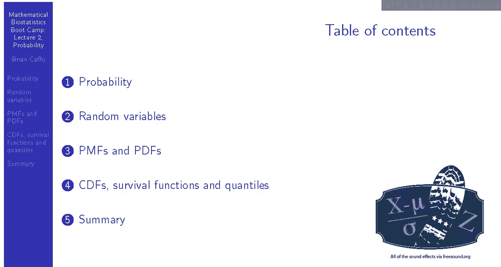
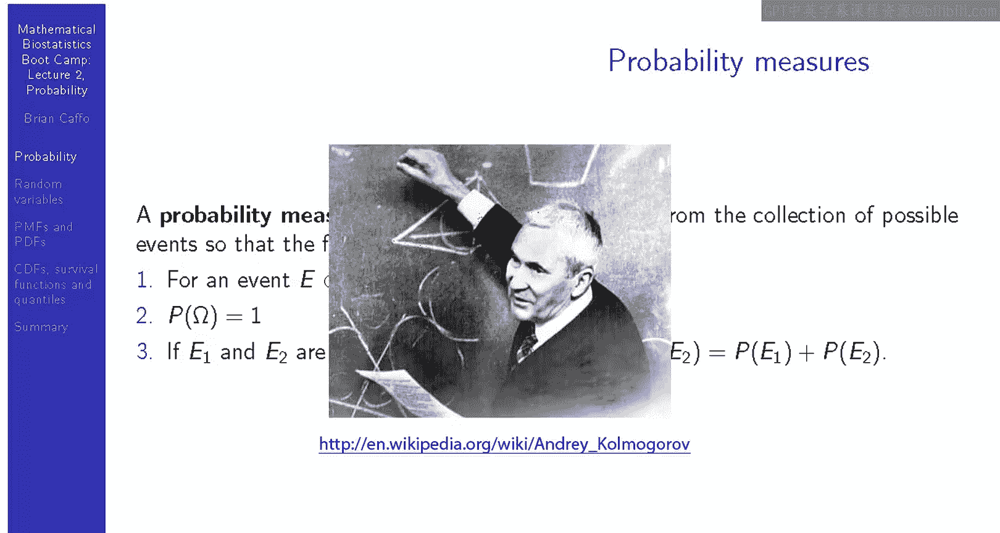
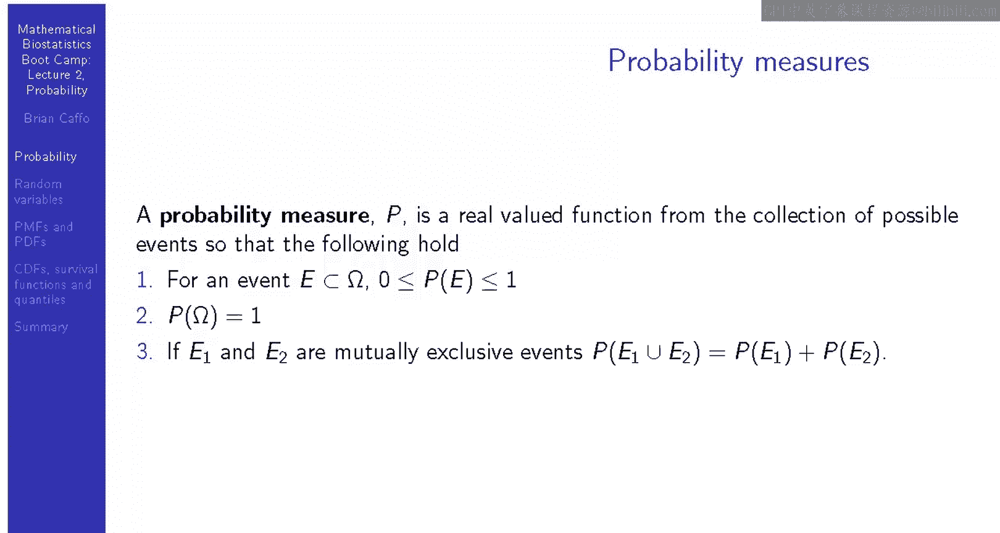
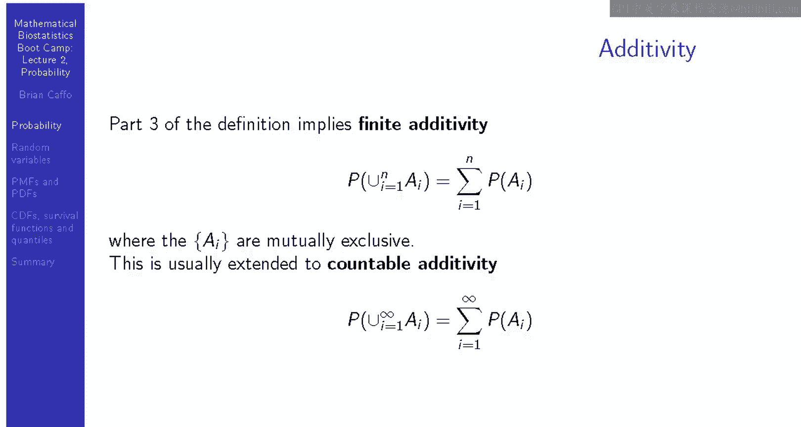
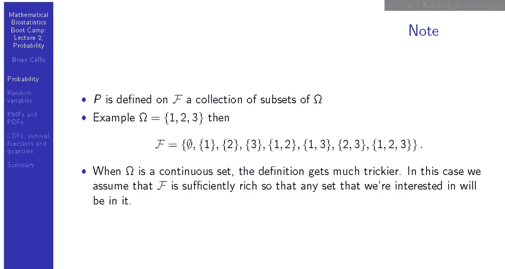
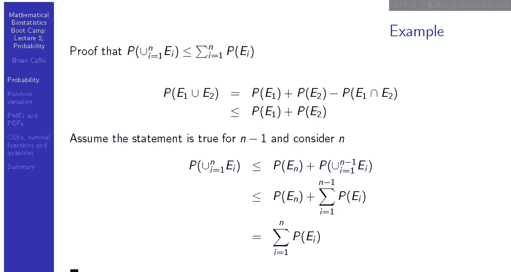
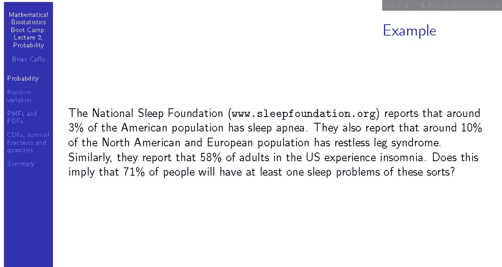
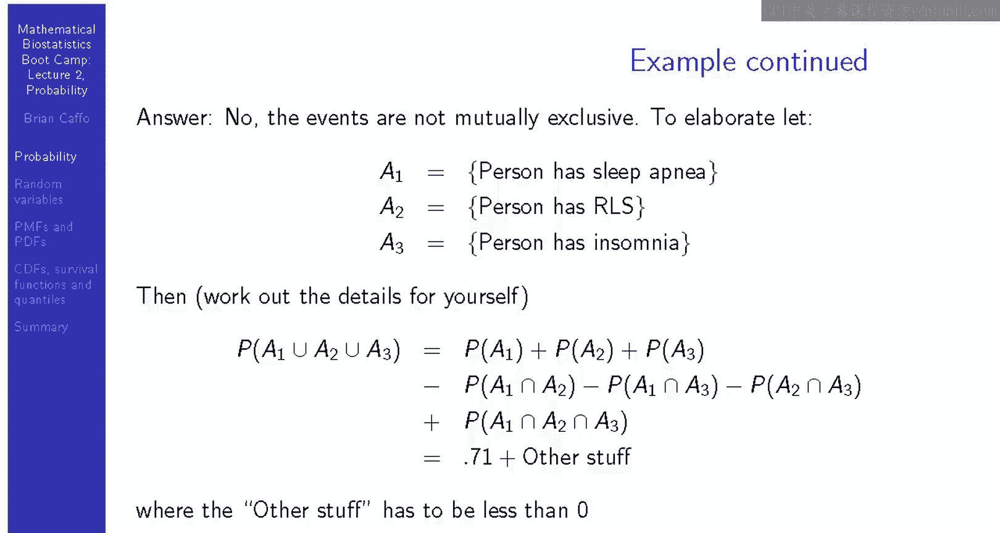

#  004：概率论

## 概述
在本节课中，我们将深入学习概率论的具体数学基础。我们将从概率测度的定义开始，探讨随机变量的概念，并介绍描述概率分布的几种核心函数。

## 1. 概率测度

上一节我们从概念层面介绍了概率和生物统计学的基础。本节中，我们来看看具体的数学函数——概率测度。

概率测度是一个函数，它规定了概率必须遵循的规则。这些规则由俄罗斯数学家柯尔莫哥洛夫提炼而成，被认为是现代概率论的基石。一个概率测度 `P` 必须遵循以下三条基本规则：

1.  **非负性与归一性**：概率测度 `P` 是一个函数，它将样本空间的子集（即事件 `E`）映射到 `[0, 1]` 区间内的一个数。
    *   公式：`P(E) ∈ [0, 1]`

2.  **样本空间概率为1**：整个样本空间（所有可能结果的集合）的概率必须等于1。这意味着必然有某个结果发生。
    *   公式：`P(Ω) = 1`

3.  **可加性**：如果两个事件 `E1` 和 `E2` 互斥（即它们没有交集），那么它们并集的概率等于各自概率之和。
    *   公式：如果 `E1 ∩ E2 = ∅`，则 `P(E1 ∪ E2) = P(E1) + P(E2)`

> **关于第三条规则的说明**：上述第三条规则仅说明了有限个互斥事件的可加性（有限可加性）。在更高级的理论中，通常要求概率满足**可列可加性**，即对于可数无穷多个互斥事件，其并集的概率等于各事件概率之和。对于本课程，有限可加性已足够。

## 2. 概率函数的定义域

回忆一下，我们的概率函数作用于事件（样本空间的子集），并将其映射到0和1之间的数字。因此，我们需要为这个函数定义一个合适的定义域。这个定义域不是一个单一事件，而是一个事件的集合。

以下是关于定义域的关键点：

*   当样本空间是**有限集**时，概率函数的定义域通常是该样本空间的所有可能子集构成的集合。
*   当样本空间是**连续集**（如实数轴上的区间）时，情况变得复杂。不能简单地说概率作用于连续集的所有子集，因为存在一些非常奇特、无法赋予合理概率的集合（如康托尔集）。
*   对于本课程，我们主要关注像区间或区间的并集这类“常规”集合。我们将默认，任何我们能想到的合理事件都在概率函数的定义域内，这足以满足我们的学习需求。

## 3. 概率测度的性质

由前述三条基本定义，可以推导出概率函数必须具有的一系列性质。以下是一些重要的性质列表：

*   **空事件概率为零**：不可能事件的概率为0。`P(∅) = 0`
*   **补事件概率**：一个事件的概率等于1减去其补事件（对立事件）的概率。`P(E) = 1 - P(E^c)`
*   **一般加法公式**：对于任意两个事件A和B（不一定互斥），其并集的概率为：`P(A ∪ B) = P(A) + P(B) - P(A ∩ B)`
*   **单调性**：如果事件A是事件B的子集，则A的概率不大于B的概率。如果 `A ⊆ B`，则 `P(A) ≤ P(B)`
*   **德摩根定律的应用**：`P(A ∪ B) = 1 - P(A^c ∩ B^c)`
*   **差集概率**：`P(A ∩ B^c) = P(A) - P(A ∩ B)`
*   **布尔不等式**：任意多个事件的并集的概率，不超过这些事件概率之和。`P(∪_{i=1}^n E_i) ≤ Σ_{i=1}^n P(E_i)`
*   **下界性质**：任意多个事件的并集的概率，不小于其中任何一个事件的概率。`P(∪_{i=1}^n E_i) ≥ max_i P(E_i)`

**性质证明示例**：
让我们证明“补事件概率”性质：`P(E) = 1 - P(E^c)`。
1.  根据规则2，样本空间概率为1：`P(Ω) = 1`。
2.  样本空间可以表示为事件E与其补集E^c的并集：`Ω = E ∪ E^c`。
3.  事件E和E^c是互斥的。
4.  根据规则3（可加性）：`P(Ω) = P(E ∪ E^c) = P(E) + P(E^c)`。
5.  结合第1步和第4步：`1 = P(E) + P(E^c)`。
6.  因此，`P(E) = 1 - P(E^c)`。

## 4. 应用实例：睡眠疾病患病率

现在，让我们从数学回到实际应用场景。

美国国家睡眠基金会报告显示，约3%的美国人口患有睡眠呼吸暂停症，约10%患有不安腿综合征，约58%的成年人经历过失眠。

假设你是一名睡眠科医生，想知道一个随机抽取的美国人至少患有这三种睡眠障碍之一的概率。你能简单地将这三个百分比（3%、10%、58%）相加，得到71%吗？

**答案是否定的**。这个问题正是我们刚刚讨论的概率关系的直接体现。

设：
*   `A1` = 患有睡眠呼吸暂停症
*   `A2` = 患有不安腿综合征
*   `A3` = 患有失眠症

我们关心的是 `P(A1 ∪ A2 ∪ A3)`。只有当 `A1`, `A2`, `A3` 两两互斥（即一个人不可能同时患有两种病）时，这个概率才等于它们概率的和（71%）。否则，根据一般加法公式（扩展到三个事件），正确的计算公式为：

`P(A1 ∪ A2 ∪ A3) = P(A1) + P(A2) + P(A3) - P(A1 ∩ A2) - P(A1 ∩ A3) - P(A2 ∩ A3) + P(A1 ∩ A2 ∩ A3)`

由于这些疾病很可能存在共病患者（交集非空），因此简单地相加会严重高估真实患病率。从科学角度看，睡眠呼吸暂停与不安腿综合征、不安腿综合征与失眠等之间很可能存在非平凡的交集，所以71%这个数字远不准确。

## 总结
本节课我们一起学习了概率论的数学核心。我们首先定义了概率测度及其必须遵循的三条公理，并探讨了其定义域。接着，我们从这些公理推导出了概率的一系列重要性质，并通过一个睡眠疾病患病率的实例，展示了如何正确应用这些性质来计算复合事件的概率，避免了简单相加的常见错误。这为我们后续理解随机变量和概率分布函数奠定了坚实的理论基础。