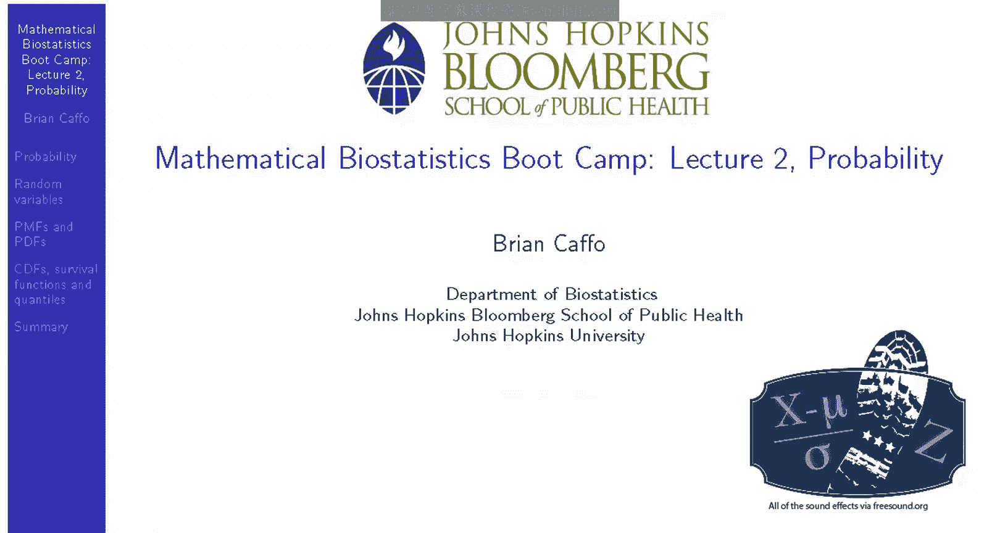
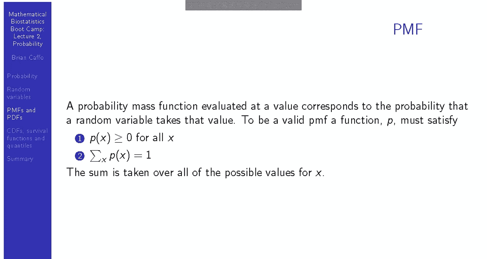
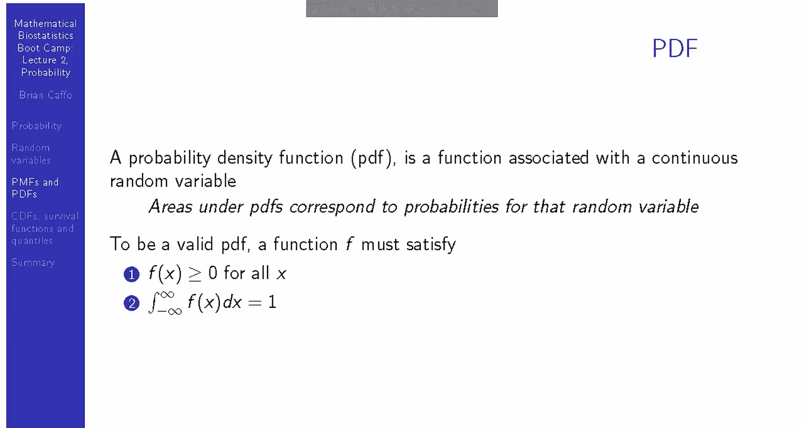
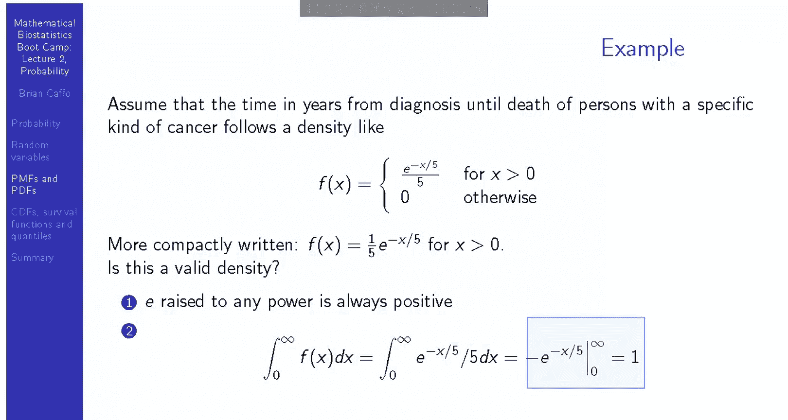
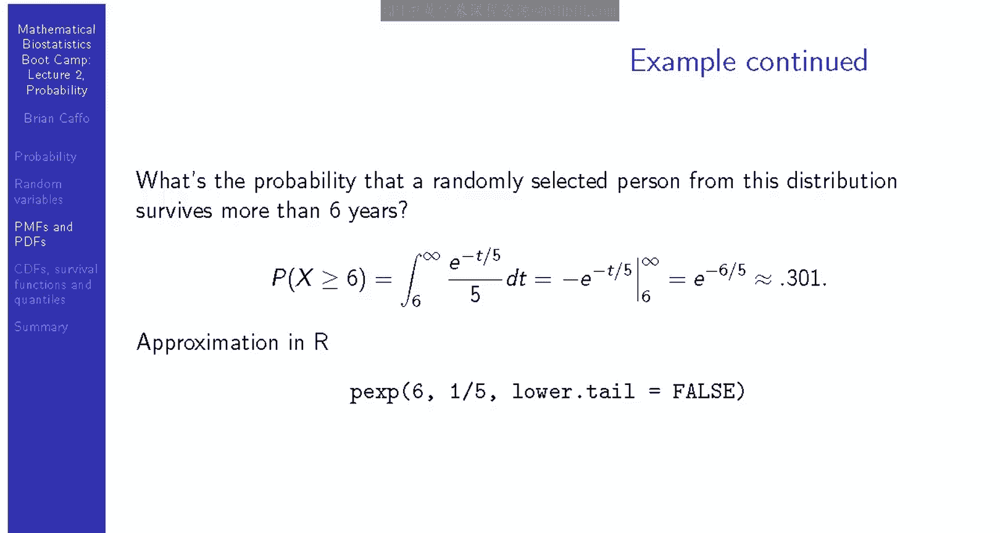
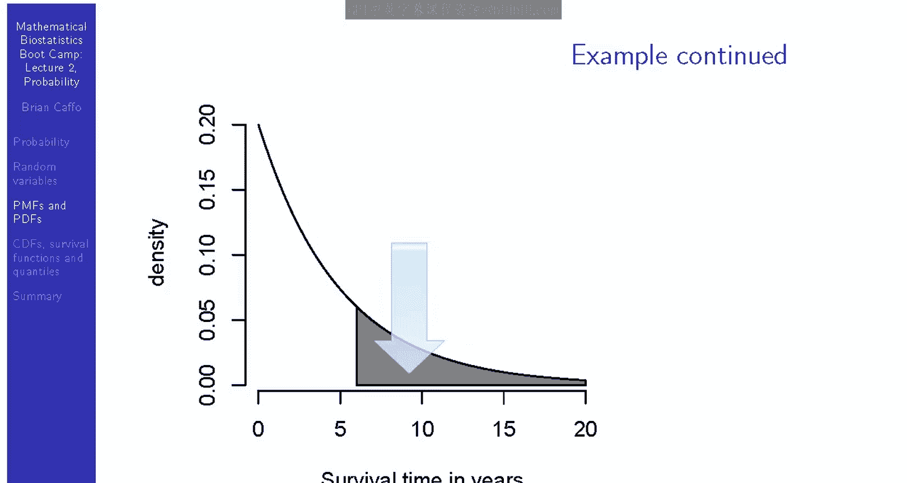

#  006：概率质量函数与概率密度函数

在本节课中，我们将学习如何将概率论的规则应用到随机变量上。具体来说，我们将介绍两种核心函数：用于描述离散随机变量的**概率质量函数**和用于描述连续随机变量的**概率密度函数**。理解这两种函数是建立统计模型的基础。

## 概率质量函数

上一节我们介绍了随机变量的基本概念，本节中我们来看看如何用数学函数来描述离散随机变量的概率分布。这种函数被称为**概率质量函数**。

概率质量函数是一个将随机变量可能取的值映射到其对应概率的函数。例如，对于一个公平的骰子，其概率质量函数 `p(1)` 的值应为 `1/6`。

要成为一个有效的概率质量函数，必须满足两个规则：
1.  函数在所有可能的取值 `x` 上都必须大于或等于0：`p(x) ≥ 0`。
2.  所有可能取值的概率之和必须等于1：`∑ p(x) = 1`。这类似于概率论中整个样本空间的概率为1的规则。

这里需要注意一个常见的符号约定：我们用大写字母（如 `X`）表示随机变量本身（一个概念，如“掷一次骰子”），而用小写字母（如 `x`）表示随机变量的具体实现值（如掷出的具体点数1或2）。

### 构建概率质量函数示例

以下是构建概率质量函数的一个简单示例。

**示例1：公平的硬币**
假设随机变量 `X` 代表一次抛硬币的结果，其中 `0` 表示反面，`1` 表示正面。对于一枚公平的硬币，其概率质量函数可以写为：
`p(x) = (1/2)^x * (1/2)^(1-x)`
验证：当 `x=0`， `p(0)=1/2`；当 `x=1`， `p(1)=1/2`。

**示例2：有偏的硬币**
现在假设硬币正面朝上的概率是一个未知参数 `θ`（`0 ≤ θ ≤ 1`）。此时，概率质量函数可以写为：
`p(x) = θ^x * (1-θ)^(1-x)`
验证：`p(0) = 1-θ`， `p(1) = θ`，且 `p(0) + p(1) = 1`。

在统计学中，像 `θ` 这样的希腊字母通常用来表示我们想要估计的未知**参数**。选择这种指数形式书写概率质量函数是因为乘法运算在概率论中非常有用，而指数形式便于进行乘法计算。

## 概率密度函数

我们已经了解了如何用概率质量函数描述离散随机变量，现在我们需要一个对应的工具来描述连续随机变量，这就是**概率密度函数**。

概率密度函数（常缩写为 **PDF**，注意在统计学中它指概率密度函数，而非“便携式文档格式”）遵循一个黄金法则：**概率密度函数曲线下的面积对应于随机变量的概率**。

最著名的概率密度函数例子是“钟形曲线”，即正态分布密度函数。当我们说一个总体服从钟形曲线时，就意味着与该随机变量相关的概率由该曲线下的面积决定。

与概率质量函数类似，一个有效的概率密度函数也必须满足两个条件：
1.  函数在随机变量所有可能取值（称为**支撑集**）上非负：`f(x) ≥ 0`。
2.  函数在整个实数轴上的积分（即曲线下的总面积）必须等于1：`∫ f(x) dx = 1`。这表示随机变量必定会落在实数轴的某个区间内。

通常，即使随机变量的实际取值范围有限（例如在0到2之间），我们也将概率密度函数在范围外的值定义为0，从而在整个实数轴上讨论其积分。

### 概率密度函数应用示例

让我们通过一个具体例子来理解概率密度函数的应用。

假设某种癌症患者从诊断到死亡的时间（年）服从以下密度函数：
`f(x) = e^(-x/5) / 5`，其中 `x > 0`。
这是一个**指数分布**的例子。我们可以验证它是一个有效的密度函数：首先 `e^(-x/5)` 总是正的；其次，其从0到无穷的积分等于1。

现在，假设我们想计算一个随机选择的患者生存时间超过6年的概率，即 `P(X ≥ 6)`。根据PDF的黄金法则，这个概率等于密度函数曲线下从6到无穷的面积：
`P(X ≥ 6) = ∫_6^∞ e^(-x/5)/5 dx ≈ 0.301`
在统计编程语言R中，可以使用代码 `pexp(6, rate=1/5, lower.tail=FALSE)` 来计算这个值，结果约为30.1%。

关于连续随机变量有一个关键点：**取任何一个特定精确值的概率是0**。因为概率对应的是面积，而一条线的面积为零。这听起来有违直觉，但请记住，概率密度函数是一个对连续现象的**模型**。在实际测量中，我们总是有限精度（如年、月、日），但使用连续模型通常比为无数个离散值分配概率更为方便和强大。因此，对于连续变量，`P(X ≥ 6)` 和 `P(X > 6)` 的计算结果是相同的。

需要注意的是，对于离散随机变量（如掷骰子），是否包含边界点（如“大于等于6” vs “大于6”）会显著影响概率计算结果，因为单个点有非零概率。在使用R等工具时，需要根据变量类型注意这一点。

## 总结

本节课中我们一起学习了描述随机变量概率分布的两种核心数学工具。
*   对于**离散随机变量**，我们使用**概率质量函数**，它为每个可能取值分配一个明确的概率，所有概率之和为1。
*   对于**连续随机变量**，我们使用**概率密度函数**，其曲线下的面积代表概率，整个曲线下的总面积为1。

理解PMF和PDF是连接概率论与实际数据，进而进行统计推断的基石。在后续课程中，我们将深入探讨如何利用这些分布模型来从数据中学习未知参数（如硬币的 `θ`）并评估我们的估计的不确定性。