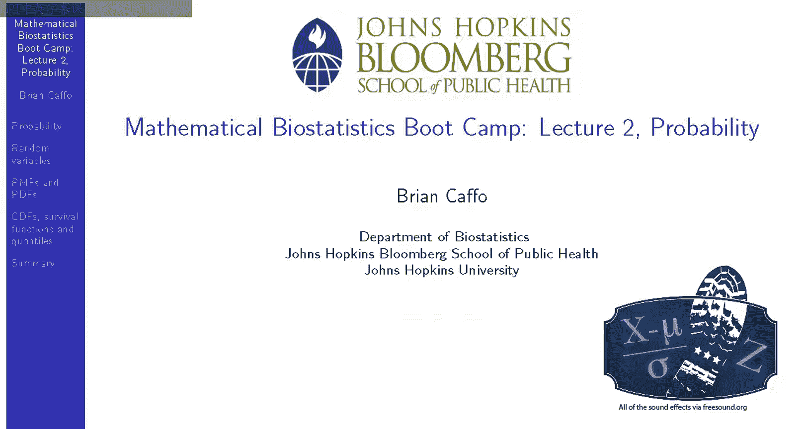
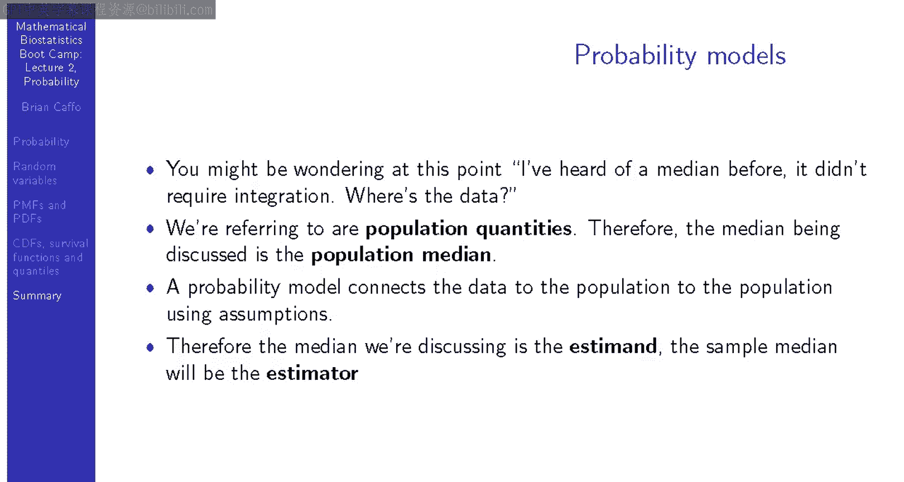

#  007：累积分布函数、生存函数与分位数

在本节课中，我们将要学习描述随机变量概率分布的三个核心工具：累积分布函数、生存函数和分位数。我们将通过一个具体的指数分布例子，来理解这些函数如何计算、有何关联，以及它们在统计学中的重要意义。

## 累积分布函数与生存函数

上一节我们讨论了如何计算随机变量大于某个特定值的概率。但在实际分析中，我们可能需要计算随机变量大于或小于任意值的概率。

对于任意随机变量，我们可以构造两个函数：一个函数在输入一个值后，返回随机变量小于等于该值的概率；另一个函数则返回随机变量大于该值的概率。这两个函数极其有用，因此我们为它们命名。

**累积分布函数** 是一个函数，它接收任意特定值 `x`，并返回随机变量小于等于 `x` 的概率。对于连续型随机变量，是否包含等号并不影响结果，但 CDF 的定义同时适用于连续型和离散型随机变量。

**生存函数** 则相反，它返回随机变量严格大于 `x` 的概率。如果我们用 `S(x)` 表示生存函数，`F(x)` 表示累积分布函数，那么它们的关系是互补的。

`S(x) = P(X > x)`
`F(x) = P(X ≤ x)`
`S(x) + F(x) = 1`

这意味着，如果你计算出了累积分布函数，也就得到了生存函数，反之亦然。

## 计算示例：指数分布

现在，让我们通过之前讨论的指数分布例子，具体计算其生存函数和累积分布函数。

首先计算生存函数。回忆一下，生存函数是随机变量大于 `x` 的概率。对于概率密度函数为 `f(t) = (1/5)e^{-t/5}` 的指数分布，我们需要计算从 `x` 到无穷大的积分。

`S(x) = ∫_x^∞ (1/5)e^{-t/5} dt = e^{-x/5}`

由于我们已经知道 `S(x) + F(x) = 1`，我们可以立即得到累积分布函数。

`F(x) = 1 - S(x) = 1 - e^{-x/5}`

我们也可以直接通过积分验证。累积分布函数是概率密度函数从负无穷到 `x` 的积分。对于这个在 `x<0` 时密度为0的指数分布，积分从0开始。

`F(x) = ∫_0^x (1/5)e^{-t/5} dt = 1 - e^{-x/5}`

此外，根据微积分基本定理，累积分布函数的导数恰好是概率密度函数。对我们的例子求导可以验证这一点。

`d/dx [F(x)] = d/dx [1 - e^{-x/5}] = (1/5)e^{-x/5} = f(x)`

## 分位数

分位数是分布（或等价地，密度函数）的性质。当我们谈论一个分布时，比如高斯分布或正态分布，我们指的是其整体的概率模型。

一个分布的 **α 分位数** 是指这样一个点 `x_α`，使得随机变量小于等于该点的概率恰好是 `α`。

`P(X ≤ x_α) = α`

例如，如果 `α = 0.25`，那么 `x_0.25` 就是使得小于它的概率为25%的点。在我们癌症生存的例子中，该分布的0.25分位数就是这样一个生存时间：有25%的人存活时间短于这个时间。

**百分位数** 只是分位数以百分比形式的表达，例如第25百分位数就是0.25分位数。

**中位数** 是第50百分位数，即0.5分位数。

## 分位数计算示例

让我们再次使用指数密度来实践这些概念。假设我们想找到指数生存分布的第25百分位数。

我们需要在横轴上找到点 `x`，使得它左侧的白色区域面积为0.25。这等价于解方程 `F(x) = 0.25`。

`0.25 = F(x) = 1 - e^{-x/5}`

解这个方程：

`e^{-x/5} = 0.75`
`-x/5 = log(0.75)`
`x = -5 * log(0.75) ≈ 1.44`

这个1.44如何解释？大约有25%来自该总体的受试者存活时间少于1.44年。

在R语言中，你可以直接使用 `qexp` 函数获取指数分布的分位数。R语言对大多数常见分布遵循类似的命名规则：`q` 前缀函数用于求分位数，`p` 前缀函数用于求累积概率或生存概率，`d` 前缀函数用于求密度值。

我们刚刚计算出的0.25分位数通常被称为 **下四分位数**。你可能听说过中位数和下四分位数，在数据分析中，样本中位数是数据中间的那个值，样本下四分位数是使得25%的观测值低于它的那个点。但这里有一个关键区别。

## 总体与样本：一个核心概念

本节课我们讨论的 **中位数** 是 **总体中位数**。当你收集数据并计算 **样本中位数** 时，那是在估计某个东西——它是在估计总体中位数。样本均值估计总体均值，样本方差估计总体方差，这是一个普遍规则：**样本统计量倾向于估计对应的总体参数**。

概率建模及其相关假设，正是连接我们的数据与总体的桥梁，使得我们能够进行估计。如果没有这个建模过程，样本中位数就仅仅是样本中的一个数字。概率建模的意义在于，它将你的样本与一个总体联系起来，这样你的样本中位数就有了一个它试图估计的总体目标——即总体中位数。

这是一个相当微妙但非常重要的概念。样本中位数是一个很直观的概念：你有一列观测值，排序后取中间的那个。而总体中位数则是一个更抽象的概率概念：我通过一个分布描述了一个总体，这个分布存在一个点，使得总体中恰好有50%的观测值低于它，这就是总体中位数。

建议在学习时，始终在概念前加上“总体”或“样本”以提醒自己。统计工作者虽然深知这些区别，但因习以为常而可能忽略。但初学时，明确区分至关重要。此外，样本中位数本身是一个定义明确、不需要太多假设的量。**概率建模才是需要谨慎假设的精细部分**。如果你要说样本中位数估计了总体中位数，就必须考虑使这个说法成立需要哪些假设，特别是如果你想用样本中位数进行统计推断或评估其不确定性时。

本节课中，我们一起学习了累积分布函数和生存函数的定义与关系，并通过指数分布实例进行了计算。我们还深入探讨了分位数的概念，并区分了总体分位数与作为其估计量的样本分位数。理解这些概率模型中的“总体”概念，是连接概率理论与实际样本数据分析的关键基础。在接下来的课程中，我们将进一步扩展概率建模的知识，并探讨概率的更多定义特征。