#  011：随机向量与独立性

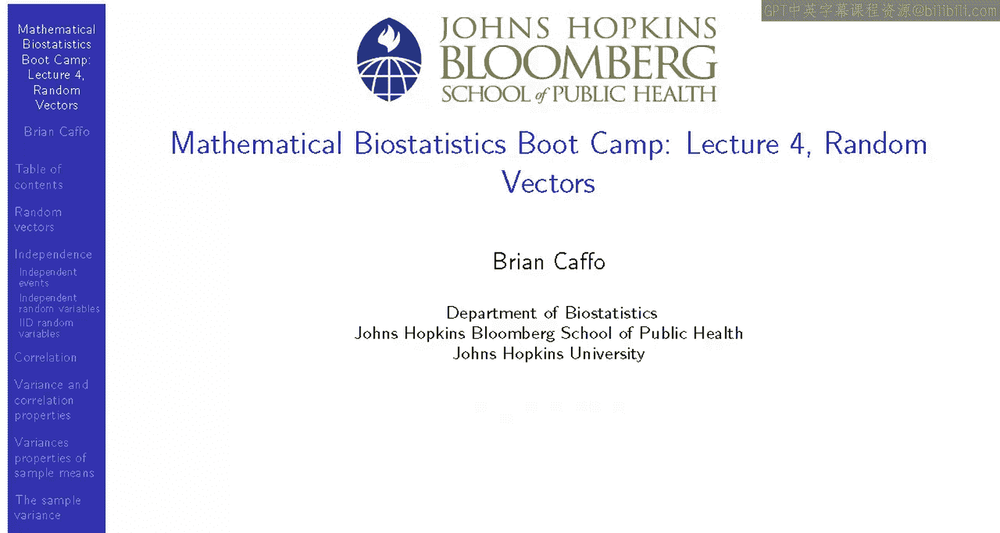

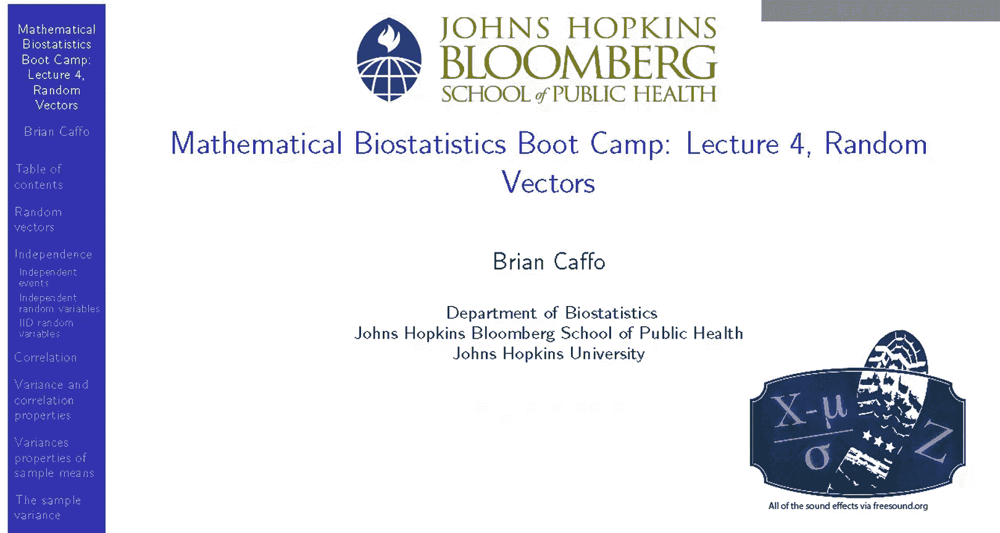

在本节课中，我们将学习随机向量与独立性的概念。独立性是简化统计模型的关键要素，它是一个非常有用的假设，我们经常在统计学中使用它来处理复杂现象。此外，我们将发现，独立同分布随机变量将成为我们理解随机样本的标准模型。

## 随机向量

上一节我们介绍了课程概述，本节中我们来看看什么是随机向量。

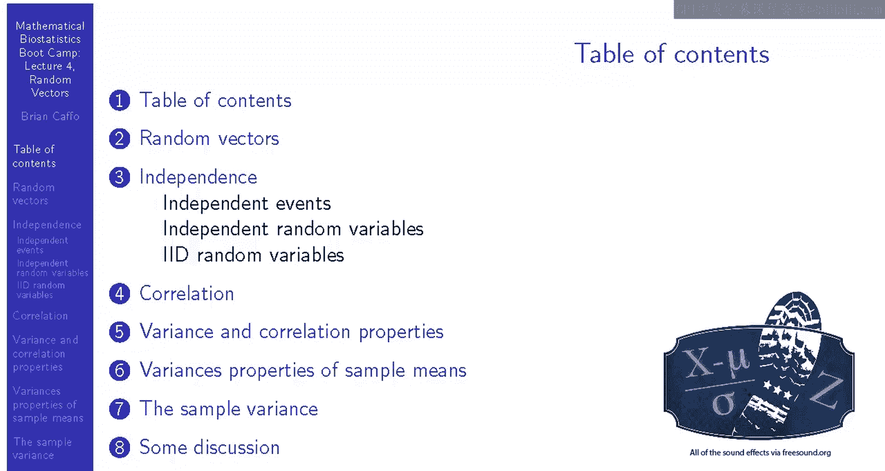

随机向量不过是一个以随机变量作为其分量的普通向量。例如，如果 X 和 Y 是随机变量，那么有序集合 (X, Y) 就是一个随机向量。

就像单个随机变量有其概率密度函数、质量函数或分布函数来支配其概率行为一样，随机向量也有联合密度函数、联合质量函数和联合分布函数来支配其概率行为。让我们从联合密度函数 F(x, y) 开始讨论。

首先，它必须满足处处为正的条件。这是一个二维随机向量，因此曲面 F 存在于二维平面上。F 大于零意味着其高度处处在水平面之上。

其次，它必须在整个 XY 平面上积分等于 1。因此，这是对普通一维概率密度函数的直接扩展。从这个定义出发，你应该能猜出 n 个随机变量的联合密度函数定义。

对于离散随机变量，假设 F 是一个联合概率质量函数。那么联合概率质量函数 F 将 X 和 Y 的可能值（小写 x 和小写 y）映射为概率。要满足联合概率质量函数的定义，F 必须对所有可能的 (x, y) 组合都大于零，并且所有可能组合的概率之和必须等于 1。

顺便说一下，联合密度函数的工作原理与单变量密度函数完全相同，即其下的体积（积分）对应概率，因此总面积为 1。同样，对于联合质量函数，对一组可能的 (x, y) 值求和就得到该集合的概率。

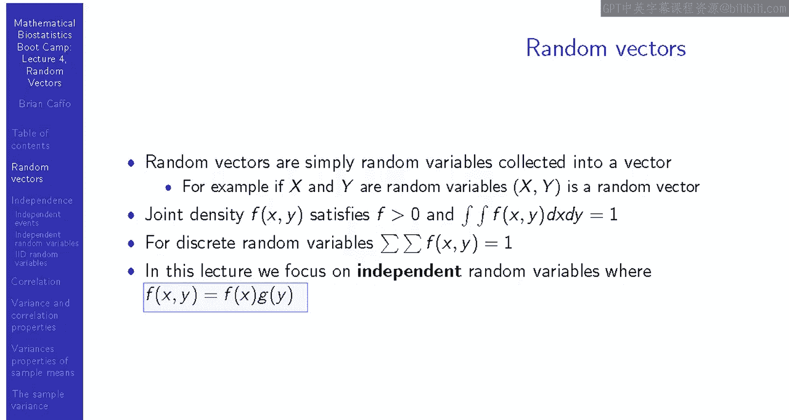

对于本课程来说，全面讨论随机向量可能内容过多，因此我们只关注一种特定类型的联合密度，即可管理性特别强的一种类型，即当随机变量 X 和 Y 独立时的情况。我们将看到，对于联合密度或联合质量函数，如果随机变量 X 和 Y 独立，那么联合密度就可以分解为两个单独密度的乘积，即 f(x) 和 g(y) 的乘积。这基本上就是独立性在数学上为我们带来的好处：它将复杂的多元结构转化为乘积形式。我们将大量使用这个事实，并解释其背后的直觉。

## 独立性的定义

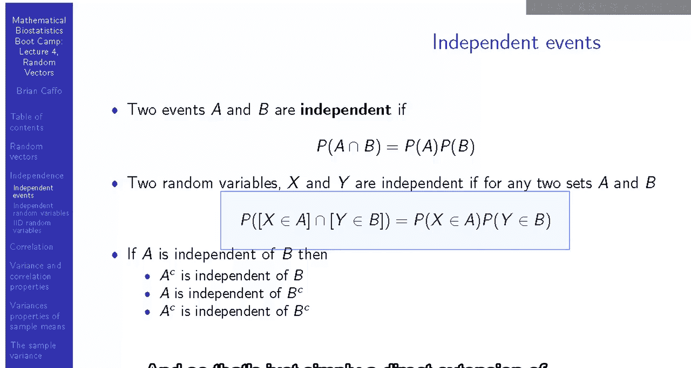

回想我们早期对概率的定义，我们讨论了样本空间和事件。如果两个事件交集的概率等于它们各自概率的乘积，即 **P(A ∩ B) = P(A) * P(B)**，那么这两个事件是独立的。如果这是真的，那么 A 与 B 的补集独立，B 与 A 的补集独立，A 的补集与 B 的补集也独立。独立性的数学定义等同于我们对“独立”含义的直觉理解：A 与 B 无关。

对于两个随机变量，我们可能会这样定义独立性：对于任意两个集合 A 和 B，事件“X 属于 A 且 Y 属于 B”的概率等于“X 属于 A”的概率（无论 Y 如何）与“Y 属于 B”的概率（无论 X 如何）的乘积。这基本上就是上述独立性定义的直接扩展。

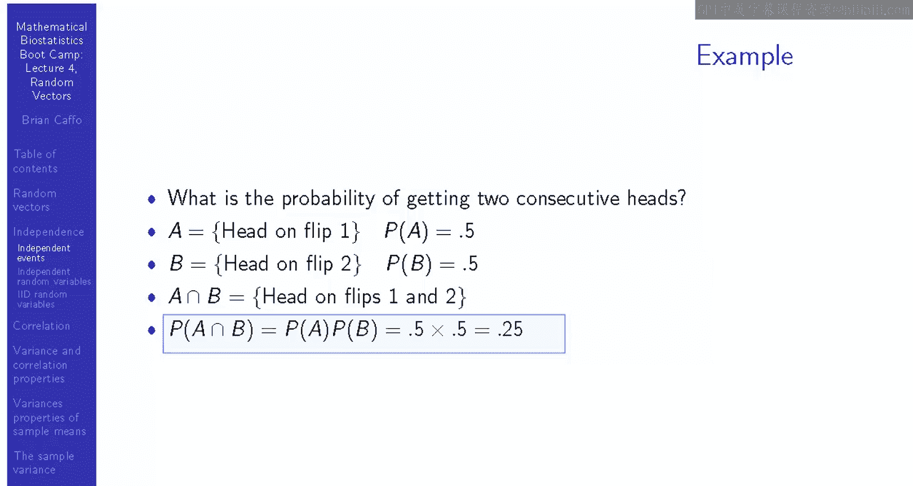

## 独立性的应用与误用

我们已经经常自动地想到独立性。如果你问任何一个有基本数学训练的人，连续两次抛硬币得到两个正面的概率是多少，他们可能会说：第一次得到正面的概率是 1/2，第二次得到正面的概率也是 1/2，所以概率是 1/4。这正是独立性规则的应用。让 A 为第一次抛掷得到正面的事件，B 为第二次抛掷得到正面的事件，那么你要求的就是交集（第一次和第二次都得到正面）的概率。根据独立性，该交集的概率恰好是 P(A) 和 P(B) 的乘积，即 0.5 * 0.5 = 0.25。

我们一直在使用独立性，其主要结果是：独立事件的概率相乘，可以得到两者同时发生的概率。

但这带来了一个问题：人们随后将这一规则扩展到无论事件是否独立都直接相乘概率，这可能导致悲剧性的后果。科学杂志第 309 卷报道了一个典型案例：一位医生在刑事审判中提供专家证词，内容涉及婴儿猝死综合征。一位女性因连续两个孩子死于 SIDS 而受审。法庭考虑这种情况是否过于偶然，从而怀疑并非 SIDS，而是母亲有恶意行为。

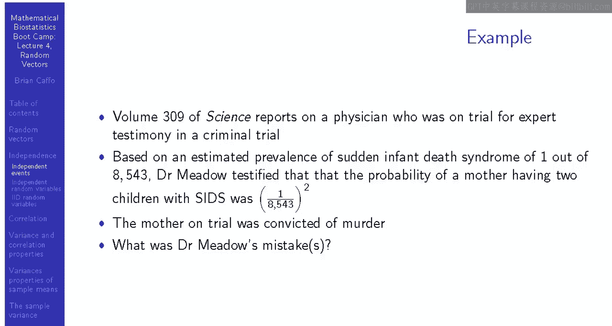

作证的医生进行了如下计算：SIDS 的概率是 1/8543。然后他说，那么发生两次 SIDS 的概率就是这个数字的平方，即 (1/8543)²。基于这个证据，母亲被判谋杀罪。那么，这位医生的错误在哪里？

对于本课程的目的，我们可以围绕这个案例讨论伦理、概率、证据和罪责等许多复杂问题。但为了简化讨论，我们只关注一点：在已知第一个概率正确的前提下，简单地将其平方的计算是否合理？如果 A1 是第一个孩子死于 SIDS 的事件，A2 是第二个孩子死于 SIDS 的事件，那么计算中隐含的假设是 A1 和 A2 独立，因此可以将 P(A1) 和 P(A2) 相乘。但这个逻辑立即失效，因为没有理由相信第二次 SIDS 事件独立于第一次 SIDS 事件。在许多生物学案例中，具有遗传或家族成分的生物过程往往在家族内是相关的，因此不能将边缘概率相乘来得到交集的概率。

本课程要强调的重点是：你不能随意地将概率相乘。你所讨论的随机变量或事件必须确实是独立的。

## 独立同分布随机变量

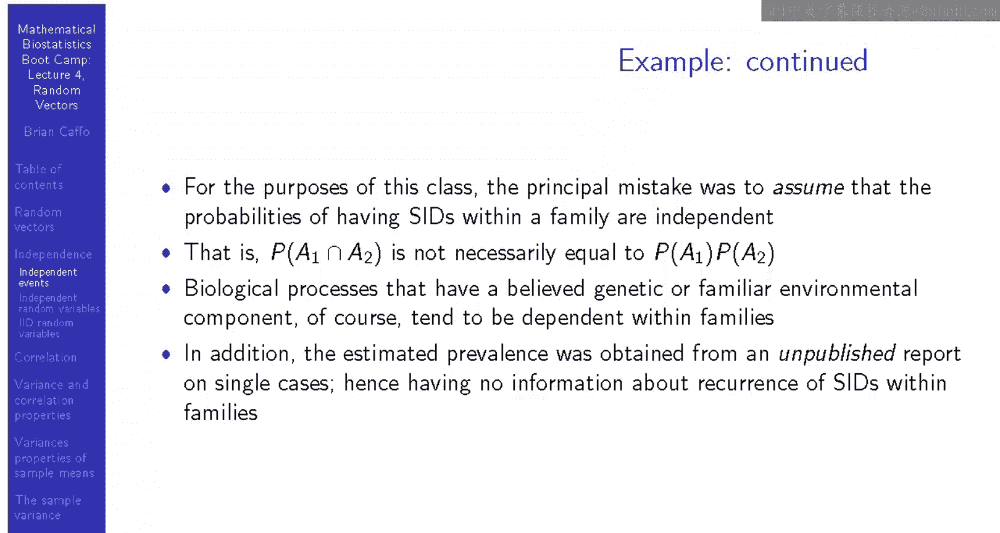

我们将在本课程中广泛使用以下事实，并将其作为一个基本的简化原则：如果我们有一个独立的随机变量集合 X1 到 Xn，那么 X1 到 Xn 的联合分布或联合密度函数就是各个密度或质量函数的乘积。

换句话说，**f(x1, ..., xn) = f1(x1) * f2(x2) * ... * fn(xn)**。这里我用 fi(xi) 表示每个 Xi 可能具有不同的密度。

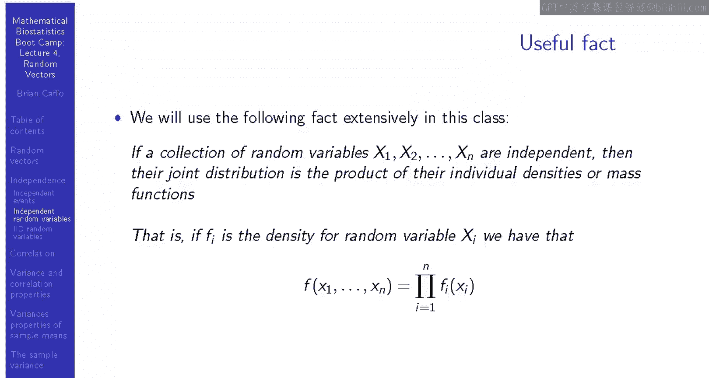

我们将处理的最常见模型是 X1, X2, ..., Xn 来自相同分布的情况。在这种特定情况下，我们说 X 是独立同分布的。“独立”指 X1 独立于 X2，依此类推；“同分布”指 f1 = f2 = ... = fn。IID 样本在统计学中非常重要，因为 IID 随机变量是随机样本的基本默认模型。如果你有一组本质上我们认为可交换的事物，我们就把它们当作 IID 来处理。

许多重要的统计学理论都建立在变量是 IID 的假设之上。举一个 IID 随机样本的例子：想象掷一个骰子。每次掷骰子都是从数字 1 到 6 的均匀分布中抽取一次。当我们说将一个过程建模为 IID 时，我们是在说，对于我们建模的每个变量，都像是在从某个总体分布中掷骰子。

我想评论一下关于概率建模的更广泛讨论。实际上，情况从来不是这样。对于掷骰子来说，这可能是一个非常好的模型，但我们用 IID 来建模那些变量本身肯定不是 IID 的情况。我们很少能保证我们的样本确实是多次从某个总体分布 F 中随机抽取的。关键在于，这是一个用于简化计算和讨论的统计模型。但每当我们使用这个统计模型时，我们必须认识到它是一个模型，并且是一个极大的简化假设。

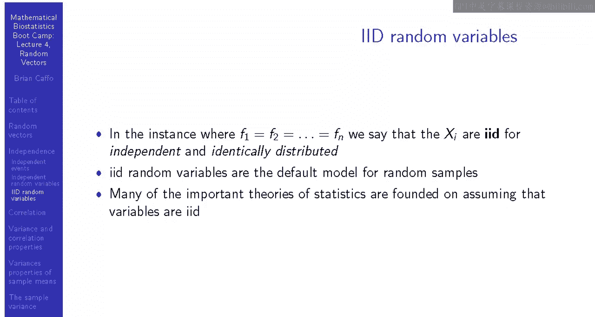

## 一个关键例子：抛硬币

让我们看一个非常重要的抛硬币例子。想象我们有一个有偏的硬币，设正面或“成功”的概率为 p，我们抛掷 n 次。那么，所有可能结果的集合的联合密度是什么？

回想一下，这里的每次抛硬币都是一个伯努利随机变量，成功概率为 p。我们曾将其密度写为 **p^x * (1-p)^(1-x)** 的形式。注意，这是一个非常方便的形式：如果代入 x=1，得到正面（或 1）的概率 p；如果代入 x=0，得到反面（或 0）的概率 1-p。这种表示法很好，你会在下一行看到我们为什么这样表示。

如果它们是独立的抛硬币结果，那么联合密度（联合质量函数）f(x1, ..., xn) 就是各个密度的乘积。从这个公式中，我们得到 **p^(Σxi) * (1-p)^(n - Σxi)**。如果 x 都是 0 或 1，这就等于 p 的“正面次数”次方乘以 (1-p) 的“反面次数”次方。这就是为什么我们这样写出密度函数，因为如果我们有一系列独立的抛硬币结果，质量函数相乘会很方便，最终得到联合质量函数的这种简洁形式。

例如，如果我有一个成功概率为 p 的有偏硬币，抛掷四次，我想知道得到 1, 0, 1, 1（即 1011）的概率，只需代入这个公式。注意顺序是 1, 0, 1, 1，我们得到三个正面和一个反面。注意顺序无关紧要，该事件的概率是 p³ * (1-p)¹，并且无论 1 和 0 以何种顺序出现，概率都相同。

我想再次强调，这个模型非常重要。例如，假设我们想模拟人群中高血压的患病率。我们可能采用的一种方法是假设我们的样本是 IID 的（这通常是一个很大的假设，即个体是独立的抛硬币结果）。我们想知道的是患高血压的“成功”概率，这个成功概率就是人群中的高血压患病率。我们将使用这个联合质量函数来为我们的数据集合建模这个过程。这就是我们后续课程思路的基础。

但请注意，这其中包含了很多假设。我想相当强调这一点：我们假设我们是从感兴趣的人群中随机抽取人员，或者甚至不是随机抽取，但我们可以将人们的血压状况集合，建模为一堆独立的抛硬币结果，患病率就是成功概率。这最终就是我们的模型所陈述的内容。因此，始终牢记这一点非常重要。

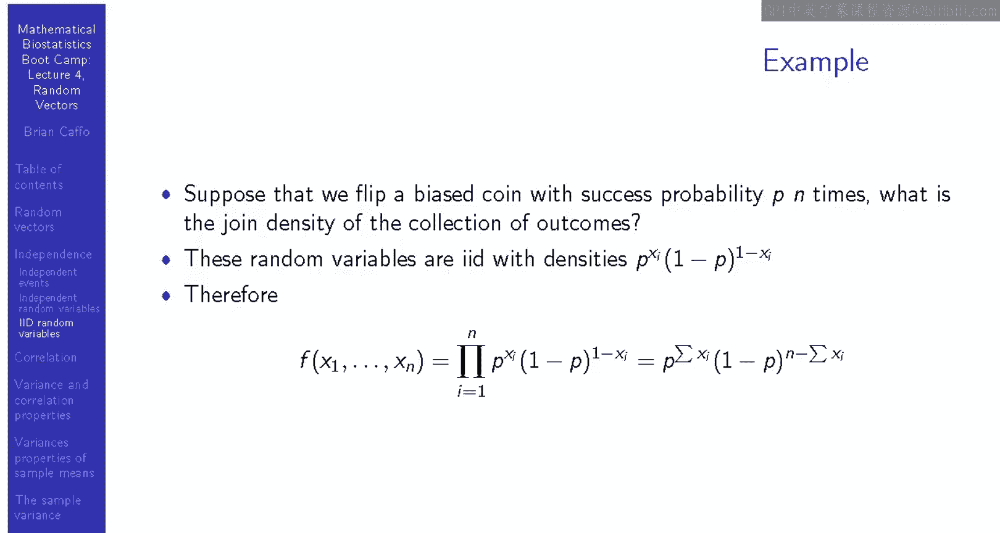

本节课中我们一起学习了随机向量与独立性的核心概念。我们定义了随机向量及其联合分布，深入探讨了独立性的数学定义及其重要性，并通过实际案例（如 SIDS 误判）警示了误用独立性的后果。我们还介绍了独立同分布随机变量这一统计学中的基石模型，并通过抛硬币的例子展示了其具体应用。理解这些概念是掌握后续概率建模和统计推断的基础。