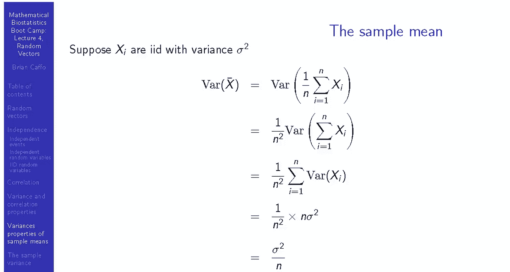
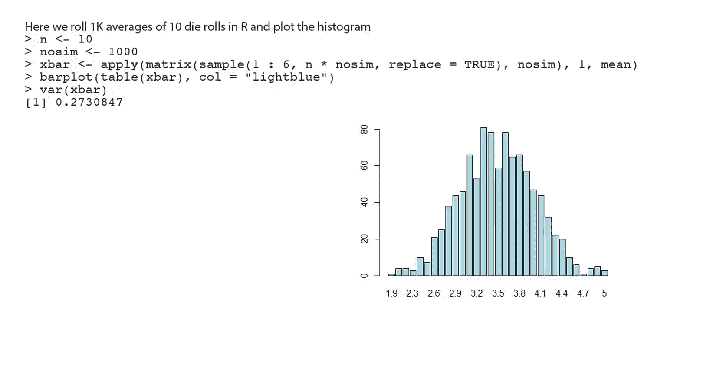
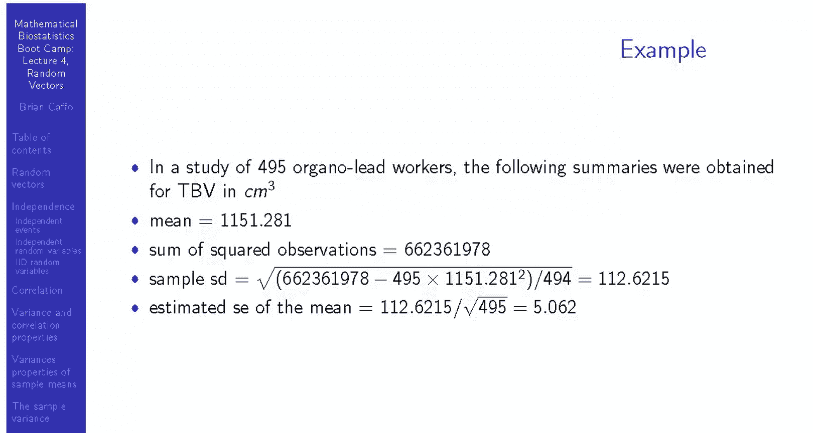

#  013：方差性质与样本方差

在本节课中，我们将要学习样本均值的方差性质，并正式定义样本方差。我们将探讨这些概念如何将数据与总体模型联系起来，并通过实例加深理解。

## 样本均值的方差

上一节我们介绍了方差的基本概念，本节中我们来看看一个由独立同分布随机变量构成的集合，其样本均值的方差有何重要性质。

假设我们有一个独立同分布（IID）的随机变量集合 `Xi`，其中 `i = 1, ..., n`。它们所来自的分布的方差为 `σ²`。那么样本均值 `x̄` 的方差计算如下：

**公式：**
`Var(x̄) = Var( (1/n) * Σ Xi ) = (1/n²) * Var( Σ Xi )`

由于 `Xi` 是独立的（因此也不相关），和的方差等于方差的和。又因为它们是同分布的，每个 `Xi` 的方差都是 `σ²`。所以：

**公式：**
`Var( Σ Xi ) = Σ Var(Xi) = n * σ²`

将结果代入，我们得到：

**公式：**
`Var(x̄) = (1/n²) * (n * σ²) = σ² / n`

这个结果非常有趣。它意味着，如果我们想知道来自某个分布的 `n` 个随机变量平均值的分布方差，我们**不需要**知道这个平均值分布的具体形态。我们只需要知道原始单个观测值分布的方差 `σ²`，然后将其除以 `n` 即可。相应地，样本均值的标准差就是 `σ / √n`。

这个性质之所以重要，是因为它连接了总体模型与数据。当我们有一组可以建模为 IID 的数据时，每个 `X` 都是对原始分布的一次独立抽取。我们可以用数据估计 `σ²`，但我们通常只有一个样本（例如，100个观测值），因此只能计算出一个样本均值。我们无法通过重复抽样来直接估计这个样本均值的方差。然而，上述结果告诉我们，我们不需要重复抽样，只需用估计的总体方差除以 `n` 即可。

## 一个骰子实验的例子

为了验证这个性质，我们可以做一个简单的实验。回忆上一讲的内容，一个均匀骰子（取值1到6，概率各为1/6）的方差是 `2.92`。

*   如果你反复投掷一个骰子成千上万次，计算这些投掷结果的样本方差，你会得到大约 `2.92`。这估计了骰子总体的方差。

现在考虑另一个问题：如果你一次投掷10个骰子，计算它们的平均值，并重复这个过程成千上万次，那么这成千上万个“10个骰子平均值”的分布的方差是多少？

这个平均值分布的最小值仍是1（全是1点），最大值仍是6（全是6点），但它不再是1到6的均匀分布，你可以得到像1.5、3.7这样的中间值。直接计算这个分布的方差似乎很复杂。

然而，根据我们推导的性质，我们根本不需要计算这个复杂分布。我们知道单个骰子分布的方差是 `2.92`，那么10个骰子平均值的分布方差就是 `2.92 / 10 = 0.292`。我们可以用程序模拟这个实验，验证结果确实接近 `0.292`。

## 标准误

当 `X` 独立且具有相同方差时，样本均值 `x̄` 的方差是 `σ² / n`。这个方差的平方根 `σ / √n` 极其重要，我们赋予它一个专门的名称：**样本均值的标准误**。

本质上，标准误就是一个统计量（如此处的样本均值）的分布的标准差。其他统计量（如中位数）也有其标准误。

*   **`σ`（总体标准差）**：描述了**总体个体**的变异程度。例如，如果 `X` 是IQ分数，`σ` 描述的是人群IQ分数的变异大小。
*   **`σ / √n`（标准误）**：描述了从该总体中抽取**大小为 n 的样本均值**的变异程度。例如，`σ / √10` 描述的是10个人IQ平均分的变异大小。

这是两个相关但不同的概念，容易混淆。一个简单的记忆方法是：样本均值肯定比单个观测值波动更小，因此它的标准差需要除以 `√n`。这也展示了随着收集数据量 `n` 的增加，标准误下降的速率。

## 样本方差的定义与性质

既然我们频繁提到样本方差，现在让我们正式定义它。样本方差是我们用数据来估计总体方差 `σ²` 的统计量。

回顾一下，总体方差是随机变量围绕其总体均值 `μ` 的期望偏差平方。类似地，样本方差是样本值围绕样本均值 `x̄` 的平均偏差平方。

**公式：**
`S² = (1/(n-1)) * Σ (Xi - x̄)²`

注意，分母是 `n-1` 而不是 `n`。样本方差 `S²` 是总体方差 `σ²` 的一个估计量。与总体方差类似，它也有一个快捷计算公式：

**公式：**
`Σ (Xi - x̄)² = Σ Xi² - n * x̄²`

### 为什么除以 `n-1`？

对于大样本，除以 `n` 或 `n-1` 差别不大。但对于小样本，这会有影响。我们选择除以 `n-1` 是为了满足**无偏性**这一性质。

无偏性是指一个统计量的期望值等于它所估计的总体参数。可以证明：

**推导：**
`E[ Σ (Xi - x̄)² ] = (n-1) * σ²`

因此，如果我们定义 `S² = [ Σ (Xi - x̄)² ] / (n-1)`，那么 `E[S²] = σ²`。这就是我们除以 `n-1` 的原因，它使得样本方差成为总体方差的无偏估计。

一种直观的理解是：在计算方差时，我们使用了样本均值 `x̄` 来代替未知的总体均值 `μ`，这消耗了一个“自由度”，因此分母需要减去1。

关于除以 `n-1` 还有一个有趣的讨论：虽然除以 `n-1` 得到了无偏估计，但除以 `n` 得到的估计量（尽管有偏）可能具有更小的方差（即估计更稳定）。这体现了统计学中经典的“偏差-方差权衡”。然而，绝大多数入门教材都采用除以 `n-1` 来定义样本方差。

## 避免混淆：样本方差与标准误

一个常见的混淆点是将计算样本方差时除以的 `n-1`，与计算标准误时除以的 `√n` 相混淆。

假设我们有一组建模为 IID 的观测值，总体均值为 `μ`，方差为 `σ²`。

1.  **样本方差 `S²`**：估计总体方差 `σ²`。其计算涉及分母 `n-1`。
2.  **样本均值的标准误**：估计总体标准误 `σ / √n`。我们用 `S / √n` 来估计它。

注意，这里有两个步骤：先计算 `S`（已经除以了 `n-1` 的平方根），再将其除以 `√n` 得到标准误。`S / √n` 可以称为**样本均值的样本标准误**。

## 实例分析：脑容量研究

让我们用一个真实数据例子来巩固这些概念。一项研究测量了495名有机铅工人的总脑容量（TBV，单位：立方厘米）。

*   **样本均值 `x̄`** = 1151。如果我们假设这些工人是来自目标总体的一个IID样本，那么1151就是总体均值 `μ` 的估计。
*   **样本标准差 `S`** = 112.6。这个112.6描述了**这495名工人脑容量数据本身的变异**，并试图估计**所有有机铅工人总体**的脑容量标准差（`σ`）。我们可以用它结合切比雪夫法则等来理解总体中脑容量的分布范围。
*   **样本均值的标准误 `S / √n`** = 112.6 / √495 ≈ 5.0。这个5.0不再描述个体脑容量的变异。它估计的是：如果从总体中反复抽取495名工人并计算其平均脑容量，这些平均值的分布的标准差。它描述的是我们计算出的那个样本均值（1151）的精确度或波动范围。

总结一下：
*   **112.6** 关注的是**个体**水平的变异（总体中脑容量的差异有多大）。
*   **5.0** 关注的是**均值**水平的变异（我们对总体均值的估计有多稳定）。

这里运用了几个核心概念：我们通过数据计算样本统计量（如 `x̄`, `S`）；我们基于IID等假设，将这些统计量视为对总体参数（`μ`, `σ`）的估计；最后，我们利用像 `Var(x̄) = σ²/n` 这样的理论性质，从估计的个体变异（`S`）推导出均值估计的变异（标准误），为后续的置信区间构建和假设检验奠定基础。

## 总结

本节课中我们一起学习了：
1.  **样本均值的方差公式**：对于独立同分布随机变量，`Var(x̄) = σ² / n`。这是一个强大的工具，允许我们通过总体方差推断样本均值的变异性。
2.  **标准误的定义**：样本均值的标准差 `σ / √n`，衡量样本均值作为估计的精度。
3.  **样本方差的正式定义**：`S² = (1/(n-1)) Σ (Xi - x̄)²`，它是总体方差的无偏估计。
4.  **`n-1` 分母的原理**：为了满足无偏性，抵消使用样本均值 `x̄` 代替总体均值 `μ` 所引入的影响。
5.  **概念区分**：明确区分了描述个体变异的**样本标准差 `S`** 和描述均值估计变异的**标准误 `S / √n`**。
6.  **实际应用**：通过脑容量研究的例子，我们看到了如何计算这些统计量，并解释它们在连接样本数据与总体推断中的不同作用。

这些概念是统计推断的基石，将在后续的置信区间和假设检验中发挥核心作用。