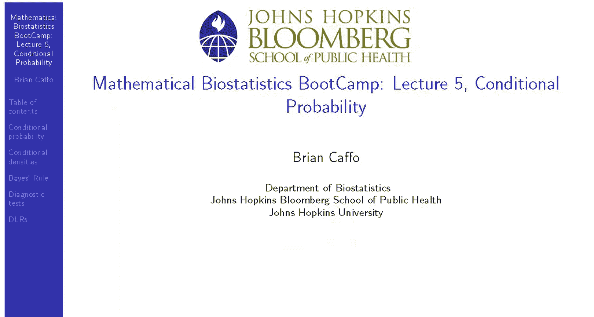
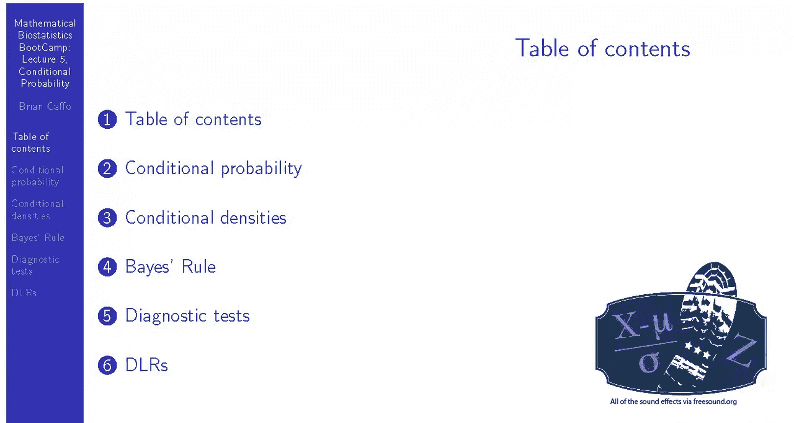
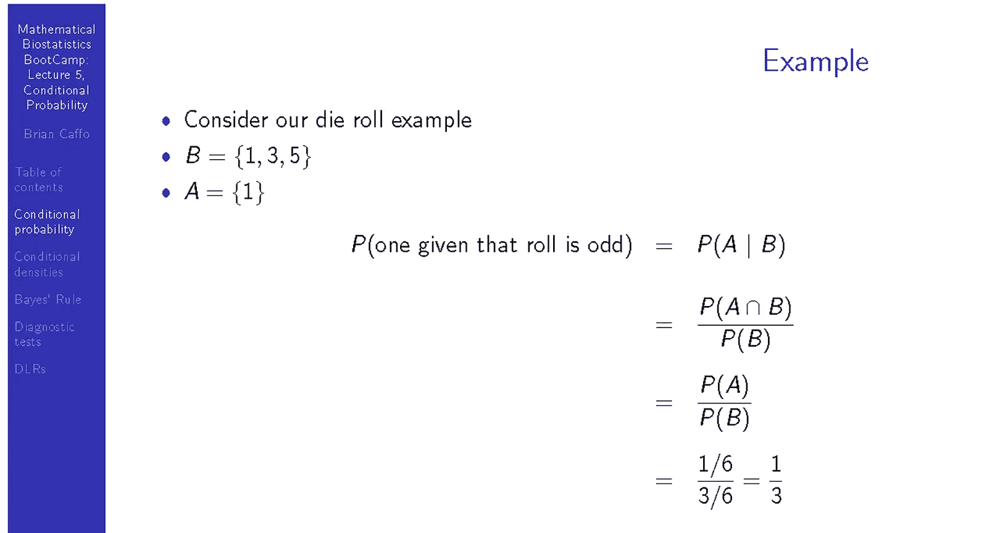
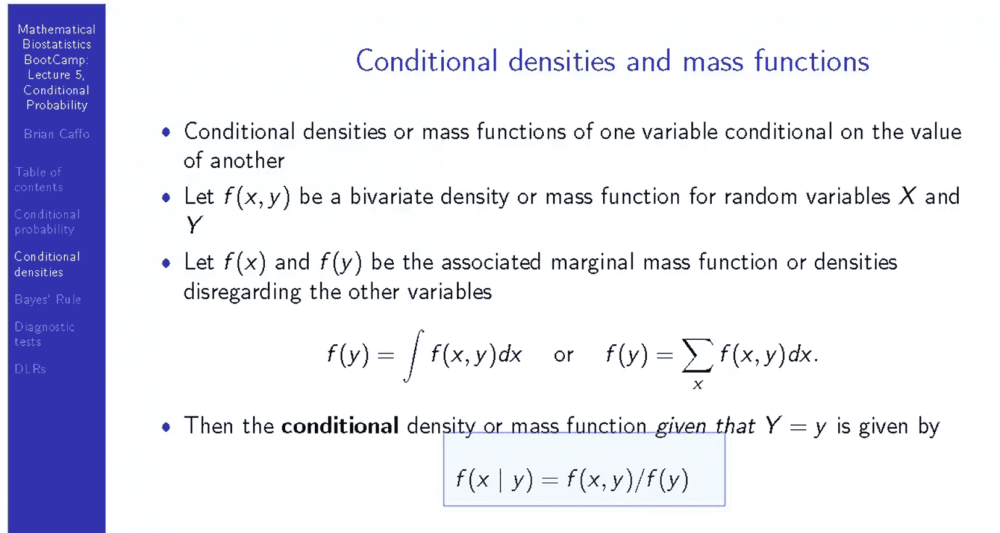
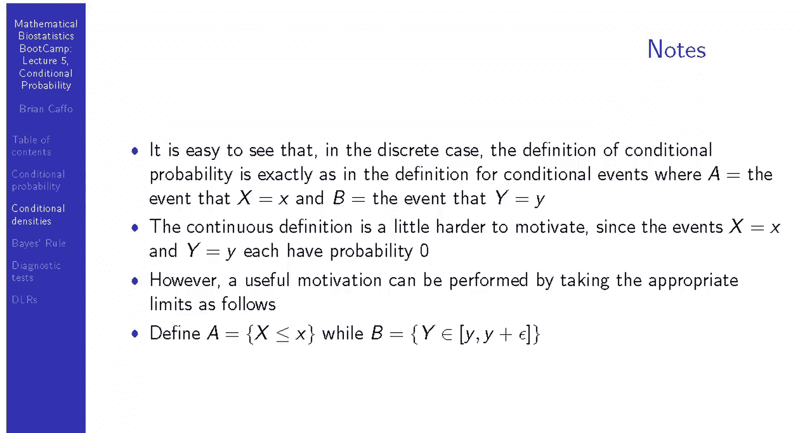
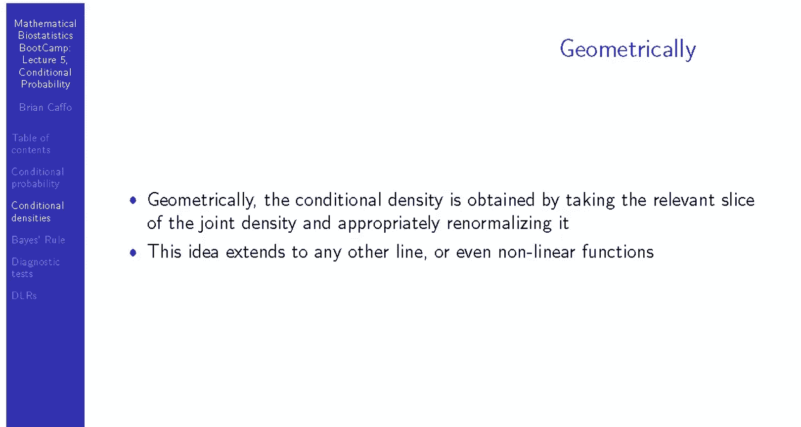
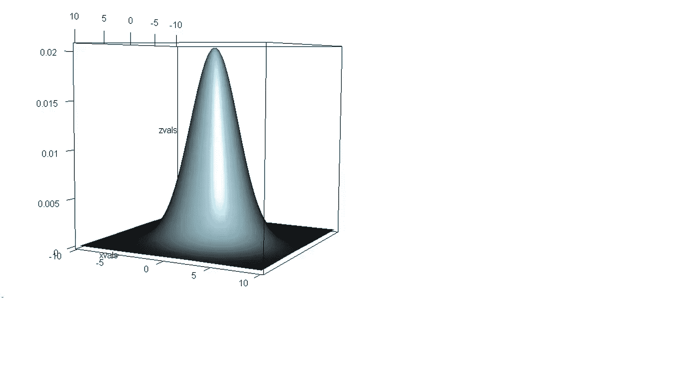
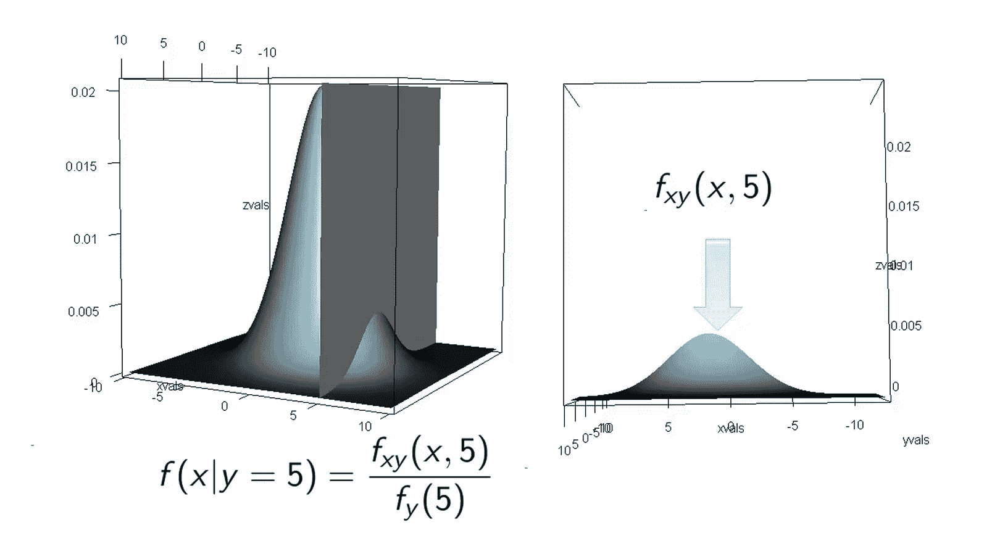
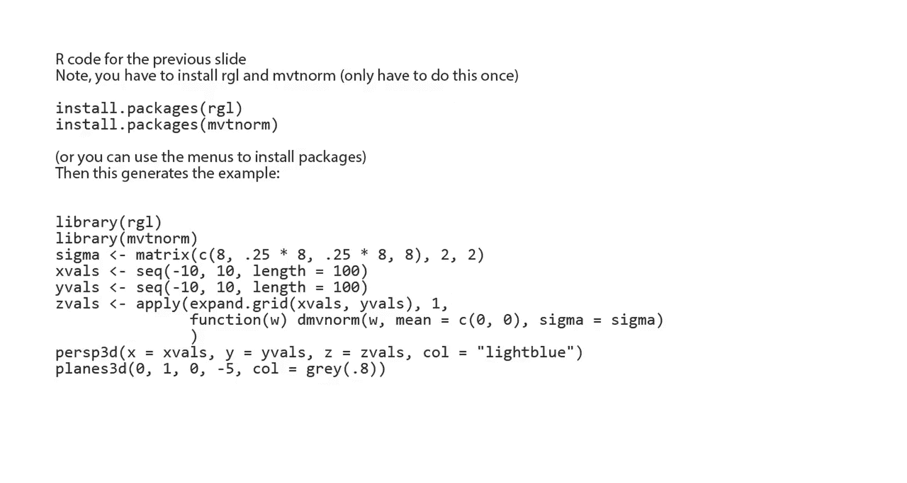
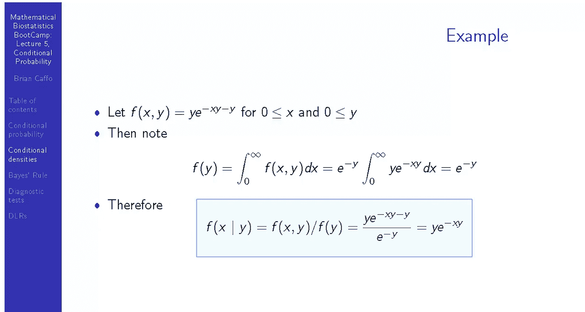

#  014：条件概率与条件密度 📊

在本节课中，我们将学习条件概率及其相关的密度函数。我们将从条件概率的基本定义开始，然后探讨离散随机变量的条件质量函数和连续随机变量的条件密度。接着，我们会介绍贝叶斯规则，并通过诊断测试的例子来展示其应用。最后，我们会简要讨论诊断似然比的概念。

## 条件概率的基本概念

上一节我们概述了课程内容，本节中我们来看看条件概率的正式定义。条件概率描述了在已知某个事件发生的情况下，另一个事件发生的概率。

设事件B的概率大于零，即 **P(B) > 0**。事件A在给定B发生条件下的条件概率定义为：

**P(A | B) = P(A ∩ B) / P(B)**

如果事件A和B相互独立，那么 **P(A ∩ B) = P(A)P(B)**。代入公式后，**P(B)** 会被约去，得到 **P(A | B) = P(A)**。这与我们的直觉一致：如果两个事件独立，知道其中一个事件发生并不会改变另一个事件发生的概率。

让我们用一个掷骰子的例子来验证这个公式。假设我们想知道掷出1点的概率，但已知掷出的点数是奇数（即1、3或5）。根据公式：
*   A是“掷出1点”的事件。
*   B是“掷出奇数点”的事件。
*   由于A是B的子集，**A ∩ B = A**。
*   因此，**P(A | B) = P(A) / P(B) = (1/6) / (3/6) = 1/3**。

这个结果与我们的直觉相符。

## 从事件到随机变量：条件密度与质量函数

理解了事件的条件概率后，本节中我们来看看如何将其扩展到随机变量。条件密度或质量函数描述了在已知另一个随机变量取特定值时，某个随机变量的概率分布行为。

设 **f(x, y)** 是随机变量X和Y的联合密度（或质量）函数。X和Y的边际密度（或质量）函数分别为：
*   **f(x) = ∫ f(x, y) dy** （对连续变量）或 **∑ f(x, y)** （对离散变量）
*   **f(y) = ∫ f(x, y) dx** （对连续变量）或 **∑ f(x, y)** （对离散变量）

那么，给定 **Y = y** 时，X的条件密度（或质量）函数定义为：

**f(x | y) = f(x, y) / f(y)**

对于离散随机变量，这个定义直接来源于事件的条件概率公式，其中A是事件 **{X = x}**，B是事件 **{Y = y}**。

对于连续随机变量，由于 **P(Y = y) = 0**，直接套用事件公式会遇到问题。其动机可以通过考虑一个微小区间来理解：我们不是条件于 **Y = y**，而是条件于 **Y ∈ [y, y+ε]**。当 **ε → 0** 时，通过极限过程，我们可以得到上述条件密度的定义。条件密度有一个很好的几何解释：联合密度 **f(x, y)** 是一个曲面。固定 **Y = y** 相当于用一个垂直平面去切割这个曲面，得到的剖面线就是 **f(x, y)**，再除以 **f(y)** 进行归一化，使其积分为1，就得到了条件密度 **f(x | y)**。

## 条件密度计算示例

让我们通过一个具体例子来巩固对条件密度的理解。

假设随机变量X和Y的联合密度函数为：
**f(x, y) = y e^{-xy - y}**, 其中 **x > 0, y > 0**

首先，我们计算Y的边际密度 **f(y)**：
**f(y) = ∫_{0}^{∞} f(x, y) dx = ∫_{0}^{∞} y e^{-xy - y} dx = e^{-y}**

接着，根据定义，给定 **Y = y** 时，X的条件密度为：
**f(x | y) = f(x, y) / f(y) = (y e^{-xy - y}) / (e^{-y}) = y e^{-xy}**

例如，如果我们想知道在 **Y = 3** 的条件下，X的分布，只需将 **y = 3** 代入：
**f(x | y=3) = 3 e^{-3x}**, 其中 **x > 0**

这个函数就描述了在已知Y等于3的情况下，X取不同值的概率密度。

## 贝叶斯规则及其应用

在掌握了条件概率和密度的计算后，本节中我们来看看一个非常重要的工具——贝叶斯规则。贝叶斯规则提供了一种在获得新证据后更新概率的方法。

从条件概率的定义出发：
**P(A | B) = P(A ∩ B) / P(B)** 且 **P(B | A) = P(A ∩ B) / P(A)**

由于两个公式的分子相同，我们可以联立得到贝叶斯规则：

**P(A | B) = [P(B | A) P(A)] / P(B)**

在更一般的形式下，如果事件 **A_1, A_2, ..., A_k** 构成样本空间的一个划分（即它们互斥且并集为全集），那么对于任意事件B，有：

**P(A_j | B) = [P(B | A_j) P(A_j)] / [∑_{i=1}^{k} P(B | A_i) P(A_i)]**

贝叶斯规则在医学诊断、机器学习、垃圾邮件过滤等领域有广泛应用。

## 诊断测试中的贝叶斯规则示例

让我们通过一个医学诊断测试的例子来具体应用贝叶斯规则。这有助于我们理解先验概率如何被新证据（测试结果）更新。

假设：
*   某种疾病的患病率为 **P(D) = 0.001**。
*   测试的灵敏度（真阳性率）为 **P(+ | D) = 0.99**。
*   测试的特异度（真阴性率）为 **P(- | 非D) = 0.99**。

现在，如果一个人检测结果为阳性（+），我们想知道他实际患病的概率 **P(D | +)**。

根据贝叶斯规则：
**P(D | +) = [P(+ | D) P(D)] / P(+)**

我们需要计算 **P(+)**，即检测结果为阳性的总概率。这包括真阳性和假阳性：
**P(+) = P(+ | D)P(D) + P(+ | 非D)P(非D)**
其中，**P(+ | 非D) = 1 - P(- | 非D) = 0.01**，**P(非D) = 0.999**。

代入计算：
**P(+) = (0.99 * 0.001) + (0.01 * 0.999) = 0.00099 + 0.00999 = 0.01098**

因此，
**P(D | +) = (0.99 * 0.001) / 0.01098 ≈ 0.0902**

这个结果意味着，即使测试准确率高达99%，一个阳性结果的人实际患病的概率也只有约9%。这是因为疾病本身非常罕见（先验概率低），假阳性的数量相对更多。这个例子突出了在解读测试结果时考虑基础概率（先验概率）的重要性。

## 诊断似然比简介

在诊断测试的语境下，我们常常使用似然比来量化测试结果提供的证据强度。诊断似然比是另一个有用的概念。

阳性似然比（LR+）定义为：
**LR+ = 灵敏度 / (1 - 特异度) = P(+ | D) / P(+ | 非D)**

阴性似然比（LR-）定义为：
**LR- = (1 - 灵敏度) / 特异度 = P(- | D) / P(- | 非D)**

似然比大于1表示测试结果支持患病假设，小于1则支持未患病假设。其绝对值越大，提供的证据强度越强。结合先验概率（患病率），可以通过以下公式快速估算后验概率：
**后验优势 = 先验优势 × 似然比**
其中，优势（Odds）定义为 **概率 / (1 - 概率)**。

---

本节课中我们一起学习了条件概率的核心思想及其数学表达。我们从事件的条件概率定义出发，将其推广到随机变量的条件密度和质量函数，并通过几何图像和具体计算加深理解。随后，我们介绍了强大的贝叶斯规则，它描述了如何用新信息更新概率，并通过一个诊断测试的例子展示了其实际应用和反直觉的结果。最后，我们简要提及了诊断似然比作为评估测试效能的工具。掌握这些概念是理解更复杂统计模型和机器学习算法的基础。