#  017：常见分布 🎲

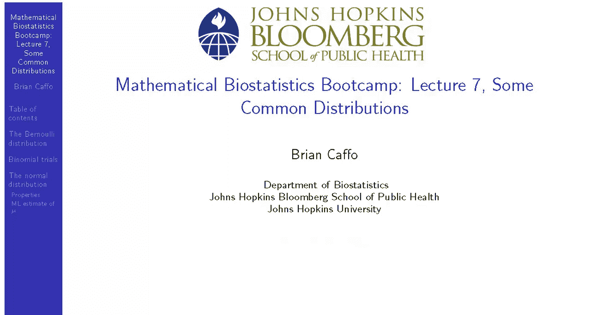

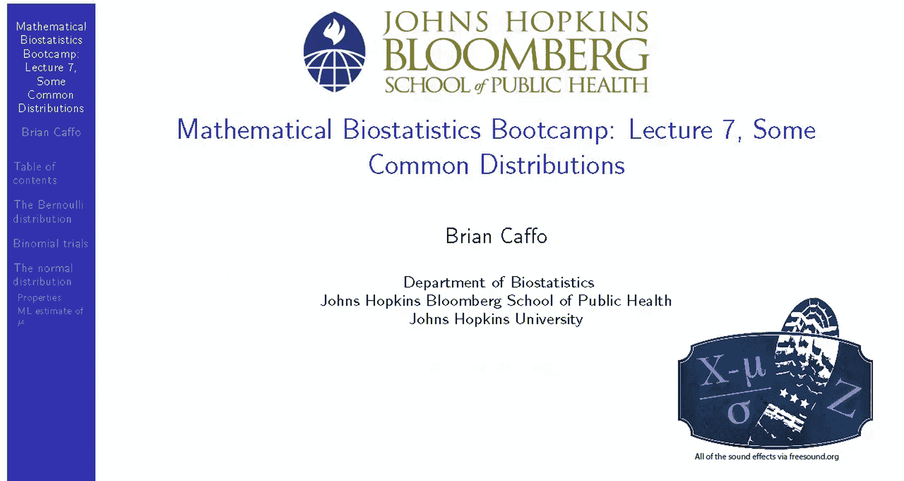

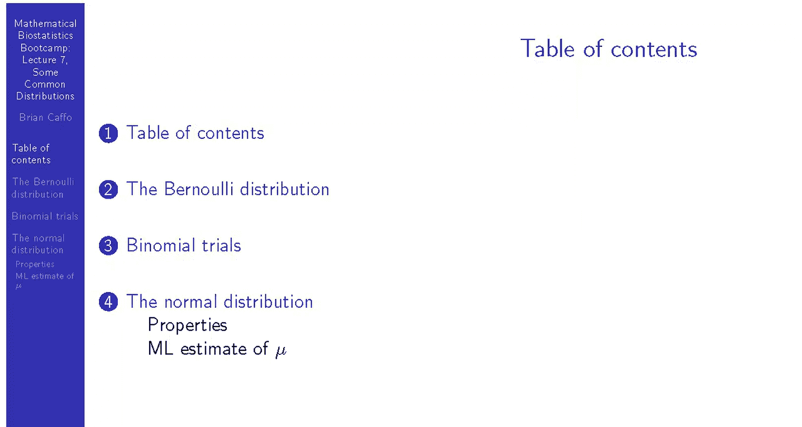

在本节课中，我们将学习三种重要的概率分布：伯努利分布、二项分布以及高斯（正态）分布。这些分布是理解数据科学中统计推断的基础。

## 伯努利分布

伯努利分布以雅各布·伯努利命名，它本质上是对一次“抛硬币”试验的数学描述。

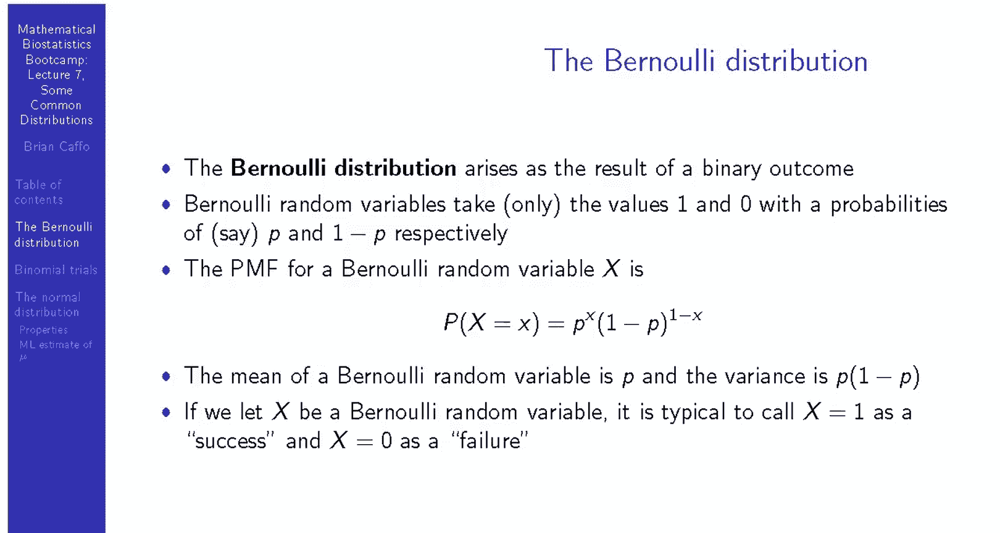

一个伯努利随机变量只能取两个值：0和1。其概率质量函数为：
`P(X = x) = p^x * (1-p)^(1-x)`，其中 `x` 可以是0或1，`p` 是取值为1的概率（介于0和1之间）。

该分布的均值为 `p`，方差为 `p * (1-p)`。在应用中，通常将结果“1”编码为“成功”，结果“0”编码为“失败”，无论该事件本身是否真的代表成功。

上一节我们介绍了伯努利分布的基本概念，本节中我们来看看其似然函数。

## 伯努利似然函数

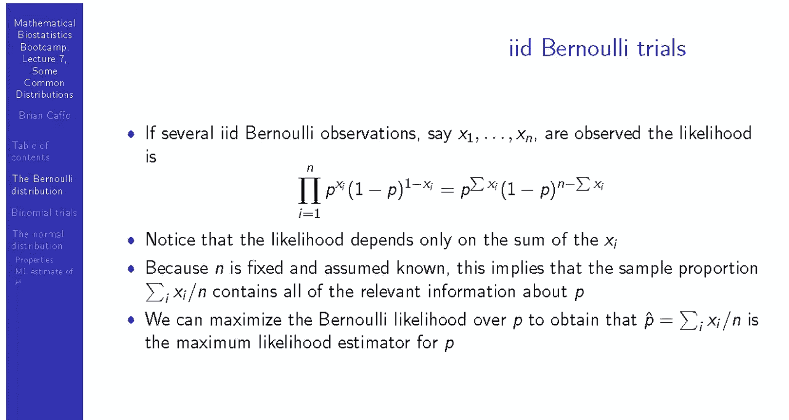

假设我们观测到 `n` 个独立同分布的伯努利试验结果 `x1, x2, ..., xn`（每个是0或1）。那么，关于参数 `p` 的似然函数为：
`L(p) = ∏ [p^xi * (1-p)^(1-xi)] = p^(∑xi) * (1-p)^(n - ∑xi)`。

这个公式表明，似然函数仅依赖于所有观测值的总和 `∑xi`（即总成功次数）。因此，样本比例 `∑xi / n` 包含了关于参数 `p` 的全部信息，这被称为充分性。最大似然估计量 `p_hat` 正是这个样本比例。

以下是伯努利似然函数的一个示例：
假设我们抛一枚硬币4次。根据观测到的正面次数（0到4次），我们可以绘制出不同的似然函数曲线。这些曲线都以各自的最大似然估计值（即观测到的正面比例）为峰值，并随着数据的变化而左右移动。即使观测到全部是正面或全部是反面，似然函数也不会完全集中在 `p=1` 或 `p=0` 处，它正确地反映了参数的不确定性。

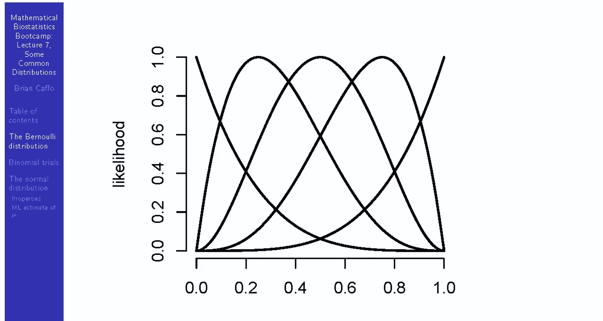

## 二项分布

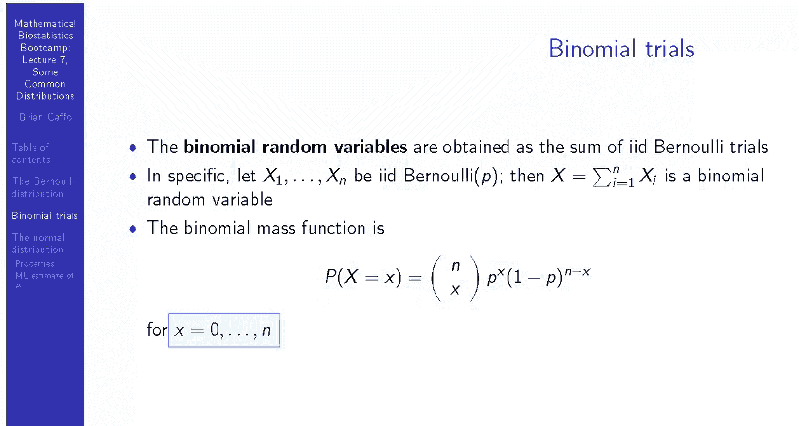

二项分布描述的是 `n` 次独立伯努利试验中“成功”次数的分布。它是伯努利分布的推广。

具体来说，如果 `X1, X2, ..., Xn` 是独立同分布的伯努利随机变量，那么它们的和 `X = ∑Xi` 就是一个二项随机变量，记作 `X ~ Binomial(n, p)`。

其概率质量函数为：
`P(X = x) = C(n, x) * p^x * (1-p)^(n-x)`，其中 `x` 可以取0到 `n` 之间的任何整数。

这里，`C(n, x)` 是组合数，计算公式为 `n! / (x! * (n-x)!)`，它表示从 `n` 个不同元素中不计顺序地选取 `x` 个元素的方法数。

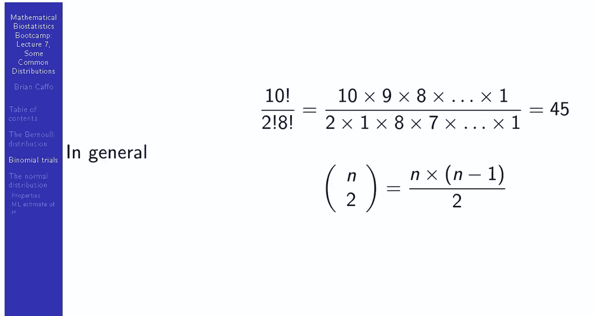

## 理解二项式系数

组合数 `C(n, x)` 出现在二项分布公式中，是为了计算在 `n` 次试验中，恰好出现 `x` 次“成功”的所有可能序列的数目。

例如，考虑在10次抛硬币试验中得到6次正面的概率。任何特定的、恰好包含6次正面和4次反面的序列（如“正正正正正正反反反反”）的概率都是 `p^6 * (1-p)^4`。我们需要计算所有这样的可能序列有多少个。这等价于从10个位置中选择6个来放置“正面”，其方法数正是 `C(10, 6)`。因此，总概率就是 `C(10, 6) * p^6 * (1-p)^4`。这个逻辑可以推广到一般情况。

## 二项分布应用示例

让我们通过一个例子来应用二项分布公式。

假设你有一位朋友有8个孩子，其中7个是女孩（没有双胞胎）。如果我们假设每次生育生女孩的概率是50%，并且各次生育的性别是独立的，那么观察到7个或更多女孩的概率是多少？

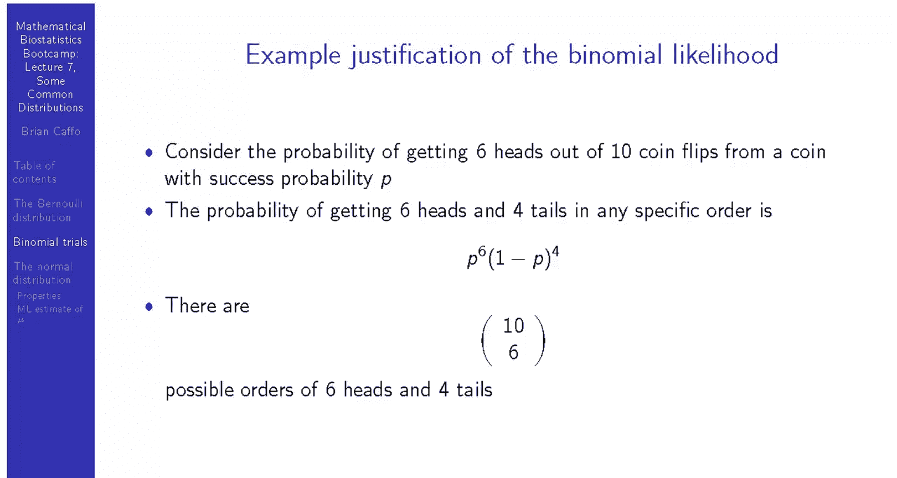

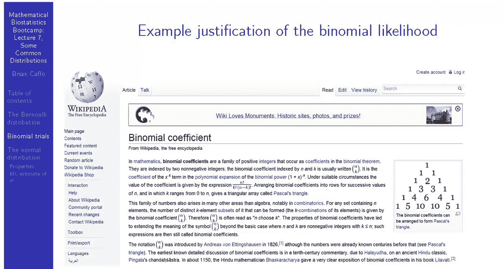

这相当于计算 `X ~ Binomial(8, 0.5)` 时，`P(X >= 7)` 的概率。
*   `P(X = 7) = C(8, 7) * (0.5)^7 * (0.5)^1 = 8 * (1/2)^8 = 8/256`
*   `P(X = 8) = C(8, 8) * (0.5)^8 * (0.5)^0 = 1 * (1/2)^8 = 1/256`
*   因此，`P(X >= 7) = (8 + 1) / 256 = 9/256 ≈ 0.035`，即大约3.5%。

这个计算在统计学中是一个 **P值** 的例子。P值是在某个原假设（此处为“生女孩概率为50%”）成立的条件下，观察到与实际结果一样极端或更极端结果的概率。一个很小的P值可能提示原假设值得怀疑。我们在此仅用它来演示二项公式的计算。

下图展示了在这个二项试验（8次试验，7次成功）中，关于参数 `p` 的似然函数。可以看到，似然函数在 `p = 7/8` 处达到峰值，并且 `p = 0.5` 位于似然函数的较低位置，这直观地展示了数据对不同 `p` 值的支持程度。

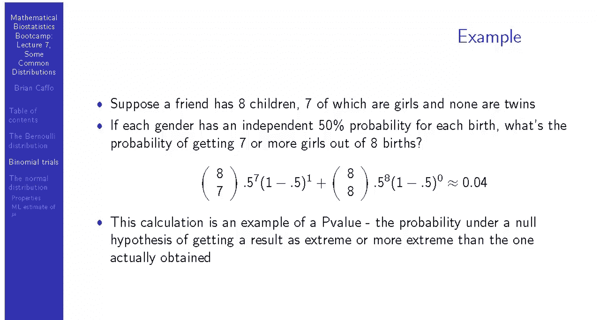

## 高斯（正态）分布预告

在本节课中，我们一起学习了伯努利分布及其似然函数，并深入探讨了由其衍生出的二项分布。二项分布是处理计数型“成功”数据的核心工具。最后，我们提到了统计学中极其重要的高斯分布（正态分布），它堪称概率分布中的“王者”，我们将在后续课程中详细学习。

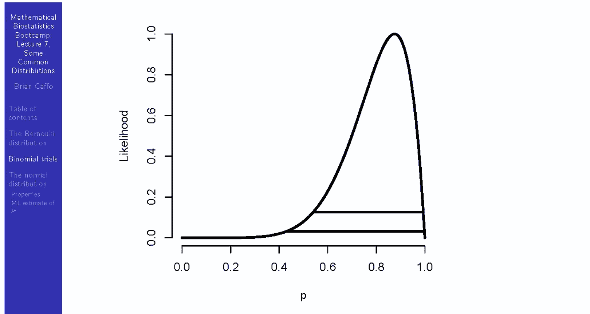

---
**本节课中我们一起学习了：**
1.  **伯努利分布**：描述单次二值试验（如抛硬币）的分布。
2.  **伯努利似然函数**：基于观测数据评估参数 `p` 的可能性，并理解了充分统计量的概念。
3.  **二项分布**：描述 `n` 次独立伯努利试验中成功次数的分布，其公式为 `P(X=x) = C(n,x) * p^x * (1-p)^(n-x)`。
4.  **二项分布的应用与P值**：通过实际例子计算概率，并引入了P值作为统计推断的基本概念。