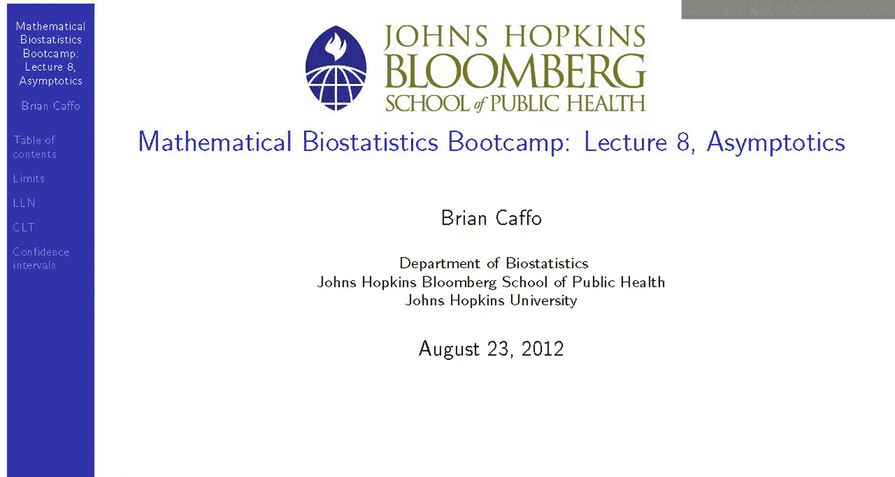
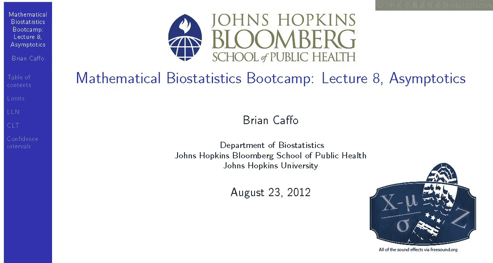
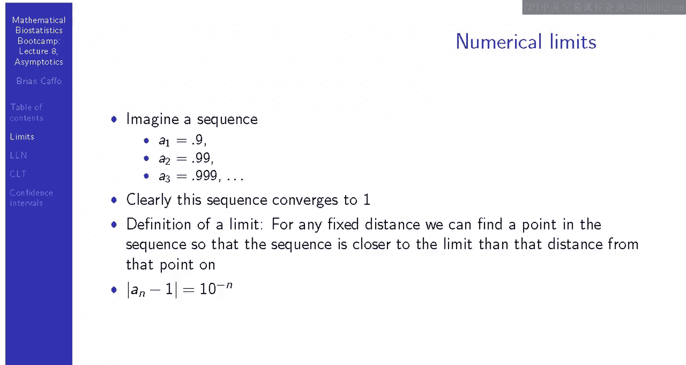
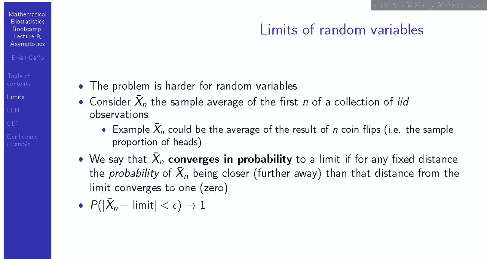
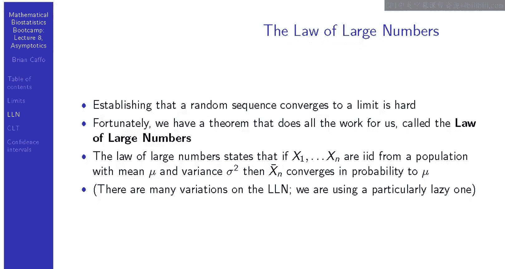
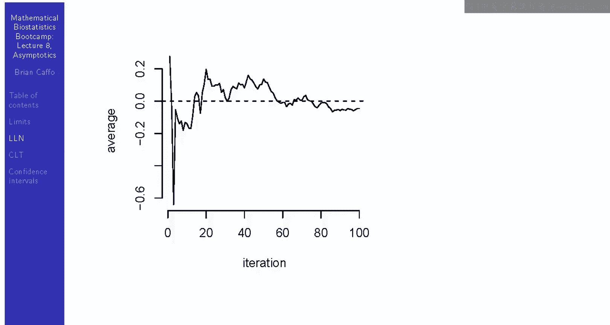
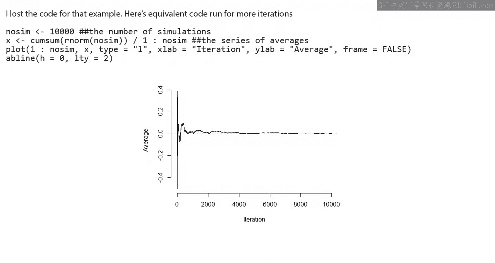
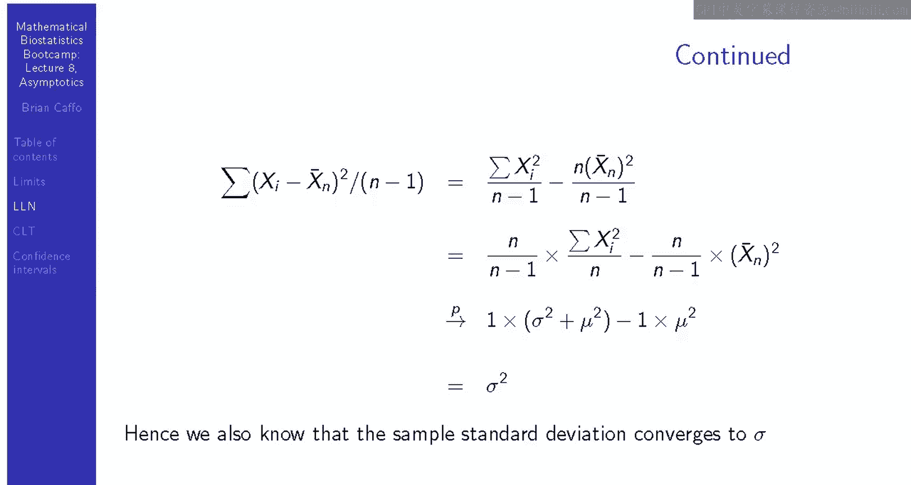
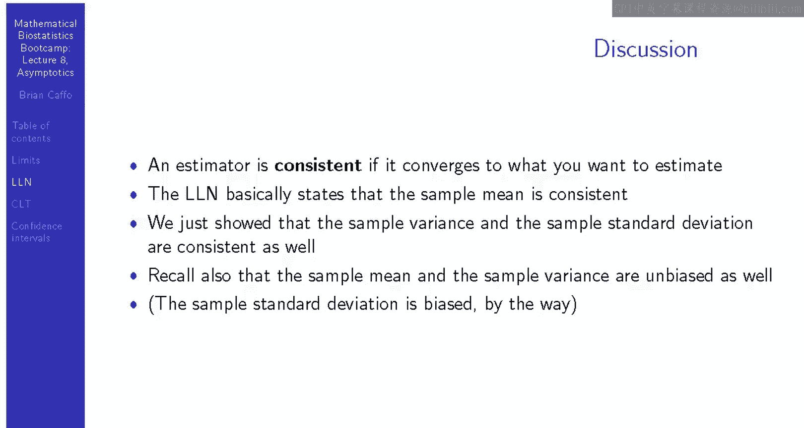

#  019：渐近理论 🧮





在本节课中，我们将学习渐近理论。渐近理论探讨的是当数据量趋于无穷大时，统计量的行为。我们将重点介绍两个核心工具：**大数定律**和**中心极限定理**。这些理论是理解统计推断中许多重要结论的基础。

## 极限与随机变量



上一节我们介绍了课程概述，本节中我们来看看极限的概念。首先，我们回顾一下数值序列的极限。

一个序列 `a1 = 0.9, a2 = 0.99, a3 = 0.999, ...` 会收敛到 1。极限的正式定义是：对于任意固定的距离 `ε`，我们都能在序列中找到一点 `N`，使得从该点之后，序列中的所有项与极限值的距离都小于 `ε`。

然而，当我们讨论随机变量（例如，一系列独立同分布观测值的平均值）的极限时，情况就复杂多了。我们不能简单地说随机变量序列“收敛”到一个数，因为每次实验的结果都是随机的。



因此，我们引入**依概率收敛**的概念。对于一个随机变量序列 `X_n`，我们说它依概率收敛于一个常数 `c`，如果对于任意 `ε > 0`，都有：
```
P(|X_n - c| < ε) → 1  当 n → ∞
```
换句话说，随着 `n` 增大，`X_n` 的值以任意高的概率落在 `c` 的任意小邻域内。这样，我们就把随机变量的收敛问题，转化为了一个概率数值序列的收敛问题。

## 大数定律 📈



上一节我们定义了随机变量的收敛，本节中我们来看看一个确保收敛的强大定理：大数定律。

大数定律是统计学中最基本和最重要的定理之一。它指出，对于独立同分布的随机变量 `X_1, X_2, ..., X_n`，如果其总体均值为 `μ`，方差 `σ^2` 有限，那么样本均值 `X̄_n` 依概率收敛于总体均值 `μ`。

用公式表示：
```
X̄_n = (X_1 + X_2 + ... + X_n) / n
```
当 `n → ∞` 时，`X̄_n` 依概率收敛于 `μ`。

这个定理的直观意义是：随着样本量无限增大，样本平均值会无限接近真实的总体平均值。这为使用样本均值估计总体均值提供了理论依据。

我们可以利用切比雪夫不等式来简单证明大数定律。切比雪夫不等式指出，对于任意 `k > 0`，有：
```
P(|X - μ| ≥ kσ) ≤ 1/k²
```
将其应用于样本均值 `X̄_n`（其标准差为 `σ/√n`），并令 `k = ε / (σ/√n)`，我们可以推导出：
```
P(|X̄_n - μ| ≥ ε) ≤ σ² / (nε²)
```
当 `n → ∞` 时，不等式右边趋于 0，因此概率 `P(|X̄_n - μ| ≥ ε)` 也趋于 0，这等价于 `X̄_n` 依概率收敛于 `μ`。





## 大数定律的推论与应用

上一节我们证明了大数定律，本节中我们来看看它的一些重要推论和应用。

以下是基于大数定律和收敛序列运算规则得出的一些有用结论：

*   **函数收敛**：若 `X_n` 依概率收敛于 `c`，则 `g(X_n)` 依概率收敛于 `g(c)`（`g` 为连续函数）。例如，`(X̄_n)²` 收敛于 `μ²`。
*   **样本方差收敛**：样本方差 `S²`（无论分母是 `n` 还是 `n-1`）依概率收敛于总体方差 `σ²`。
*   **样本标准差收敛**：样本标准差 `S` 依概率收敛于总体标准差 `σ`。

这些结论共同表明，我们常用的样本统计量（均值、方差、标准差）都是其对应总体参数的**相合估计量**。相合性是指当样本量趋于无穷大时，估计量依概率收敛于被估计的参数值。这是一个估计量应具备的基本但较弱的性质。

需要注意的是，相合性不同于无偏性。例如，样本标准差 `S` 是 `σ` 的相合估计，但它通常是有偏的。评价一个估计量的好坏需要综合考虑其偏差、方差、相合性等多种性质。

## 中心极限定理 ⚖️



上一节我们讨论了大数定律，它描述了样本均值收敛于总体均值。本节中我们来看看中心极限定理，它描述了这种收敛的**分布形态**。

中心极限定理是概率论和统计学中另一个里程碑式的定理。它指出，对于独立同分布的随机变量 `X_1, X_2, ..., X_n`（均值为 `μ`，方差为 `σ^2`），其样本均值 `X̄_n` 的标准化形式，随着 `n` 增大，其分布会趋近于标准正态分布。

用公式表示：
```
Z_n = (X̄_n - μ) / (σ/√n)
```
当 `n → ∞` 时，`Z_n` 的分布趋近于标准正态分布 `N(0, 1)`。

这意味着，无论原始总体 `X` 的分布形状如何（可以是偏态的、离散的等），只要样本量足够大，样本均值的抽样分布都近似服从正态分布。这个定理为许多统计推断方法（如构造置信区间、进行假设检验）提供了理论基础，因为它允许我们在不知道总体具体分布的情况下，使用正态分布来近似样本均值的分布。

---



本节课中我们一起学习了渐近理论的核心内容。我们首先回顾了极限概念，并将其扩展到随机变量的**依概率收敛**。然后，我们深入探讨了**大数定律**，它保证了样本均值是总体均值的相合估计。最后，我们介绍了**中心极限定理**，它揭示了样本均值标准化后的抽样分布近似为正态分布，这是许多统计推断方法的基石。理解这些渐近理论，对于掌握更高级的统计建模和数据分析至关重要。