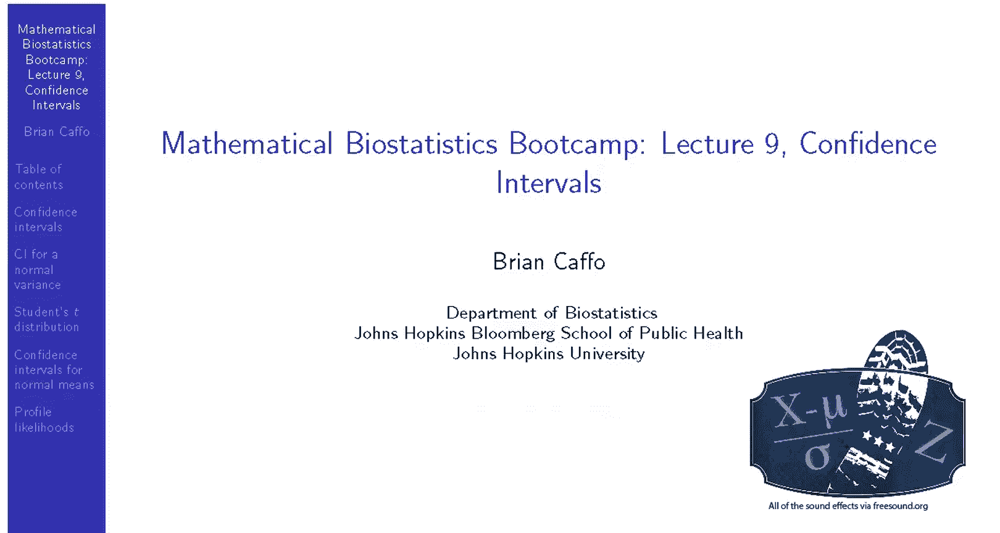
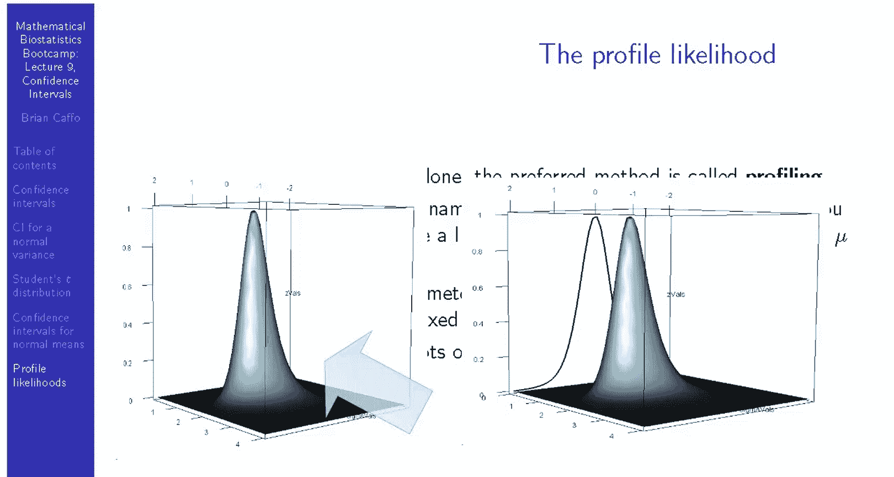
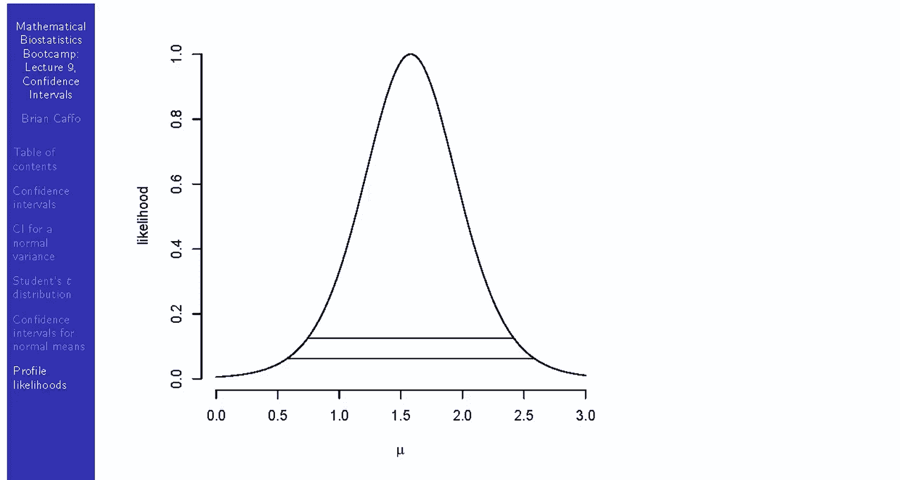

#  023：轮廓似然法



在本节课中，我们将学习一种称为“轮廓似然法”的技术。该方法用于从多变量似然函数中，提取出针对单个参数的似然函数。我们将以双变量正态分布为例，具体演示如何获取仅关于均值参数 μ 的似然函数。

## 概述

轮廓似然法是一种处理多参数模型的技术。当我们只关心其中一个参数（例如 μ），而将其他参数（例如 σ）视为“讨厌参数”时，可以通过“轮廓化”过程，得到一个仅关于目标参数的一维似然函数。这就像从三维曲面的阴影中观察其轮廓。

## 核心思想

上一节我们介绍了多变量似然函数是一个曲面。本节中我们来看看如何从中提取单变量信息。

想象一个关于参数 μ 和 σ 的双变量似然函数曲面。轮廓似然法的过程，可以类比为沿着 σ 轴的方向照射一束光，然后观察该曲面在 μ 轴所在平面上投下的“阴影”。这个阴影的轮廓线，就是关于 μ 的轮廓似然函数。



## 数学推导

现在，我们来具体执行这个过程的数学计算。

### 固定参数值

首先，我们选定一个特定的 μ 值，记作 μ₀。我们的目标是找出在 μ = μ₀ 这条线上，似然函数能达到的最大值。这相当于在固定 μ = μ₀ 的条件下，对另一个参数 σ² 求似然函数的最大值。

给定独立同分布的数据 X₁, X₂, ..., Xₙ ~ N(μ, σ²)，当 μ 固定为 μ₀ 时，联合似然函数为：
```
L(σ² | μ=μ₀) = ∏ (1/√(2πσ²)) * exp(-(Xᵢ - μ₀)²/(2σ²))
           = (σ²)^{-n/2} * exp(-∑(Xᵢ - μ₀)²/(2σ²))
```

### 求解条件最大似然估计

为了找到在 μ=μ₀ 条件下使似然函数最大的 σ²，我们对上述似然函数取对数，然后对 σ² 求导并令其为零（为方便求导，可将 σ² 视为一个整体参数 θ）。

求解过程如下：
1.  取对数：`l(σ²) = -(n/2) log(σ²) - (1/(2σ²)) * ∑(Xᵢ - μ₀)²`
2.  对 σ² 求导并令导数为零，解得 σ² 的条件最大似然估计量为：
    ```
    σ̂²(μ₀) = (1/n) * ∑(Xᵢ - μ₀)²
    ```
    这是一个很好的结果：当均值固定为 μ₀ 时，方差 σ² 的估计量就是以 μ₀ 为中心的样本方差。

### 构建轮廓似然函数

这个 `σ̂²(μ₀)` 就是当 μ=μ₀ 时，似然曲面在 σ 方向上的最高点。我们将这个估计值代回原始的似然函数中，就得到了在 μ=μ₀ 这一点上的轮廓似然值。

将 `σ̂²(μ₀)` 代入似然函数：
```
L_p(μ₀) = [∑(Xᵢ - μ₀)² / n]^{-n/2} * e^{-n/2}
```
其中 `e^{-n/2}` 是一个与 μ₀ 无关的常数，在比较不同 μ 值的似然度时可以忽略。

对每一个可能的 μ 值重复此过程，我们就得到了关于 μ 的轮廓似然函数：
```
L_p(μ) ∝ [∑(Xᵢ - μ)²]^{-n/2}
```

### 轮廓似然的性质

以下是轮廓似然函数的一个重要性质：
*   轮廓似然函数的最大值点，就是完整模型（同时估计 μ 和 σ）的最大似然估计量。在本例中，使 `L_p(μ)` 最大的 μ 值正是样本均值 `X̄`。
*   为了使轮廓似然函数的最大值为1（便于解释和绘图），我们可以将其除以其在 `μ = X̄` 处取得的最大值进行归一化。

## R 代码示例

让我们通过 R 代码，使用睡眠数据集来实际生成轮廓似然函数图。

```r
# 假设 sleep_data 是您的数据向量
sleep_data <- c(...) # 您的数据
n <- length(sleep_data)
x_bar <- mean(sleep_data)

# 创建一系列 mu 值
mu_values <- seq(from = 0, to = 3, length.out = 1000)

# 计算轮廓似然函数值（已归一化）
profile_likelihood <- sapply(mu_values, function(mu) {
  s <- sum((sleep_data - mu)^2) / sum((sleep_data - x_bar)^2)
  return(s^(-n/2))
})

# 绘图
plot(mu_values, profile_likelihood, type = "l", 
     xlab = expression(mu), ylab = "轮廓似然度",
     main = "关于 μ 的轮廓似然函数")
# 添加似然区间参考线（例如，1/8 和 1/16 似然区间）
abline(h = 1/8, lty = 2, col = "gray")
abline(h = 1/16, lty = 2, col = "gray")
```

运行这段代码将得到关于 μ 的轮廓似然函数图。这条曲线就是当我们沿着 σ 轴方向“照射”双变量似然曲面时，在 μ 轴“墙面”上得到的阴影轮廓。

## 解释与应用

得到的轮廓似然函数可以像普通的单变量似然函数一样使用：
*   **更高的值**表示该 μ 值得到数据的支持更强。
*   **峰值点** `X̄` 就是 μ 的最大似然估计。
*   我们可以通过**绘制水平线**（例如在似然度为峰值 1/8 或 1/16 处）来获取 μ 的似然比置信区间。

## 总结

本节课中我们一起学习了轮廓似然法。这是一种从多参数模型中，提取针对单个参数的似然函数的强大技术。我们以双变量正态分布为例，详细推导了其数学过程，并通过 R 代码进行了演示。轮廓似然函数保留了似然推断的核心思想，允许我们为感兴趣的参数构建区间估计，同时考虑了其他“讨厌参数”的不确定性。

---

**关于 t 区间的一个补充说明**：课程中常被问到，何时可以从学生 t 置信区间切换到标准正态区间。关键在于，t 区间在样本量增大时会收敛到正态区间。因此，最稳妥的做法是**始终使用 t 置信区间**。当样本量足够大时，t 分位数自然会接近正态分位数，这样你就不必担心切换阈值的问题。




在接下来的课程中，我们将把置信区间的概念扩展到更一般的场景，例如多组数据比较的情况。