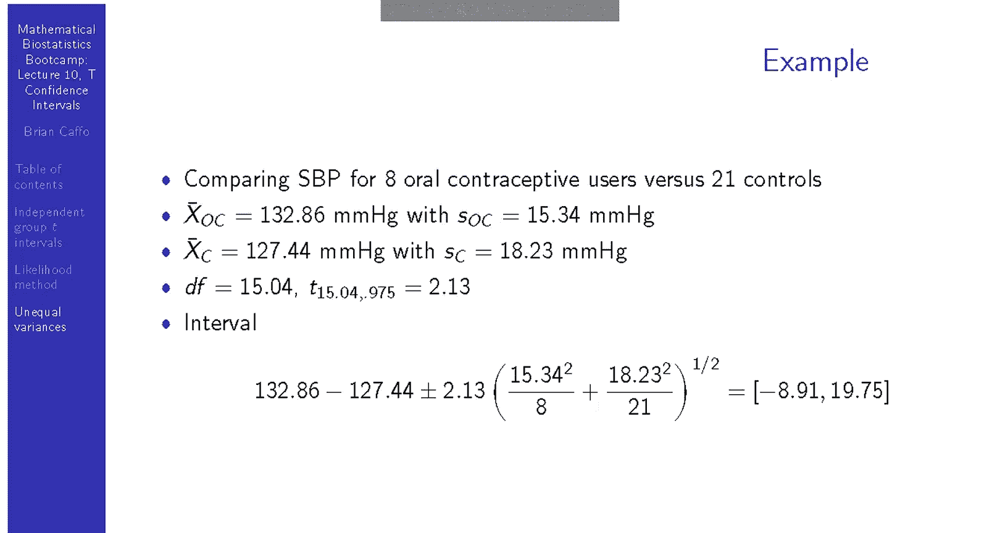

#  024：T置信区间 🎯

在本节课中，我们将学习如何为两个独立组的均值差异构建T置信区间。上一讲我们讨论了单个均值或配对观测的T区间，本节我们将探讨当拥有两个独立组时的情况。我们将简要介绍构建似然的方法，并讨论当组间方差不等时应如何处理。

## 问题引入

假设我们想在一项随机试验中比较两个组的平均血压：接受治疗的组和接受安慰剂的组。与上周讨论的同一受试者在治疗前后进行比较（配对）不同，这两个组是完全独立的。因此，我们不能使用相同的程序，不能对测量值进行配对差分。事实上，两个组的样本量可能不同，这使我们无法使用配对方法。本讲将讨论在拥有独立样本时，如何研究组间总体均值差异的方法。我们将看到，其方法与上周所学的非常相似，核心思想几乎相同。

## 假设与设定

首先，我们介绍构建第一种T区间变体所需的一些假设。

我们有两组数据：
*   第一组：`x1, x2, ..., x_nx`，它们是独立同分布的正态随机变量，均值为 `μ_x`，方差为 `σ^2`。
*   第二组：`y1, y2, ..., y_ny`，它们是独立同分布的正态随机变量，均值为 `μ_y`，方差也为 `σ^2`。

**注意**：目前我们假设两组方差相等。我们可以将 `x` 视为处理组，`y` 视为对照组。

我们定义：
*   `x_bar` 和 `y_bar` 为两组样本均值。
*   `S_x` 和 `S_y` 为两组样本标准差。

我们的目标是估计参数 `μ_y - μ_x`（或 `μ_x - μ_y`），并构建一个置信区间来量化估计该参数时的不确定性。

## 估计量与标准误

`μ_y - μ_x` 的一个明显估计量是 `y_bar - x_bar`。任何区间都应以此点为中心。

我们需要计算这个估计量的标准误。根据我们的假设，`y_bar - x_bar` 的方差为：
`Var(y_bar - x_bar) = σ^2 * (1/nx + 1/ny)`

我们需要估计这个方差。一个非常好的估计量是**合并方差估计量** `S_p^2`，其公式为：
`S_p^2 = [(nx - 1) * S_x^2 + (ny - 1) * S_y^2] / (nx + ny - 2)`

这个估计量是两组方差的加权平均。如果两组样本量相等（`nx = ny`），则 `S_p^2` 就是两个样本方差的算术平均。如果一组样本量更大，则该组的方差估计在加权平均中会获得更大的权重，这符合我们的直觉，因为数据更多的组其方差估计更可靠。可以证明，`S_p^2` 是 `σ^2` 的无偏估计。

此外，`y_bar - x_bar` 与合并方差估计量 `S_p^2` 是独立的。

## 构建T统计量

基于以上，我们可以构建一个服从T分布的统计量。过程与单样本情况类似：

1.  我们知道 `(y_bar - x_bar) - (μ_y - μ_x)` 服从均值为0的正态分布。
2.  将其除以其理论标准误 `σ * sqrt(1/nx + 1/ny)`，得到一个标准正态变量。
3.  同时，可以证明 `(nx + ny - 2) * S_p^2 / σ^2` 服从自由度为 `(nx + ny - 2)` 的卡方分布，且与分子独立。
4.  将标准正态变量除以（卡方变量除以其自由度）的平方根，就得到了一个服从自由度为 `(nx + ny - 2)` 的T分布的统计量。

经过整理，我们得到最终的T统计量：
`T = [(y_bar - x_bar) - (μ_y - μ_x)] / [S_p * sqrt(1/nx + 1/ny)]`

这个形式非常熟悉：**（估计量 - 参数真值）/ 估计标准误**。

## 置信区间公式

利用上述T统计量的性质，我们可以推导出 `μ_y - μ_x` 的 `(1-α)%` 置信区间：
`(y_bar - x_bar) ± t_{1-α/2, df} * S_p * sqrt(1/nx + 1/ny)`
其中，`df = nx + ny - 2`，`t_{1-α/2, df}` 是自由度为 `df` 的T分布的 `1-α/2` 分位数。

**重要提醒**：这个区间的一个关键假设是两组方差相等（同方差性）。

## 关于方差齐性检验的讨论

有些教科书建议先进行方差齐性检验（例如F检验），如果检验不拒绝方差相等的原假设，则使用上述合并方差的T区间；如果拒绝，则使用下一节将讨论的方差不等的区间。

然而，方差齐性检验本身效果并不理想。一个更稳妥的做法是：
1.  通过观察数据图形来评估方差是否相等。
2.  如果必须估计组间方差比，且样本量不是特别小，建议使用自助法。
3.  如果担心方差不等的影响，一个保守的做法是总是假设方差不相等，直接使用下一节的方法。

## 效应大小的似然函数

我们可以为标准化均值差 `(μ_y - μ_x) / σ`（即效应大小）构建一个确切的似然函数。这是因为统计量 `(y_bar - x_bar) / [S_p * sqrt(1/nx + 1/ny)]` 服从一个非中心T分布，其非中心参数与 `(μ_y - μ_x) / σ` 有关。

效应大小 `(μ_y - μ_x) / σ` 是一个很有用的参数，因为它消除了量纲，将均值差异表达为组内标准差单位，便于在不同研究间进行比较。

## 实例演示：口服避孕药与血压

以下是一个来自Rosner《生物统计学基础》教科书的例子，比较8名口服避孕药使用者与21名对照者的收缩压。

*   **口服避孕药组 (OC)**：`n_oc = 8`, `x_bar_oc = 132.86`, `S_oc = 15.34`
*   **对照组 (C)**：`n_c = 21`, `x_bar_c = 127.44`, `S_c = 18.23`

我们的目标是构建 `μ_oc - μ_c` 的95%置信区间。

**步骤1：计算合并方差**
`S_p^2 = [(8-1)*15.34^2 + (21-1)*18.23^2] / (8+21-2) ≈ 307.8`
`S_p = sqrt(307.8) ≈ 17.54`

**步骤2：确定自由度与t分位数**
`df = 8 + 21 - 2 = 27`
对于95%置信区间，`α=0.05`，需要 `t_{0.975, 27}`。在R中可用 `qt(0.975, df=27)` 计算，结果约为 `2.052`。

**步骤3：计算置信区间**
`估计差值 = 132.86 - 127.44 = 5.42`
`标准误 = 17.54 * sqrt(1/8 + 1/21) ≈ 7.29`
`边际误差 = 2.052 * 7.29 ≈ 14.94`
`置信区间 = 5.42 ± 14.94 = (-9.52, 20.36) mmHg`

**结果解读**：该区间包含了0。这意味着，考虑到测量中的不确定性，口服避孕药使用者与对照者之间的平均收缩压差异有可能为零。因此，数据并未提供证据表明口服避孕药的使用会导致收缩压升高。

**注意**：务必记住均值相减的顺序。本例是“处理组(OC) - 对照组(C)”。如果顺序相反，区间符号也会相反，解释时需对应调整。

## 方差不等的置信区间（Welch方法）

如果我们不愿意假设两组方差相等，则需要使用不同的方法。此时，`y_bar - x_bar` 的方差为 `σ_x^2/nx + σ_y^2/ny`。

我们想使用的统计量是：
`[(y_bar - x_bar) - (μ_y - μ_x)] / sqrt(S_x^2/nx + S_y^2/ny)`

这个统计量并不精确服从T分布。但Welch提出，可以用一个T分布来近似它，只是需要调整自由度。调整后的自由度公式如下（无需记忆，软件会自动计算）：
`df' = (S_x^2/nx + S_y^2/ny)^2 / [ (S_x^2/nx)^2/(nx-1) + (S_y^2/ny)^2/(ny-1) ]`

然后，置信区间公式变为：
`(y_bar - x_bar) ± t_{1-α/2, df'} * sqrt(S_x^2/nx + S_y^2/ny)`

**对前例应用Welch方法**：
*   `S_x^2/nx + S_y^2/ny = 15.34^2/8 + 18.23^2/21 ≈ 29.41 + 15.82 = 45.23`
*   代入自由度公式计算得 `df' ≈ 15.04`
*   `t_{0.975, 15.04} ≈ 2.131`
*   `标准误 = sqrt(45.23) ≈ 6.73`
*   `边际误差 = 2.131 * 6.73 ≈ 14.34`
*   `置信区间 = 5.42 ± 14.34 = (-8.92, 19.76) mmHg`

这个区间与合并方差方法得到的区间类似，也包含0，结论一致。当担心方差不等时，使用Welch方法是更安全、更通用的选择。

## 总结

本节课我们一起学习了如何为两个独立组的均值差异构建T置信区间。

*   我们首先在**方差相等**的假设下，引入了**合并方差估计量** `S_p^2`，并推导出相应的T统计量和置信区间公式。
*   我们讨论了方差齐性检验的局限性，并建议通过观察数据或直接采用保守策略来处理方差问题。
*   我们简要介绍了为**效应大小** `(μ_y - μ_x)/σ` 构建似然函数的概念。
*   通过一个血压研究的实例，我们演示了合并方差T区间的计算和解读过程，并强调了关注区间是否包含0的重要性。
*   最后，我们介绍了当**方差不相等**时使用的**Welch方法**，该方法通过调整自由度来构建近似的T区间，是更稳健的选择。

无论是单样本、配对样本还是独立双样本，置信区间的核心思想都是一致的：**估计量 ± (分位数 × 标准误)**。理解了这个范式，你就能应对实践中遇到的大多数置信区间问题。

下一讲，我们将轻松一下，讨论数据可视化——绘图。