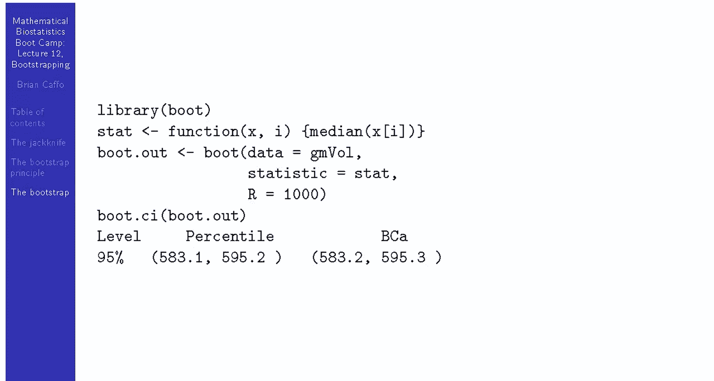

#  027：自助法 🚀

在本节课中，我们将要学习一种极其强大的统计工具——自助法。它是一种通过重采样技术来估计统计量（如中位数）的抽样分布、标准误和置信区间的方法，尤其适用于那些分布未知或难以推导的复杂统计量。

## 自助法原理

上一节我们介绍了刀切法，本节中我们来看看自助法。自助法遵循所谓的“自助法原则”。其核心思想是：当我们不知道某个统计量（例如中位数）的抽样分布时，我们可以用观测数据本身定义的分布来近似它。

这个由数据定义的分布，称为经验分布。它将概率 **1/n** 均匀地放在每一个观测数据点上。这是一个离散分布，其均值就是样本均值。自助法原则建议，我们可以从这个经验分布中反复抽样，并计算我们感兴趣的统计量（如中位数），从而近似该统计量在真实总体分布下的抽样分布。

## 自助法执行步骤：重采样

为了实际操作这个原则，我们采用重采样的方法。以下是自助法的通用步骤：

1.  **准备数据**：假设我们有 `n` 个观测值。
2.  **生成自助样本**：从原始数据中**有放回地**随机抽取 `n` 个观测值，形成一个“自助样本”。因为有放回，所以同一个原始数据点可能被多次抽中。
3.  **计算统计量**：在这个自助样本上，计算我们关心的统计量（例如中位数）。
4.  **重复过程**：将步骤2和步骤3重复 `B` 次（例如 `B=1000` 或 `10000` 次），得到 `B` 个自助统计量（例如 `B` 个中位数）。
5.  **构建分布**：这 `B` 个自助统计量构成了该统计量抽样分布的一个近似。我们可以用这个分布来计算标准误、偏差或置信区间。

这个过程本质上是在从经验分布中独立同分布地抽取样本。虽然第一次接触时可能觉得奇怪，但它基于一个直观的类比：如果我们能从一个已知总体分布中反复抽样，我们就能通过模拟得到任何统计量的精确抽样分布。自助法用经验分布替代了未知的总体分布。

## 一个具体案例：中位数的置信区间

让我们通过一个具体例子来应用自助法。假设我们有630名铅制造厂工人的灰质体积测量值，样本中位数约为589立方厘米。我们想为总体中位数构建一个95%的置信区间。

以下是使用R语言执行非参数自助法的步骤和代码：

```r
# 设定参数
B <- 1000  # 自助法重复次数
n <- length(gray_matter_data)  # 原始数据长度

# 生成自助样本并计算中位数
resamples <- matrix(sample(gray_matter_data, n*B, replace = TRUE), B, n)
medians <- apply(resamples, 1, median)

# 计算自助法中位数的标准误（即中位数抽样分布的标准差估计）
bootstrap_se <- sd(medians)

# 计算百分位数置信区间 (例如 95%)
conf_interval <- quantile(medians, c(0.025, 0.975))
# 结果可能类似：2.5% 分位数为582，97.5% 分位数为595
```

在这段代码中：
*   `sample(..., replace = TRUE)` 执行有放回抽样。
*   `apply(resamples, 1, median)` 对每一行（即每一个自助样本）计算中位数。
*   `sd(medians)` 给出了中位数标准误的自助法估计。
*   `quantile(medians, ...)` 给出了中位数的自助百分位数置信区间。

通常，绘制自助统计量的直方图也很有帮助，可以直观地查看其分布形态，并在图上标出置信区间的上下限。

## 关于自助法的注意事项

自助法是一个非常灵活的工具，但使用时需要注意以下几点：

*   **非参数特性**：本节描述的是**非参数自助法**，它对总体分布形态的假设非常少。
*   **大样本理论**：证明自助法有效性的理论通常依赖于大样本。对于小样本，结果需谨慎对待。
*   **置信区间类型**：上面演示的简单**百分位数置信区间**可能不是最优的。在实践中，更推荐使用偏差校正的加速置信区间（BCa区间）。R语言中的 `boot` 包可以方便地计算这种改进的区间。
*   **变体与方法**：自助法有很多变体，包括参数自助法、时间序列自助法等，适用于不同场景。
*   **深入学习**：要深入理解自助法，推荐阅读Efron和Tibshirani的著作《An Introduction to the Bootstrap》。这本书在理论解释和实践操作之间取得了很好的平衡，也涵盖了刀切法等其他重采样技术。

## 总结




本节课中我们一起学习了自助法的核心思想和操作流程。自助法是一种通过从原始数据中有放回地重采样，来模拟统计量抽样分布的重采样技术。它特别适用于分布未知或形式复杂的统计量，可用于估计标准误、偏差和构建置信区间。虽然我们介绍的是基础的非参数百分位数法，但实践中存在更稳健的变体（如BCa区间）。自助法是计算统计学革命带来的一个巧妙而强大的工具，它让我们能够更充分地利用数据本身来探索统计量的不确定性。