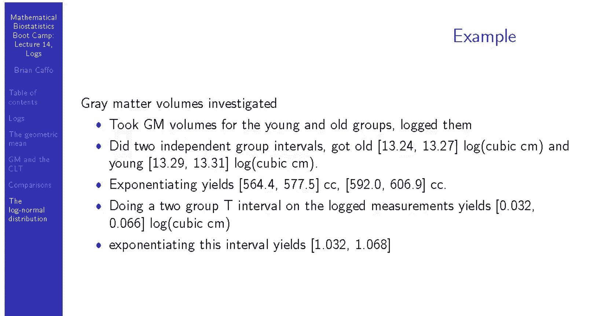

#  030：对数变换

在本节课中，我们将学习对数变换的含义，以及当你对取对数后的数据进行算术平均、构建置信区间等操作时，这种变换会产生何种影响。

我们将讨论对数、几何平均数（它与对数据取对数并进行算术平均有内在联系），以及几何平均数与大数定律和中心极限定理的关系。接着，我们将回顾一些已学过的技术，例如构建T置信区间，并重点说明如何解释在对数数据上应用这些技术的结果。最后，我们将介绍对数正态分布。

## 对数基础回顾

首先，我们简要回顾一下对数的概念。以 `b` 为底 `x` 的对数，记作 `log_b(x)`，是满足 `b^y = x` 的数 `y`。`log_b(1)` 总是等于 `0`，因为 `b^0 = 1`。当 `x` 趋近于 `0` 时，`log_b(x)` 会趋近于负无穷。

在本课程中，我们通常将 `log` 默认为以自然常数 `e` 为底的自然对数，有时也写作 `ln`。实际上，常用的对数底数主要有三种：以 `e` 为底的对数具有许多优良的数学性质；以 `10` 为底的对数便于表示数量级，因为 `log_10(10)=1`，`log_10(100)=2`，`log_10(1000)=3`，依此类推；以 `2` 为底的对数也很有用，因为 `2` 比 `10` 小，得到的幂次较低，在某些场景下非常方便。

以下是几个重要的对数运算法则：
*   `log(AB) = log A + log B`
*   `log(A^B) = B log A`
*   `log(A/B) = log A - log B`

换句话说，**对数将乘法转化为加法，将除法转化为减法，将幂运算转化为乘法**。

## 统计学中为何进行对数变换？

了解了对数的数学性质后，我们来看看在统计学中为何要对数据进行对数变换。最常见的原因是处理**右偏（正偏）** 数据。例如，收入数据就是一个典型的右偏例子：大多数人收入较低，少数人收入极高，其分布呈现出一个靠近零值的“峰”和一条向右延伸的“长尾”。对收入数据取对数，可以使其分布更接近钟形（正态分布）。这在生物统计学中也很常见，例如医疗支出：多数人平时医疗花费很少，但当健康出现问题时花费会剧增，因此像医疗支出这类有下限（通常为0）的数据分布往往是右偏的。

在以下情况中，进行对数变换是自然而然的：
*   **误差可能具有相乘性时**：例如在处理浓度、速率等问题时。
*   **处理比率时**：取对数可以将比率转化为差值，便于分析。
*   **关注数量级而非具体数值时**：例如在天文距离等场景中，使用以10为底的对数可以更直观地反映数量级差异。
*   **处理计数数据时**：例如医院感染人数等。但需注意，如果数据中包含零值，则无法直接取对数，需要采取一些处理办法（如加一个小的常数）。

## 几何平均数

上一节我们提到了对数变换的动机，本节中我们来看看一个与对数变换紧密相关的概念：**几何平均数**。

对于数据集 `X1, X2, ..., Xn`，其样本几何平均数定义为所有观测值乘积的 `n` 次方根：
`几何平均数 = (∏_{i=1}^{n} Xi)^{1/n}`

请注意，如果所有 `Xi` 均为正数（考虑几何平均数时通常如此），那么**几何平均数的对数，等于各个观测值对数的算术平均数**：
`log(几何平均数) = (1/n) * Σ_{i=1}^{n} log(Xi)`

这个关系非常重要。因为几何平均数的对数就是对数尺度上的算术平均数，所以**几何平均数继承了我们在样本算术平均数中讨论过的所有性质**，例如大数定律和中心极限定理（在满足相应假设的条件下）都适用。此外，作为一个普遍性质，几何平均数总是小于或等于算术平均数。

以下是几何平均数的一个应用示例：
在某些领域，人们频繁使用几何平均数，以至于当他们提到“平均数”时，指的就是几何平均数而非算术平均数。当所思考的问题本质上是**相乘性**的时候，通常会使用几何平均数。

假设在某个人群中，一种疾病的患病率第一年上升了2%，第二年下降了1%，第三年上升了2%，第四年又上升了1%。要计算起始患病率经过这四年后的最终患病率，本质上需要将起始患病率依次乘以 `1.02`、`0.99`、`1.02`、`1.01`。这些增减率的几何平均数（即它们的乘积再开四次方）就是一个有意义的研究量。因为，**将起始患病率乘以这个几何平均数四次，得到的结果与依次乘以原始的四个因子得到的结果相同**。这与算术平均数的概念类似：算术平均数是需要**加**四次才能得到相同总和的数；而几何平均数是需要**乘**四次才能得到相同乘积的数。因此，在处理像百分比增减这类本质上是相乘的问题时，使用几何平均数更为自然。

为了更直观地理解，这里有一个几何解释：对于一个边长分别为 `a` 和 `b` 的矩形，其**算术平均数** `(a+b)/2` 是与之周长相等的正方形的边长；而其**几何平均数** `√(ab)` 是与之面积相等的正方形的边长。所以，如果你关心的是像面积这样的相乘性质，你会想要边长的几何平均数；如果你关心的是像周长这样的相加性质，你会想要边长的算术平均数。

## 对数变换的统计推断

回到统计学，由于样本几何平均数的对数本身就是一个算术平均数，根据大数定律，只要 `log(X)` 的期望值存在，这个算术平均数就会收敛于 `μ = E[log(X)]`。这里 `X` 是原始尺度（非对数尺度）上的观测值。

那么，几何平均数本身会收敛于什么呢？几何平均数等于其对数的指数：`几何平均数 = exp(log(几何平均数))`。我们自然希望它收敛于 `E[X]`，但事实并非如此，因为指数运算不能直接移到期望算子里面。几何平均数收敛于 `exp(μ) = exp(E[log(X)])`。这个量 `exp(μ)` 没有一个广泛接受的名称，但我们可以合理地称之为**总体几何平均数**，以类比样本统计量收敛于相应总体参数的概念。

需要重申的是：`exp(E[log(X)])` 并不等于 `E[exp(log(X))] = E[X]`。因此，这里定义的总体几何平均数，不等于我们之前定义的总体算术平均数。

然而，有一个有趣的情况：**如果 `log(X)` 的分布是对称的**（这正是我们一开始对右偏数据取对数希望达到的效果之一），那么在对数尺度上，均值 `μ` 也等于中位数。此时，原始尺度 `X` 的中位数恰好是 `exp(μ)`。

**结论是：对于对数对称的分布，几何平均数估计的是中位数。**

为什么要讲这些？目的是将看似简单的操作背后的含义阐述清楚。当你对数据取对数，然后进行常规统计分析时，你所得到的统计量在原始尺度上具有明确的解释。你无需丢弃原始尺度单位。

## 构建置信区间

基于以上理解，我们可以利用中心极限定理为对数测量值构建置信区间。这个区间估计的是 `μ`，即对数测量值的期望值（`E[log(X)]`）。

*   **如果对这个区间取指数**，那么你估计的就是 `exp(μ)`，即我们所说的总体几何平均数。
*   **进一步，如果假设对数数据的分布本身是对称的**，那么取指数后的区间也是在估计原始尺度的中位数。

这提供了一种间接获取中位数置信区间的方法，前提是你愿意假设数据在对数尺度上对称。这比使用自助法（Bootstrapping）求中位数置信区间要简单得多，因为它只使用了普通的T置信区间方法。

这在**配对数据**且我们关心**比率**时尤其有用。以下是《Rosner生物统计学基础》一书中的一个配对设计例子，比较了服用口服避孕药者与匹配对照组的收缩压。通过计算每对个体的比率（服药者/对照者），然后对比率取对数（即对数差），我们可以对这些对数差进行普通的单样本T检验并构建置信区间。最后，将置信区间的上下限取指数，就得到了比率几何平均数的置信区间。在这个例子中，得到的区间是 `[1.01, 1.07]`，意味着估计口服避孕药使用者的收缩压比对照组高 `1%` 到 `7%`。

对于**两独立组**的情况，过程类似：分别对两组数据取对数，构建两组对数均值之差的置信区间，然后对这个区间取指数。此时，取指数后的区间估计的是 `exp(μ1)/exp(μ2)`，即**两组总体几何平均数之比**。同样，如果假设两组数据在对数尺度上对称，那么这个比值也是两组总体中位数之比。

## 对数正态分布

有一种分布，其数据取对数后恰好服从正态分布，因此非常重要，我们称之为**对数正态分布**。

一个随机变量 `X` 服从对数正态分布，**当且仅当它的对数 `log(X)` 服从正态分布**。
请注意，它**不是**“正态分布随机变量的对数”（因为正态变量可能为负，无法取对数）。记住这句话：“我是对数正态的，意味着对我取对数，我就会变成正态的”，这有助于理解正确的顺序。

形式上，若 `log(X) ~ N(μ, σ²)`，则 `X ~ LogNormal(μ, σ²)`。反之，若 `Y ~ N(μ, σ²)`，则 `exp(Y) ~ LogNormal(μ, σ²)`。

对数正态分布 `LogNormal(μ, σ²)` 的密度函数（此处从略）依赖于参数 `μ` 和 `σ²`。其重要性质包括：
*   均值：`E[X] = exp(μ + σ²/2)`
*   方差：`Var(X) = [exp(σ²) - 1] * exp(2μ + σ²)`
*   中位数：`Median(X) = exp(μ)`
*   （总体）几何平均数：`exp(μ) = exp(E[log(X)])`

这清楚地展示了 `E[X]` 和 `exp(E[log(X)])` 是不同的。如果 `X1, ..., Xn` 来自对数正态分布，那么 `log(X1), ..., log(Xn)` 就来自正态分布，满足构建T置信区间的条件。此时，`μ` 是原始尺度 `X` 的中位数的对数，`exp(μ)` 给出了原始尺度的中位数和总体几何平均数。

## 实例分析

让我们通过一个快速实例来巩固理解。假设我们测量了年轻组（<65岁）和年长组（≥65岁）的脑灰质体积。我们对两组数据分别取对数，然后构建独立样本的T置信区间。

*   在**对数尺度**上，年长组的置信区间为 `[13.24, 13.27]` log立方厘米，年轻组为 `[13.29, 13.31]` log立方厘米。
*   将这两个区间**取指数**，得到年长组约为 `[564, 578]` 立方厘米，年轻组约为 `[592, 606]` 立方厘米。
    *   这两个区间分别估计了年长组和年轻组的**总体几何平均灰质体积**。
    *   如果我们愿意假设脑体积在对数尺度上的总体分布是对称的，那么这两个区间也分别估计了年长组和年轻组的**总体中位灰质体积**。
*   接下来，构建两组**对数均值之差**的T置信区间，得到 `[0.032, 0.066]` log立方厘米。
*   将这个区间**取指数**，得到 `[1.032, 1.068]`。
    *   这个区间估计了年轻组与年长组的**几何平均脑体积之比**，即年轻组比年长组高出约 `3%` 到 `7%`。
    *   同样，在对称性假设下，这也是**中位数之比的估计**，意味着年轻组的灰质体积中位数估计比年长组高 `3%` 到 `7%`。这符合随着年龄增长，灰质体积会有所减少的常识。

## 总结

本节课中，我们一起学习了**对数变换**在统计学中的应用。核心要点是：当你对测量值取对数，进行我们已学过的统计推断（如构建置信区间），然后再将结果取指数时，你需要理解这些估计值在原始尺度上所指代的意义。

具体来说：
1.  取指数后的置信区间，估计的是**总体几何平均数**（`exp(E[log(X)])`）。
2.  如果进一步假设原始数据在对数尺度上对称，那么该区间也估计了**原始尺度的总体中位数**。
3.  对于两组比较，取指数后的差异区间估计的是**几何平均数之比**（或在中位数对称假设下的**中位数之比**）。

对数变换在实践中只是已有方法的简单延伸：对数据取对数，执行标准分析，然后对结果取指数。虽然操作上没有变化，但理解其背后的含义至关重要。对数之所以特殊，是因为它能产生唯一且易于解释的结果（如将乘法转化为加法），而其他变换（如立方根）则不具备这样清晰的可解释性。

希望本课程对你有所帮助，并祝愿你在未来的数据科学学习中运用这些知识取得更大的成就。