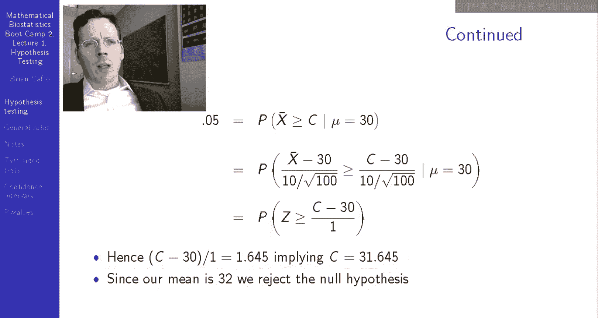
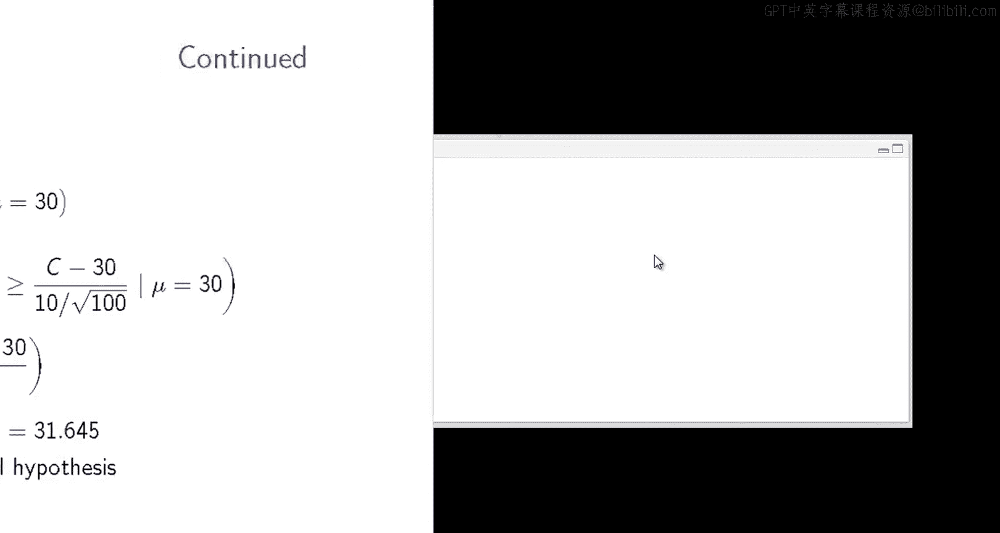
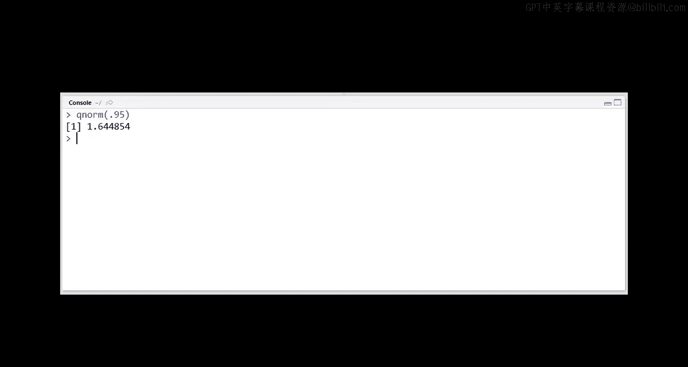
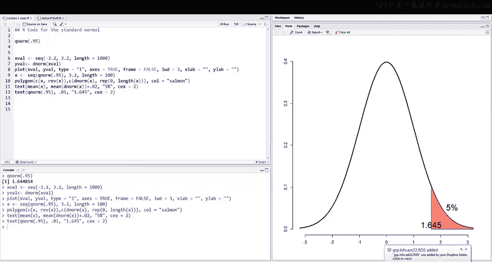

#  032：更多假设检验 🧪

在本节课中，我们将通过一个具体的例子，深入学习假设检验的核心概念，包括原假设与备择假设、两类错误，以及如何构建一个控制第一类错误率的检验。

---

## 概述

假设检验是统计推断的核心工具，用于根据样本数据对总体参数做出决策。本节我们将以睡眠呼吸障碍指数为例，详细讲解单侧假设检验的构建过程、两类错误的权衡，以及如何利用正态分布计算检验的临界值。

---

## 睡眠呼吸障碍指数案例

呼吸障碍指数每小时超过30次事件被认为是严重睡眠呼吸障碍的证据。呼吸障碍指数通常缩写为RDI。每小时30次事件意味着相当严重，这表明一个人在睡眠时上呼吸道完全或部分塌陷，平均每小时发生30次。这很严重，因为每次发生时他们都会缺氧，然后会短暂醒来再睡回去。这种疾病被称为睡眠呼吸障碍。

假设每小时30次事件是严重睡眠呼吸障碍的某个分界点。实际上，诊断睡眠呼吸障碍的分界点要低得多。这里选择30是出于示例目的，请记住这一点。

设想你招募了一批超重受试者，并想了解这些超重受试者是否来自一个总体RDI大于30的群体。你的原假设是该群体的平均RDI为30，备择假设是RDI大于30。

请注意，这里讨论的μ指的是总体均值，而非样本均值。我们假设样本均值为每小时32次事件。我们想检验的是，在从该总体进行独立同分布抽样，并对呼吸障碍指数做出高斯（正态）假设的模型下，基于样本均值32、标准差10以及100个观测值的事实，是否有足够证据得出总体均值确实大于30的结论。这就是我们想要检验的。

上一页我们指定的备择假设是μ大于30。但假设检验有不同的版本，我们可以检验小于、大于或不等于。关于检验μ是否恰好等于30，还是不等于30是否合理，可能存在一些哲学讨论，我们稍后会谈到。

目前，我们认为备择假设有三种形式：大于、小于或不等于。

---

## 假设检验的决策与两类错误

基本上，我们可以创建一个2x2的决策类型表格。如果事实是原假设，而我们决定接受原假设，那么我们就正确地接受了原假设。如果事实是原假设，而我们决定接受备择假设，那么我们就犯了所谓的**第一类错误**，即错误地拒绝了原假设。

如果事实是备择假设，而我们未能拒绝原假设，我们就犯了所谓的**第二类错误**。如果事实是备择假设，而我们拒绝了原假设，我们就正确地拒绝了原假设。这个表格概括了假设检验的决策空间。

---

### 法庭案例的类比

让我们再次回顾这个法庭案例。通常，在大多数法庭上，原假设是被告无罪，然后我们需要证据来拒绝原假设或定罪。

如果我们要求的证据很少，会发生什么？我们会增加无辜者被定罪的比例，这对应第一类错误。然而，我们也会增加有罪者被定罪的比例，这对应正确地拒绝原假设。

另一方面，如果法庭要求大量证据才能定罪，那么我们会增加无辜者被释放的比例，这对应正确地接受原假设。但我们也增加了有罪者被释放的比例，这对应第二类错误。

这也表明，基本上在所有决策空间中，不仅仅是统计决策空间，法律政策中同样的事情也会发生：第一类和第二类错误是相关联的，增加一个就会减少另一个，反之亦然。

我们将看到，我们会以特定的方式建立统计决策，以最小化犯第一类错误的机会。这样做，我们就在很大程度上限制了可能犯的第二类错误。这将在很大程度上影响我们讨论假设检验的框架和准则，即我们将非常具体地控制第一类错误，然后可能稍后再讨论如何控制第二类错误并尝试最小化它们。显然，要在保持第一类错误率低的同时控制第二类错误，你必须做点什么，你需要获得更好的证据，而不仅仅是更多或更少，我们稍后会讨论这一点。

---

## 假设检验的标准实施方法

让我们谈谈实施假设检验的标准方法，并回到呼吸障碍指数的例子。

显而易见的策略是，我们想检验总体均值是否大于30，明显的策略是看样本均值是否大于某个常数C，并以某种合理的方式选择这个常数。

传统的做法是选择常数C，使得第一类错误的概率很低。有一个非常常见的标准基准，即5%。其思想是控制第一类错误率，使得犯第一类错误的概率很低。

人们这样做有几个原因。其一，可能有一些逻辑：原假设是我们的现状假设，所以我们想确保不会轻易拒绝它。因此，如果它是真的，这其中可能内置了某种科学保守主义。我认为，这在数学上也相当实用。因为原假设下，均值被明确指定为μ=30，这使得数学计算稍微容易一些。事实证明，即使原假设是μ小于或等于30，你最终也会得到相同的检验。但原假设是“尖锐的”零假设这一事实也对数学计算有所帮助，这可能不是最好的理由，但仍然是人们这样做的一部分原因。不过，主要原因可能是我们希望控制第一类错误，并将其概率保持在某个水平以下。

第一类错误率我们通常用希腊字母α表示，它是犯第一类错误的概率，即当原假设为真时拒绝它的概率。我们希望第一类错误率为5%。

我们要做的是选择常数C，使其考虑到样本均值的不确定性，并且使我们的第一类错误率概率为5%。让我们开始做吧。

---

## 计算临界值

我们希望这里的C值被选择为：在给定总体均值确实为30的条件下，获得大于C的样本均值的概率为5%。如果我们遵循“当观测到的x bar大于这个常数时就拒绝原假设”的规则，这将是第一类错误的概率。

根据中心极限定理，或者假设我们的数据是高斯分布的，我们可以将X bar标准化，使其在原假设下具有零均值和单位方差。在这种情况下，我们可以从这个不等式的两边减去30，因为那是实际的总体均值。

然后我们可以除以均值的标准误，在这个例子中是 `10 / sqrt(100)`。我们假设总体的标准差已知为10，并且均值由100个观测值组成，所以分母是 `sqrt(100)`。因此，这里的这个量 `(x bar - 30) / (10 / sqrt(100))` 现在是一个标准正态变量，或者如果数据是独立同分布的，它趋近于标准正态。

所以我们可以把这里的整个量替换为Z。在右边，我们有 `(C - 30) / (10 / sqrt(100))`。我们想计算这个概率。记住，这个量是Z随机变量的原因是因为我们是在原假设为真的条件下计算这个概率，即μ=30。你会看到我之前提到的这一点：当原假设为真时，我们有一个明确指定的参数，这很有帮助，因为我们可以在这里精确地代入30。

所以我们希望5%等于一个Z随机变量大于 `(C - 30) / (10 / sqrt(100))` 的概率。我们可以设 `(C - 30) / (10 / sqrt(100))` 等于一个值，使得Z大于该值的概率为5%。我们知道那个值是什么，它是标准正态的95%分位数，即1.645。我们可以解出C，C等于31.645。由于本例中我们的样本均值是32，因此我们会拒绝原假设。

**公式推导：**
```
P(X_bar > C | μ=30) = 0.05
=> P( (X_bar - 30) / (σ/√n) > (C - 30) / (σ/√n) ) = 0.05
=> P( Z > (C - 30) / (10/√100) ) = 0.05
=> (C - 30) / 1 = Z_{0.95}
=> C - 30 = 1.645
=> C = 31.645
```

由于观测到的样本均值 `X_bar = 32 > 31.645`，我们拒绝原假设。

---

## 在R中验证计算

非常简要地，我想展示如何在R中获取这个正态分位数。这里有一个RStudio的截图，我正在输入适当的命令。

**R代码：**
```r
# 计算标准正态分布的95%分位数
qnorm(0.95)
```
运行结果约为1.645。

让我们用图形来可视化这个计算。这里是我的RStudio窗口，提醒我们标准正态的95%分位数大约是1.645。我们用qnorm函数计算。让我们可视化它。

**R代码：**
```r
# 创建绘图点
x <- seq(-3, 3, length=1000)
y <- dnorm(x)
plot(x, y, type="l", lwd=2, main="标准正态分布与5%上尾区域", xlab="Z值", ylab="密度")

# 定义并填充代表5%上尾的区域
x_shade <- seq(qnorm(0.95), 3, length=100)
y_shade <- dnorm(x_shade)
polygon(c(x_shade, rev(x_shade)), c(y_shade, rep(0, length(y_shade))), col="salmon")



# 添加分位数线
abline(v=qnorm(0.95), lty=2, col="blue")
text(qnorm(0.95), 0.2, "Z = 1.645", pos=4, col="blue")
text(2, 0.02, "5% 区域", col="darkred")
```
图形显示了一个从-3到+3的钟形曲线，其中上尾5%的区域被涂成了鲑鱼色。代表这5%区域的数值是1.645。





---

## 总结

本节课中，我们一起学习了假设检验的完整流程。我们从一个具体的睡眠呼吸障碍指数案例出发，定义了原假设（H₀: μ=30）和备择假设（H₁: μ>30）。我们深入探讨了决策过程中可能发生的两类错误：第一类错误（拒真）和第二类错误（纳伪），并通过法庭的类比理解了权衡两者的重要性。

随后，我们学习了构建检验的标准方法：通过控制第一类错误率α（通常设为5%）来确定拒绝域的临界值。利用样本均值的抽样分布（正态分布），我们将问题转化为寻找标准正态分布的上5%分位数（Z₀.₉₅=1.645），并最终计算出对应的样本均值临界值C=31.645。由于观测到的样本均值32大于临界值，我们做出了拒绝原假设的决策。



最后，我们使用R语言验证了计算并可视化了拒绝域。这个过程展示了假设检验如何将实际问题、概率论和统计决策框架紧密结合，为数据驱动的推断提供严谨的基础。