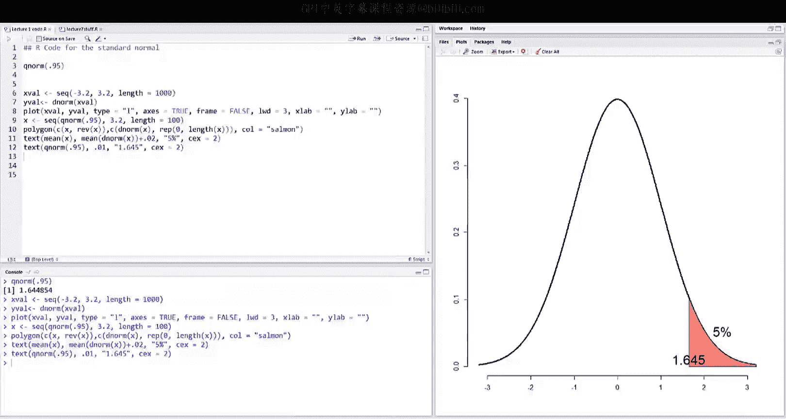
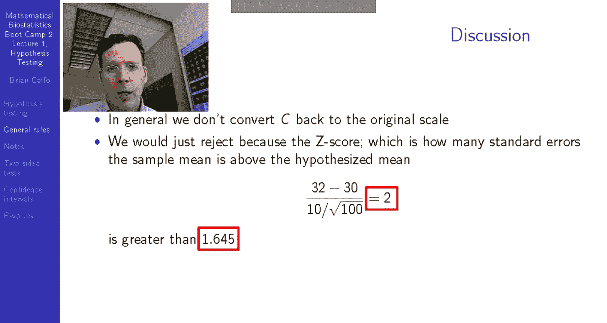
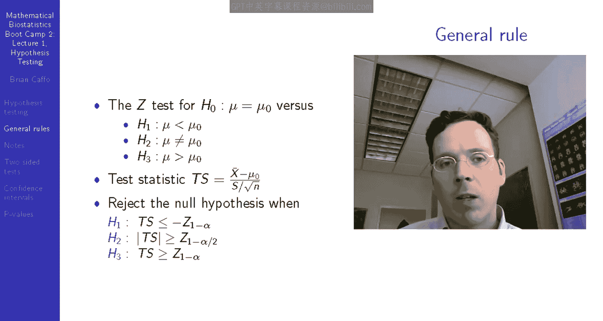
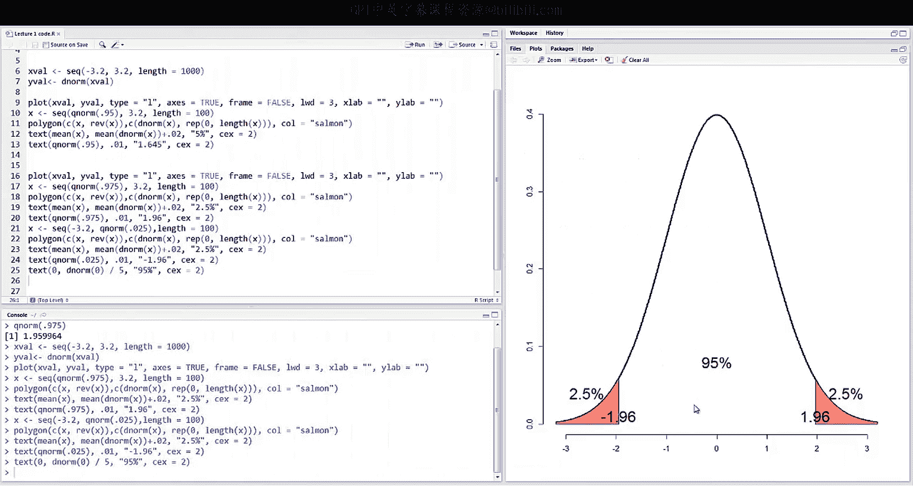
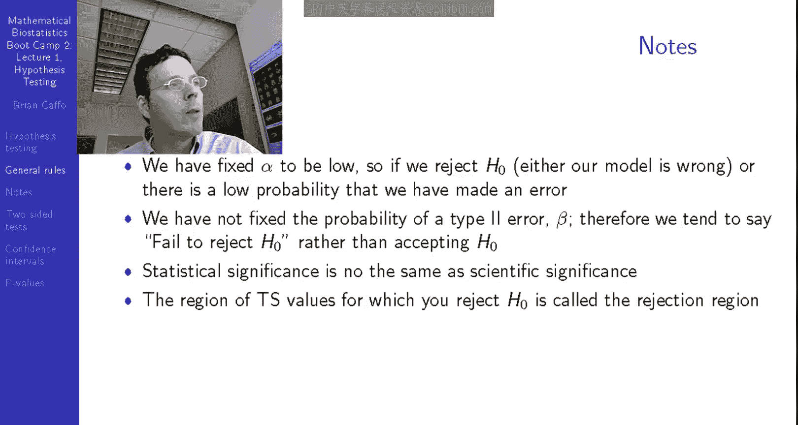

#  033：假设检验的一般规则

在本节课中，我们将学习假设检验的一般规则，特别是针对单个均值的Z检验。我们将了解如何构建检验统计量，如何根据不同的备择假设设定拒绝域，以及理解统计显著性与科学显著性的区别。

上一节我们介绍了假设检验的基本概念，本节中我们来看看如何将这些概念具体化为可操作的规则。

## 标准化均值与Z检验

我们通常不会将感兴趣的常数转换回原始尺度，而是直接取标准化的均值，并将其与标准正态分位数进行比较。

在之前的例子中，经验均值是32，零假设下的均值是30，均值的标准误是10除以根号100。因此，以标准误单位表示的、与假设均值的偏差计算如下：

**公式：**
`(32 - 30) / (10 / √100) = 2`

我们的均值距离假设均值有2个标准误单位。然后，我们将其与标准正态分布的95%分位数（1.645）直接进行比较。2大于1.645，因此我们拒绝零假设。

## Z检验的规则化

我们可以将针对单个均值的正态检验规则总结为几条简单的规则，称之为Z检验。这要求我们假设数据服从高斯分布，或者中心极限定理提供了足够好的近似。

假设我们要检验零假设 **H₀: μ = μ₀**，对应以下三种备择假设之一：
*   **H₁: μ < μ₀** （左侧检验）
*   **H₂: μ ≠ μ₀** （双侧检验）
*   **H₃: μ > μ₀** （右侧检验）

在所有情况下，我们都将样本均值以标准误单位表示，即计算检验统计量（Z分数）：

**公式：**
`Z = (X̄ - μ₀) / (S / √n)`

这个Z分数表示样本均值距离假设均值有多少个标准误。例如，如果Z=3，则表示样本均值比假设均值高出3个标准误，这为拒绝零假设提供了证据。

为了控制第一类错误（错误拒绝真零假设）的概率为α（例如5%），我们设定以下拒绝规则：

以下是针对不同备择假设的具体拒绝规则：

*   **对于 H₁ (μ < μ₀)**：如果检验统计量 **Z < -z₁₋α**，则拒绝H₀。例如，α=0.05时，-z₀.₉₅ = -1.645。
*   **对于 H₂ (μ ≠ μ₀)**：如果检验统计量的绝对值 **|Z| > z₁₋α/₂**，则拒绝H₀。例如，α=0.05时，z₀.₉₇₅ ≈ 1.96。
*   **对于 H₃ (μ > μ₀)**：如果检验统计量 **Z > z₁₋α**，则拒绝H₀。例如，α=0.05时，z₀.₉₅ = 1.645。

## 理解双侧检验

让我们更详细地描述双侧检验（H₂）的思想。

如果α=0.05，那么1 - α/2 = 0.975。标准正态分布的97.5%分位数约为1.96。

我们设定拒绝域为：如果检验统计量 **Z > 1.96** 或 **Z < -1.96**，则拒绝零假设。在零假设成立的情况下，Z值落入上侧拒绝域的概率是2.5%，落入下侧拒绝域的概率也是2.5%，两者合并的总概率为5%。这等价于判断 **|Z| > 1.96**。

## 重要概念辨析

在假设检验的执行中，我们强制控制了第一类错误率（α），使其保持较小（通常为5%）。因此，如果我们拒绝了零假设，要么是我们的模型（零假设）不正确，要么我们犯了一个低概率的错误。

然而，我们并未固定第二类错误率（β，即错误接受假零假设的概率）。β通常较大。因此，我们倾向于说“未能拒绝H₀”，而不是“接受H₀”。

一个经典的例子是：如果你的样本量非常小，并且未能拒绝零假设，这并不一定意味着零假设为真。可能是因为样本量太小，导致均值的变异性太大，即使备择假设为真，你也缺乏足够的能力（检验功效）去检测出差异。所以，“没有证据”并不等同于“证据表明没有”。

另一个要点是：统计显著性不等于科学显著性。在假设检验中，零假设通常是精确指定的（例如μ恰好等于5）。如果你有巨大的样本量，即使观测到的均值是5.01（与5的科学差异微乎其微），但由于标准误极小，你仍可能拒绝零假设。因此，从统计检验中拒绝零假设，并不总是意味着你检测到的差异具有实际意义。当然，在某些情境（如随机化对照试验）中，即使微小的偏差也可能很重要，但这是一个需要具体分析的微妙问题。

最后，回顾之前的规则：对于H₁，拒绝域是Z值小于某个负分位数；对于H₂，拒绝域是|Z|大于某个正分位数；对于H₃，拒绝域是Z值大于某个正分位数。这些导致拒绝零假设的检验统计量值的集合，就称为**拒绝域**。

## 总结

本节课中我们一起学习了假设检验的一般框架。我们学会了如何为单个均值的Z检验构建检验统计量 `Z = (X̄ - μ₀) / (S / √n)`，并针对左侧、双侧和右侧备择假设设定了具体的拒绝规则以控制第一类错误。我们重点区分了“未能拒绝”与“接受”零假设的含义，并理解了统计显著性与实际（科学）显著性的重要区别。掌握这些基本规则和概念是正确理解和应用假设检验的基础。