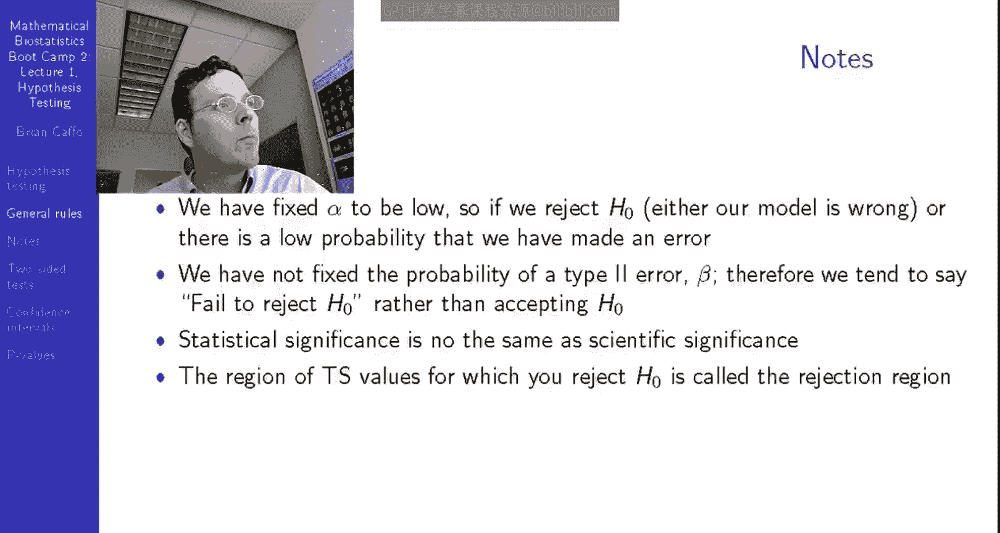
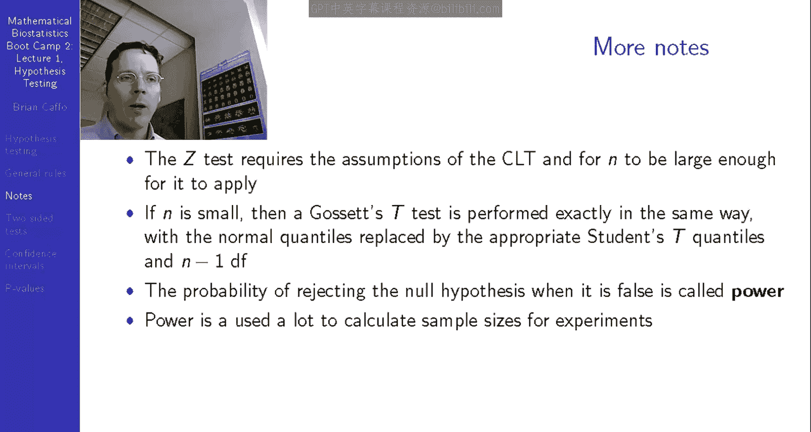
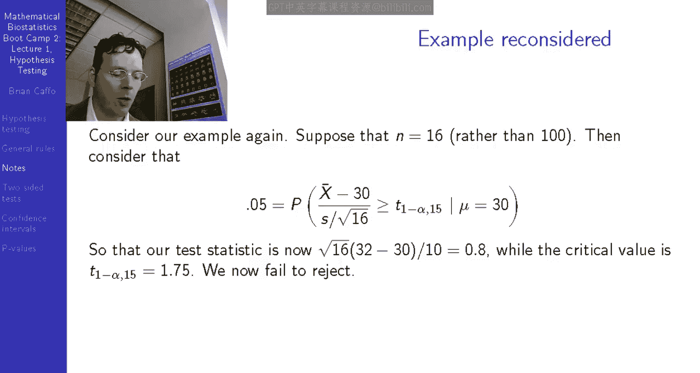
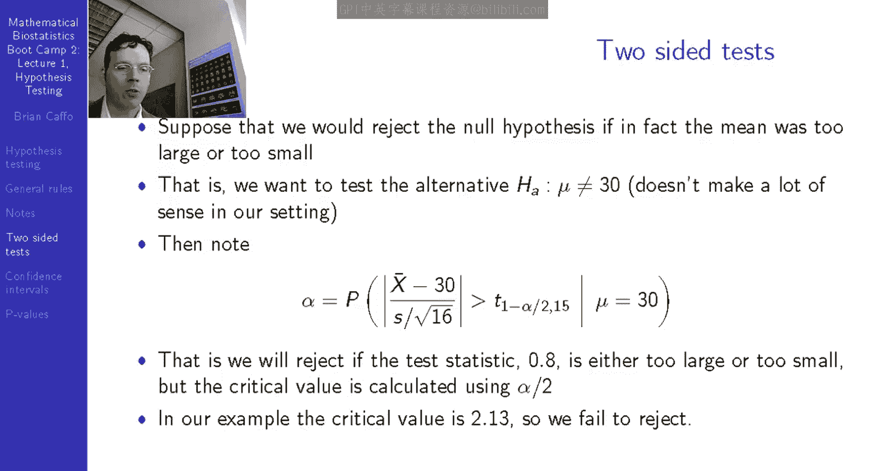
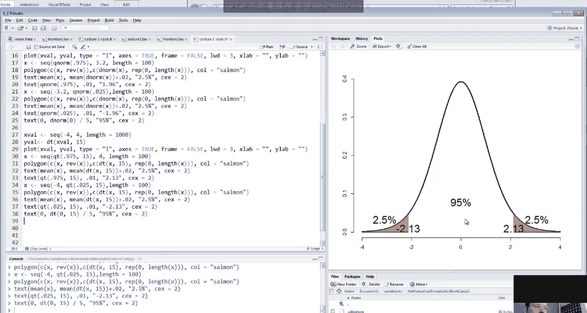

#  034：双侧检验

在本节课中，我们将学习假设检验中的双侧检验，并回顾Z检验与T检验的应用条件。我们将通过一个具体例子，演示当样本量较小时如何从Z检验转向T检验，并详细解释检验功效的概念及其在实验设计中的重要性。

## Z检验与T检验的适用条件

我们讨论的Z检验需要中心极限定理的假设成立，并且样本量n足够大，该检验才适用。

如果样本量n较小，你可以直接使用学生T检验，方法类似，只是将正态分位数替换为学生T分位数。

## 检验功效与错误类型

当原假设为假时，拒绝它的概率被称为**功效**。

请记住，我们设定了**第一类错误率**，即当原假设为真时拒绝它的概率。我们强制第一类错误率保持较小。

**第二类错误率**，即当原假设事实上为假时，未能拒绝它的概率。**功效**等于1减去第二类错误率，它是在原假设为假时拒绝它的概率。

因此，功效是一件好事——你希望在原假设为假时拒绝它。不幸的是，在实验进行后，功效通常不在我们的控制范围内。因此，人们在开展研究之前应对此进行规划。

他们进行**功效计算**，通过改变样本量，或者如果情况足够简单，直接根据他们对标准误和假设的显著效应的猜测，计算出达到特定功效水平所需的样本量。

这将是我们下一讲要讨论的内容。

## 小样本T检验计算示例

现在，让我们实际完成这个例子的T检验计算。

假设n是16，而不是我们之前考虑的100。因此，我们必须使用T检验。

请看这个方程：我们希望有5%的概率使得 `(x_bar - 30)`（30是原假设下的值）除以估计的标准误 `S / sqrt(16)` 大于T分位数（现在用T分位数代替Z分位数），即自由度为15的 `1 - alpha` 分位数。

所以，我们的检验统计量现在是标准化的观测均值：`(32 - 30) / (10 / sqrt(16))`。`sqrt(16)` 移到分子上，计算结果为 `0.8`。

T临界值是 `1.75`。因此，现在我们**未能拒绝**原假设。这并不奇怪，因为我们把之前乘以 `sqrt(100)` 变成了现在乘以 `sqrt(16)`，所以检验统计量大幅下降，而我们与之比较的分位数却上升了，因为请记住T分布比正态分布的尾部更重。

所以，我们现在未能拒绝原假设并不令人意外。

## 从单侧检验到双侧检验

在上一节中，我们进行了单侧检验。现在让我们进行双侧检验。我们将快速浏览这些内容，因为希望到了课程的这个时候，你们已经开始习惯这类计算。

我们现在要检验的备择假设是 `μ` 是否不等于30。你可能会说在这个案例中这不太合理，因为我描述的问题是我们在观察一个特别容易有高RDI的群体，所以我们为什么不只检验 `μ > 30` 呢？好吧，为了论证，也为了向你们展示计算，我们就检验不等于30的情况。但我也要说，在许多期刊和科学探究途径中，他们要求进行双侧检验，即使单侧检验是更自然的方向。

所以，让我们做一个双侧检验。我们想要检验的是，我们的观测均值 `x_bar` 是否与我们对总体均值的原假设值30有显著差异。这意味着它可能显著大于30，或者显著小于30。

我们可以说，好吧，也许我们看看绝对值 `|x_bar - 30|`，这将检验它是太小（低于30）还是太大（高于30）。当然，因为我们想要标准化我们的统计量，我们将除以均值的标准误 `S / sqrt(16)`。我们知道，如果数据是独立同分布的高斯分布，那么 `(x_bar - 30) / (S / sqrt(16))` 服从T分布。

因此，如果我们希望**第一类错误率** `α` 被设定，使得这个检验统计量太大或太小的发生概率正好是 `α`。那么，我们可以选择T分位数 `t_{1 - α/2}`（自由度为15）。这样做是说明：这个随机的T统计量，其大于这个分位数的概率是 `α/2`（统计量的正侧部分）。其小于 `t_{α/2}` 分位数（自由度为15，这是一个负值）的概率也是 `α/2`。所以我们在下尾放 `α/2` 的概率，在上尾放 `α/2` 的概率，总共得到 `α` 的概率。

在下一张幻灯片中，我会稍作描述。当然，这个计算都是在原假设 `μ = 30` 下进行的。

因此，如果我们的检验统计量（在本例中 `(x_bar - 30) / (S / sqrt(16))` 等于 `0.8`，当我们取绝对值时它仍然是 `0.8`）要么太大要么太小，我们就拒绝。但再次记住，现在的临界值是使用 `α/2` 而不是 `α` 计算的，因为我们希望有 `α/2` 的概率因统计量太大而拒绝，有 `α/2` 的概率因统计量太小（负值太小）而拒绝。

在本例中，临界值是 `2.13`。注意，这当然比我们只使用 `α` 时的值要大，因为我们进入了更远的尾部。所以，对于双侧检验，拒绝比单侧检验更难。既然我们在单侧检验中拒绝了，我们在双侧检验中当然也会拒绝。

## 双侧检验计算与α/2的由来

让我们再简要展示一下双侧检验的计算以及 `α/2` 的由来。

这里我设置了一个从 `-4` 到 `+4` 的x值序列，我计算了自由度为15的T分布密度在这些点上的值，然后绘图，这就是我的T分布。

现在，我将给那个区域着色。那是 `2.5%`。假设我的 `α`，即我想要的第一类错误率是 `5%`。那个值是 `2.13`。所以对于T分布，当自由度为15时，`97.5%` 分位数是 `2.13`。

让我们对下分位数做同样的事情。好了，这样更好。那里是 `2.5%`，那是 `-2.13`，中间是 `95%`。

所以我们说的是：我们计算标准化的检验统计量 `(x_bar - 30) / (S / sqrt(16))`，该统计量的绝对值大于 `2.13` 的概率（换句话说，该统计量正值太大，超过 `2.13` 的概率是 `2.5%`，或者负值太小，小于 `-2.13` 的概率是 `2.5%`）总共是 `5%`。因此，检验统计量落在拒绝域的概率是 `5%`（上尾 `2.5%` 加下尾 `2.5%`）。

## 总结

本节课中，我们一起学习了假设检验中的双侧检验。我们回顾了Z检验与T检验的适用条件，并通过一个样本量较小的例子，具体演示了如何从Z检验转向T检验，以及相应的计算过程。我们明确了**第一类错误**、**第二类错误**和**检验功效**的定义与关系，并解释了为什么在实验前进行功效计算和样本量规划至关重要。最后，我们详细剖析了双侧检验中 `α/2` 的由来，以及如何根据T分布确定拒绝域。理解这些概念是正确进行统计推断的基础。