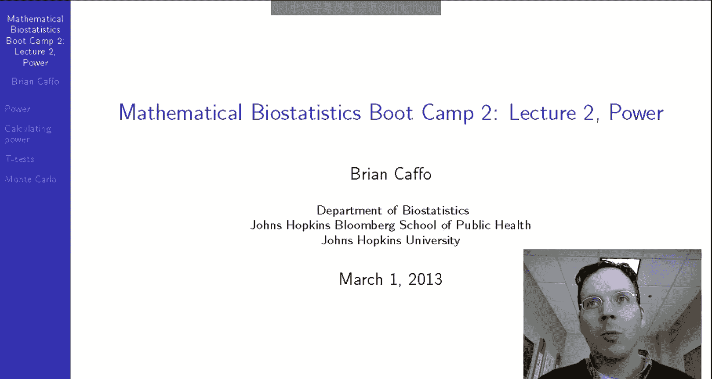
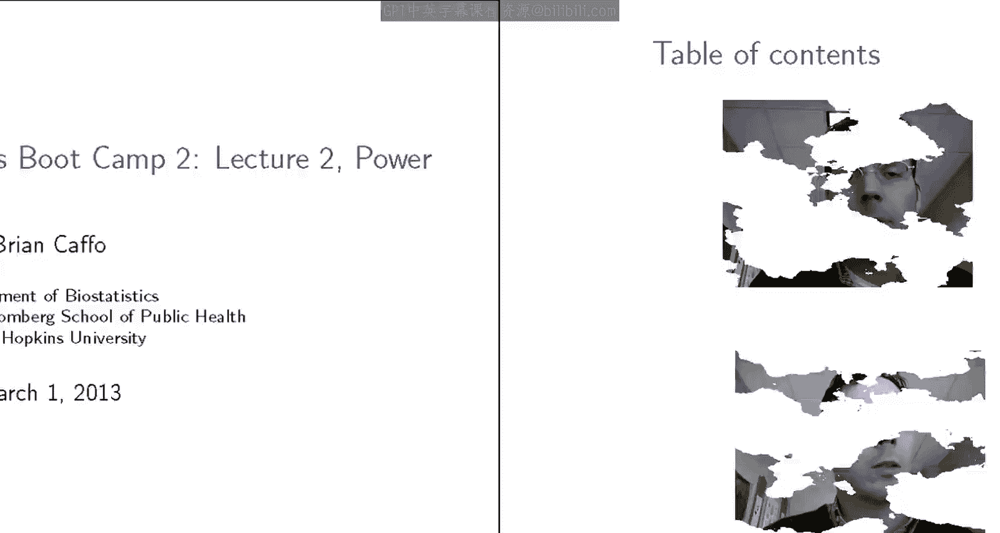
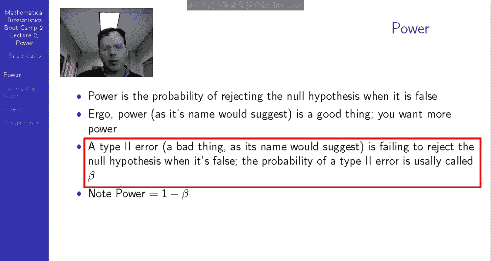
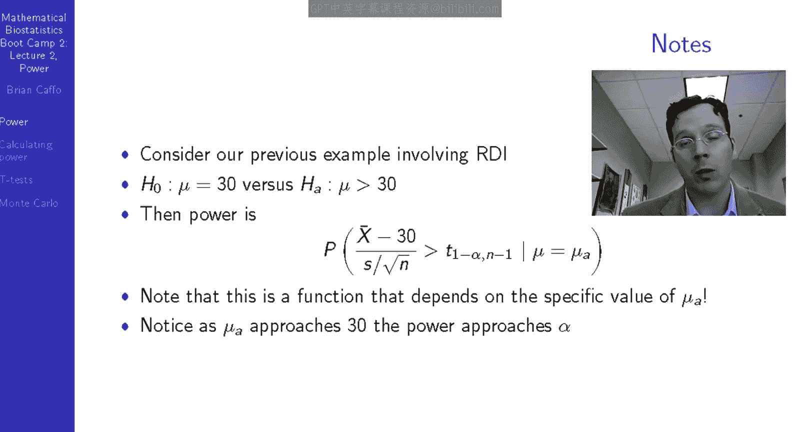

#  036：统计功效 💪



在本节课中，我们将要学习统计功效的概念，特别是如何计算T检验的统计功效。由于T检验的精确计算可能涉及复杂的数学，我们还将介绍如何使用蒙特卡洛模拟这一标准方法来估计功效。



## 概述

统计功效，顾名思义，是一件好事，我们希望拥有更高的功效。具体来说，功效是指在原假设实际上为假时，我们拒绝原假设的概率。与功效相对的是第二类错误率（1 - 功效），它是指在原假设为假时，我们未能拒绝它的概率，我们通常用 β 来表示这个错误率。

## 功效的计算原理


上一节我们介绍了假设检验的基本框架，本节中我们来看看如何具体计算功效。考虑我们之前关于呼吸障碍指数的例子，我们检验的原假设是 μ = 30，备择假设是 μ > 30。

那么，功效就是我们的检验统计量落在拒绝域内的概率。回顾一下，我们计算的拒绝域是：如果标准化均值 `(x̄ - 30) / (s / √n)` 大于一个特定的t分位数，即 `t_{1-α, n-1}` 分位数（其中 α 是期望的第一类错误率），我们就拒绝原假设。

因此，功效就是在备择假设（μ > 30）成立的前提下，检验统计量大于该t分位数的概率。当 μ_A 趋近于30时，这个概率趋近于 α（第一类错误率）。反之，如果 μ 确实不等于30，那么这个计算就依赖于我们代入的特定 μ_A 值。所以，要进行功效计算，你必须知道你想要代入的备择假设下的具体值，然后才能进行计算。



## 使用蒙特卡洛方法估计功效

由于精确计算T检验的功效可能涉及复杂的非中心t分布，一个更通用且直观的方法是使用蒙特卡洛模拟。这种方法通过重复模拟数据来估计功效。

以下是使用蒙特卡洛方法估计功效的基本步骤：

1.  **设定参数**：首先，确定你的样本量 `n`、备择假设下的真实效应大小（例如，真实的 μ_A）、数据的标准差 `σ`（或根据样本估计），以及显著性水平 `α`。
2.  **模拟数据**：在循环中（例如，进行10,000次迭代），每次根据设定的参数（均值 μ_A，标准差 σ）生成一组大小为 `n` 的随机样本数据。
3.  **执行检验**：对每次模拟生成的样本数据，执行你计划使用的统计检验（例如，单样本t检验，检验 H0: μ = 30）。
4.  **记录结果**：检查每次检验的p值是否小于 `α`。如果是，则记录为一次“拒绝”。
5.  **计算功效**：模拟结束后，计算“拒绝”的次数占总模拟次数的比例。这个比例就是对你检验功效的蒙特卡洛估计。

下面是一个简化的R语言代码示例，用于说明这个过程：

```r
# 设定参数
n <- 100               # 样本量
true_mu <- 32          # 备择假设下的真实均值
sigma <- 5             # 已知或估计的标准差
alpha <- 0.05          # 显著性水平
num_simulations <- 10000 # 模拟次数

# 初始化计数器
reject_count <- 0

# 开始蒙特卡洛模拟
set.seed(123) # 设置随机种子以保证结果可重复
for (i in 1:num_simulations) {
  # 1. 模拟数据：从真实分布中抽取样本
  sample_data <- rnorm(n, mean = true_mu, sd = sigma)
  
  # 2. 执行t检验（这里检验H0: mu = 30）
  test_result <- t.test(sample_data, mu = 30, alternative = "greater")
  
  # 3. 检查是否拒绝原假设
  if (test_result$p.value < alpha) {
    reject_count <- reject_count + 1
  }
}

# 4. 计算估计的功效
estimated_power <- reject_count / num_simulations
print(paste("Estimated Power:", estimated_power))
```

## 影响功效的因素

理解哪些因素影响统计功效，对于设计实验和分析至关重要。以下是几个关键因素：

*   **效应大小**：真实效应（例如，μ_A - μ_0 的差值）越大，越容易被检测出来，功效越高。
*   **样本量**：样本量 `n` 越大，估计值越精确，检验越灵敏，功效越高。样本量通常是研究者为达到期望功效而需要计算的核心参数。
*   **变异性**：数据的标准差 `σ` 越小，信号越清晰，功效越高。
*   **显著性水平**：第一类错误率 `α` 设置得越大（例如，从0.01提高到0.05），拒绝域越宽，拒绝原假设更容易，功效也会相应提高，但这是以增加犯第一类错误的风险为代价的。

## 总结



本节课中我们一起学习了统计功效的核心概念。我们了解到，功效是当备择假设为真时正确拒绝原假设的概率，它是衡量一个统计检验侦测到真实效应能力的重要指标。我们探讨了功效的计算原理，并介绍了使用蒙特卡洛模拟这一强大且灵活的工具来估计功效，特别是当精确计算比较困难时。最后，我们回顾了影响功效的四个关键因素：效应大小、样本量、数据变异性和显著性水平。理解这些因素有助于我们在实际研究中进行合理的实验设计和样本量规划。