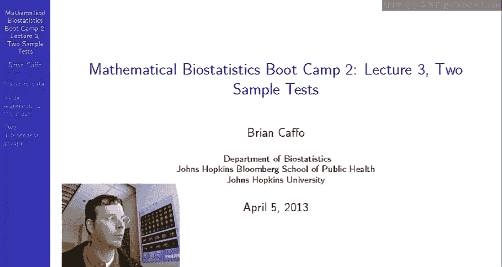
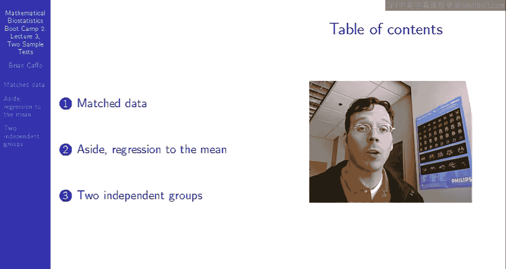
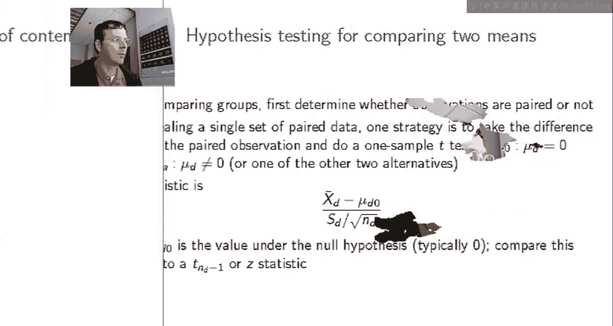
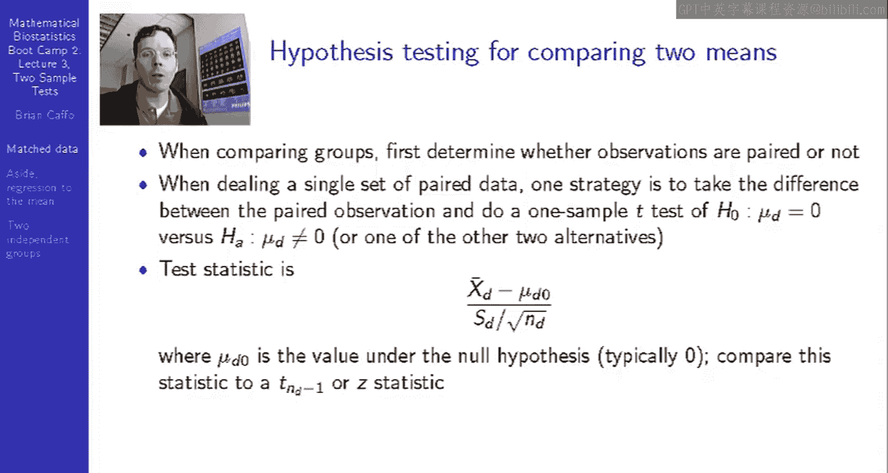

#  039：配对数据 I 📊



在本节课中，我们将学习双样本检验，重点探讨配对数据的情况。我们将了解什么是配对数据，如何识别它，以及如何对配对数据进行统计检验。课程将从配对数据的基本概念开始，然后讨论一个有趣的历史话题——均值回归，最后会简要提及独立组的情况。





---

## 配对数据与独立数据

当比较两个组时，首先要确定数据是否配对。这一点可能比最初想象的更微妙一些。

最明显的数据配对情况是，观测值来自同一个受试者。例如，在一项治疗试验中，假设测试某种药物。一种情况是，你将治疗随机分配给一组人，将安慰剂随机分配给另一组人。这显然不是配对数据，因为一组人接受了治疗，另一组人接受了安慰剂。

而明显配对的情况是，想象你以某种随机顺序，让每个人先接受治疗，经过一段洗脱期后再接受安慰剂；或者让一些人先接受安慰剂，洗脱期后再接受治疗。在这种情况下，数据显然是配对的，因为同一个人既接受了治疗也接受了对照。

在这两种情况下，问题都是比较治疗与安慰剂的效果。但在一种情况下，你有两个独立的、由不同人组成的组；在另一种情况下，每个人都会接受两种处理，因此数据是配对的。

有时，配对可能不那么明显。例如，你可能不是在研究被分配的处理。假设你想比较高血压人群和低血压人群的某个其他特征，比如呼吸紊乱指数。这看起来像是非配对数据，因为低血压人群是一组人，高血压人群是另一组人。

但它们也可以是配对的。在这类实验中，研究者通常的做法是，为低血压组中的每个人，在高血压组中寻找一个在年龄、性别和其他特征上都非常匹配的人。在这种情况下，数据是“软配对”的。当然，这不可能是同一个人，因为一个人不可能同时拥有低血压和高血压。但你可以让低血压组中的一个人，在年龄、体重等特征上与高血压组中的一个人高度匹配，这样他们就构成了配对。

这个过程被称为“匹配”。这是一种非常有效的方法，用于处理那些你虽然不感兴趣但可能混淆你所关注关系的变量。

总之，本节幻灯片的核心是区分两种主要的两组比较类型：一种是观测值通过匹配或其他方式配对的情况。

---

## 配对数据的处理方法

上一节我们介绍了配对数据的概念，本节中我们来看看如何处理它。配对数据的情况相对简单，因为它基本上可以简化为一个单样本问题。

当观测值配对时，一种策略是计算配对观测值之间的差值，然后对差值进行单样本T检验。零假设是总体平均差值为零，备择假设是总体平均差值非零（或其他两种备择假设之一）。

这样做非常直接。你的检验统计量就是普通的单样本检验统计量：差值的平均值减去假设的均值（通常为零），再除以差值的标准差，最后除以配对观测数量的平方根。

需要注意的是，这里的分母是配对观测的数量，而不是总观测数。因为开始时你有2n个观测值（第一次测量n个，第二次测量n个），当计算差值后，你得到的观测数通常是开始时的一半。

处理配对数据的主要方法就是简单地计算差值，然后像处理单样本检验一样处理这些差值。这就是普通的配对双样本T检验。

其核心公式如下：

**检验统计量公式：**
`t = (平均差值 - 假设均值) / (差值标准差 / √配对数量)`

**代码示例（概念性）：**
```python
# 假设 paired_group1 和 paired_group2 是配对的测量值
differences = paired_group1 - paired_group2
mean_diff = np.mean(differences)
std_diff = np.std(differences, ddof=1)  # 样本标准差
n_pairs = len(differences)
t_statistic = mean_diff / (std_diff / np.sqrt(n_pairs))
```

---

## 本节课总结



本节课中，我们一起学习了双样本检验中的配对数据。我们首先明确了配对数据与独立数据的区别，了解了通过同一受试者或匹配方法形成配对的情况。接着，我们探讨了处理配对数据的核心方法：计算配对观测值之间的差值，并将其转化为单样本T检验问题。这种方法简化了分析过程，使我们能够有效地检验两组配对数据之间的平均差异是否显著。