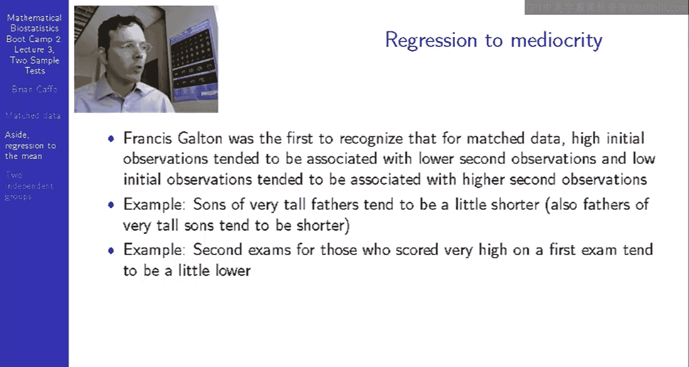
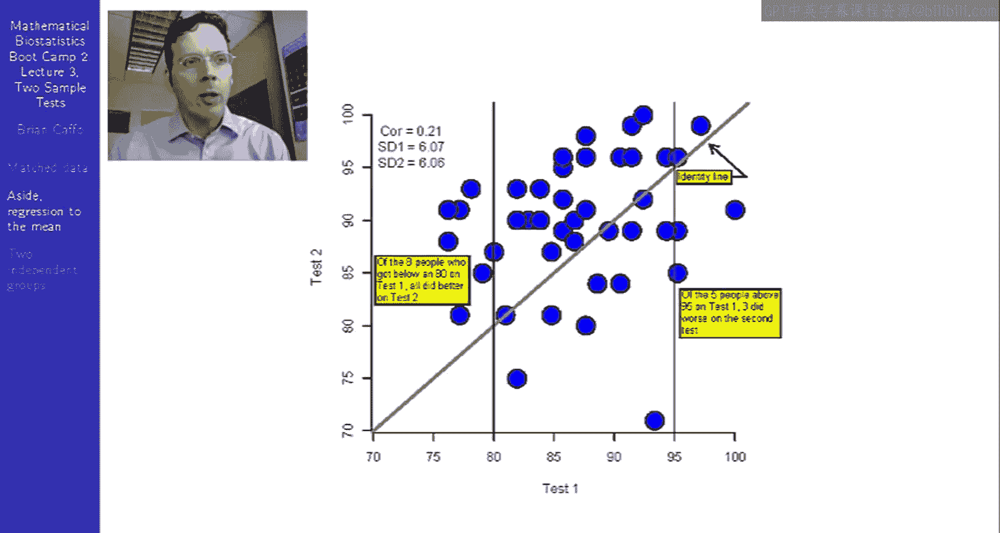
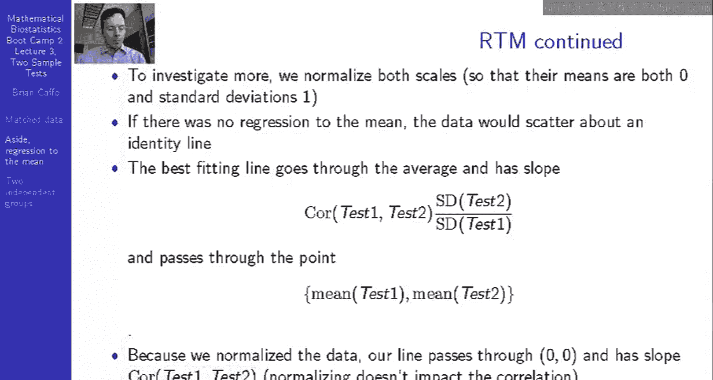
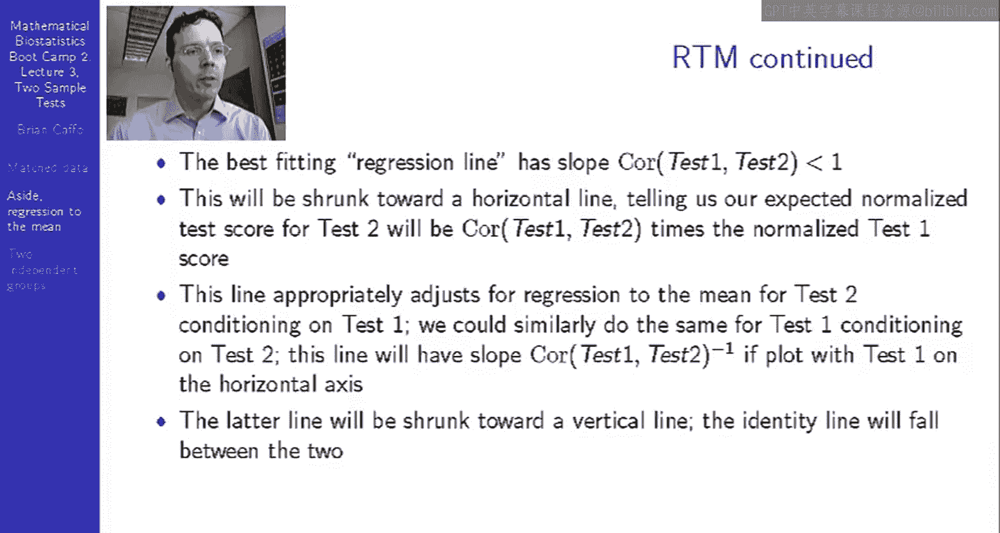
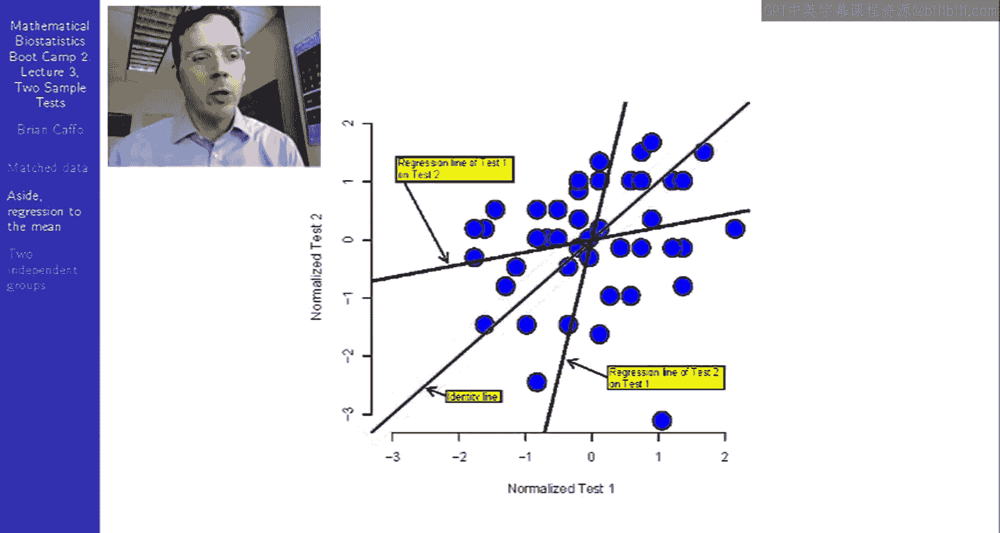
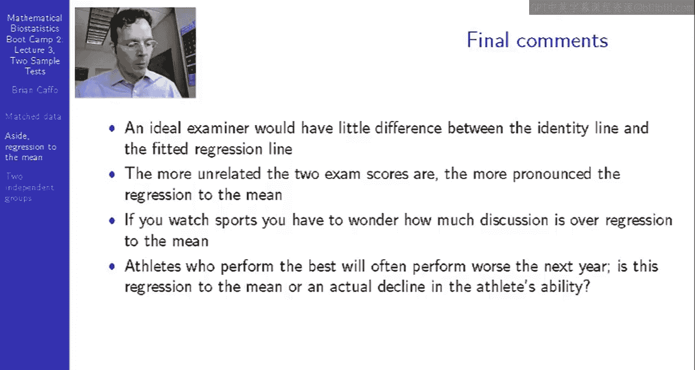

#  041：均值回归 📉

在本节课中，我们将学习一个统计学中的重要概念——**均值回归**。这个概念由弗朗西斯·高尔顿首次发现，它解释了为什么在配对数据中，极高的初始观测值往往伴随着较低的后续观测值，反之亦然。我们将通过一个考试分数的例子，来理解其背后的原理和数学表达。

## 均值回归的起源与背景

上一节我们介绍了配对数据的检验，本节中我们来看看一个与之相关的经典现象——均值回归。这个现象由查尔斯·达尔文的表弟、统计学家弗朗西斯·高尔顿首次提出并阐释。

高尔顿观察到，在配对数据中，极高的初始观测值往往伴随着较低的后续观测值，而极低的初始观测值则往往伴随着较高的后续观测值。他举的例子包括：非常高父亲的儿子往往也高，但会略矮一些；非常高儿子的父亲也往往略矮一些。在我们今天讨论的语境中，第一次考试得分极高的学生，在第二次考试中的得分往往会略低一些。

## 均值回归的原理

让我们探讨一下这个现象发生的原因。原因在于，观测值通常由“真实信号”和“随机噪声”两部分组成。

考虑两个极端情况：
1.  **完全随机（噪声主导）**：假设两次考试分数完全随机，彼此独立。那么，第一次考试的最高分仅仅是随机出现的极值。这个极值再次出现的概率很低，第二次的分数更可能落在分布的中心附近。反之，极低分也是如此。这种情况下，均值回归现象会非常明显。
2.  **完全相关（信号主导）**：假设考试是衡量学生能力的完美工具，没有测量误差。那么，一个学生应该在两次考试中得到完全相同的分数。在这种情况下，数据点将完美地落在一条斜率为1的直线上，不存在均值回归。

当然，实际情况通常介于两者之间。既有真实能力的体现，也存在随机波动。因此，我们总能观察到一定程度的均值回归。

以下是考试分数示例的观察结果：
*   在第一次考试低于80分的8名学生中，有7名在第二次考试中取得了更好的成绩。
*   在第一次考试高于95分的5名学生中，有3名在第二次考试中成绩下滑。

这显示了明显的均值回归趋势。

## 标准化数据与回归线

为了更清晰地分析，我们通常先将数据标准化。这意味着调整数据，使其均值为0，标准差为1。

标准化公式为：
`标准化分数 = (原始分数 - 平均值) / 标准差`

经过标准化后，两次考试的均值都为0，标准差都为1。这消除了均值的偏移和尺度的影响，让我们能专注于分数之间的相关关系。

如果不存在均值回归，标准化后的数据将围绕一条斜率为1的直线（恒等线）分布。数据点越分散，均值回归的现象就越明显。

实际上，描述两次考试分数关系的最佳拟合回归线，其斜率等于两次考试分数之间的相关系数 `r`。

回归线斜率公式为：
`斜率 = r * (sd_test2 / sd_test1)`

由于数据已标准化（`sd_test1 = sd_test2 = 1`），因此斜率简化为：
`斜率 = r`

这个斜率 `r` 通常小于1。它告诉我们，基于第一次考试的标准化分数 `X` 来预测第二次考试的标准化分数 `Y` 时，预测值会被“收缩”：
`预测的Y = r * X`

例如，如果相关系数是0.95，那么你对第二次考试的预测分数将是第一次考试分数的0.95倍。这本身就是对均值回归的调整。

## 回归线的双向解释

理解回归线的方向很重要。当我们用考试1（X轴）预测考试2（Y轴）时，回归线斜率是 `r`。

如果我们想用考试2（X轴）预测考试1（Y轴），那么回归线的斜率将是 `1/r`。

在图形上，这两条回归线都通过原点(0,0)。当数据点完全相关（`r=1`）时，两条回归线都与恒等线重合，均值回归消失。当相关性较弱（`r`较小）时，回归线会变得平缓，表明基于一个分数预测另一个分数时，需要向均值方向进行大幅调整。

## 现实意义与总结

本节课中我们一起学习了均值回归的概念。一个理想的测量工具应尽可能减少随机误差，从而使观测值更接近真实值，恒等线与回归线之间的差异也会变小。

两个观测值之间的相关性越弱，随机噪声的成分就越大，均值回归的现象也就越显著。这种现象在众多领域都有体现，一个常被讨论的例子是体育比赛。运动员或球队在某赛季的卓越表现，往往是其真实实力与随机运气共同作用的结果。如果随机成分很大，那么在下个赛季，他们的表现就很可能“回归”到平均水平附近。因此，体育评论中很多关于“状态起伏”的讨论，本质上可能就是在讨论均值回归。

总结来说，均值回归是一个重要的统计现象，它提醒我们在解读极端数据时要保持谨慎，因为其中可能包含了较大的随机波动成分。通过计算相关系数和拟合回归线，我们可以量化并调整这种效应。