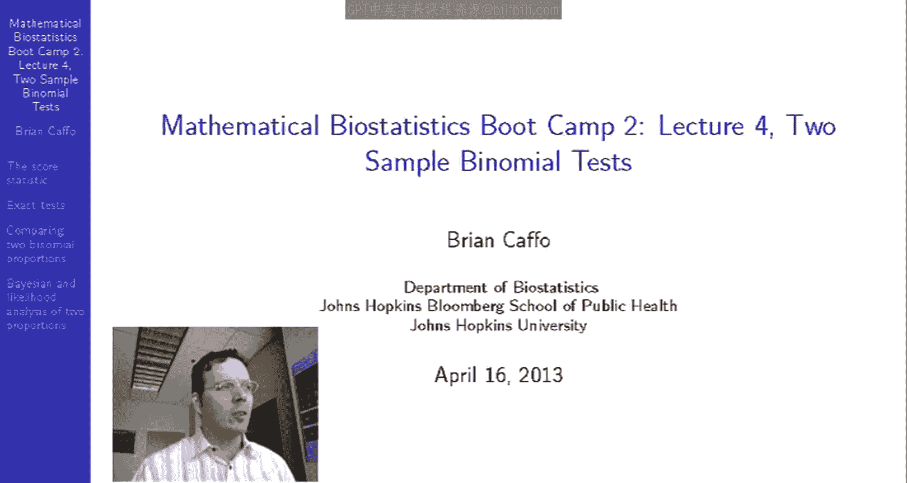
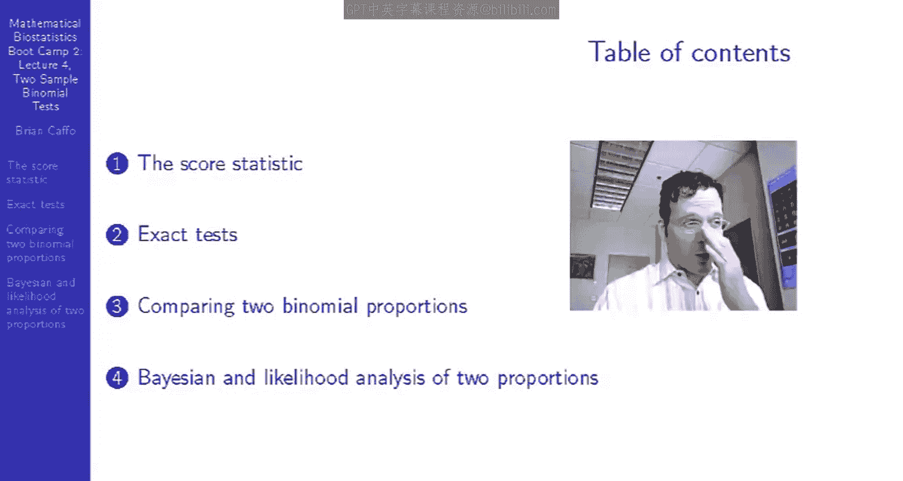
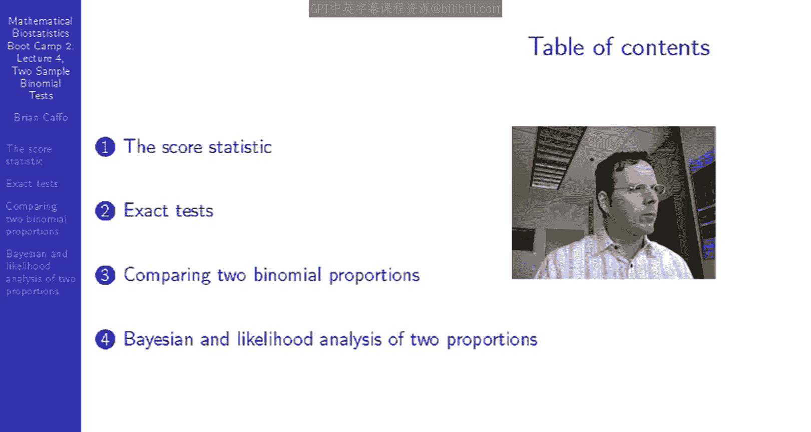
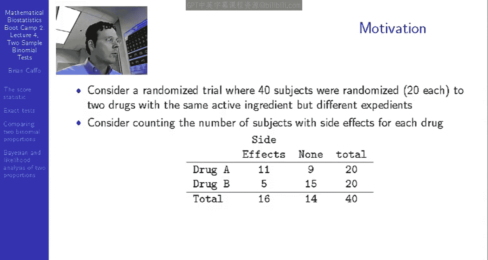
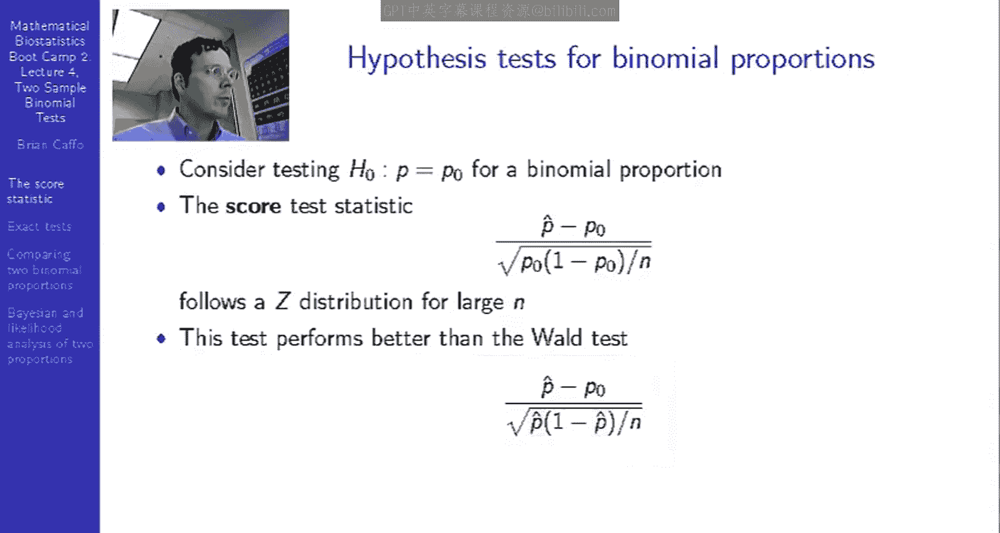
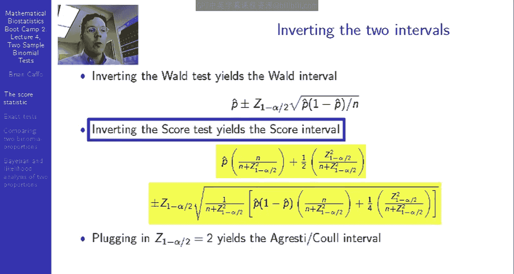
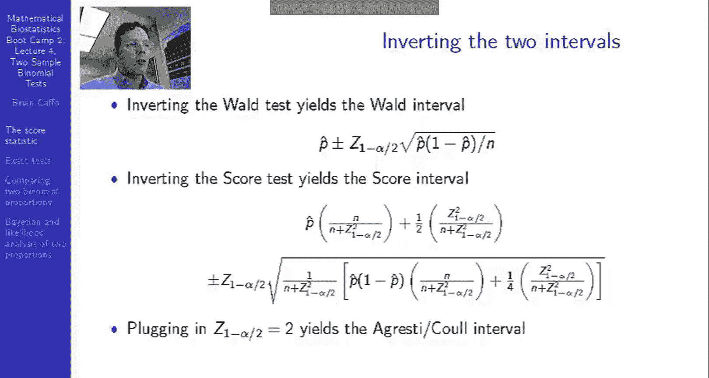
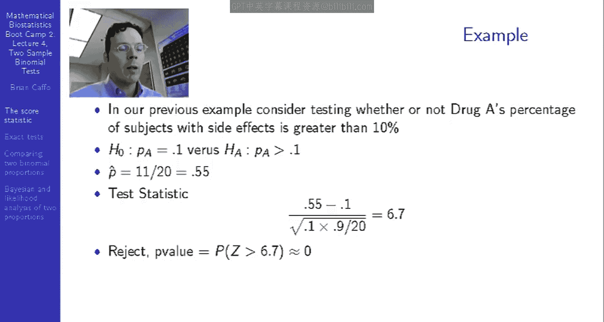

#  043：得分统计量







在本节课中，我们将要学习双样本二项检验，特别是得分统计量。我们将以此作为构建置信区间的动机，并探讨如何对两个二项比例进行精确检验。此外，我们还将讨论比较两个二项比例的贝叶斯和似然方法。我们将花相当多的时间在二项比例上，因为后续课程还会涉及相对风险和比值比等内容。

## 背景与问题设定

上一节我们介绍了得分统计量的基本概念，本节中我们来看看如何将其应用于一个具体的双样本场景。



想象一个随机对照试验，共有40名受试者，每组20人被随机分配到两种药物。这两种药物含有相同的活性成分，但辅料不同（例如，一种是胶囊，另一种是药片）。我们统计每种药物出现副作用的人数。

以下是数据表格：

| 药物 | 出现副作用 | 未出现副作用 | 总计 |
| :--- | :---: | :---: | :---: |
| 药物A | 11 | 9 | 20 |
| 药物B | 5 | 15 | 20 |
| **总计** | **16** | **24** | **40** |

从表面上看，药物A出现副作用的倾向似乎高于药物B。我们希望检验这两种药物出现副作用的概率是否相同。即使从这个简单的数据集出发，我们也有多种方法来表述和解决这个问题。现在，让我们从得分检验开始讨论。



## 单样本二项检验回顾

在深入双样本检验之前，我们先回顾一下单样本二项比例检验，这有助于理解后续内容。

假设我们只关注药物A，并想检验其总体副作用比例 `p_A` 是否等于某个特定值 `p_0`。我们的自然估计量是样本比例 `\hat{p}_A`。衡量 `\hat{p}_A` 与 `p_0` 之间差异的一个明显指标是差值。为了将其与统计分布进行比较，我们需要用 `\hat{p}_A` 的标准误对其进行标准化。

在零假设 `H_0: p = p_0` 下，`\hat{p}_A` 的方差为 `p_0(1-p_0)/n`。因此，我们的检验统计量为：



```
Z = (\hat{p}_A - p_0) / sqrt( p_0(1-p_0)/n )
```

这个 `Z` 统计量服从标准正态分布。将其与标准正态分布的分位数进行比较，即可完成假设检验。

需要指出的是，在分母中代入零假设下的 `p_0`（得分检验）比代入样本估计值 `\hat{p}_A`（Wald检验）通常表现更好。

## 从检验到置信区间



我们可以通过“反转”这个假设检验来构建置信区间。以下是两种常见方法：

*   **反转Wald检验**：得到 **Wald置信区间**。
    ```
    \hat{p} ± z_{1-α/2} * sqrt( \hat{p}(1-\hat{p})/n )
    ```
*   **反转得分检验**：得到更复杂的 **得分区间**。
    ```
    ( \hat{p} * [n/(n+z^2)] + 0.5 * [z^2/(n+z^2)] ) ± z_{1-α/2} * sqrt( \hat{p}(1-\hat{p})/n + z^2/(4n^2) ) / (1 + z^2/n)
    ```

得分区间有一个有趣的性质：它将样本比例 `\hat{p}` 向 `0.5` 方向“收缩”。当 `n` 很大时，它接近Wald区间；当 `n` 较小时，这种收缩有助于改善区间在分布不对称时的表现。如果我们取 `z_{1-α/2} ≈ 2`（对应95%置信水平），代入得分区间公式，就得到了之前讨论过的 **Agresti-Coull区间**。

## 单样本检验实例

让我们应用上述知识到之前的例子中。假设药监局规定，此类药物的副作用发生率若超过10%将引起严重关切。我们想检验药物A的副作用比例 `p_A` 是否大于10%。

*   **假设**：
    *   `H_0: p_A = 0.1`
    *   `H_1: p_A > 0.1` （单侧检验）
*   **数据**：`\hat{p}_A = 11/20 = 0.55`
*   **计算检验统计量**：
    ```
    Z = (0.55 - 0.1) / sqrt( 0.1*0.9 / 20 ) ≈ 6.7
    ```
*   **决策**：对于单侧检验，`α=0.05` 的临界值约为 `1.65`。`Z=6.7` 远大于此，因此我们拒绝零假设。对应的P值（`P(Z > 6.7)`）几乎为0。

计算虽然简单，但我们必须思考其背后的模型假设。我们假设20名受试者的副作用发生情况是独立同分布的伯努利试验，这隐含了“无干扰”和“从目标总体中随机抽样”的假设。在实际研究中（例如受试者是职业试药者），这些假设可能不成立。因此，在得到像 `6.7` 这样显著的统计量时，理解其模型背景与实际含义至关重要。

## 总结

本节课中我们一起学习了：
1.  **得分统计量**：用于单样本二项比例检验，其分母使用零假设下的比例 `p_0`，通常比Wald检验更优。
2.  **置信区间构建**：通过反转假设检验，可以从得分检验得到得分置信区间，其性质优于标准的Wald区间，并与Agresti-Coull区间相关联。
3.  **实例分析**：我们通过一个药物副作用检验的实例，演练了单样本二项检验的计算步骤。
4.  **模型思考**：我们强调了在简单计算背后，理解独立同分布、无干扰等统计模型假设的实际意义的重要性，这是正确解读统计结果的关键。



在接下来的课程中，我们将把重点从单样本扩展到双样本，直接比较药物A和药物B的副作用比例。