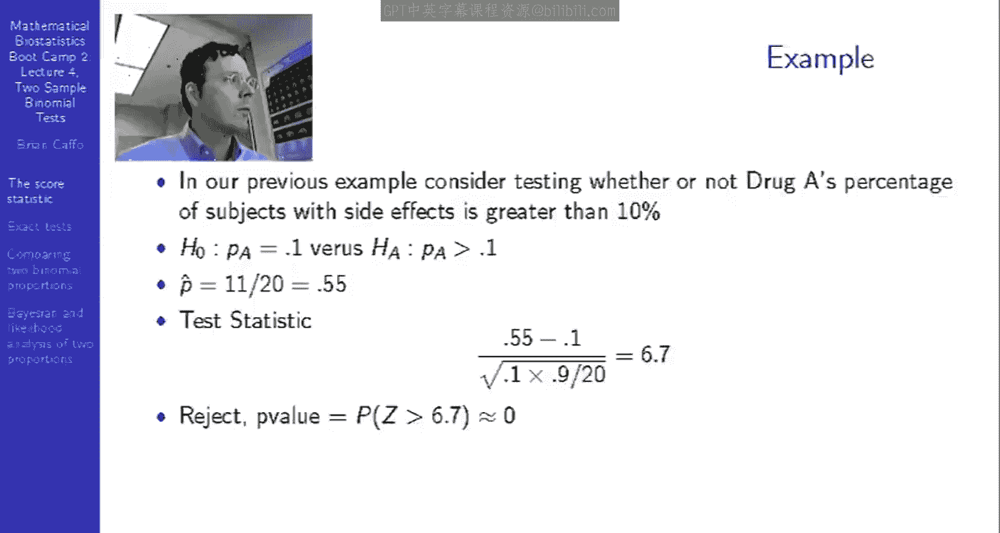
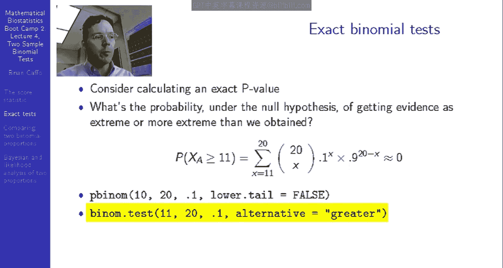
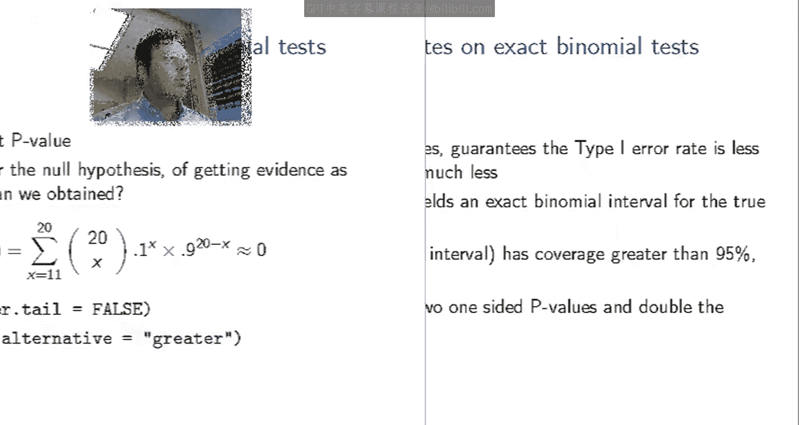
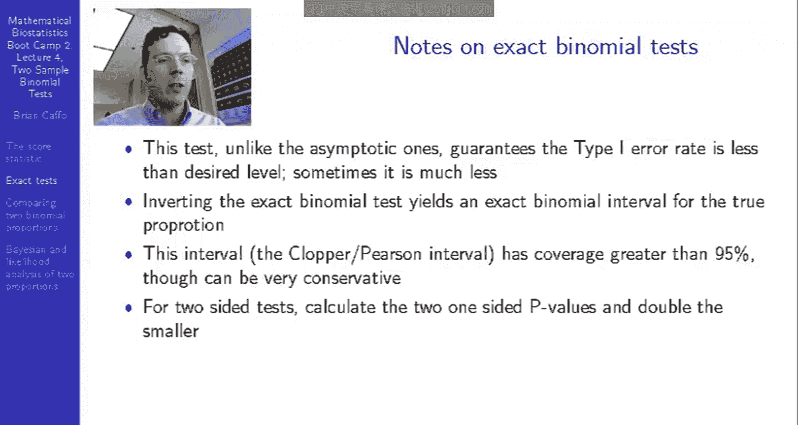
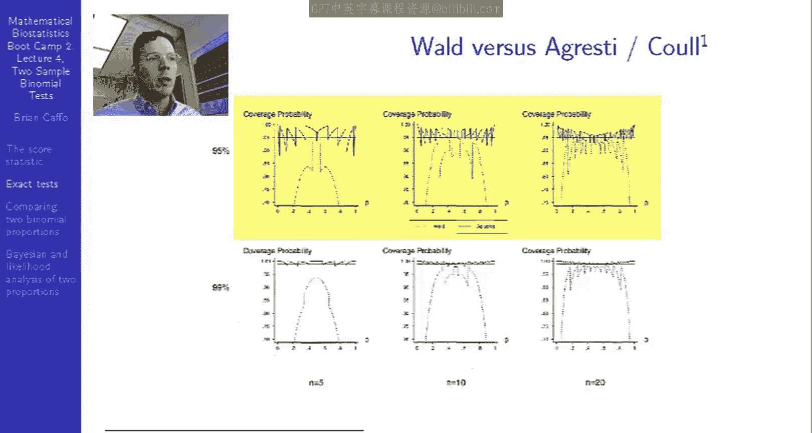

#  044：精确检验



在本节课中，我们将要学习二项检验的精确方法。与之前依赖大样本中心极限定理的近似方法不同，精确检验直接基于二项分布进行计算，从而在样本量较小时也能保证检验的准确性。

## 精确二项检验的原理

上一节我们介绍了基于渐近正态分布的近似检验方法。本节中我们来看看当样本量不够大时，如何执行精确的二项检验。

所谓“精确”，是指计算过程直接利用二项分布的概率质量函数，而非样本比例的渐近分布。假设我们观察到样本中有11人出现副作用，我们想检验样本比例是否大于某个值。那么，获得与我们观察到的证据同样极端或更极端结果的概率，就是观察到11个或更多副作用的概率。

具体而言，设 `X_A` 为药物A出现副作用的患者人数。在零假设 `H_0: p = 0.1` 下，获得11个或更多副作用的概率为：
```
P(X_A ≥ 11) = Σ_{x=11}^{20} [C(20, x) * (0.1)^x * (0.9)^{20-x}]
```
这个计算是在零假设（真实比例 `p` 为10%）下进行的。它衡量了在零假设成立时，获得支持备择假设的极端证据的概率，因此这就是P值。

在R语言中，可以轻松计算这个概率：
```r
pbinom(10, 20, 0.1, lower.tail = FALSE)
```
这里有一个细节需要注意：`pbinom` 函数的 `lower.tail` 参数。若 `lower.tail = TRUE`（默认值），则计算 `P(X ≤ q)`；若 `lower.tail = FALSE`，则计算 `P(X > q)`。因此，要计算 `P(X ≥ 11)`，即从11开始累加的概率，必须设置 `lower.tail = FALSE`。

为了避免混淆，也可以直接使用 `binom.test` 函数，它功能更全面，还能给出精确的置信区间：
```r
binom.test(11, 20, p = 0.1, alternative = "greater")
```

## 精确检验的性质与优势





了解了精确检验的计算方法后，我们来看看它被称为“精确”的原因及其优缺点。

该检验被称为“精确”，是因为与渐近检验的近似错误率不同，它能精确控制检验水准 `α`。例如，若设定 `α = 0.05`，精确检验能保证实际的I类错误率不高于5%。但这也带来了一个问题：它是保守的，实际错误率可能远低于设定的 `α`，尤其是在样本量很小时。

对于双侧检验，一个常用的方法是：分别计算两个单侧检验的P值，取较小的那个，然后将其乘以2。这遵循了我们之前在正态检验中使用的规则，通常足够好，尽管存在一些稍作改进的更好方法。

基于这种双侧检验，我们可以通过网格搜索，找出所有不会导致拒绝零假设的 `p` 值，从而构造出一个置信区间。这个区间被称为**Clopper-Pearson区间**。它的优点是能保证覆盖概率：进行5%的检验，就能得到95%或更高的置信水平。缺点是，当覆盖概率“更高”时，区间可能被不必要地加宽了。因为更高的置信水平通常意味着更宽的区间。

## 不同置信区间的性能比较

在讨论了精确检验的性质后，我们通过一项研究来比较不同置信区间的表现。

下图展示了一项研究结果，比较了Wald区间与通过反转得分检验并简单使用 `2` 代替 `1.96` 得到的近似区间的覆盖概率。




图中顶部的线条呈锯齿状，这是由于二项分布的离散性造成的。我们看95%置信水平的那一行（最上方）。实线代表的Agresti-Coull区间始终围绕95%上下轻微波动。而Wald区间（点线）的覆盖概率可能偏差很大。即使在样本量达到20时，当真实比例 `p` 接近0或1时，Wald区间的覆盖概率可能非常低（图中被截断在70%以下，实际上在0和1处会降至0）。

这个比较说明，从使用 `p̂` 计算标准误的Wald区间，切换到Agresti-Coull区间（一个简单的修正），可以在不增加概念或计算成本的情况下，显著提升区间估计的性能。这基本上表明，在这种情况下，得分检验区间（与Agresti-Coull区间相关）的表现远优于Wald区间，而这往往是一个普遍规律。

## 总结



本节课中我们一起学习了二项检验的精确方法。我们首先介绍了精确二项检验的原理，即直接基于二项分布计算P值，并演示了如何在R中实现。接着，我们探讨了精确检验能保证错误率但不免保守的特性，以及如何构建精确的Clopper-Pearson置信区间。最后，通过性能比较，我们了解到像Agresti-Coull区间这样的改进方法，相比传统的Wald区间，能在小样本或极端比例情况下提供更可靠的统计推断。