#  045：比较两个二项比例 📊

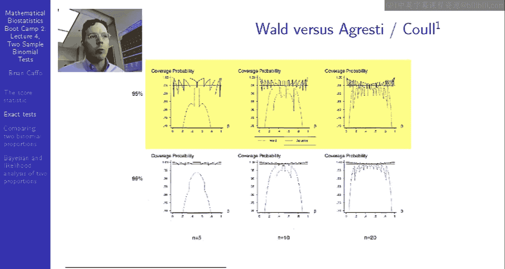

在本节课中，我们将要学习如何比较两个独立的二项比例，例如比较两种药物副作用的发生率是否相同。我们将介绍经典的得分检验（Score Test）和Wald区间，并探讨其性能问题及改进方法。最后，我们将简要介绍贝叶斯方法在此问题上的应用。

---

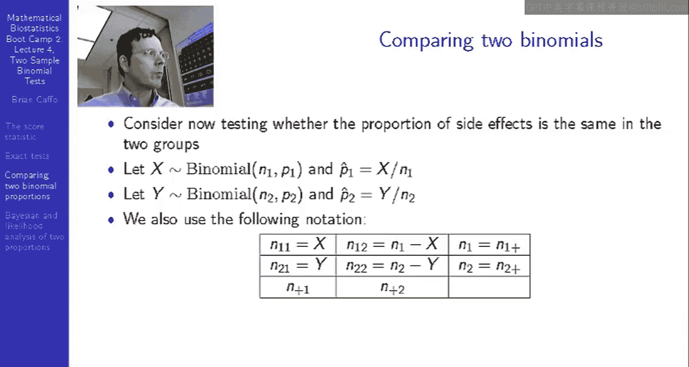

## 从单样本到双样本比较 🔄

上一节我们介绍了单样本二项比例的检验。本节中，我们来看看如何比较两个独立的二项比例。

我们想要检验两个组的副作用发生率是否相同。例如，A组可能是一种新配方药物，B组是标准药物，我们想检验新配方的副作用发生率是否更高。

对于2x2列联表，我们使用以下符号表示数据：

| 组别 | 成功（事件） | 失败（非事件） | 总计 |
| :--- | :---: | :---: | :---: |
| 组1 | x | N1 - x | N1 |
| 组2 | y | N2 - y | N2 |

有时，我们也会用矩阵坐标来指代四个单元格：N11, N12, N21, N22。行合计记为N1+和N2+，列合计记为N+1和N+2。

---

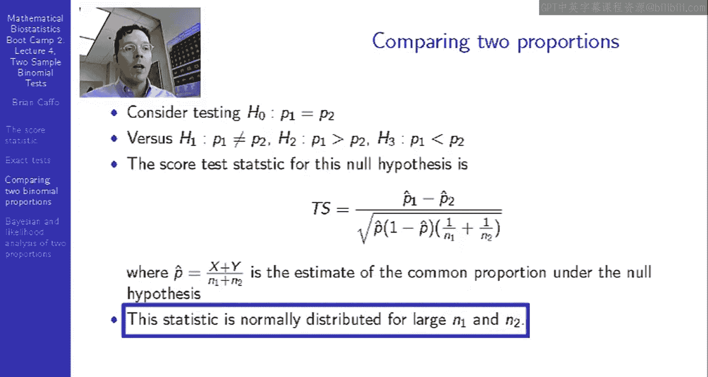

## 得分检验：检验比例是否相等 ✅

我们的零假设是 H₀: P₁ = P₂，备择假设可以是“不等于”、“大于”或“小于”。

得分检验的统计量构造如下：

*   **分子**：样本比例之差减去零假设下的差值（通常为零）。
    `P₁_hat - P₂_hat`
*   **分母**：在零假设（P₁ = P₂）下，该差值的标准误估计。

在零假设下，P₁_hat - P₂_hat 的方差为：
`Var(P₁_hat - P₂_hat) = P(1-P) * (1/N₁ + 1/N₂)`
其中，`P` 是两组的共同比例。

我们需要估计这个共同的 `P`。在零假设下，所有数据可以看作来自同一个伯努利分布，因此其最大似然估计（MLE）为总成功数除以总试验数：
`P_hat = (x + y) / (N₁ + N₂)`

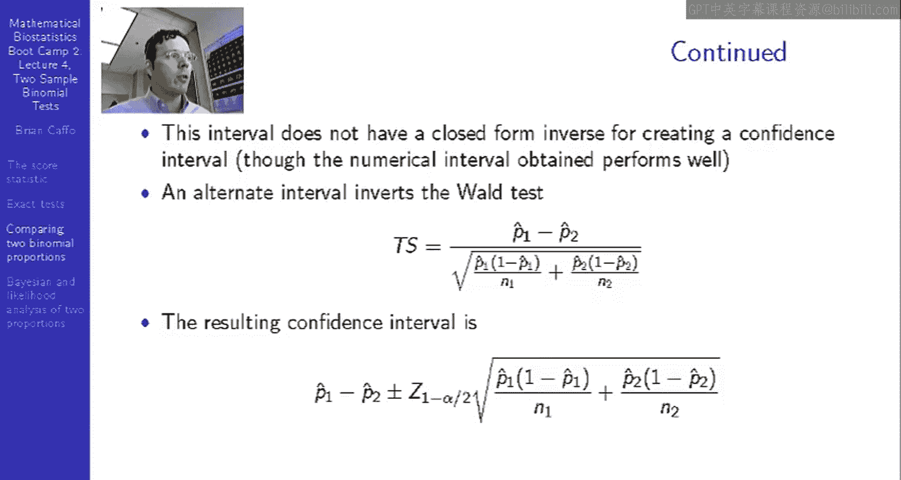

将其代入方差公式，得到我们的检验统计量：
`Z = (P₁_hat - P₂_hat) / sqrt( P_hat * (1 - P_hat) * (1/N₁ + 1/N₂) )`

在大样本（N₁ 和 N₂ 较大）下，该统计量在零假设下近似服从标准正态分布。

---

## Wald置信区间及其局限性 ⚠️

如果我们想将检验反转为置信区间，对于单个比例我们有得分区间，但对于两个比例之差，情况更复杂。

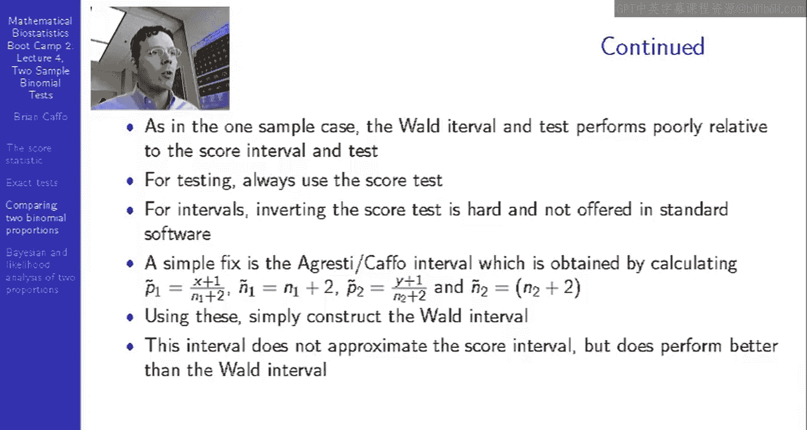

Wald区间很容易计算，形式如下：
`(P₁_hat - P₂_hat) ± Z * sqrt( P₁_hat(1-P₁_hat)/N₁ + P₂_hat(1-P₂_hat)/N₂ )`

然而，这个区间性能不佳，尤其是在比例接近0或1时，其覆盖率会显著低于名义置信水平（如95%）。这是因为其分母没有利用零假设下比例相等的信息，且在小样本或极端比例下正态近似较差。

**为什么不能直接反转得分检验来得到区间？**
因为得分检验的分母是在特定的零假设（P₁ = P₂）下计算的。如果我们想检验 P₁ - P₂ = δ（δ不为0），分子需要调整，但分母没有直接的方法随之调整，因此需要通过编程来获得相应的置信区间。

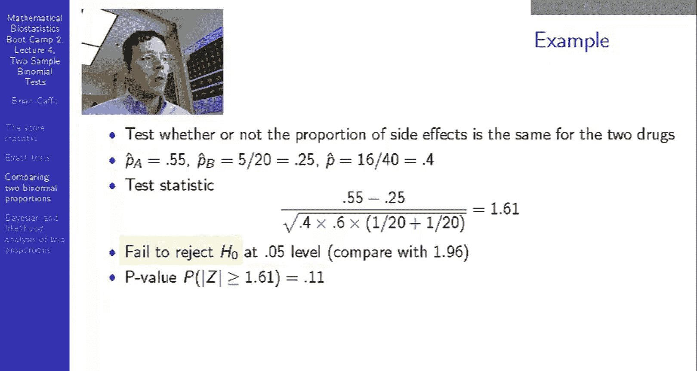

---

## 改进方法：Agresti-Coull区间 ✨

由于反转得分检验较难，且Wald区间性能差，我们提出一个简单的改进方案，灵感来自单样本的Agresti-Coull区间。

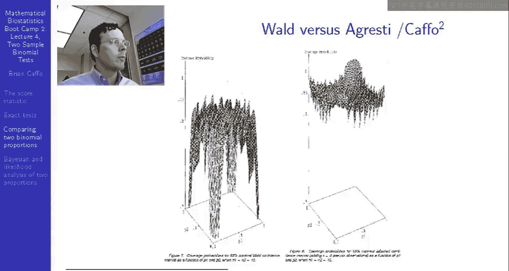

方法是在每个组的成功数和失败数上都加1。具体操作如下：

1.  定义调整后的数据：
    *   `x_tilde = x + 1`
    *   `N1_tilde = N1 + 2`
    *   `P1_tilde = x_tilde / N1_tilde`
    *   对第二组进行同样操作：`y_tilde = y + 1`, `N2_tilde = N2 + 2`, `P2_tilde = y_tilde / N2_tilde`
2.  使用调整后的 `P_tilde` 和 `N_tilde` 代入Wald区间的公式进行计算。

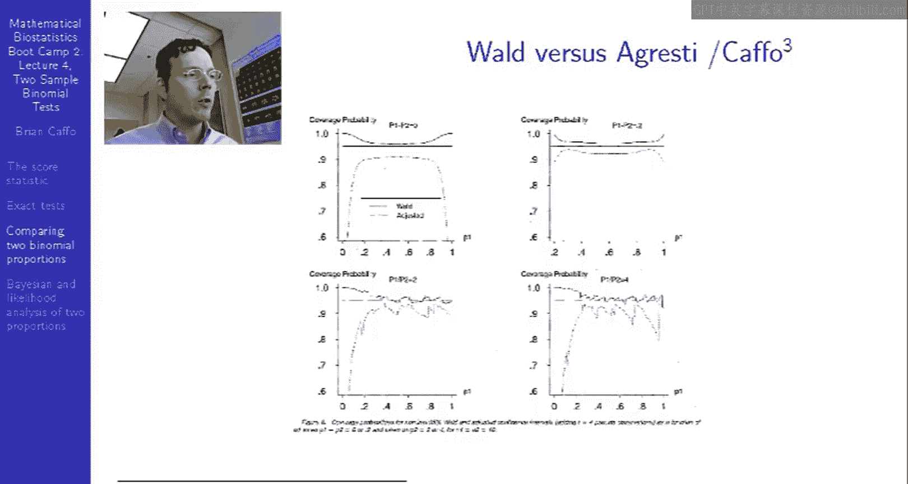

这相当于在原始的2x2表中，给每个单元格都加了1。这种方法将估计的比例向0.5方向“收缩”，显著改善了区间在极端比例情况下的覆盖率，且计算非常简单。

以下是性能对比的结论：
*   在双样本情况下，Wald区间的性能下降不如单样本时那么严重，因为“相减”操作本身使分布更接近正态。
*   但Agresti-Coull调整后的区间性能仍然明显优于普通Wald区间，尤其是在小样本或比例接近边界时。

---

## 实例计算 🧮

让我们通过一个例子进行计算。假设：
*   组1（药物A）：N1=20，副作用人数 x=11，比例 P1_hat = 0.55
*   组2（药物B）：N2=20，副作用人数 y=5，比例 P2_hat = 0.25

**1. 计算共同比例估计：**
`P_hat = (11 + 5) / (20 + 20) = 16 / 40 = 0.4`

**2. 计算得分检验统计量：**
`Z = (0.55 - 0.25) / sqrt( 0.4 * 0.6 * (1/20 + 1/20) )`
`Z = 0.3 / sqrt( 0.24 * 0.1 ) = 0.3 / sqrt(0.024) ≈ 0.3 / 0.155 ≈ 1.61`

**3. 假设检验：**
对于双侧检验，临界值 Z_{0.975} ≈ 1.96。由于 |1.61| < 1.96，我们在5%显著性水平上**无法拒绝**零假设。
双侧P值为：`P(|Z| > 1.61) = 2 * P(Z > 1.61) ≈ 2 * 0.054 = 0.108`。

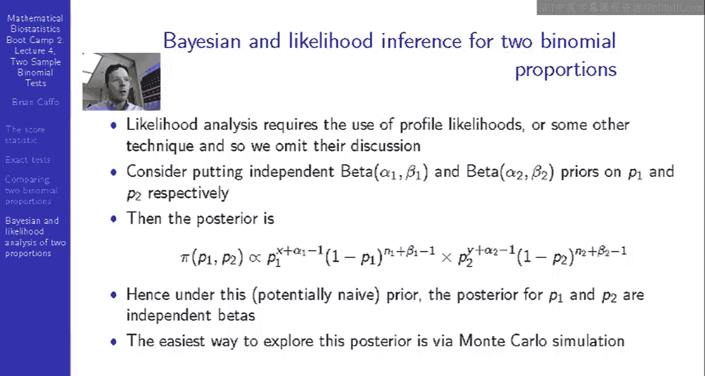

因此，没有足够证据表明两种药物的副作用发生率不同。

---

## 贝叶斯方法简介 🎲

上一节我们介绍了单样本二项比例的贝叶斯分析。本节中，我们将其扩展到双样本比较。

**思路：**
对两个比例 P₁ 和 P₂ 分别设置独立的先验分布（例如Beta分布），然后通过数据更新得到后验分布。

**具体步骤：**
1.  **设定先验**：假设 P₁ ~ Beta(α₁, β₁)， P₂ ~ Beta(α₂, β₂)，且两者独立。
2.  **计算后验**：似然函数是两个独立的二项分布。根据共轭性，后验分布也是独立的Beta分布：
    *   P₁ | 数据 ~ Beta(α₁ + x, β₁ + N₁ - x)
    *   P₂ | 数据 ~ Beta(α₂ + y, β₂ + N₂ - y)
3.  **后验推断**：我们关心的是 P₁ 和 P₂ 的某个函数，例如风险差 `δ = P₁ - P₂`、相对风险 `RR = P₁ / P₂` 或比值比 `OR`。
    通过从后验分布中抽取大量样本（蒙特卡洛模拟），可以轻松得到这些函数量的后验分布，并计算其均值、中位数、可信区间等。

**优势：**
贝叶斯方法可以方便地得到任何感兴趣参数（如风险差、相对风险）的完整后验分布，而不仅仅是点估计和区间。这让我们能更直观地看到哪些参数值更受数据支持。

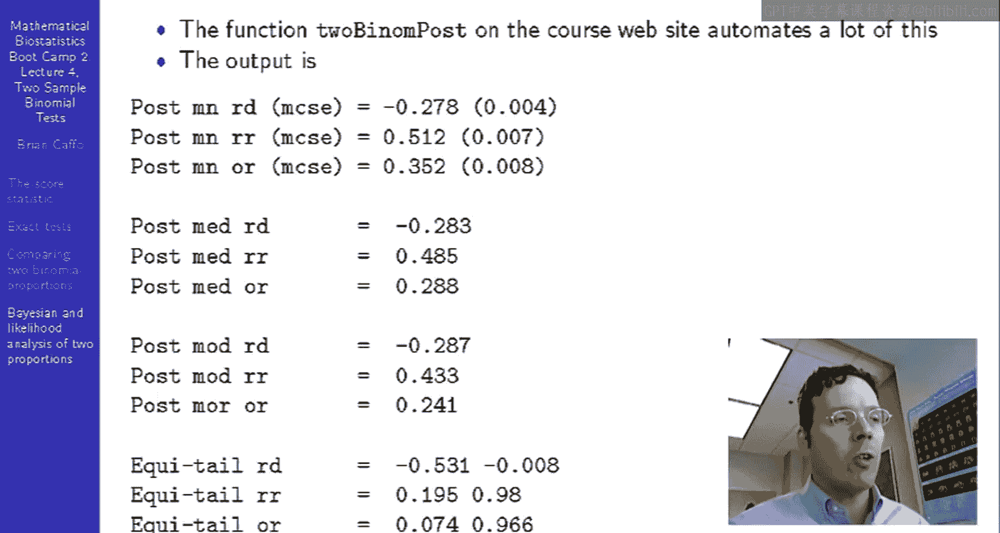

例如，即使风险差的后验95%可信区间包含0，我们也能从后验密度图上看出0这个值是否位于分布的高概率区域。

---

## 总结 📝

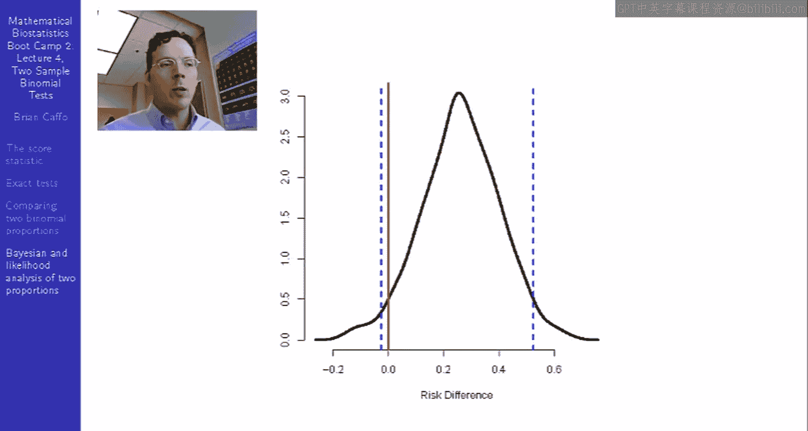

本节课中我们一起学习了比较两个二项比例的方法：
1.  **频率主义方法**：我们介绍了**得分检验**用于假设检验，它比Wald检验更优。对于置信区间，标准的**Wald区间**在极端比例下性能不佳，而简单的**Agresti-Coull调整**（每组的成功与失败数各加1）能显著改善其性能。
2.  **贝叶斯方法**：通过为每个比例设定独立的Beta先验，我们可以得到共轭的后验分布。利用蒙特卡洛模拟，可以灵活地推断风险差、相对风险等任何感兴趣参数的后验分布。

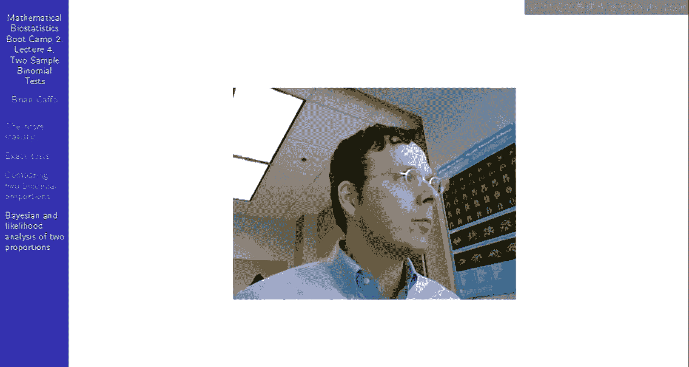

这些技术的基础思想（如利用渐近分布、进行连续性调整、使用共轭先验和模拟）在统计学中反复出现，希望你现在能更轻松地掌握它们。