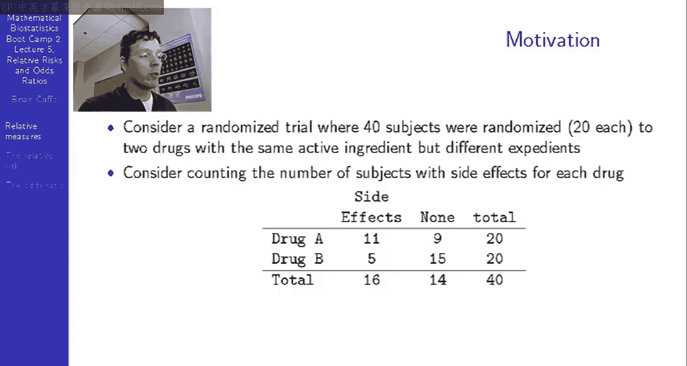
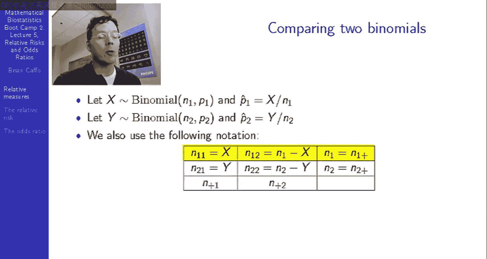
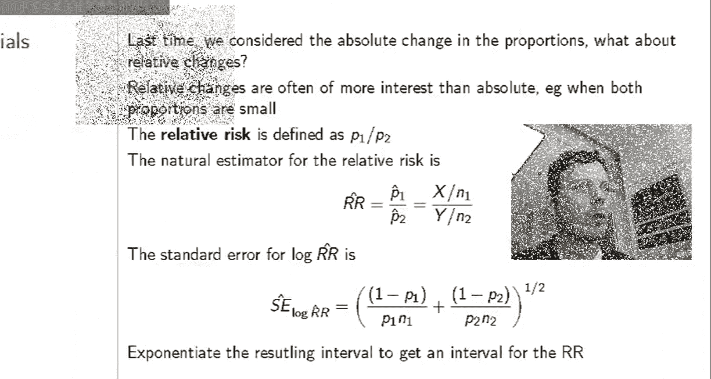

#  046：相对度量 📊

在本节课中，我们将要学习两种重要的相对度量指标：相对风险与优势比。我们将探讨为何在某些情况下，相对度量比绝对度量（如风险差）更有意义，并学习如何计算和解释它们。

上一节我们介绍了处理比例数据的基本概念，本节中我们来看看如何比较两个群体的比例。

## 相对度量的动机 🤔

在许多情况下，我们更关心相对差异而非绝对差异。例如，在研究某种环境因素是否会导致一种罕见疾病时，未暴露组和暴露组的患病比例可能都很小。此时，尽管患病率的绝对差异很小，但相对差异可能非常大。因此，我们经常对相对差异感兴趣。

以下是两种特别有趣的比例比较方式：
*   **A. 将两个比例相除**，这称为**相对风险**。
*   **B. 将两个相关的优势相除**，这称为**优势比**。

## 案例研究：药物副作用试验 💊

让我们通过一个具体案例来理解这些概念。考虑一项随机试验，40名受试者被随机分配到两种药物（各20人）。两种药物活性成分相同，但辅料不同（例如一种是胶囊，一种是片剂）。我们记录每种药物出现副作用的受试者数量。

*   药物A：11人有副作用，9人无副作用，总计20人。
*   药物B：5人有副作用，15人无副作用，总计20人。
*   总计：16人有副作用，24人无副作用，总计40人。

我们的研究兴趣是：在考虑随机波动的情况下，药物A的副作用发生率是否在统计学上显著高于药物B。

## 数据建模方法 📈

处理这个问题有多种方法。我们将采用以下建模方式：
我们假设第一组（药物A）出现副作用的人数 `X` 服从二项分布，参数为 `N1 = 20` 和未知比例 `P1`。同样，第二组（药物B）出现副作用的人数 `Y` 也服从二项分布，参数为 `N2 = 20` 和未知比例 `P2`。

`P1` 的自然估计值是 `P1_hat = X / N1`。
`P2` 的自然估计值是 `P2_hat = Y / N2`。

## 数据表示法 📋

除了使用 `X` 和 `Y` 表示计数，对于这种2x2列联表数据，我们还可以使用下标 `i` 和 `j` 来索引元素。

*   `n11` 表示左上角单元格（药物A，有副作用）。
*   `n21` 表示左下角单元格（药物B，有副作用）。
*   以此类推。

如果需要表示跨行或跨列汇总的边际总数，我们使用加号 `+`。
*   `n+1` 表示对第一个索引（行）求和后的第一列总数。
*   `n1+` 表示对第二个索引（列）求和后的第一行总数。

---

本节课中我们一起学习了相对风险与优势比的基本概念及其应用场景。我们通过一个药物试验的案例，介绍了如何用二项分布对数据进行建模，并学习了2x2列联表的标准表示方法。在接下来的课程中，我们将基于此框架深入计算和解释相对风险与优势比。