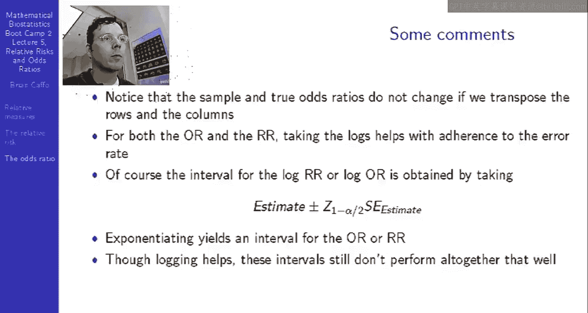
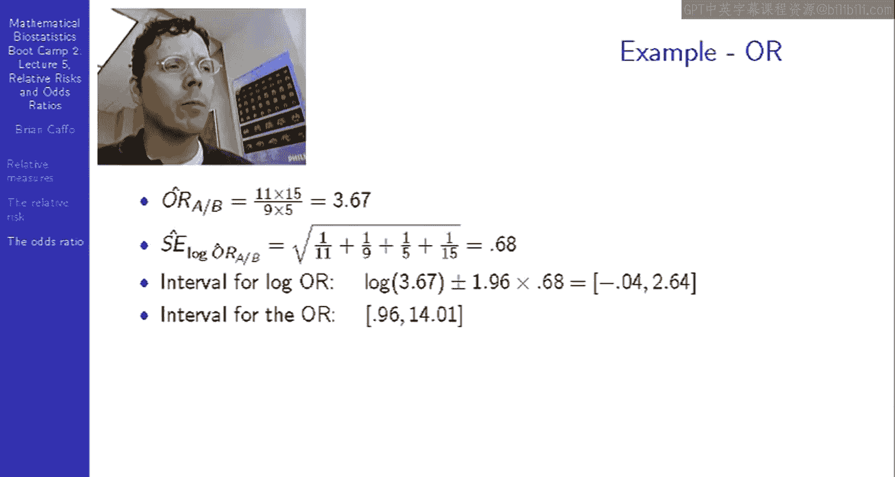
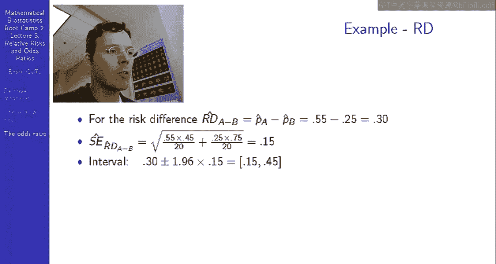
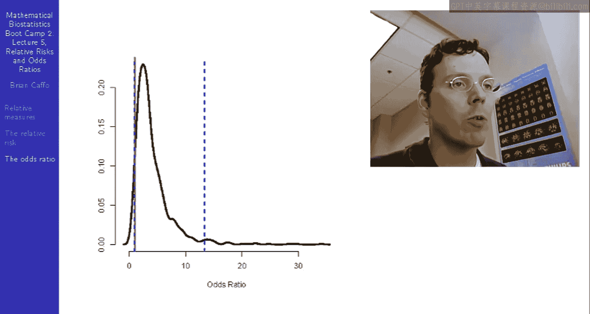

#  048：优势比

在本节课中，我们将学习如何计算和解释优势比，并将其与之前讨论的相对风险进行比较。我们将通过一个具体的药物副作用研究案例，演示如何计算优势比、其标准误和置信区间，并简要回顾贝叶斯分析在解释这些效应度量中的应用。

## 相对风险回顾

上一节我们介绍了相对风险的计算和解释。现在，我们通过一个具体例子来回顾。

假设一项研究比较两种药物（A和B）的副作用发生率。在20名服用药物A的患者中，有11人出现副作用。在20名服用药物B的患者中，有5人出现副作用。

药物A的副作用发生率估计值 `PA_hat` 为 11/20 = 0.55。
药物B的副作用发生率估计值 `PB_hat` 为 5/20 = 0.25。

因此，相对风险（A相对于B）的计算公式为：
**相对风险 = PA_hat / PB_hat = 0.55 / 0.25 = 2.2**

这个值2.2表明药物A出现副作用的可能性是药物B的2.2倍。然而，我们需要判断这个差异是否具有统计学意义。

相对风险对数的标准误计算公式为：
**SE(log(RR)) = sqrt( (1/11 + 1/5) - (1/20 + 1/20) ) = 0.44**

基于此，我们可以构建相对风险对数的95%置信区间：
**log(2.2) ± 1.96 * 0.44**

计算得到区间为 (-0.07, 1.65)。由于这个区间包含了0，意味着在统计学上，相对风险可能为1（即无差异）。

将区间取指数转换回原始尺度，得到相对风险的95%置信区间：
**exp(-0.07, 1.65) = (0.93, 5.21)**

该区间包含了1，进一步证实了从现有数据来看，两种药物副作用发生率的差异在统计上不显著。

## 优势比计算

现在，我们来看看如何计算优势比。优势比是另一种衡量两个比例之间关联强度的常用指标。

以下是计算优势比的步骤：

1.  首先，构建一个2x2列联表。
2.  然后，使用交叉乘积公式进行计算。

对于我们的药物副作用数据，列联表如下：

|          | 有副作用 | 无副作用 | 总计 |
| :------- | :------- | :------- | :--- |
| **药物A** | 11 (a)   | 9 (b)    | 20   |
| **药物B** | 5 (c)    | 15 (d)   | 20   |

优势比（A相对于B）的计算公式为：
**优势比 = (a * d) / (b * c) = (11 * 15) / (9 * 5) = 3.67**

这个值3.67表明，药物A出现副作用的“优势”（odds）是药物B的3.67倍。

## 优势比的置信区间

为了评估优势比估计的精确度，我们需要计算其标准误和置信区间。

优势比对数的标准误计算公式为：
**SE(log(OR)) = sqrt( 1/a + 1/b + 1/c + 1/d ) = sqrt( 1/11 + 1/9 + 1/5 + 1/15 ) = 0.68**

基于此，构建优势比对数的95%置信区间：
**log(3.67) ± 1.96 * 0.68**

计算得到区间为 (-0.4, 2.64)。

将区间取指数转换回原始尺度，得到优势比的95%置信区间：
**exp(-0.4, 2.64) = (0.96, 14.01)**

该区间非常宽，且包含了1，再次表明从现有数据中无法得出两种药物副作用发生率存在显著差异的结论。

## 风险差异补充

除了相对风险和优势比，风险差异也是一个直观的度量。

风险差异的计算公式为：
**风险差异 = PA_hat - PB_hat = 0.55 - 0.25 = 0.30**

其标准误计算公式为：
**SE(RD) = sqrt( [PA_hat*(1-PA_hat)]/nA + [PB_hat*(1-PB_hat)]/nB ) = sqrt( (0.55*0.45)/20 + (0.25*0.75)/20 ) = 0.15**

由此可计算其置信区间。需要注意的是，对于小样本或极端比例的情况，风险差异的估计可能不稳定。在上一讲中，我们讨论过通过给每个单元格加1（或其他平滑方法）来改进其性能。

## 贝叶斯分析视角

最后，我们简要回顾一下贝叶斯分析如何为这类问题提供更丰富的信息。

在上一讲中，我们为两个比例 `P1` 和 `P2` 设定了独立的Beta先验分布。通过后验模拟，我们可以得到大量来自后验分布的 `(PA, PB)` 样本对。

利用这些样本对，我们可以：

1.  直接计算风险比（`PA / PB`）的后验分布。
2.  绘制其密度曲线图，直观展示证据的分布情况。
3.  计算95%可信区间（例如，图中蓝色竖线所示），该区间表示参数有95%的概率落在此范围内。
4.  在图中标注参考线（如风险比=1），便于判断效应。

同样地，我们也可以计算优势比（`(PA/(1-PA)) / (PB/(1-PB))`）的后验分布并绘图。

这种贝叶斯后验分析提供的不仅仅是一个点估计、P值或置信区间，它完整地展示了参数所有可能值的不确定性，能够传递更丰富的信息。

## 总结

本节课中我们一起学习了：

1.  **回顾了相对风险**：通过案例计算了相对风险及其置信区间，并解释了如何判断统计显著性。
2.  **学习了优势比**：详细介绍了优势比的定义、计算方法和解释，并构建了其置信区间。
3.  **补充了风险差异**：简要提及了风险差异作为另一种效应度量。
4.  **了解了贝叶斯视角**：通过后验模拟和绘图，展示了贝叶斯分析如何提供关于风险比和优势比更全面、更直观的不确定性描述。

核心要点在于，相对风险、优势比和风险差异是描述两个比例之间关联的不同方式，各有其适用场景和解释。在报告结果时，应同时提供点估计和区间估计（如置信区间或可信区间），以完整反映估计的不确定性。