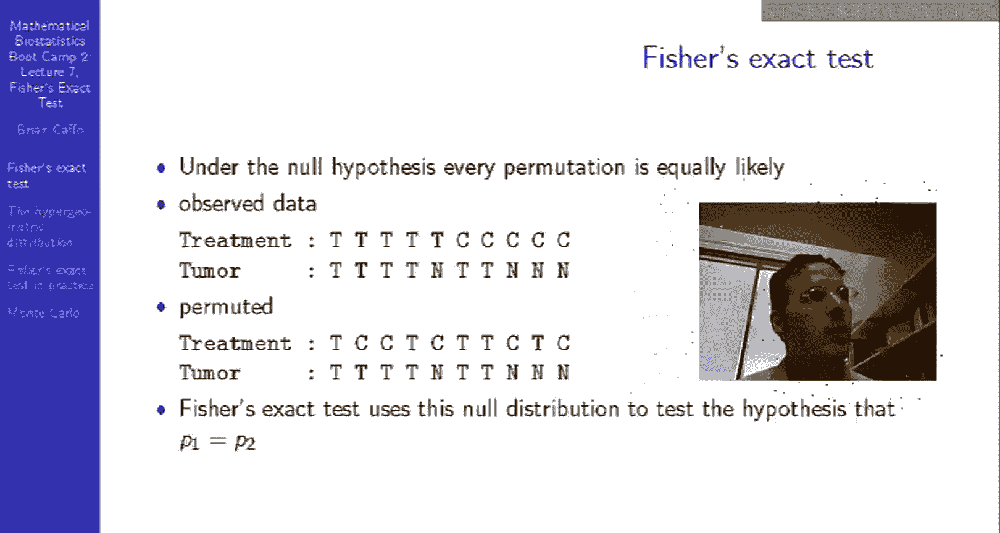
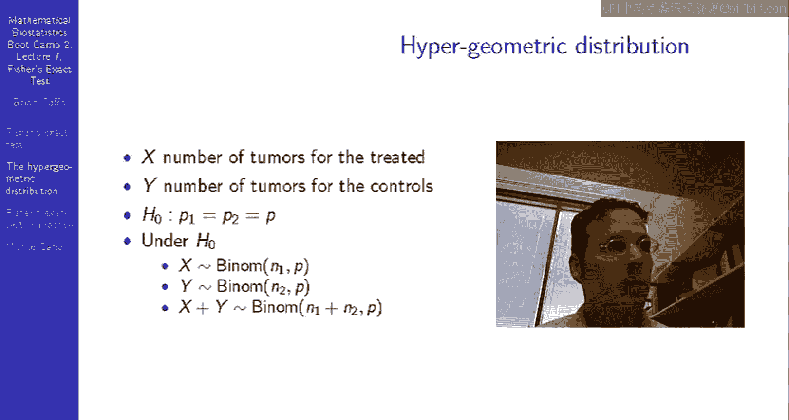
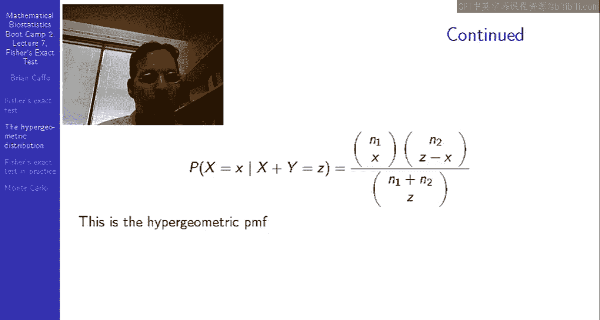
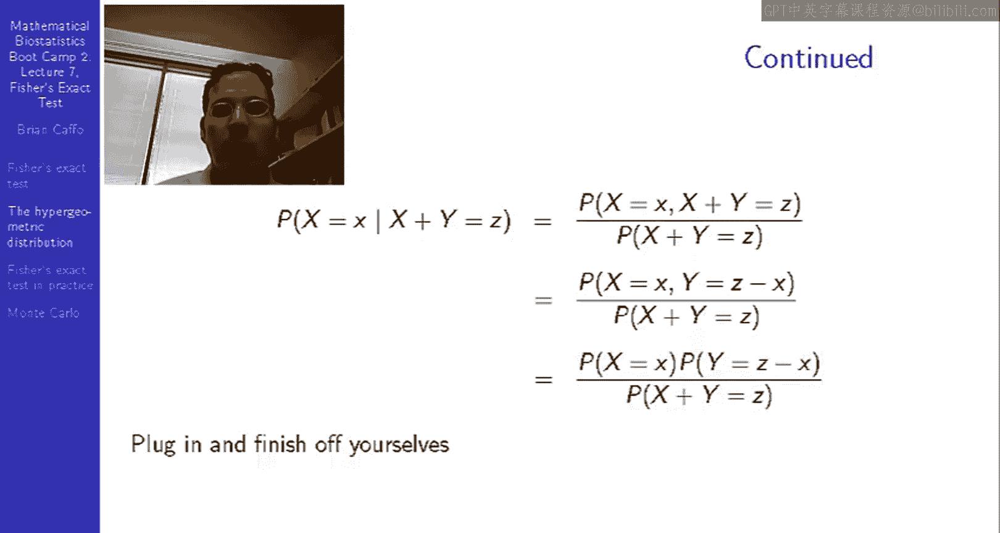

#  052：超几何分布与费希尔精确检验

在本节课中，我们将学习费希尔精确检验的另一种数学推导视角。我们将从假设一个概率模型出发，探讨如何通过条件化处理来消除未知参数，并最终引出超几何分布。

上一节我们介绍了将费希尔精确检验视为一种随机化过程。本节中，我们来看看如何将其构建为一个基于概率模型的统计检验。

## 模型设定与零假设

我们首先定义随机变量。令 **X** 表示治疗组中出现肿瘤的数量，**Y** 表示对照组中出现肿瘤的数量。我们假设：
*   **X** 服从二项分布：`X ~ Binomial(n1, p1)`
*   **Y** 服从二项分布：`Y ~ Binomial(n2, p2)`

我们的零假设 **H₀** 是：治疗组与对照组的肿瘤发生概率相同，即 `p1 = p2 = p`。这里的 `p` 是一个共同的未知概率参数。备择假设 **H₁** 则是 `p1 ≠ p2`。

一个关键的性质是，如果零假设成立（即 `p1 = p2 = p`），那么 **X** 和 **Y** 就是具有相同成功概率 `p` 的独立二项分布随机变量。因此，它们的和 **X + Y** 也服从二项分布：
`X + Y ~ Binomial(n1 + n2, p)`
这是因为 **X + Y** 本质上是 `n1 + n2` 个独立的伯努利试验（成功概率均为 `p`）的总和。

## 2x2列联表的自由度与参数问题

在2x2列联表中，如果我们已知行合计（`n1` 和 `n2`，即治疗组和对照组的样本量），那么整个表实际上只有两个自由数字（例如 **X** 和 **Y**）。知道了 **X** 和 **Y**，结合行合计，就能计算出表中所有四个单元格的数值。

然而，即使在零假设下，我们仍然面临一个未知参数 `p`。为了进行检验，我们需要找到一个不依赖于 `p` 的统计量分布。

解决这个问题的策略是进行**条件化**。具体来说，我们考虑在给定总和 `Z = X + Y` 的条件下，**X** 的分布，即计算 `P(X = x | X + Y = z)`。

## 推导条件分布：超几何分布

可以证明，这个条件分布恰好就是**超几何分布**。其概率质量函数如下：

`P(X = x | X + Y = z) = [C(n1, x) * C(n2, z - x)] / C(n1 + n2, z)`

其中，`C(a, b)` 表示组合数“a 选 b”。`x` 的取值范围是 `max(0, z - n2)` 到 `min(n1, z)`。

这个分布的有趣之处在于，它完全**不包含未知参数 `p`**。这正是我们进行费希尔精确检验时所用的分布。它等价于我们之前描述的随机化过程：在固定行合计（治疗/对照组人数）和列合计（总肿瘤/非肿瘤人数）的前提下，随机分配“治疗”和“控制”标签，观察治疗组肿瘤数 **X** 的分布。

以下是推导该条件分布的关键步骤：

1.  **写出联合概率与边缘概率**：
    *   `P(X = x) = C(n1, x) * p^x * (1-p)^(n1-x)`
    *   `P(Y = z - x) = C(n2, z-x) * p^(z-x) * (1-p)^(n2 - (z-x))`
    *   `P(X + Y = z) = C(n1+n2, z) * p^z * (1-p)^((n1+n2)-z)`

2.  **应用条件概率公式**：
    `P(X = x | X+Y = z) = P(X=x, Y=z-x) / P(X+Y = z)`

3.  **代入并化简**：
    由于 **X** 与 **Y** 独立，分子 `P(X=x, Y=z-x) = P(X=x) * P(Y=z-x)`。将上述三个表达式代入公式，公因子 `p^z * (1-p)^(n1+n2-z)` 会被约去，最终得到不包含 `p` 的超几何分布公式。

这种通过条件化于一个**充分统计量**（这里是 `X + Y`）来消除冗余参数（`p`）的方法，是数理统计学中的一个重要原理。对于本课程而言，我们只需理解：**在费希尔精确检验中，通过固定列联表的所有边际和（行和与列和），并计算在零假设下得到当前或更极端表格的概率（基于超几何分布），我们就得到了一个不依赖于任何未知参数的检验方法**。

## 总结

本节课中我们一起学习了：
1.  从概率模型（二项分布）的角度重新构建了费希尔精确检验的零假设。
2.  认识到在固定行合计后，2x2列联表仍受一个未知参数 `p` 的影响。
3.  引入了**条件化**的思想，通过计算在给定总肿瘤数 `Z = X + Y` 的条件下，治疗组肿瘤数 **X** 的分布来消除参数 `p`。
4.  推导出该条件分布即为**超几何分布**，其概率质量函数不包含 `p`。
5.  理解了这一推导结果与此前介绍的随机化过程在本质上是等价的，共同构成了费希尔精确检验的理论基础。