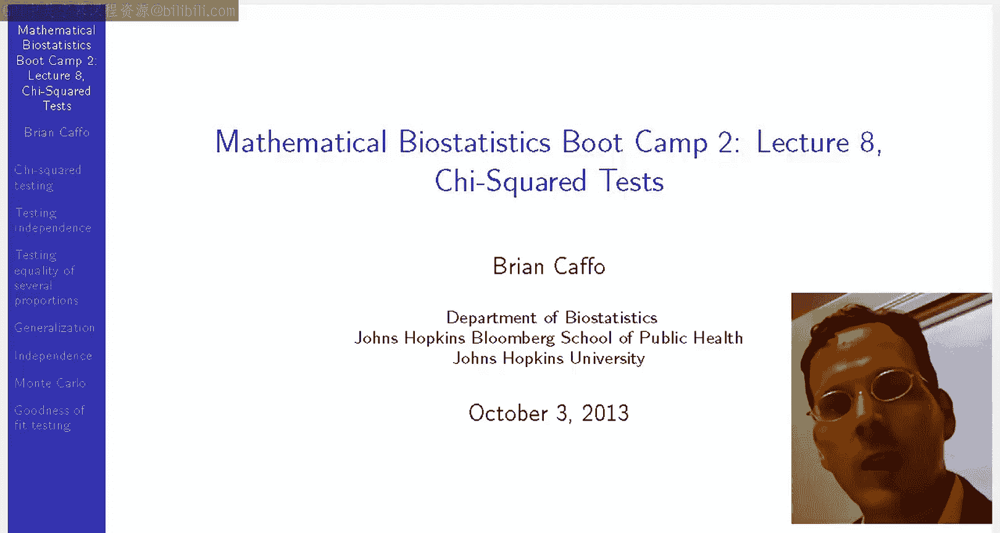
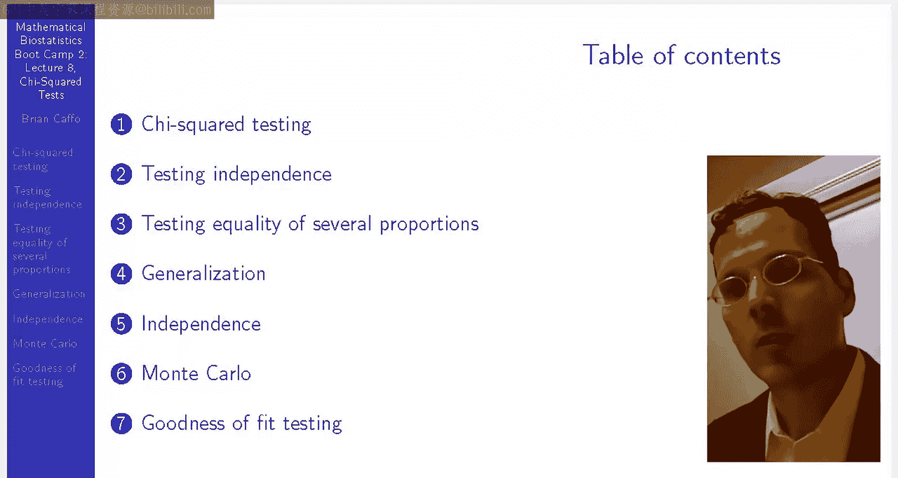
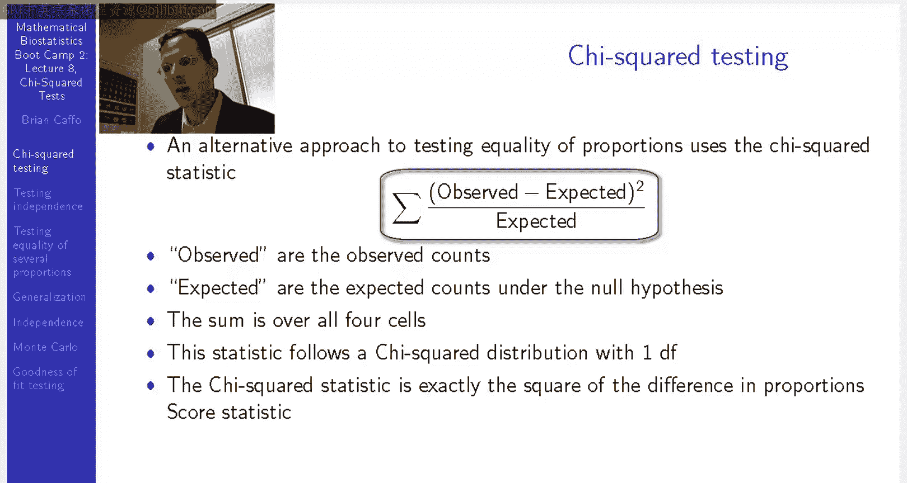
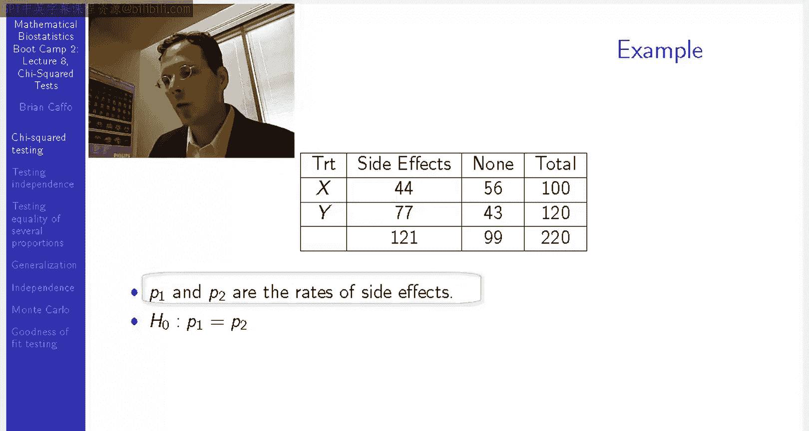
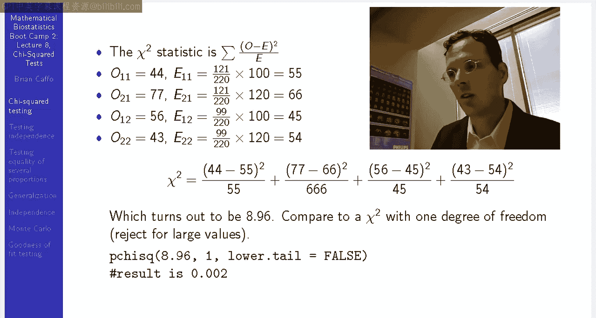
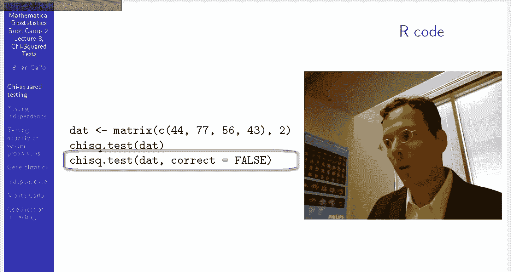
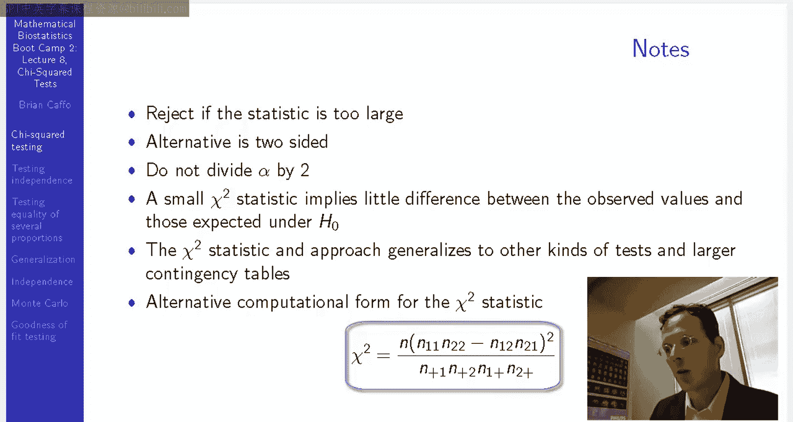
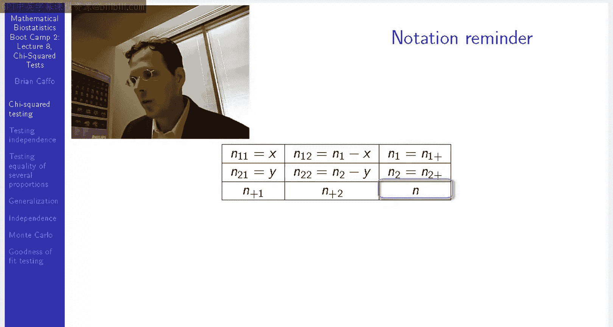
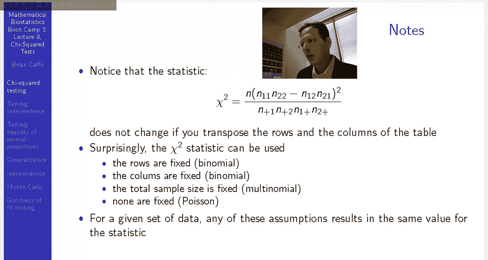

#  054：卡方检验 📊





在本节课中，我们将学习卡方检验，特别是用于列联表的卡方检验。我们将从经典的独立性检验开始，将其与多个比例的比较联系起来，并探讨其向高阶列联表的自然推广。接着，我们会讨论蒙特卡洛变体以获得精确的独立性检验。最后，我们将介绍拟合优度检验，这是一种特殊的列联表检验，用于判断数据是否来自特定分布。

## 卡方检验简介



上一节我们讨论了在2x2列联表中检验两个二项比例是否相等。本节中，我们将介绍一种替代方法——卡方检验。



所有卡方检验的形式都相同，其公式为：
\[
\chi^2 = \sum \frac{(O - E)^2}{E}
\]
其中，`O` 代表观测到的单元格计数，`E` 代表在原假设下期望的单元格计数。求和遍历列联表的所有单元格（包括成功与失败）。在用于检验比例相等的2x2列联表情况下，该统计量在原假设下服从自由度为1的卡方分布。

值得注意的是，卡方检验统计量实际上是比例差异得分统计量的平方（其中标准误的分母使用了共同比例）。由于统计量是观测值与期望值之间距离的平方，因此它没有方向性。它检验的是观测值是否与模型预期存在差异，而不是具体哪个方向，所以它本质上总是检验“不等于”的假设。

## 2x2列联表卡方检验示例

让我们回到一个熟悉的例子。假设我们比较两种疗效相同的治疗方法X和Y，想了解其中一种是否会产生更多副作用。我们将100人分配到X组，120人分配到Y组。我们将副作用发生人数占总人数的比例视为二项分布，以此作为我们的模型。

我们关心的是两个比例 `P1`（X组）和 `P2`（Y组）是否相等。

以下是计算卡方统计量的逻辑步骤：
1.  **观测计数**：我们得到四个单元格的观测值：44, 77, 56, 43。
2.  **期望计数**：在原假设（比例相等）下，我们使用共同比例的最佳估计值（121/220）来计算期望计数。例如，X组的期望副作用人数为 `100 * (121/220) ≈ 55`。类似地，可以计算出其他单元格的期望值。
3.  **计算统计量**：将每个单元格的 `(观测值 - 期望值)^2 / 期望值` 相加。在本例中，总和为8.96。
4.  **假设检验**：将统计量8.96与自由度为1的卡方分布进行比较。由于我们拒绝大的统计量值（表示观测值与期望值差异大），计算p值 `P(χ² > 8.96)`，结果约为0.0027。

这个结果提供了证据，表明两种治疗的副作用发生率存在差异。但卡方检验本身不指明哪个组的副作用发生率更高。



## 在R中执行卡方检验

以下是在R中执行卡方检验的简单代码。您无需手动计算。



```r
# 创建数据矩阵
dat <- matrix(c(44, 56, 77, 43), nrow=2)
# 执行卡方检验，不使用连续性校正（为了教学演示）
chisq.test(dat, correct=FALSE)
```

运行上述代码会得到与我们手动计算相同的检验统计量。默认情况下，R会使用**连续性校正**（`correct=TRUE`）来改善离散计数的渐近近似效果。出于教学目的，我们在此禁用了它，但在实际分析中通常建议保留默认设置以获得更好的近似。

## 卡方检验要点总结



本节我们一起回顾了卡方检验的核心要点：
*   我们拒绝大的卡方统计量值。
*   备择假设总是双边的，检验比例是否不同。注意，我们**不需要**像标准高斯检验那样将α除以2来查找分位数。
*   小的卡方统计量意味着观测值与H0下的期望值差异很小，从而支持H0。
*   可以将卡方统计量视为一种距离度量。



卡方检验的一个有趣特性是，其统计量在转置表格后值不变。这意味着它不关心研究设计中哪一边际是固定的。无论您将副作用视为结果，还是将接受的治疗视为结果，都会得到相同的检验。这与其在多种情况下的实用性有关，我们将在讨论病例对照研究时进一步探讨。

## 卡方检验的模型等价性

卡方统计量可以从不同的模型假设中推导出来，这非常有趣。
*   如果行是固定的（例如，每组人数固定，视为二项分布），卡方检验是自然的选择。
*   如果列是固定的（另一种二项分布），同样适用。
*   如果只有总样本量是固定的（例如，您随机调查了220人，记录其治疗情况和副作用，将整个2x2表视为一个四项分布），并在特定的原假设（即独立性检验）下，您会得到**完全相同的检验统计量和卡方结果**。

这就是为什么人们在多项设置中对假设有时比较宽松，因为相同的检验程序适用于不同的情况。然而，**必须注意**：虽然检验统计量的数值相同，但不同实验设计（如随机化实验与观察性研究）背后的假设和结果解释可能**非常不同**。随机化有助于平均化混杂效应，而观察性研究则不一定。

## 总结



本节课中，我们一起学习了用于列联表的卡方检验。我们从2x2表检验两个比例相等的基本概念和公式出发，通过一个具体示例演示了计算和解释过程。我们还介绍了在R软件中的实现方法，并讨论了检验的关键特性。最后，我们探讨了卡方检验在不同抽样模型（二项分布与多项分布）下的等价性，并强调了在不同研究设计下正确解释结果的重要性。卡方检验是分析分类变量关联性的一个基础且强大的工具。