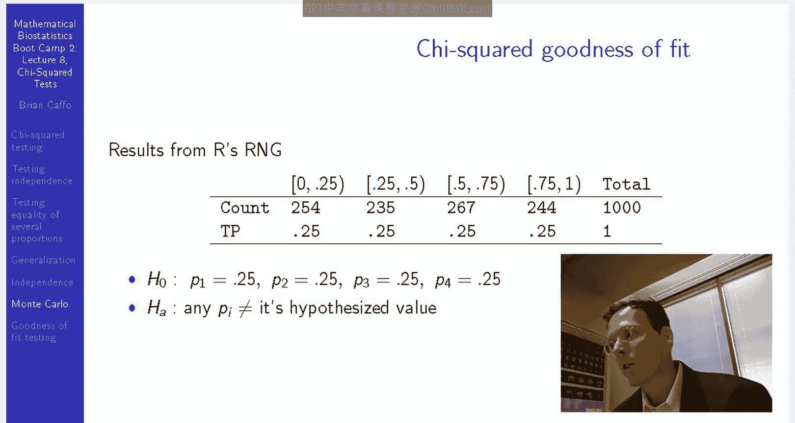
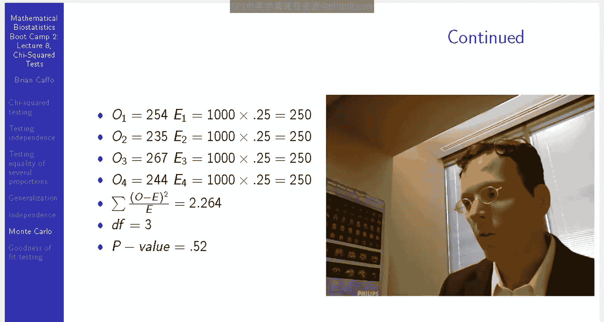
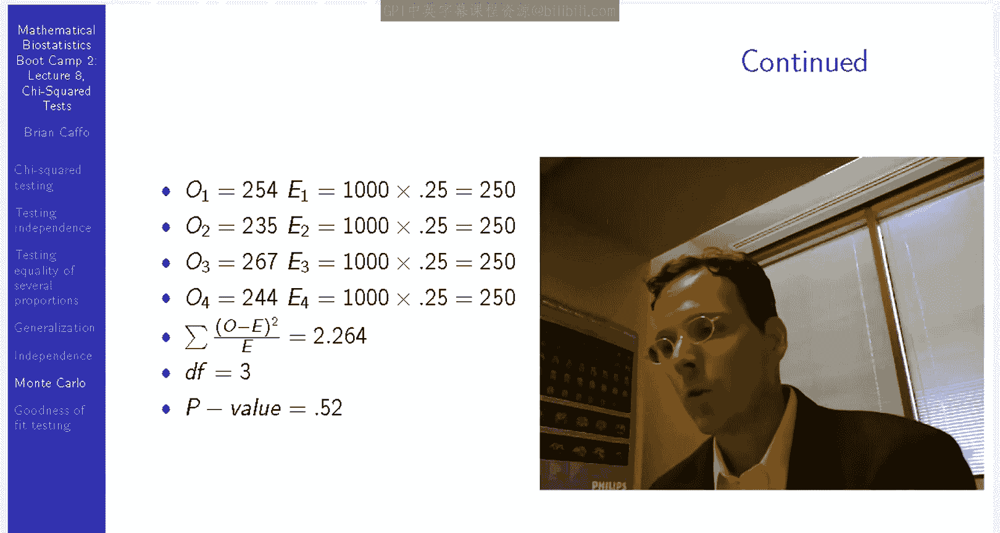
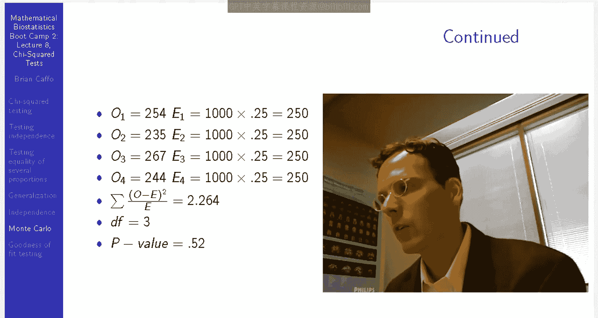
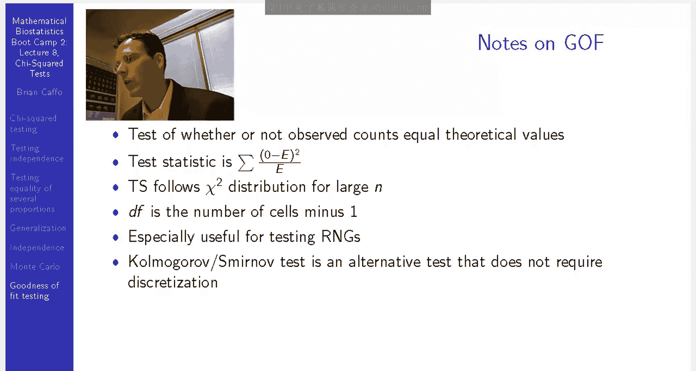

#  057：拟合优度检验 📊

在本节课中，我们将学习拟合优度检验。这是一种特殊的卡方检验，用于判断观测到的数据分布是否符合某个理论分布或假设分布。我们将通过几个具体例子来理解其应用和计算方法。

## 概述

拟合优度检验的核心是评估观测频数与理论期望频数之间的差异。其检验统计量仍然是卡方统计量，但自由度的计算方式与之前的列联表检验有所不同。本节我们将探讨其原理、应用场景，并通过实例演示计算过程。

## 均匀分布随机数生成器的检验

上一节我们介绍了列联表中的卡方检验。本节中，我们来看看如何检验一个均匀分布随机数生成器的质量。

假设我们想检验R语言的均匀分布随机数生成器。均匀分布是指在0到1的连续区间内，每个值出现的概率相等，其概率密度函数是一个高度为1的矩形。我们可以使用卡方分布来检验生成的随机数是否符合预期。

我们模拟生成了1000个均匀分布随机数。理论上，这些数落在区间[0, 0.25)、[0.25, 0.5)、[0.5, 0.75)和[0.75, 1]中的比例应各为25%。

以下是观测到的频数：
*   区间 [0, 0.25)：254
*   区间 [0.25, 0.5)：235
*   区间 [0.5, 0.75)：267
*   区间 [0.75, 1]：244

接下来，我们计算在假设的理论分布下的期望频数。

零假设是每个区间的概率均为0.25。备择假设是至少有一个区间的概率与其假设值不同。

期望频数为总样本数乘以假设概率：`1000 * 0.25 = 250`。

卡方检验统计量的计算公式为：
`χ² = Σ (观测值 - 期望值)² / 期望值`

代入数据计算：
`(254-250)²/250 + (235-250)²/250 + (267-250)²/250 + (244-250)²/250 ≈ 2.3`

此检验的自由度为单元格数减1，即 `4 - 1 = 3`。对应的P值约为0.52。

得到较大的P值并不意外，因为我们检验的是R语言的随机数生成器，它本身质量就很好。这个例子展示了无论我们如何划分区间，检验的逻辑都适用。需要注意的是，此处的自由度是单元格数减1，原因在于零假设中我们直接指定了概率值，没有从数据中估计任何参数。

关于随机数生成器检验的补充说明：在实际应用中，通常会生成成千上万个随机数，并使用更精细的区间划分。此外，均匀性检验只是随机数检验的一个方面，我们还需要检验其他特性，如自相关性或游程行为。随机数生成器本质上是确定性的序列，相关领域的研究致力于设计出能通过严格统计检验的序列。

另一个有趣的实验是，如果让一群人随机写出1到10的数字，收集起来后，你几乎能立即诊断出这些数字并非均匀独立分布。人们很少会写出连续三个7这样的序列，这说明我们对随机性的直觉并不准确，必须依赖数学工具。

## 孟德尔豌豆实验的经典案例

现在，让我们看另一个拟合优度检验的著名例子：孟德尔的豌豆实验。

根据独立分配定律，通过庞尼特方格分析，理论上应得到约75%的黄色豌豆和25%的绿色豌豆。

以下是观测数据：
*   黄色：6022
*   绿色：2001
*   总计：8023

以下是期望频数的计算过程：
如果独立分配定律正确，理论概率应为0.75和0.25。
*   黄色期望频数：`0.75 * 8023 = 6017.25`
*   绿色期望频数：`0.25 * 8023 = 2005.75`

使用相同的卡方统计量公式计算，得到一个非常小的卡方值。

这是一个自由度为 `2 - 1 = 1` 的检验。计算出的P值约为0.90，说明观测频数与期望概率拟合得非常好。

历史上有一个著名的讨论：统计学家费舍尔将孟德尔的多个表格数据合并，利用独立卡方变量之和仍服从卡方分布的性质，得到了一个P值几乎等于1的结果。他据此提出质疑，认为数据与理论假设拟合得“过于完美”，背后可能存在问题。这成为统计学史上一个有趣的研究案例。

## 总结与要点回顾

本节课我们一起学习了拟合优度检验。

拟合优度检验用于判断观测计数是否与理论假设概率一致。其检验统计量保持不变，即卡方统计量：
`χ² = Σ (观测值 - 期望值)² / 期望值`

它服从自由度为 `单元格数 - 1` 的卡方分布。这种方法特别适用于检验随机数生成器。

需要注意的是，我们讨论的是离散数据的检验。对于均匀分布这样的连续分布，我们需要先将其离散化才能使用卡方拟合优度检验。此外，还有一种称为**柯尔莫哥洛夫-斯米尔诺夫检验**的方法，它不需要离散化，但常被认为检验功效较低，其效果取决于所考虑的备择假设类型。

今天课程涵盖了卡方检验的核心内容。请记住以下几点：
1.  **核心公式**：`Σ (观测值 - 期望值)² / 期望值` 是通用的检验统计量。
2.  **期望频数计算**：基于独立性假设计算期望频数的方法适用于我们今天讨论的所有场景。
3.  **自由度差异**：拟合优度检验的自由度计算方式与列联表检验不同。
4.  **应用场景**：拟合优度检验的设立方式虽有不同，但同样使用上述卡方统计量。

下一讲将是本模块的最后一课。